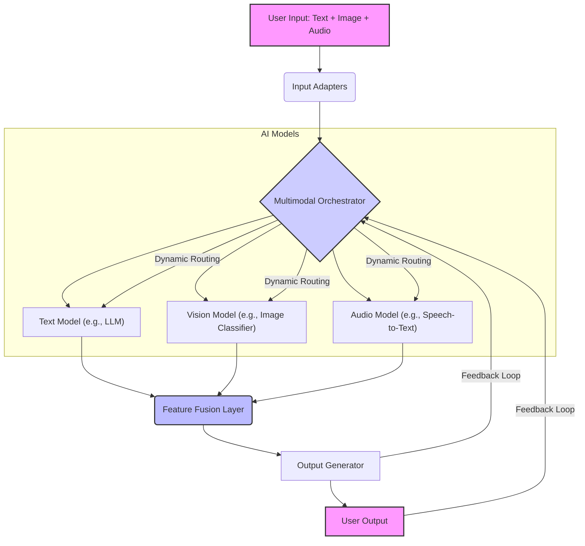

멀티모달 AI 모델의 효율적인 통합은 현대 AI 시스템의 복잡성을 관리하고 실제 애플리케이션에서 광범위한 활용성을 확보하는 데 필수적입니다. 텍스트, 이미지, 오디오, 비디오 등 다양한 양식(modality)의 데이터를 처리하는 AI 모델들을 개별적으로 운영하는 것은 비효율적이며, 상호작용의 시너지를 발휘하기 어렵습니다. Harnessing 디자인 패턴은 이러한 이종(heterogeneous) 모델들을 조율하고, 최적화된 워크플로우를 구축하여 시스템의 성능, 확장성, 그리고 신뢰성을 극대화하는 엔지니어링 접근 방식입니다. 특히 2026년 현재, 실시간 처리 및 온디바이스(on-device) AI의 중요성이 부각됨에 따라, 이러한 통합 전략은 더욱 중요해지고 있습니다.

## 멀티모달 AI 통합의 핵심 과제

멀티모달 AI 모델 통합은 다음과 같은 주요 과제에 직면합니다:

*   **데이터 이종성 (Data Heterogeneity)**: 각 모델이 요구하는 입력 데이터 형식과 전처리 방식이 달라 통합 파이프라인 설계가 복잡합니다.
*   **성능 불균형 (Performance Disparity)**: 모델별 추론 시간과 자원 요구량이 상이하여 전체 시스템의 지연 시간(latency) 관리가 어렵습니다.
*   **동기화 및 조정 (Synchronization and Coordination)**: 여러 모델의 추론 결과를 의미론적으로 결합하고, 최적의 순서로 실행을 조정하는 로직이 필요합니다.
*   **확장성 및 유연성 (Scalability and Flexibility)**: 새로운 모델 추가나 기존 모델 교체 시 시스템 전체에 미치는 영향을 최소화하면서 유연하게 확장할 수 있어야 합니다.

## Harnessing 디자인 패턴

멀티모달 AI 모델 통합을 위한 Harnessing 디자인 패턴은 이러한 과제를 해결하고 시스템의 견고성을 높이는 구조적인 접근법을 제공합니다.

### 1. Orchestration Layer Pattern (오케스트레이션 계층 패턴)

이 패턴은 여러 멀티모달 AI 모델의 실행 흐름과 상호작용을 중앙에서 관리하는 계층을 정의합니다. 사용자 요청을 해석하고, 적절한 모델을 선택하여 데이터를 전달하며, 각 모델의 결과를 취합하여 최종 응답을 생성하는 역할을 수행합니다.

```python
class MultimodalOrchestrator:
    def __init__(self, text_model, vision_model, fusion_model):
        self.text_model = text_model
        self.vision_model = vision_model
        self.fusion_model = fusion_model
        self.adapters = {}

    def register_adapter(self, modality_type, adapter):
        self.adapters[modality_type] = adapter

    def process_request(self, multimodal_input):
        # 1. Adapt input data
        processed_text = self.adapters['text'].adapt(multimodal_input.get('text'))
        processed_image = self.adapters['image'].adapt(multimodal_input.get('image'))

        # 2. Execute individual models
        text_features = self.text_model.predict(processed_text) if processed_text else None
        vision_features = self.vision_model.predict(processed_image) if processed_image else None

        # 3. Fuse results
        fused_output = self.fusion_model.fuse(text_features, vision_features)

        return fused_output

# ... Adapter implementation (e.g., TextAdapter, ImageAdapter)
```

### 2. Adapter Pattern (어댑터 패턴)

각기 다른 입력/출력 인터페이스를 가진 멀티모달 모델들을 통일된 방식으로 오케스트레이션 계층과 연결하기 위해 사용됩니다. 데이터 전처리, 형식 변환, API 호출 표준화 등을 담당하여 모델 간 결합도(coupling)를 낮춥니다.

### 3. Dynamic Routing Pattern (동적 라우팅 패턴)

입력 데이터의 특성, 사용자 컨텍스트, 또는 모델의 현재 부하 상태에 따라 가장 적합한 AI 모델을 동적으로 선택하여 추론을 요청하는 패턴입니다. 예를 들어, 짧은 텍스트에는 경량 모델을, 복잡한 쿼리에는 고성능 모델을 사용하거나, 특정 객체가 포함된 이미지에는 전문화된 비전 모델을 라우팅할 수 있습니다.

### 4. Contextual Fusion Pattern (컨텍스트 융합 패턴)

여러 모델에서 생성된 다양한 양식의 결과물을 의미론적으로 결합하여 더 풍부하고 정확한 최종 결과물을 도출합니다. Early Fusion, Late Fusion, Hybrid Fusion 등 다양한 융합 전략이 사용될 수 있으며, 2026년에는 특히 Attention Mechanism이나 Transformer 기반의 융합 모델이 활발히 연구되고 있습니다.

### 5. Feedback Loop Pattern (피드백 루프 패턴)

시스템의 출력과 사용자 피드백을 지속적으로 수집하여 모델 선택 로직, 융합 전략, 또는 개별 모델의 성능을 개선하는 데 활용합니다. 자가 개선(self-correction) 능력을 통해 시스템의 지속적인 진화를 가능하게 합니다.

## 시스템 아키텍처 예시

아래 Mermaid 다이어그램은 Orchestration Layer를 중심으로 Multimodal AI 모델들이 통합되는 일반적인 아키텍처를 보여줍니다.



이 아키텍처는 Input Adapters를 통해 다양한 양식의 입력 데이터를 표준화하고, Orchestrator가 Dynamic Routing을 사용하여 적절한 AI 모델로 요청을 전달합니다. 각 모델의 결과는 Feature Fusion Layer에서 결합된 후, Output Generator를 통해 최종 사용자 응답이 생성됩니다. Feedback Loop는 시스템의 지속적인 개선을 지원합니다.

## 트레이드오프

멀티모달 AI 모델 통합을 위한 Harnessing 디자인 패턴은 강력한 이점을 제공하지만, 몇 가지 트레이드오프를 고려해야 합니다.

*   **오케스트레이션 복잡성 (Orchestration Complexity)**: 오케스트레이션 계층을 도입하면 모델 간의 독립성을 높이고 관리의 효율성을 증대시킬 수 있습니다. 그러나 초기 설계 및 구현 비용이 증가하며, 특히 대규모 시스템에서는 오케스트레이터 자체가 병목 현상(bottleneck)이 되거나 단일 실패 지점(single point of failure)이 될 위험이 있습니다. 언제 좋냐면, 이종 모델 수가 많고 상호작용 로직이 복잡할 때 시스템의 가독성과 유지보수성이 크게 향상됩니다. 언제 나쁘냐면, 소수의 모델만 통합하거나 모델 간 상호작용이 매우 단순할 때, 불필요한 오버헤드를 유발할 수 있습니다.
*   **지연 시간 vs. 정확도 (Latency vs. Accuracy)**: 동적 라우팅 패턴을 통해 입력에 따라 최적의 모델을 선택하여 정확도 또는 지연 시간을 최적화할 수 있습니다. 하지만 라우팅 로직 자체가 추가적인 지연 시간을 발생시키거나, 잘못된 라우팅 결정으로 인해 성능 저하를 초래할 수 있습니다. 언제 좋냐면, 사용자 요청의 다양성이 크고 각 요청에 대해 다른 모델 성능 지표(KPI)가 중요할 때 유용합니다. 언제 나쁘냐면, 모든 요청에 대해 일관된 최소 지연 시간이 절대적으로 요구될 경우, 동적 라우팅의 판단 시간조차 허용되지 않을 수 있습니다.
*   **유연성 vs. 표준화 (Flexibility vs. Standardization)**: 어댑터 패턴은 다양한 모델 인터페이스를 수용하여 시스템의 유연성을 극대화합니다. 그러나 각 모델마다 어댑터를 개발하고 유지보수하는 데 상당한 노력이 필요하며, 너무 많은 어댑터는 시스템의 전체적인 표준화를 저해할 수 있습니다. 언제 좋냐면, 다양한 공급업체의 AI 모델이나 자주 변경되는 모델을 통합해야 할 때 시스템의 변화 대응력을 높여줍니다. 언제 나쁘냐면, 모든 모델이 동일한 표준 인터페이스를 따르거나 모델 변경이 거의 없는 안정적인 환경에서는 과도한 설계가 될 수 있습니다.
*   **자원 활용 효율성 (Resource Utilization Efficiency)**: Harnessing 패턴은 모델을 분리하고 동적으로 할당함으로써 자원 활용의 유연성을 높일 수 있습니다. 하지만 분리된 모델들이 개별적으로 자원을 점유하게 되므로, 자원 오버헤드가 발생하거나 유휴 자원이 발생할 수 있습니다. 언제 좋냐면, 각 모델의 자원 요구량이 크게 다르거나 피크 로드가 예측 가능한 경우 자원을 효율적으로 스케줄링할 수 있습니다. 언제 나쁘냐면, 자원이 제한적이거나 모델 간 자원 공유가 필수적인 환경에서는 통합된 단일 모델 구조가 더 효율적일 수 있습니다.

## 실전 체크리스트

멀티모달 AI 모델 통합 프로젝트에 Harnessing 디자인 패턴을 적용할 때 다음 항목들을 검토해야 합니다.

- [ ] **모델 API 및 입력/출력 규격 정의 완료 여부**: 통합할 각 멀티모달 AI 모델의 API 엔드포인트, 입력 데이터 형식(JSON Schema 등), 출력 데이터 형식이 명확하게 문서화되었는지 확인합니다.
- [ ] **오케스트레이션 계층의 상태 관리 전략 수립 여부**: 오케스트레이터가 모델 간 컨텍스트 전달, 세션 관리, 오류 처리 등을 위해 어떤 상태 관리(stateless, stateful) 전략을 사용하는지 정의하고 구현했는지 검증합니다.
- [ ] **데이터 어댑터 구현 및 테스트 완료 여부**: 각 양식별(텍스트, 이미지 등) 입력 데이터를 모델이 요구하는 형식으로 변환하고, 모델 출력을 통합 계층이 이해할 수 있는 형식으로 변환하는 어댑터가 견고하게 구현되고 단위 테스트되었는지 확인합니다.
- [ ] **동적 라우팅 로직의 성능 및 신뢰성 검증 여부**: 입력 특성 분석, 모델 부하 모니터링, 비용 최적화 등을 고려한 동적 라우팅 로직이 기대하는 성능(지연 시간, 처리량)을 내고, 오류 없이 작동하는지 부하 테스트(load testing)를 통해 검증합니다.
- [ ] **융합 계층의 의미론적 일관성 검증 여부**: 여러 모델의 추론 결과가 융합 계층에서 결합될 때, 결과물의 의미론적 일관성(semantic consistency)이 유지되며, 예상치 못한 충돌이나 왜곡이 발생하지 않는지 평가합니다.
- [ ] **시스템 전체 지연 시간(End-to-End Latency) 목표 달성 여부**: 사용자 입력부터 최종 응답까지의 전체 시스템 지연 시간이 서비스 요구사항(SLA)을 충족하는지 측정하고, 병목 지점을 식별하여 최적화 계획을 수립합니다.
- [ ] **모든 모델 및 오케스트레이터에 대한 오류 처리 및 재시도(Retry) 전략 구현 여부**: 개별 모델의 실패, 네트워크 오류, 오케스트레이터 내부 오류 발생 시 적절한 예외 처리, 로깅, 그리고 재시도 메커니즘이 구현되어 시스템의 견고성을 확보했는지 확인합니다.