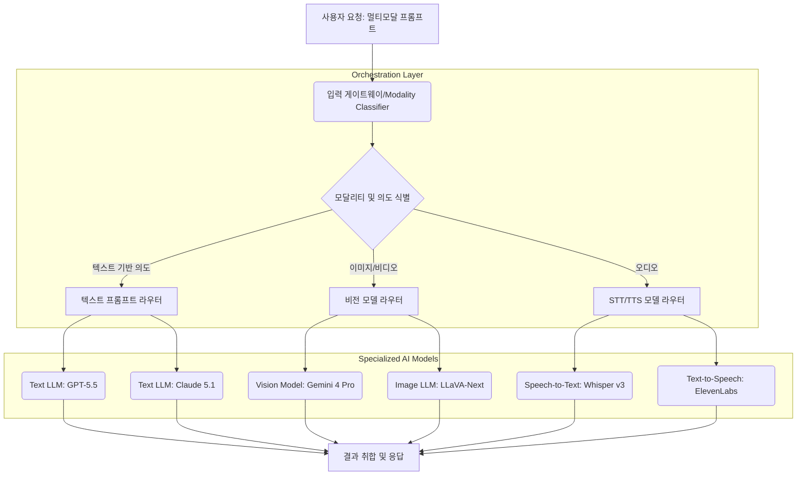

멀티모달 LLM(Large Language Model) 애플리케이션의 발전은 텍스트, 이미지, 오디오 등 다양한 입력 모드를 동시에 처리해야 하는 복잡성을 증가시켰습니다. 이러한 환경에서 애플리케이션의 유연성과 확장성을 확보하기 위해서는 입력 모드와 사용자 의도에 따라 가장 적합한 LLM 또는 전문 AI 모델로 프롬프트를 지능적으로 라우팅하는 동적 라우팅 패턴이 필수적입니다. 정적인 프롬프트 처리 방식은 새로운 모달리티나 모델이 추가될 때마다 코드 변경이 불가피하며, 이는 유지보수 비용 증가와 시스템 확장성 저하로 이어집니다. 동적 라우팅은 이러한 갭을 해소하고, 변화하는 요구사항과 모델 생태계에 효과적으로 대응할 수 있는 아키텍처를 제공합니다.

## 동적 라우팅의 핵심 원리
동적 라우팅은 들어오는 멀티모달 프롬프트를 분석하여, 해당 프롬프트를 처리하는 데 가장 효율적이고 정확한 AI 모델(LLM, 비전 모델, STT 모델 등)로 요청을 전송하는 메커니즘입니다. 이 과정은 일반적으로 다음과 같은 단계로 구성됩니다:

### 1. 입력 모달리티 식별 (Input Modality Identification)
최초 입력 게이트웨이(Gateway)는 사용자 요청에 포함된 데이터의 모달리티(예: 텍스트, 이미지, 오디오, 비디오)를 식별합니다. 이는 MIME 타입, 파일 확장자, 또는 경량 AI 분류 모델을 통해 이루어질 수 있습니다. 2026년에는 더 정교한 임베딩 기반의 모달리티 감지 기술이 발전하여, 복합 모달리티(예: 이미지 속 텍스트와 음성 설명)까지 효과적으로 분류할 수 있게 됩니다.

### 2. 의도 및 특징 추출 (Intent & Feature Extraction)
모달리티 식별 후, 라우팅 엔진은 입력에서 핵심 의도(Intent)와 도메인별 특징(Features)을 추출합니다. 예를 들어, 텍스트 프롬프트의 경우 NER(Named Entity Recognition)이나 토픽 모델링을 사용하고, 이미지의 경우 객체 감지(Object Detection)나 이미지 캡셔닝을 활용하여 컨텍스트를 파악합니다. 이 단계에서 경량 LLM이나 specialized classifier를 활용하여 라우팅 결정을 위한 메타데이터를 생성합니다.

### 3. 라우팅 결정 (Routing Decision)
추출된 모달리티와 특징, 의도를 기반으로 최적의 타겟 모델을 결정합니다. 라우팅 결정 로직은 다음과 같은 요소를 고려할 수 있습니다:
*   **모델 전문성 (Model Specialization)**: 특정 모달리티나 도메인에 특화된 모델 (예: 코드 생성은 Code LLM, 이미지 분석은 Vision Transformer).
*   **비용 효율성 (Cost-Efficiency)**: 복잡성에 따라 저렴한 경량 모델과 고성능/고비용 모델 중 선택.
*   **성능 (Performance)**: 낮은 Latency가 요구되는 경우, 더 빠른 추론이 가능한 모델로 라우팅.
*   **사용자 그룹/Tier (User Group/Tier)**: VIP 사용자나 특정 그룹에는 고성능 모델을 우선 배정.
*   **API 가용성 및 부하 (API Availability & Load)**: 특정 모델의 서비스 부하가 높거나 장애 발생 시, 다른 모델로 Failover 라우팅.

## 아키텍처 패턴
동적 라우팅은 주로 마이크로서비스 아키텍처 내에서 Gateway 또는 Orchestration 레이어에서 구현됩니다.



이 다이어그램은 멀티모달 입력이 게이트웨이를 거쳐 모달리티 및 의도에 따라 적절한 라우터로 전달되고, 각 라우터가 전문화된 AI 모델로 요청을 분배한 뒤 최종 결과를 취합하는 과정을 보여줍니다.

## 구현 예제 (Python)
아래는 동적 라우팅의 개념을 보여주는 간소화된 Python 예제입니다. 실제 프로덕션 환경에서는 이보다 훨씬 복잡한 로직과 에러 핸들링, 캐싱 등이 포함됩니다.

```python
import json

class PromptRouter:
    def __init__(self):
        self.routes = {
            