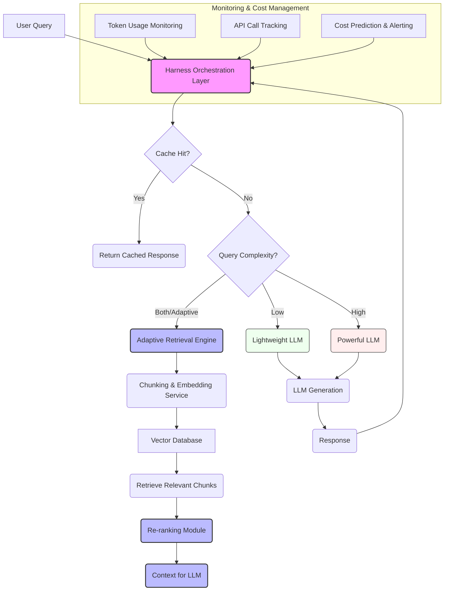

RAG (Retrieval Augmented Generation) 파이프라인은 대규모 언어 모델 (LLM)의 최신 정보 접근성과 정확성을 향상시키는 핵심 기술입니다. 그러나 실제 서비스에 도입할 때는 단순히 동작하는 것을 넘어, 성능(Latency, Throughput)과 비용 효율성을 동시에 고려한 설계가 필수적입니다. 이 글에서는 RAG 파이프라인의 이러한 도전 과제를 해결하기 위한 하네스 엔지니어링(Harness Engineering) 방법론과 구체적인 전략을 다룹니다.

## RAG 파이프라인의 핵심 구성 요소 및 최적화 포인트

RAG 파이프라인은 크게 **리트리벌(Retrieval)**과 **생성(Generation)** 두 단계로 나눌 수 있으며, 각 단계는 성능과 비용에 지대한 영향을 미칩니다.

### 1. 리트리벌 단계 최적화

*   **청킹(Chunking) 전략**: 원본 문서를 LLM이 처리하기 적합한 작은 단위(청크)로 나누는 과정입니다. 청크 크기와 오버랩(Overlap)은 리트리벌의 정확도와 벡터 데이터베이스(Vector Database) 저장 비용, 검색 Latency에 직접적인 영향을 미칩니다. 텍스트 특성을 고려한 동적 청킹, 의미론적 청킹(Semantic Chunking) 등이 중요합니다.
*   **임베딩(Embedding) 모델 선택 및 관리**: 텍스트를 벡터 공간에 매핑하는 임베딩 모델의 성능은 리트리벌의 품질을 결정합니다. 모델의 크기, Latency, 비용을 고려하여 적절한 모델을 선택하고, 임베딩 벡터의 효율적인 업데이트 및 저장 전략이 필요합니다.
*   **벡터 데이터베이스(Vector Database) 효율화**: 수많은 벡터를 저장하고 빠르게 검색하는 벡터 DB의 인덱싱(Indexing) 전략(예: HNSW, IVF), 샤딩(Sharding), 스케일링(Scaling)은 검색 Latency와 운영 비용에 결정적입니다.

### 2. 생성 단계 최적화

*   **LLM 선택 및 활용**: 질문에 답변을 생성하는 LLM의 선택은 비용과 성능, 품질에 직접적인 영향을 미칩니다. 작업의 복잡성과 민감도에 따라 여러 LLM(예: Claude Opus, Sonnet, Haiku, GPT-4o, GPT-3.5)을 조합하여 사용하는 동적 LLM 라우팅(Dynamic LLM Routing)이 효과적일 수 있습니다.
*   **프롬프트 엔지니어링(Prompt Engineering)**: LLM에 주입되는 프롬프트의 품질은 생성 결과의 정확성과 비용(토큰 사용량)에 영향을 미칩니다. 컨텍스트를 효율적으로 압축하고, 불필요한 토큰 사용을 줄이는 프롬프트 최적화 기법이 중요합니다.

## 하네스 엔지니어링을 통한 RAG 파이프라인 최적화 전략

하네스 엔지니어링은 이러한 최적화 포인트를 통합적으로 관리하고 자동화하여, RAG 파이프라인의 성능과 비용 효율성을 지속적으로 개선하는 접근 방식입니다.

### 1. 지능형 청킹 및 임베딩 관리 (Intelligent Chunking & Embedding Management)

문서의 구조와 콘텐츠 유형에 따라 최적의 청킹 전략을 동적으로 적용하는 하네스를 설계합니다. 예를 들어, 코드, 테이블, 일반 텍스트에 대해 다른 청킹 로직을 적용할 수 있습니다. 또한, 임베딩 벡터의 생성 및 업데이트 주기를 관리하고, 변경된 문서에 대해서만 임베딩을 다시 생성하여 비용을 절감합니다.

```python
import hashlib
from typing import List, Dict, Any

class DocumentProcessor:
    def __init__(self, chunk_size: int = 500, chunk_overlap: int = 50):
        self.chunk_size = chunk_size
        self.chunk_overlap = chunk_overlap
        self.embedding_cache = {}

    def _dynamic_chunk_text(self, text: str, doc_type: str = "text") -> List[str]:
        # 실제 구현에서는 doc_type에 따라 다른 청킹 로직을 적용 (e.g., Markdown, Code, JSON)
        if doc_type == "code":
            # 예: 함수 단위, 클래스 단위 청킹
            return [chunk for chunk in text.split('\n\n') if chunk]
        else:
            # 기본 텍스트 청킹
            chunks = []
            for i in range(0, len(text), self.chunk_size - self.chunk_overlap):
                chunks.append(text[i : i + self.chunk_size])
            return chunks

    def generate_embedding(self, text: str) -> List[float]:
        # 실제 임베딩 모델 API 호출 (예: OpenAI Embeddings, Cohere Embeddings)
        # 여기서는 단순화된 더미 구현
        text_hash = hashlib.md5(text.encode()).hexdigest()
        if text_hash in self.embedding_cache:
            return self.embedding_cache[text_hash] # Cache hit

        # Simulate embedding generation latency and cost
        embedding = [float(ord(c)) / 100 for c in text[:16]] # Dummy embedding
        while len(embedding) < 1536: # Ensure standard embedding size
            embedding.append(0.0)
        embedding = embedding[:1536]

        self.embedding_cache[text_hash] = embedding
        return embedding

    def process_document(self, document_content: str, doc_type: str = "text") -> List[Dict[str, Any]]:
        chunks = self._dynamic_chunk_text(document_content, doc_type)
        processed_data = []
        for i, chunk in enumerate(chunks):
            embedding = self.generate_embedding(chunk)
            processed_data.append({"chunk_id": f"doc_{doc_type}_{i}", "content": chunk, "embedding": embedding})
        return processed_data

# Example Usage
# processor = DocumentProcessor()
# doc_data = processor.process_document("Your long document content here...", doc_type="text")
# print(doc_data[0])
```

### 2. 적응형 리트리벌 및 재랭킹 (Adaptive Retrieval & Re-ranking)

단일 리트리벌 방식으로는 복잡한 질문에 대한 답변 정확도를 보장하기 어렵습니다. 질문의 유형(사실 확인, 요약, 코드 생성 등)과 사용자 선호도에 따라 여러 리트리벌 전략(예: 키워드 검색, 벡터 검색, 그래프 검색)을 동적으로 조합하고, 검색된 문서들을 다시 랭킹하여 LLM에 제공하는 하네스를 구축합니다. 재랭킹(Re-ranking)은 LLM의 컨텍스트 윈도우(Context Window) 제약 내에서 가장 관련성 높은 정보를 주입하여 Latency를 줄이고 정확도를 높입니다.

### 3. 동적 LLM 라우팅 및 응답 캐싱 (Dynamic LLM Routing & Response Caching)

비용과 성능 목표에 따라 여러 LLM을 실시간으로 선택하여 사용하는 동적 라우팅 계층을 구현합니다. 간단한 질문이나 캐시 히트(Cache Hit)가 가능한 경우 저비용/고속 LLM을 사용하고, 복잡한 질문에는 고성능 LLM을 라우팅하는 방식입니다. 또한, 이전에 생성된 질문-답변 쌍을 캐싱하여 반복적인 쿼리에 대한 Latency와 비용을 크게 줄일 수 있습니다.

```python
import functools
import time

class LLMCache:
    def __init__(self):
        self._cache = {}

    def get(self, key: str) -> Any:
        return self._cache.get(key)

    def set(self, key: str, value: Any):
        self._cache[key] = value

class DynamicLLMRouter:
    def __init__(self, cache: LLMCache):
        self.cache = cache
        self.llm_configs = {
            "fast_cheap": {"model": "claude-3-5-sonnet", "cost_per_token": 0.000003, "latency_ms": 200},
            "accurate_expensive": {"model": "claude-3-opus", "cost_per_token": 0.000015, "latency_ms": 500}
        }

    def _call_llm(self, model_name: str, prompt: str) -> str:
        # 실제 LLM API 호출 로직
        time.sleep(self.llm_configs[model_name]['latency_ms'] / 1000)
        return f"[Response from {self.llm_configs[model_name]['model']}] {prompt[:50]}..."

    def route_and_generate(self, query: str, complexity_score: float) -> str:
        cache_key = hashlib.md5(query.encode()).hexdigest()
        cached_response = self.cache.get(cache_key)
        if cached_response:
            return f"[Cached] {cached_response}"

        # complexity_score에 따라 LLM 동적 선택
        if complexity_score < 0.5: # 덜 복잡한 쿼리
            chosen_llm = "fast_cheap"
        else: # 더 복잡하거나 중요한 쿼리
            chosen_llm = "accurate_expensive"

        print(f"Routing query to {self.llm_configs[chosen_llm]['model']} (complexity_score: {complexity_score})")
        response = self._call_llm(chosen_llm, query)
        self.cache.set(cache_key, response)
        return response

# Example Usage
# llm_cache = LLMCache()
# router = DynamicLLMRouter(llm_cache)
# print(router.route_and_generate("What is the capital of France?", 0.3))
# print(router.route_and_generate("Explain quantum entanglement simply.", 0.8))
# print(router.route_and_generate("What is the capital of France?", 0.3)) # Should be cached
```

### 4. 비용 인식 모니터링 및 알림 (Cost-Aware Monitoring & Alerting)

하네스 레벨에서 LLM API 호출, 토큰 사용량, 벡터 데이터베이스 쿼리 수 등 핵심 지표를 실시간으로 모니터링합니다. 임계값을 설정하여 예상 비용 초과 시 자동 알림을 발생시키고, 이상 비용 패턴을 감지하여 즉각적인 조치를 취할 수 있도록 합니다. 이를 통해 예상치 못한 비용 급증을 방지하고, 지속적인 최적화 기회를 식별합니다.



## 트레이드오프

*   **동적 청킹 전략**: 복잡도가 높은 문서에 대한 정확도를 높일 수 있지만, 청킹 로직 구현 및 유지보수 복잡도가 증가합니다. 특히 코드나 복잡한 표와 같은 구조화된 데이터에서는 정교한 파싱 로직이 필요하며, 이는 개발 리소스를 많이 소모할 수 있습니다. 언제 좋냐면, `원본 문서의 구조가 매우 다양하고, 각 구조에 맞는 최적의 청킹 전략이 필요한 경우`입니다. 언제 나쁘냐면, `문서 구조가 단순하거나, 문서 수가 매우 많아 동적 청킹 로직의 오버헤드가 더 큰 비용을 발생시키는 경우`입니다.
*   **다중 리트리벌 및 재랭킹**: 질문 유형에 따른 검색 정확도 및 커버리지를 크게 향상시키지만, 여러 검색 엔진을 통합하고 관리하는 복잡성과 추가적인 Latency 및 컴퓨팅 리소스 비용이 발생할 수 있습니다. 언제 좋냐면, `사용자 질문의 스펙트럼이 넓고, 다양한 유형의 정보(키워드, 의미론적, 그래프)를 복합적으로 찾아야 하는 경우`입니다. 언제 나쁘냐면, `단순 질의응답 시스템으로, 검색 대상 문서의 특성이 균일하며 단일 벡터 검색으로도 충분한 정확도를 보이는 경우`입니다.
*   **LLM 동적 라우팅**: 비용 효율성과 성능 유연성을 제공하지만, 라우팅 로직의 복잡도가 증가하고, 라우팅 결정에 따른 Latency 오버헤드가 발생할 수 있습니다. 잘못된 라우팅은 품질 저하로 이어질 수 있습니다. 언제 좋냐면, `서비스 요구사항에 따라 다양한 LLM 모델의 비용-성능 프로파일을 활용하여 최적화를 극대화하고자 할 때`입니다. 언제 나쁘냐면, `단일 LLM으로도 충분한 성능과 비용을 만족하거나, 라우팅 로직 자체의 개발 및 운영 비용이 더 큰 경우`입니다.
*   **응답 캐싱**: 반복적인 쿼리에 대한 Latency를 줄이고 LLM API 비용을 절감하는 데 매우 효과적이지만, 캐시된 데이터의 신선도(freshness) 관리가 중요합니다. 원본 데이터가 자주 변경되는 환경에서는 stale data 문제가 발생할 수 있습니다. 언제 좋냐면, `자주 반복되는 쿼리가 있고, 해당 쿼리에 대한 답변이 시간에 따라 크게 변하지 않는 경우`입니다. 언제 나쁘냐면, `실시간으로 정보가 업데이트되어 항상 최신 정보를 제공해야 하는 경우나, 쿼리의 다양성이 높아 캐시 히트율이 매우 낮은 경우`입니다.

## 실전 체크리스트

- [ ] **청킹 전략 문서화**: 현재 RAG 파이프라인의 청킹 전략(크기, 오버랩, 유형별 처리 방식)이 명확히 문서화되어 있고, 성능 및 정확도 측면에서 벤치마킹되었는가?
- [ ] **임베딩 업데이트 자동화**: 원본 데이터 변경 시 임베딩 벡터 업데이트 파이프라인이 자동화되어 있으며, 불필요한 재임베딩을 최소화하는 로직이 적용되었는가?
- [ ] **LLM 라우팅 정책 정의**: 서비스 Latency 및 비용 목표에 따른 LLM 동적 라우팅 정책이 명확히 정의되어 있고, 각 LLM의 비용-성능 프로파일이 최신 상태로 관리되고 있는가?
- [ ] **캐싱 Hit Rate 측정 및 최적화**: 응답 캐싱이 구현되어 있다면, 캐시 히트율(Hit Rate)이 주기적으로 측정되고 있으며, 낮은 히트율의 원인을 분석하고 개선하고 있는가?
- [ ] **비용 모니터링 및 알림**: LLM API 호출 비용, 토큰 사용량, 벡터 DB 쿼리 수 등 핵심 비용 지표를 실시간으로 모니터링하고, 설정된 임계값 초과 시 자동 알림 시스템이 정상 작동하는가?
- [ ] **Latency 목표 달성 여부**: 사용자 쿼리부터 최종 응답까지의 전체 Latency가 정의된 목표(예: < 1초)를 지속적으로 만족하며, 병목 지점이 식별 및 개선되고 있는가?
- [ ] **Retrieval 성능 지표 추적**: Precision, Recall, MRR(Mean Reciprocal Rank)과 같은 리트리벌 성능 지표를 주기적으로 추적하고, 개선을 위한 A/B 테스트 또는 모델 업데이트를 계획하고 있는가?