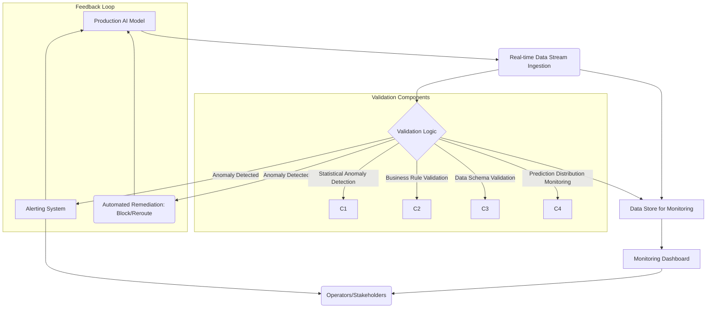

Deployed AI 모델의 안전성 및 신뢰성 검증은 미션 크리티컬한 시스템에서 필수적입니다. 예측 불가능한 엣지 케이스, 데이터 드리프트, 그리고 Adversarial Attack은 모델 성능 저하를 넘어 심각한 운영 위험을 초래할 수 있습니다. 이러한 위험에 선제적으로 대응하기 위해, 실시간 데이터 스트림을 활용한 AI 모델 안전성 및 신뢰성 검증 하네스(Harness) 디자인 패턴이 필요합니다. 이 패턴은 배포된 모델의 입력 및 출력 데이터를 실시간으로 모니터링하고, 정의된 안전성 및 신뢰성 기준에 따라 지속적으로 검증하여 잠재적 위험을 즉시 감지하고 완화하는 것을 목표로 합니다.

## 핵심 아키텍처 구성 요소
실시간 검증 하네스는 다음과 같은 핵심 구성 요소로 이루어집니다.

### 1. 스트림 데이터 수집 (Stream Data Ingestion)
운영 환경에 배포된 AI 모델로 유입되는 모든 입력 데이터와 모델의 추론 결과를 실시간으로 수집합니다. Kafka, Kinesis와 같은 분산 스트리밍 플랫폼을 활용하여 대량의 데이터를 안정적으로 처리합니다. 데이터는 원본 형태를 유지하거나, 필요한 경우 익명화(anonymization) 및 정규화(normalization) 단계를 거칩니다.

### 2. 실시간 검증 로직 (Real-time Validation Logic)
수집된 데이터를 기반으로 AI 모델의 안전성과 신뢰성을 평가하는 다양한 검증 로직을 포함합니다. 이는 통계적 이상 탐지(Statistical Anomaly Detection), 비즈니스 규칙(Business Rule) 기반 검증, 데이터 스키마 유효성 검사(Schema Validation), 그리고 예측 분포 모니터링(Prediction Distribution Monitoring) 등을 포함합니다. 예를 들어, 모델 출력의 특정 임계값 초과 여부, 입력 데이터 분포의 변화 감지, 또는 민감 정보(sensitive information) 유출 시도 탐지 등이 있습니다.

### 3. 피드백 및 알림 시스템 (Feedback & Alerting System)
검증 로직에서 이상 징후나 안전성 위반이 감지되면, 즉시 관련 이해관계자에게 알림을 전송합니다. 이 시스템은 Slack, PagerDuty, 이메일 등 다양한 채널을 통해 경고를 발생시키며, 필요에 따라 모델의 추론 요청을 차단하거나 대체 모델로 라우팅하는 자동화된 대응 메커니즘을 트리거할 수 있습니다.

### 4. 지속적인 모니터링 및 시각화 (Continuous Monitoring & Visualization)
하네스를 통해 수집된 모든 검증 데이터와 모델 성능 지표는 대시보드를 통해 지속적으로 모니터링됩니다. Grafana, Kibana 같은 도구를 사용하여 데이터 드리프트, 모델 성능 저하, 안전성 위반 추세 등을 시각화하여 운영자가 시스템 상태를 한눈에 파악할 수 있도록 돕습니다.

## 실시간 AI 모델 검증 하네스 흐름


## 구현 예시: Python 기반 스트림 검증
아래는 Kafka를 통해 실시간 데이터를 수집하고 AI 모델의 입력 및 출력을 검증하는 개념적인 Python 하네스 예시입니다.

```python
import json
from kafka import KafkaConsumer
from datetime import datetime

class RealtimeAIValidationHarness:
    def __init__(self, kafka_bootstrap_servers: str, topic: str):
        self.consumer = KafkaConsumer(
            topic,
            bootstrap_servers=kafka_bootstrap_servers,
            value_deserializer=lambda m: json.loads(m.decode('utf-8'))
        )
        print(f"Harness initialized, listening to topic: {topic}")

    def validate_input_data(self, data: dict) -> bool:
        """
        입력 데이터의 스키마 유효성 및 이상 징후를 검증합니다.
        예: 필수 필드 누락, 비정상적인 값 범위 등.
        """
        required_fields = ["user_id", "input_text", "timestamp"]
        if not all(field in data for field in required_fields):
            print(f"Validation Error: Missing required fields in input data - {data}")
            return False
        
        if not isinstance(data.get("input_text"), str) or len(data["input_text"]) < 5:
            print(f"Validation Error: Invalid input_text format or length - {data['input_text']}")
            return False
        
        # 2026 트렌드: LLM 프롬프트 인젝션 시도 감지 로직 추가
        if "DROP TABLE" in data.get("input_text", "").upper():
            print(f"Security Alert: Potential prompt injection detected in input - {data['input_text']}")
            return False
        
        return True

    def validate_model_output(self, output: dict) -> bool:
        """
        모델 출력의 안전성 및 신뢰성을 검증합니다.
        예: 민감 정보 포함, 비정상적인 예측 범위, Hallucination 징후 등.
        """
        if not isinstance(output.get("prediction"), str) or len(output.get("prediction", "")) > 500:
            print(f"Validation Error: Model output too long or invalid format - {output.get('prediction')}")
            return False
        
        # 2026 트렌드: LLM 기반 모델의 경우, 출력의 '독성(toxicity)' 감지 로직
        if "bad_word" in output.get("prediction", "").lower(): # 예시 로직
            print(f"Safety Alert: Potentially toxic output detected - {output['prediction']}")
            return False
        
        return True

    def run(self):
        for message in self.consumer:
            event = message.value
            timestamp = datetime.now().isoformat()
            print(f"[{timestamp}] Received event: {event}")

            if "input" in event and "output" in event:
                input_data = event["input"]
                model_output = event["output"]

                if not self.validate_input_data(input_data):
                    self.send_alert("CRITICAL", "Input data validation failed", event)
                    # 모델에 유입되는 데이터 차단 또는 라우팅 변경 로직 추가 가능
                    continue

                if not self.validate_model_output(model_output):
                    self.send_alert("CRITICAL", "Model output validation failed", event)
                    # 해당 모델 출력 사용 중단 또는 대체 로직 사용 가능
                    continue
                
                print(f"[{timestamp}] Validation successful for event.")
            else:
                print(f"[{timestamp}] Event missing 'input' or 'output' keys: {event}")

    def send_alert(self, level: str, message: str, event_data: dict):
        """실제 알림 시스템 (Slack, PagerDuty 등) 연동"""
        alert_payload = {
            "level": level,
            "message": message,
            "event_data": event_data,
            "timestamp": datetime.now().isoformat()
        }
        print(f"ALERT [{level}]: {message} - Details: {json.dumps(event_data)}")
        # 실제 알림 발송 API 호출 로직 추가

if __name__ == "__main__":
    # Kafka 브로커 주소 설정
    KAFKA_BOOTSTRAP_SERVERS = "localhost:9092"
    # 모니터링할 AI 모델의 데이터 스트림 토픽
    AI_MODEL_TOPIC = "ai_model_inference_stream"

    harness = RealtimeAIValidationHarness(KAFKA_BOOTSTRAP_SERVERS, AI_MODEL_TOPIC)
    harness.run()
```

## 트레이드오프

실시간 데이터 스트림 기반 AI 모델 검증 하네스 설계는 여러 트레이드오프를 수반합니다.

*   **즉각적인 위험 감지 vs. 시스템 복잡성 및 비용**: 
    *   **언제 좋은가 (When Good)**: 금융 거래 사기 탐지, 자율 주행 시스템, 의료 진단과 같이 지연이 허용되지 않는 고위험(high-stakes) AI 애플리케이션의 경우, 실시간 감지는 필수적인 안전망을 제공합니다. 잠재적인 오류나 악의적인 공격에 대한 즉각적인 대응이 가능해 피해를 최소화할 수 있습니다.
    *   **언제 나쁜가 (When Bad)**: 실시간 스트리밍 인프라(Kafka, Flink 등) 구축 및 운영은 상당한 엔지니어링 리소스와 비용을 요구합니다. 배치(Batch) 처리로도 충분한 비실시간/저위험 AI 모델(예: 비동기 보고서 생성, 주간 추천 시스템 업데이트)의 경우, 불필요한 복잡성과 과도한 운영 비용을 초래할 수 있습니다.

*   **광범위한 검증 범위 vs. 성능 오버헤드**: 
    *   **언제 좋은가 (When Good)**: 다양한 유형의 안전성 위협(데이터 드리프트, 스키마 유효성, 프롬프트 인젝션, 윤리적 편향)에 대비하여 다층적인 검증 로직을 적용할 때 강력한 보호 기능을 제공합니다. 특히 새로운 위협 패턴에 대한 유연한 대응이 필요할 때 유용합니다.
    *   **언제 나쁜가 (When Bad)**: 모든 입력/출력에 대해 복잡한 검증 로직을 실시간으로 적용하면 AI 모델의 추론 지연 시간(inference latency)이 증가하거나, 검증 시스템 자체의 처리량(throughput)이 병목이 될 수 있습니다. 저지연(low-latency)이 핵심 요구사항인 경우, 검증 로직을 최소화하거나 비동기 처리 부분으로 분리해야 합니다.

*   **자동화된 대응 vs. 오탐(False Positive) 위험**: 
    *   **언제 좋은가 (When Good)**: 명확한 규칙과 낮은 오탐률을 보장하는 시나리오(예: 특정 키워드 감지, 명백한 스키마 오류)에서는 자동화된 차단 또는 대체 모델 라우팅이 신속하고 효과적인 방어 수단이 됩니다. 이는 인적 개입 없이 시스템의 안정성을 유지하는 데 기여합니다.
    *   **언제 나쁜가 (When Bad)**: 검증 로직의 오탐률이 높거나, 모호한 상황에서 자동화된 대응을 도입하면 정상적인 서비스 흐름을 방해하고 사용자 경험을 저해할 수 있습니다. 이 경우, 자동화된 대응보다는 알림 및 수동 검토 프로세스를 우선하는 것이 더 안전합니다.

*   **데이터 투명성 및 가시성 vs. 데이터 프라이버시 및 보안**: 
    *   **언제 좋은가 (When Good)**: 모든 입력 및 출력 데이터를 수집하고 분석하면 AI 모델의 동작을 투명하게 파악하고 문제 발생 시 근본 원인을 신속하게 진단하는 데 유리합니다. 모델의 Black-box 특성을 완화하는 데 도움이 됩니다.
    *   **언제 나쁜가 (When Bad)**: 고객의 개인 식별 정보(PII), 기밀 데이터 등이 포함된 스트림 데이터를 처리할 때 프라이버시 침해 및 보안 위험이 증가합니다. 강력한 데이터 익명화, 암호화, 접근 제어, 그리고 규제 준수(예: GDPR, CCPA)가 필수적이며, 이는 시스템 설계 및 운영에 추가적인 부담을 줍니다.

## 실전 체크리스트

실시간 데이터 스트림 기반 AI 모델 안전성 및 신뢰성 검증 하네스를 프로젝트에 적용할 때 다음 항목들을 검증하십시오.

*   [ ] **스트림 데이터 소스 및 형식 정의**: 모든 AI 모델 입력 및 출력에 대한 데이터 소스(Kafka topic, Kinesis stream 등)와 데이터 스키마(JSON, Protobuf 등)가 명확하게 정의되고 문서화되었는가?
*   [ ] **핵심 안전성/신뢰성 지표 및 임계값 설정**: 감지해야 할 주요 위험(예: 데이터 드리프트, 편향, 프롬프트 인젝션, 민감 정보 유출)에 대한 구체적인 지표와 각 지표의 허용 가능한 임계값(threshold)이 정의되었는가?
*   [ ] **알림 및 대응 프로토콜 수립**: 이상 징후 감지 시 누가(Who), 언제(When), 어떻게(How) 알림을 받고, 어떤 자동화된(Automated) 또는 수동(Manual) 대응 절차가 실행될지 명확한 프로토콜이 수립되었는가?
*   [ ] **모니터링 대시보드 구축 및 시각화**: 주요 검증 지표, 모델 성능, 그리고 이상 감지 이력을 실시간으로 확인할 수 있는 대시보드가 구축되었으며, 운영자가 직관적으로 이해할 수 있도록 시각화되었는가?
*   [ ] **오탐(False Positive) 및 미탐(False Negative) 관리 전략**: 하네스 테스트 단계에서 발생할 수 있는 오탐과 미탐을 최소화하기 위한 전략(예: 룰셋(rule-set) 미세 조정, 머신러닝 기반 이상 탐지 모델 학습)이 마련되었는가?
*   [ ] **데이터 거버넌스 및 보안 강화**: 실시간으로 처리되는 데이터의 민감도를 고려하여 데이터 익명화, 접근 제어, 암호화 등 데이터 거버넌스 및 보안 조치가 설계 및 구현되었는가?
*   [ ] **재해 복구 및 고가용성 설계**: 스트리밍 인프라 및 검증 시스템 자체의 장애 발생 시 데이터 손실 없이 복구(Recovery)하고 서비스 연속성(Continuity)을 유지할 수 있도록 재해 복구(Disaster Recovery) 및 고가용성(High Availability)이 설계되었는가?