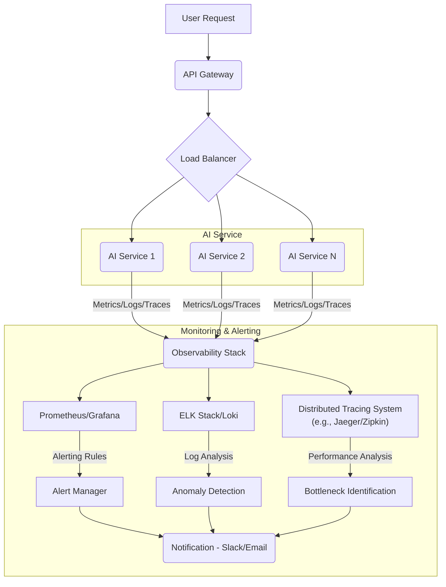

대규모 AI 애플리케이션의 성공은 단순히 모델의 정확성을 넘어선다. 실시간으로 변화하는 사용자 트래픽과 데이터 패턴 속에서 안정적인 성능과 최적의 사용자 경험을 제공하는 것이 핵심이다. 특히, AI 서비스는 일반적인 소프트웨어와 달리 모델 추론 지연 (inference latency), 처리량 (throughput), GPU 활용률, 그리고 모델 드리프트 (model drift)와 같은 AI 특화 지표 관리가 필수적이다. 이러한 복합적인 요인들을 실시간으로 감지하고 대응하는 시스템은 AI 서비스의 신뢰성과 효율성을 결정하는 중요한 요소이다.

## 핵심 과제: AI 서비스의 복잡한 성능 저하 요인
대규모 AI 애플리케이션은 다양한 성능 저하 요인에 직면한다.
*   **추론 지연 (Inference Latency)**: 사용자 요청에 대한 AI 모델의 응답 시간. 특히 실시간 대화형 AI나 추천 시스템에서 Critical하다.
*   **처리량 (Throughput)**: 단위 시간당 처리할 수 있는 요청의 수. 급증하는 트래픽을 처리하기 위한 확장성 (scalability)과 직결된다.
*   **리소스 활용률 (Resource Utilization)**: GPU, CPU, 메모리 등의 컴퓨팅 자원 사용 효율. 과도한 사용은 비용 증가로, 낮은 사용은 자원 낭비로 이어진다.
*   **모델 드리프트 (Model Drift)**: 학습 데이터와 실제 서비스 데이터 분포의 차이로 인해 모델 성능이 점진적으로 저하되는 현상. 실시간 감지가 어려울 수 있다.
*   **데이터 품질 (Data Quality)**: 입력 데이터의 노이즈, 불일치, 편향 등이 모델 추론에 미치는 영향.

이러한 문제들을 해결하기 위해 체계적인 실시간 성능 모니터링 및 최적화 전략이 필요하다.

## 실시간 성능 모니터링 시스템 구축
효과적인 실시간 모니터링은 AI 서비스의 건강 상태를 파악하고, 잠재적인 문제를 사전에 예방하는 데 필수적이다.

### 1. 통합 관측 가능성 (Unified Observability)
AI 애플리케이션은 일반적인 시스템 모니터링 (CPU, 메모리, 네트워크) 외에 AI 특화 지표를 함께 관리해야 한다.
*   **메트릭 (Metrics)**: 추론 지연 (p50, p90, p99), 처리량 (RPS: Requests Per Second), GPU/CPU/Memory 사용률, 모델 정확도 (accuracy), 정밀도 (precision), 재현율 (recall), F1-score. 특히 AI 모델의 특정 레이어별 지연 시간도 중요하게 모니터링할 수 있다.
*   **로그 (Logs)**: 모델 추론 요청/응답 로그, 에러 로그, 데이터 전처리 로그. 상세한 로그는 문제 발생 시 원인 분석에 결정적인 역할을 한다.
*   **분산 추적 (Distributed Tracing)**: 사용자 요청이 시스템의 여러 마이크로서비스와 AI 모델을 거치는 과정을 시각화하여, 병목 구간을 정확히 찾아낸다. OpenTelemetry와 같은 표준을 활용할 수 있다.

### 2. AI 특화 지표 및 경고 시스템
모델의 동작 특성을 반영하는 지표를 수집하고, 임계치 (threshold) 기반의 경고 시스템을 구축한다.
*   **모델 성능 지표**: 실시간으로 모델의 예측 정확도, 예측 분포 변화, 특정 클래스에 대한 편향 등을 모니터링한다. A/B 테스트 환경에서 새로운 모델의 성능 저하를 즉시 감지할 수 있다.
*   **데이터 드리프트 감지**: 입력 데이터의 통계적 특성 (평균, 분산, 고유 값 분포 등)이 학습 데이터와 유의미하게 달라지는 경우를 감지한다. 이를 통해 모델 재학습의 필요성을 판단한다.
*   **자원 고갈 예측**: GPU 메모리 사용량이 특정 임계치를 초과하거나, GPU 큐 대기 시간이 길어지는 경우를 예측하여 스케일 아웃을 자동화한다.

## 코드 예제: AI 추론 메트릭 수집 (Python + Prometheus client)
다음은 간단한 Python Flask 애플리케이션에서 AI 모델 추론 시간을 Prometheus 메트릭으로 노출하는 예제이다.

```python
from flask import Flask, request, jsonify
from prometheus_client import Gauge, Histogram, generate_latest
import time
import random

app = Flask(__name__)

# Prometheus Metrics 정의
INFERENCE_LATENCY_SECONDS = Histogram(
    'ai_inference_latency_seconds',
    'Latency for AI model inference',
    ['model_name', 'status']
)
INFERENCE_REQUESTS_TOTAL = Gauge(
    'ai_inference_requests_total',
    'Total number of AI inference requests',
    ['model_name']
)
GPU_UTILIZATION = Gauge(
    'gpu_utilization_percent',
    'Current GPU utilization percentage',
    ['gpu_id']
)

# Mock AI Model Inference
def mock_ai_inference(data):
    # Simulate inference time
    time.sleep(random.uniform(0.01, 0.5))
    # Simulate a potential error
    if random.random() < 0.05:
        raise ValueError("Simulated inference error")
    return {"prediction": random.randint(0, 9)}

@app.route('/predict', methods=['POST'])
def predict():
    model_name = request.args.get('model', 'default_model')
    INFERENCE_REQUESTS_TOTAL.labels(model_name=model_name).inc()

    start_time = time.time()
    status = 'success'
    try:
        data = request.json
        if not data:
            raise ValueError("No input data provided")
        
        result = mock_ai_inference(data)
        
        # Simulate GPU utilization
        GPU_UTILIZATION.labels(gpu_id='gpu-0').set(random.uniform(30, 90))
        
        return jsonify(result)
    except Exception as e:
        status = 'failure'
        return jsonify({"error": str(e)}), 500
    finally:
        latency = time.time() - start_time
        INFERENCE_LATENCY_SECONDS.labels(model_name=model_name, status=status).observe(latency)

@app.route('/metrics')
def metrics():
    return generate_latest().decode('utf-8')

if __name__ == '__main__':
    app.run(host='0.0.0.0', port=5000)
```

이 예제는 Flask 웹 서버에서 `ai_inference_latency_seconds`와 `ai_inference_requests_total`, `gpu_utilization_percent` 메트릭을 노출한다. Prometheus는 `/metrics` 엔드포인트를 주기적으로 스크랩하여 데이터를 수집하고, Grafana와 같은 대시보드 도구에서 시각화할 수 있다.

## Mermaid 다이어그램: AI 서비스 실시간 모니터링 아키텍처


## AI 애플리케이션 성능 최적화 전략 (2026 트렌드 반영)
실시간 모니터링을 통해 문제점을 발견했다면, 다음과 같은 전략을 통해 성능을 최적화할 수 있다.

### 1. 동적 배치 (Dynamic Batching)
*   들어오는 요청을 실시간으로 그룹화하여 GPU 활용률을 극대화한다. 고정된 배치 크기 (fixed batch size) 대신, 트래픽 상황에 따라 배치 크기를 동적으로 조절하여 지연 시간과 처리량 사이의 균형을 맞춘다. NVIDIA Triton Inference Server 같은 솔루션이 이 기능을 제공한다.

### 2. 모델 경량화 및 양자화 (Model Quantization & Pruning)
*   **양자화 (Quantization)**: 모델의 가중치를 FP32에서 INT8과 같이 낮은 비트의 정수형으로 변환하여 모델 크기를 줄이고 추론 속도를 높인다. 이는 특히 엣지 디바이스나 리소스 제약이 있는 환경에서 중요하다.
*   **가지치기 (Pruning)**: 모델의 중요하지 않은 가중치나 뉴런을 제거하여 모델을 희소하게 만들어 추론 속도를 개선한다.

### 3. 지능형 캐싱 (Intelligent Caching)
*   자주 반복되는 요청이나 예측 결과에 대한 캐싱 전략을 도입한다. 특히 LLM (Large Language Model) 기반 애플리케이션의 경우, 프롬프트 (prompt)나 중간 결과를 캐싱하여 토큰 처리 비용과 지연 시간을 크게 줄일 수 있다. 벡터 데이터베이스 기반의 유사성 캐싱 (similarity caching)도 고려할 수 있다.

### 4. 탄력적 스케일링 (Elastic Scaling)
*   Kubernetes Horizontal Pod Autoscaler (HPA) 또는 Custom Metrics Autoscaler를 활용하여 GPU 활용률, 추론 지연 시간, 요청 큐 길이 등 AI 특화 지표에 따라 자동으로 서비스 인스턴스를 확장하거나 축소한다. 2026년에는 서버리스 GPU 인프라의 발전으로 더욱 세밀한 비용 효율적인 스케일링이 가능해질 것이다.

### 5. 프롬프트 엔지니어링 및 최적화 (Prompt Engineering & Optimization)
*   LLM 기반 서비스의 경우, 프롬프트의 효율성이 추론 비용과 지연 시간에 직접적인 영향을 미친다. 최소한의 토큰으로 최대의 정보를 전달하는 프롬프트 디자인, Chain-of-Thought (CoT) 프롬프팅의 최적화, 그리고 불필요한 컨텍스트 제거 등을 통해 성능을 개선할 수 있다.

## 트레이드오프
*   **실시간 모니터링의 비용 vs. 문제 조기 감지**:
    *   **언제 좋음**: 서비스 안정성이 최우선인 프로덕션 환경. 문제 발생 시 즉각적인 대응으로 사용자 경험 저하 및 잠재적 매출 손실을 최소화할 수 있다.
    *   **언제 나쁨**: 개발 초기 단계나 소규모 PoC (Proof of Concept) 프로젝트. 모니터링 인프라 구축 및 유지보수에 드는 비용과 복잡성이 과도할 수 있다.
*   **세분화된 메트릭 수집 vs. 성능 오버헤드**:
    *   **언제 좋음**: 복잡한 AI 모델의 내부 동작을 심층적으로 이해하고 싶을 때. 특정 레이어나 모듈의 병목 현상을 정확히 진단하는 데 유용하다.
    *   **언제 나쁨**: 성능에 매우 민감한 초저지연 (ultra-low latency) 애플리케이션. 메트릭 수집 자체가 모델 추론에 미세한 지연을 추가할 수 있으며, 스토리지 비용도 증가한다.
*   **모델 경량화/양자화 vs. 모델 정확도**:
    *   **언제 좋음**: 엣지 디바이스, 모바일 환경, 또는 GPU 자원이 제한적인 환경에서 성능 향상이 필수적일 때. 일반적으로 정확도 손실이 미미하거나 허용 가능한 수준이다.
    *   **언제 나쁨**: 모델의 미세한 정확도 손실이 치명적인 영향을 미치는 도메인 (예: 의료 진단, 금융 사기 탐지). 복잡한 모델을 단순히 경량화하면 임계 상황에서 예측 성능이 저하될 수 있다.
*   **지능형 캐싱 도입 vs. 데이터 신선도/복잡성 증가**:
    *   **언제 좋음**: 동일하거나 유사한 요청이 자주 발생하는 서비스 (예: 대규모 추천 시스템의 인기 아이템, LLM의 정형화된 질문). 응답 속도를 크게 향상하고 컴퓨팅 자원 사용을 줄일 수 있다.
    *   **언제 나쁨**: 입력 데이터나 모델이 매우 빠르게 변화하여 캐시의 유효 기간이 짧거나, 캐시 적중률이 낮은 경우. 캐싱 로직의 복잡성만 증가시키고 실제 효과는 미미할 수 있다. 캐시 무효화 (cache invalidation) 전략이 어려워진다.
*   **동적 스케일링 vs. 예측 불가능한 비용/콜드 스타트**:
    *   **언제 좋음**: 트래픽 변동성이 크지만, 갑작스러운 트래픽 급증에 유연하게 대응해야 하는 서비스. 자원 낭비를 줄이고 사용자 경험을 유지할 수 있다.
    *   **언제 나쁨**: 트래픽이 매우 안정적이거나, 콜드 스타트 (cold start)로 인한 초기 지연이 허용되지 않는 서비스. 스케일링 업/다운 과정에서의 지연 시간이나 인스턴스 초기화 비용이 문제가 될 수 있다.

## 실전 체크리스트
대규모 AI 애플리케이션의 실시간 성능 모니터링 및 최적화를 적용하기 위한 체크리스트는 다음과 같습니다.
- [ ] **핵심 성능 지표 (KPI) 정의**: AI 모델의 추론 지연, 처리량, 자원 활용률, 모델 정확도 등 사업 및 기술 관점에서 중요한 지표를 명확히 정의했는가?
- [ ] **통합 관측 가능성 스택 구축**: Prometheus/Grafana, ELK/Loki, OpenTelemetry 기반의 메트릭, 로그, 추적 (tracing) 시스템을 AI 서비스에 통합하고 대시보드를 구축했는가?
- [ ] **AI 특화 경고 시스템 설정**: 모델 드리프트, 데이터 편향, 특정 클래스에 대한 예측 오류율 변화 등 AI 모델의 이상 징후를 감지하는 경고 규칙을 설정하고 알림 채널을 연동했는가?
- [ ] **자동화된 자원 스케일링 구현**: GPU 활용률, 요청 큐 길이 등 AI 서비스의 실시간 부하 지표에 따라 컴퓨팅 자원 (예: GPU 인스턴스)을 자동으로 확장/축소하는 시스템을 구축했는가?
- [ ] **성능 최적화 기술 도입 검토**: 동적 배치, 모델 양자화 (INT8), 지능형 캐싱 (프롬프트/결과 캐싱) 등 AI 모델의 추론 성능을 향상할 수 있는 기술들을 도입 가능성을 평가하고 PoC를 진행했는가?
- [ ] **코드 레벨 성능 프로파일링**: AI 모델 추론 파이프라인의 각 단계 (데이터 전처리, 모델 포워드 패스, 후처리)에서 정확한 병목을 식별하기 위한 프로파일링 도구를 적용하고 분석했는가?
- [ ] **비용 모니터링 및 최적화**: GPU 사용량, API 호출 비용 등 AI 서비스 운영에 필요한 인프라 비용을 실시간으로 모니터링하고, 비용 효율적인 스케줄링 및 자원 할당 전략을 적용했는가?