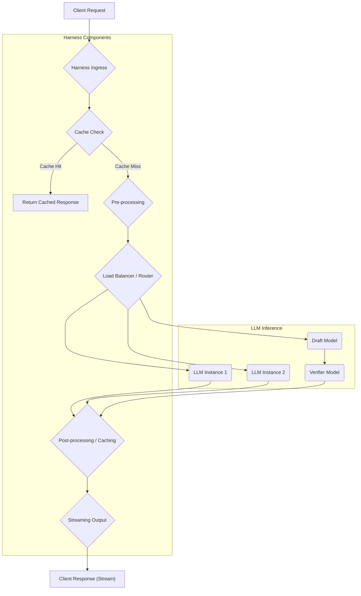

Real-time LLM 서비스에서 사용자 응답 지연(latency)은 사용자 경험(UX)에 결정적인 영향을 미친다. 특히 대화형 AI나 즉각적인 정보 제공이 필요한 애플리케이션에서는 밀리초 단위의 최적화가 필수적이다. LLM 자체의 추론(inference) 속도 개선과 더불어, LLM 호출을 감싸는 Harness 레이어에서의 최적화는 엔드투엔드(end-to-end) 지연 시간을 줄이는 데 핵심적인 역할을 한다.

## Harness가 LLM 응답 지연에 미치는 영향
Harness는 LLM과의 상호작용을 추상화하고 관리하는 계층으로, API 호출, 데이터 전처리, 후처리, 캐싱, 로드 밸런싱, 오류 처리 등을 담당한다. 이 Harness 계층의 비효율성은 아무리 빠른 LLM 모델이라 할지라도 전체 시스템의 응답 속도를 저하시킬 수 있다. 따라서 Harness 레벨에서의 최적화는 시스템 전반의 성능 향상을 위한 필수 요소이다.

## 실시간 LLM 서비스 응답 지연 최소화를 위한 Harness 패턴

### 1. 비동기/스트리밍 응답 처리 (Asynchronous/Streaming Responses)
LLM의 응답은 대개 토큰 단위로 생성되며, 전체 응답이 완료될 때까지 기다리는 대신 생성되는 즉시 스트리밍으로 사용자에게 전달하는 것이 체감 성능을 크게 향상시킨다. 이는 HTTP/2의 Server-Sent Events (SSE)나 웹소켓(WebSocket) 등을 통해 구현할 수 있다. Harness는 LLM API로부터의 스트리밍 응답을 중간에서 효율적으로 처리하여 클라이언트에게 다시 스트리밍하는 파이프라인을 구축해야 한다.

```python
import httpx
import asyncio

async def stream_llm_response(prompt: str):
    url = "https://api.llm-provider.com/v1/chat/completions"
    headers = {
        "Content-Type": "application/json",
        "Authorization": "Bearer YOUR_API_KEY"
    }
    payload = {
        "model": "gpt-4o-mini",
        "messages": [{"role": "user", "content": prompt}],
        "stream": True
    }

    async with httpx.AsyncClient() as client:
        async with client.stream("POST", url, headers=headers, json=payload, timeout=httpx.Timeout(60.0)) as response:
            response.raise_for_status()
            async for chunk in response.aiter_bytes():
                # 실제 LLM 응답 파싱 로직 추가 (예: SSE 파싱)
                if chunk.strip():
                    yield chunk.decode('utf-8') + "\n"

async def main():
    async for token in stream_llm_response("한국의 수도는 어디인가요?"):
        print(token, end="")

if __name__ == "__main__":
    asyncio.run(main())
```

### 2. 요청 캐싱 (Request Caching)
동일하거나 유사한 프롬프트에 대한 응답은 캐시하여 LLM 호출 자체를 우회할 수 있다. 이는 특히 반복적인 질문이나 고정된 지식 기반 질의에 유용하다. Harness 레벨에서 요청 프롬프트와 컨텍스트를 해싱(hashing)하여 캐시 키로 사용하고, Redis나 Memcached와 같은 인메모리(in-memory) 캐시 저장소를 활용한다. 캐시 만료 정책과 무효화 전략이 중요하다.

```go
package main

import (
	"crypto/sha256"
	"encoding/hex"
	"fmt"
	"log"
	"sync"
	"time"
)

// Simplified Cache Store
var cache = struct {
	sync.RWMutex
	data map[string]CacheEntry
}{
	data: make(map[string]CacheEntry),
}

type CacheEntry struct {
	Value     string
	Timestamp time.Time
}

func generateCacheKey(prompt string) string {
	hasher := sha256.New()
	hasher.Write([]byte(prompt))
	return hex.EncodeToString(hasher.Sum(nil))
}

func getFromCache(key string) (string, bool) {
	cache.RLock()
	defer cache.RUnlock()
	entry, found := cache.data[key]
	if !found || time.Since(entry.Timestamp) > 5*time.Minute { // Cache expiry: 5 minutes
		return "", false
	}
	return entry.Value, true
}

func setToCache(key string, value string) {
	cache.Lock()
	defer cache.Unlock()
	cache.data[key] = CacheEntry{Value: value, Timestamp: time.Now()}
}

func callLLM(prompt string) string {
	log.Printf("Calling LLM for prompt: %s", prompt)
	time.Sleep(2 * time.Second) // Simulate LLM latency
	return fmt.Sprintf("LLM response for '%s'", prompt)
}

func getLLMResponseWithCache(prompt string) string {
	key := generateCacheKey(prompt)
	if cachedResponse, found := getFromCache(key); found {
		log.Printf("Cache hit for prompt: %s", prompt)
		return cachedResponse
	}

	response := callLLM(prompt)
	setToCache(key, response)
	log.Printf("Cache miss, LLM called for prompt: %s", prompt)
	return response
}

func main() {
	fmt.Println(getLLMResponseWithCache("What is the capital of France?"))
	fmt.Println(getLLMResponseWithCache("What is the capital of France?")) // Cache hit
	fmt.Println(getLLMResponseWithCache("Who invented the light bulb?"))
	fmt.Println(getLLMResponseWithCache("Who invented the light bulb?")) // Cache hit
}
```

### 3. 동적 로드 밸런싱 및 모델 라우팅 (Dynamic Load Balancing & Model Routing)
다수의 LLM 인스턴스 또는 여러 LLM 공급자(provider)를 사용하는 경우, Harness는 실시간 부하 상태, 모델 성능, 비용 등을 고려하여 최적의 LLM 엔드포인트로 요청을 라우팅해야 한다. 이는 지연 시간을 줄이고 리소스 활용도를 높이는 데 기여한다. Canary 배포, A/B 테스트와 연동하여 새로운 모델 버전을 안전하게 도입할 수도 있다.

### 4. 스펙티브 디코딩 (Speculative Decoding)
2026년 주요 트렌드 중 하나인 스펙티브 디코딩은 작은(draft) 모델로 빠르게 초안을 생성한 뒤, 큰(verifier) 모델이 이를 병렬로 검증하고 교정하는 방식이다. Harness는 이 두 모델 간의 오케스트레이션을 담당하며, 효율적인 배치(batching)와 병렬 처리(parallel processing)를 통해 지연 시간을 단축한다. 이를 통해 큰 모델의 정확도를 유지하면서도 추론 속도를 여러 배 향상시킬 수 있다.

### 5. 병렬화 및 배치 처리 (Parallelization & Batching)
여러 개의 독립적인 LLM 호출이 필요한 경우, Harness는 이들을 병렬로 실행하여 전체 처리 시간을 단축할 수 있다. 또한, 유사한 여러 사용자 요청을 묶어 배치로 LLM에 전달함으로써 GPU 활용 효율을 극대화하고 토큰 처리량을 높여 평균 지연 시간을 감소시킨다. 실시간 시스템에서는 마이크로-배칭(micro-batching) 기법을 활용하여 지연 시간과 처리량 간의 균형을 맞춘다.

### 6. 경량 전처리/후처리 (Lightweight Pre/Post-processing)
LLM 입출력에 대한 전처리(pre-processing)와 후처리(post-processing) 로직은 가능한 한 경량화되어야 한다. 복잡하거나 지연이 큰 로직은 LLM 호출 전에 미리 처리하거나, LLM 응답 후 비동기적으로 처리하여 핵심 응답 경로(critical response path)의 지연을 최소화해야 한다.

## Harness 최적화 흐름



## 트레이드오프

*   **요청 캐싱 (Request Caching)**
    *   **언제 좋고**: 동일하거나 반복적인 요청이 많은 경우, 고정된 정보성 질의에 탁월. LLM 비용 절감 및 응답 속도 대폭 개선.
    *   **언제 나쁜지**: 실시간성이 매우 중요하고 프롬프트 다양성이 매우 높은 경우 캐시 적중률(hit rate)이 낮아 효과 미미. 캐시 무효화(invalidation) 전략 복잡성 증가.
*   **스트리밍 응답 (Streaming Responses)**
    *   **언제 좋고**: 사용자에게 즉각적인 피드백을 제공하여 체감 지연 시간을 크게 개선. 대화형 AI/채팅 서비스에 필수적.
    *   **언제 나쁜지**: 최종 응답의 전체 구조를 알기 전까지 후처리(post-processing)가 어렵거나 복잡한 경우 구현이 까다로움. 클라이언트 측 구현 복잡성 증가.
*   **스펙티브 디코딩 (Speculative Decoding)**
    *   **언제 좋고**: 큰 모델의 품질을 유지하면서 추론 속도를 크게 높여야 할 때. 특히 토큰 생성량이 많은 경우 유리.
    *   **언제 나쁜지**: 초안 모델(draft model)과 검증 모델(verifier model) 간의 아키텍처 오버헤드 발생. 검증 모델이 초안을 자주 거부하면 오히려 지연이 증가할 수 있음.
*   **동적 로드 밸런싱 및 모델 라우팅**
    *   **언제 좋고**: 다수의 LLM 인스턴스를 효율적으로 활용하여 처리량 증대 및 부하 분산. 비용과 성능 최적화에 유리.
    *   **언제 나쁜지**: 라우팅 로직 자체의 복잡성과 오버헤드 발생. 실시간 부하 모니터링 및 예측 시스템 구축 필요.

## 실전 체크리스트

- [ ] 현재 LLM 서비스의 엔드투엔드 응답 지연 시간(TTFT: Time To First Token, TSF: Time To Last Token)을 측정하고 주요 병목 구간을 식별했는가?
- [ ] LLM API 응답을 클라이언트에게 스트리밍 방식으로 전달하는 파이프라인이 구축되어 있으며, 프론트엔드에서 이를 효율적으로 처리하고 있는가?
- [ ] 반복적인 프롬프트에 대한 캐싱 전략(Redis, Memcached 등)이 구현되어 있으며, 캐시 적중률 및 만료 정책이 최적화되어 있는가?
- [ ] 다수의 LLM 인스턴스 또는 모델을 활용하는 경우, 실시간 부하 및 성능 지표에 기반한 동적 로드 밸런싱 또는 모델 라우팅 시스템이 운영되고 있는가?
- [ ] 스펙티브 디코딩 또는 병렬 처리와 같은 최신 추론 가속 기법이 Harness에 통합되어 성능 향상에 기여하고 있는가?
- [ ] LLM 입출력에 대한 전처리 및 후처리 로직이 핵심 응답 경로의 지연을 최소화하도록 경량화되어 있으며, 비동기 처리가 필요한 부분은 분리되었는가?
- [ ] Harness 계층의 각 컴포넌트에 대한 상세한 모니터링(CPU, Memory, Network I/O, QPS, Latency) 및 알림(alerting) 시스템이 구축되어 있는가?