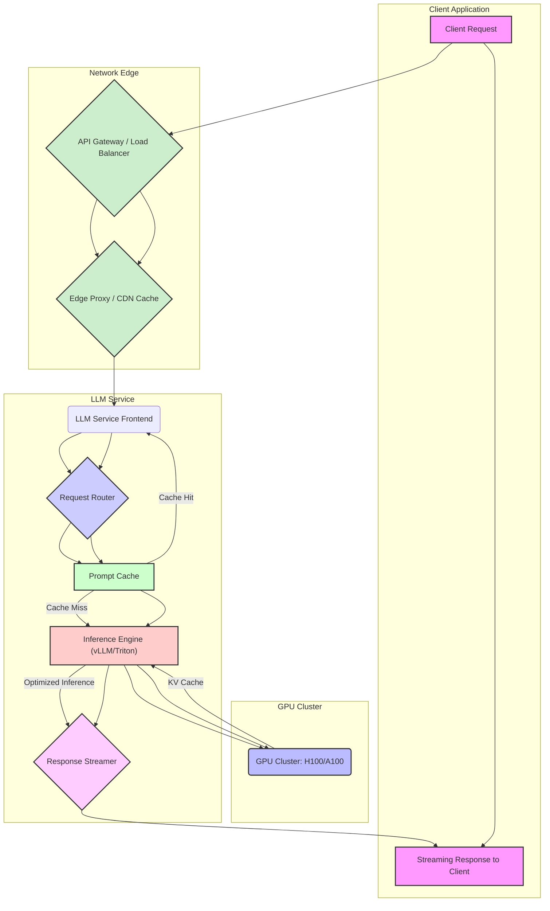

실시간 LLM (Large Language Model) 서비스에서 사용자 경험(UX)을 좌우하는 핵심 요소는 바로 지연 시간(latency)입니다. 응답 지연이 길어질수록 사용자는 서비스의 성능 저하를 느끼고, 이는 이탈로 이어질 수 있습니다. 특히 대화형 AI, 실시간 코드 자동 완성, 즉석 요약 등 인터랙티브한 LLM 애플리케이션에서는 밀리초 단위의 지연 시간 감소가 서비스의 성공에 결정적인 영향을 미칩니다. 본 문서는 2026년 현재 최신 기술 동향을 반영하여 실시간 LLM 서비스의 지연 시간을 최적화하기 위한 인프라 디자인 전략을 다룹니다.

## 핵심 지연 시간 요소 (Key Latency Factors)
LLM 서비스의 전체 지연 시간은 여러 구성 요소의 합으로 이루어집니다. 각 구성 요소의 최적화는 전체 성능 향상에 필수적입니다.

### 1. 모델 추론 시간 (Model Inference Time)
가장 큰 비중을 차지하는 부분으로, 입력 프롬프트(input prompt)를 처리하고 응답 토큰(response token)을 생성하는 데 걸리는 시간입니다. 모델의 크기, 복잡성, 사용되는 하드웨어 가속기(GPU) 성능에 크게 의존합니다.

### 2. 데이터 전송 지연 (Data Transfer Latency)
클라이언트에서 서버, 그리고 서버 내부에서 GPU 메모리로 데이터가 이동하는 데 걸리는 시간입니다. 네트워크 대역폭, 데이터 직렬화(serialization)/역직렬화(deserialization) 오버헤드 등이 영향을 미칩니다.

### 3. 네트워크 오버헤드 (Network Overhead)
클라이언트와 LLM 서비스 백엔드 간의 왕복 시간(Round-Trip Time, RTT)입니다. 지리적 거리, 네트워크 혼잡도, DNS 해석 시간 등이 포함됩니다.

### 4. 큐잉 지연 (Queueing Delays)
동시 요청(concurrent requests)이 많을 때, GPU 리소스가 부족하여 요청이 처리 대기열(queue)에서 기다리는 시간입니다.

## 인프라 최적화 전략 (Infrastructure Optimization Strategies)

### 1. 고성능 GPU 인스턴스 및 가속기 (High-Performance GPU Instances & Accelerators)
LLM 추론 성능을 극대화하기 위해 최신 고성능 GPU 인스턴스를 활용하는 것이 중요합니다. NVIDIA H100, A100과 같은 데이터센터용 GPU는 높은 연산 처리량과 메모리 대역폭을 제공합니다. 또한, TensorRT-LLM, DeepSpeed와 같은 라이브러리를 활용하여 모델별 최적화를 적용합니다. 이들은 모델의 레이어(layer) 연산을 GPU에 최적화된 커널(kernel)로 변환하여 추론 속도를 대폭 향상시킵니다.

### 2. 최적화된 추론 엔진 (Optimized Inference Engines)
vLLM, Triton Inference Server와 같은 전용 LLM 추론 엔진은 다음과 같은 최적화 기법을 제공하여 지연 시간을 줄입니다.

*   **동적 배치(Dynamic Batching):** 여러 사용자 요청을 하나의 배치(batch)로 묶어 GPU 활용률을 높입니다. vLLM의 PagedAttention과 같은 기술은 KV 캐시(KV Cache) 효율성을 극대화하여 처리량을 높이면서도 개별 요청의 지연 시간을 낮춥니다.
*   **모델 양자화(Model Quantization):** 모델의 가중치(weights)를 낮은 비트(예: FP16에서 INT8)로 표현하여 메모리 사용량과 연산량을 줄입니다. 이로 인해 GPU에 더 많은 모델을 로드하거나 더 빠른 추론이 가능해집니다.
*   **모델 증류(Model Distillation):** 대형 모델의 성능을 유지하면서 더 작은 모델을 훈련하여 추론 속도를 높입니다.

### 3. 네트워크 및 엣지 컴퓨팅 (Network & Edge Computing)
사용자와 LLM 서비스 간의 물리적 거리를 줄이는 것이 네트워크 지연 시간 감소에 핵심입니다. 콘텐츠 전송 네트워크(CDN)를 활용하여 사용자 근처에 LLM 프록시 서버를 배치하거나, 엣지 컴퓨팅(edge computing) 전략을 통해 추론 요청을 사용자에게 더 가까운 데이터센터로 라우팅합니다. 또한, 클라우드 제공업체 내에서는 고속 인터커넥트(InfiniBand 등)를 사용하여 분산 GPU 클러스터 간의 통신 지연을 최소화합니다.

### 4. 캐싱 전략 (Caching Strategies)

*   **KV 캐시(Key-Value Cache):** LLM의 어텐션(attention) 메커니즘에서 이전 토큰의 키(Key)와 값(Value) 벡터를 캐싱하여, 새로운 토큰 생성 시 전체 시퀀스를 다시 계산할 필요 없이 효율적으로 처리합니다. 이는 특히 긴 시퀀스(long sequences)에서 추론 속도 향상에 크게 기여합니다.
*   **프롬프트 캐싱(Prompt Caching):** 자주 사용되는 프롬프트의 임베딩(embedding) 또는 초기 토큰 생성 결과를 캐싱하여 반복적인 계산을 방지합니다.
*   **출력 캐싱(Output Caching):** 완전히 동일한 입력에 대해 동일한 응답이 기대되는 경우, 이전에 생성된 응답을 캐싱하여 즉시 반환합니다. 이는 비용 효율적이고 가장 빠른 응답을 보장하지만, LLM의 확률적 특성상 모든 시나리오에 적용하기는 어렵습니다.

### 5. 스트리밍 응답 (Streaming Responses)
첫 번째 토큰이 생성되는 즉시 클라이언트에게 전송하기 시작하여 사용자가 전체 응답을 기다리지 않고도 결과를 볼 수 있도록 합니다. 이는 TTD (Time To First Token)를 최소화하여 사용자 인지 지연(perceived latency)을 크게 줄여줍니다. 서버-센트 이벤트(SSE, Server-Sent Events) 또는 WebSocket과 같은 기술을 활용합니다.

### 6. 분산 추론 및 로드 밸런싱 (Distributed Inference & Load Balancing)
단일 GPU로 처리하기 어려운 매우 큰 모델이나 높은 처리량(throughput)이 요구되는 경우, 모델을 여러 GPU 또는 서버에 분산하여 추론을 수행합니다. 모델 병렬화(model parallelism), 파이프라인 병렬화(pipeline parallelism), 데이터 병렬화(data parallelism) 등의 기법이 사용됩니다. 지능형 로드 밸런서(load balancer)는 요청의 특성(예: 프롬프트 길이)을 기반으로 적절한 GPU 또는 서버로 라우팅하여 리소스 활용을 최적화하고 큐잉 지연을 줄입니다.

## 아키텍처 다이어그램 (Architectural Diagram)
아래 Mermaid 다이어그램은 실시간 LLM 서비스의 일반적인 요청 흐름과 최적화 요소를 보여줍니다.



## 코드 예시: 스트리밍 응답 (Code Example: Streaming Response)
Python FastAPI를 사용하여 LLM 응답을 스트리밍하는 간단한 예시입니다. `simulate_llm_response` 함수는 각 토큰을 지연과 함께 생성하는 것을 모방합니다.

```python
import time
from fastapi import FastAPI, Response
from fastapi.responses import StreamingResponse

app = FastAPI()

async def simulate_llm_response(prompt: str):
    # 실제 LLM 호출을 시뮬레이션합니다.
    # 여기서는 각 토큰을 생성하는 데 시간이 걸리는 것으로 가정합니다.
    full_response = f"안녕하세요! 당신이 요청한 '{prompt}'에 대한 응답을 스트리밍합니다:"
    for char in full_response:
        yield char
        time.sleep(0.05) # 각 토큰 생성 지연 시뮬레이션
    for i in range(10):
        chunk = f" 토큰_{i+1}"
        yield chunk
        time.sleep(0.1)
    yield "\n" # 마지막에 줄바꿈 추가
    yield "생성이 완료되었습니다."

@app.post("/stream_llm_response")
async def stream_llm_response(prompt_data: dict):
    prompt = prompt_data.get("prompt", "기본 질문")
    return StreamingResponse(simulate_llm_response(prompt), media_type="text/plain")

# 실행 방법 (터미널에서):
# uvicorn your_module_name:app --reload
# curl -N -X POST -H "Content-Type: application/json" -d '{"prompt": "실시간 LLM"}' http://127.0.0.1:8000/stream_llm_response
```

## 트레이드오프 (Trade-offs)

### 1. 성능 vs. 비용 (Performance vs. Cost)
*   **언제 좋고:** 초저지연이 핵심적인 사용자 대면 서비스(customer-facing services)에서는 고성능 GPU(H100 등)와 최적화된 추론 엔진에 투자하는 것이 필수적입니다. TTD와 TTL(Time To Last Token)을 극적으로 개선하여 사용자 만족도를 높일 수 있습니다.
*   **언제 나쁜지:** 배치 처리(batch processing)나 중요도가 낮은 백그라운드 작업 등 지연 시간 민감도가 낮은 애플리케이션에서는 비용 효율적인 GPU(A10, T4 등)를 사용하거나, 더 높은 배치 크기(batch size)를 허용하는 것이 합리적입니다. 불필요하게 고성능 하드웨어에 투자하면 운영 비용만 증가합니다.

### 2. 복잡성 vs. 유연성 (Complexity vs. Flexibility)
*   **언제 좋고:** vLLM, Triton Inference Server와 같은 고급 추론 엔진은 복잡한 설정과 튜닝을 요구하지만, 모델별 최적화, 동적 배치, 멀티 모델 서빙 등의 고급 기능을 통해 극한의 성능을 끌어낼 수 있는 유연성을 제공합니다.
*   **언제 나쁜지:** 소규모 프로젝트나 프로토타이핑 단계에서는 복잡한 인프라 설정이 개발 속도를 저해할 수 있습니다. 간단한 REST API를 통한 모델 호출이나 Hugging Face `transformers` 라이브러리의 기본 서빙 기능을 사용하는 것이 더 빠르고 관리하기 쉽습니다.

### 3. 범용성 vs. 특화 (Generality vs. Specialization)
*   **언제 좋고:** 특정 모델에 특화된 TensorRT-LLM과 같은 솔루션은 해당 모델에 대한 추론 속도를 최고 수준으로 끌어올립니다. 이는 단일 모델에 대한 성능 요구사항이 매우 높은 경우에 적합합니다.
*   **언제 나쁜지:** 다양한 LLM 모델을 유연하게 전환하거나 여러 모델을 동시에 서빙해야 하는 서비스에서는 특정 모델에 종속적인 솔루션보다 vLLM이나 Triton과 같이 여러 모델을 지원하는 범용적인 추론 엔진이 더 적합합니다.

### 4. 보안 vs. 지연 시간 (Security vs. Latency)
*   **언제 좋고:** 데이터 민감도가 높은 환경에서 LLM 서비스는 엄격한 보안 프로토콜, 데이터 암호화, 네트워크 격리 등을 적용해야 합니다. 이러한 보안 조치는 필수적이지만, 일반적으로 약간의 지연 시간 증가를 동반합니다.
*   **언제 나쁜지:** 지연 시간이 극도로 중요한 서비스에서는 보안 오버헤드를 최소화하기 위해 네트워크 경로를 최적화하거나, TLS 핸드셰이크(TLS handshake)를 미리 수행하는 등의 기법을 고려해야 합니다. 하지만 이는 보안 위험과 항상 트레이드오프 관계에 있습니다.

## 실전 체크리스트 (Practical Checklist)
LLM 서비스의 지연 시간 최적화 인프라를 구축할 때 검증해야 할 핵심 항목들입니다.

- [ ] **TTFT (Time To First Token) 측정 및 목표 설정:** 사용자 인지 지연 시간을 최소화하기 위한 TTFT 목표(예: 200ms 미만)를 설정하고, 실제 운영 환경에서 주기적으로 측정하고 있는지 확인합니다.
- [ ] **동적 배치(Dynamic Batching) 활성화 여부 확인:** vLLM 또는 Triton Inference Server와 같은 추론 엔진에서 동적 배치가 올바르게 구성되어 GPU 활용률을 최적화하고 있는지 검증합니다.
- [ ] **KV 캐시(KV Cache) 효율성 모니터링:** GPU 메모리 내 KV 캐시 사용률 및 히트율을 모니터링하여 캐시가 추론 성능에 기여하고 있는지, 또는 캐시 부족으로 인한 성능 저하가 없는지 확인합니다.
- [ ] **네트워크 엣지 배포 전략 검토:** 사용자 분포를 기반으로 LLM 프록시 또는 서비스 엔드포인트(endpoint)를 지리적으로 분산 배치하여 네트워크 RTT를 최소화하고 있는지 확인합니다.
- [ ] **모델 양자화(Quantization) 적용 및 성능/정확도 평가:** 사용 중인 LLM 모델에 양자화를 적용하고, 추론 속도 향상 대비 출력 정확도(accuracy) 저하가 허용 가능한 수준인지 정량적으로 평가했는지 확인합니다.
- [ ] **스트리밍 응답(Streaming Response) 엔드 투 엔드 구현 확인:** 클라이언트 애플리케이션부터 백엔드 LLM 서비스까지 전체 경로에서 스트리밍이 원활하게 작동하며, 첫 번째 토큰이 빠르게 전송되는지 테스트 및 검증합니다.
- [ ] **로드 밸런싱 및 라우팅 전략 최적화:** 요청의 특성(예: 프롬프트 길이, 모델 종류)에 따라 LLM 인스턴스 또는 GPU로 트래픽을 지능적으로 라우팅하여 리소스 활용률을 높이고 큐잉 지연을 줄이는 전략이 적용되었는지 검토합니다.