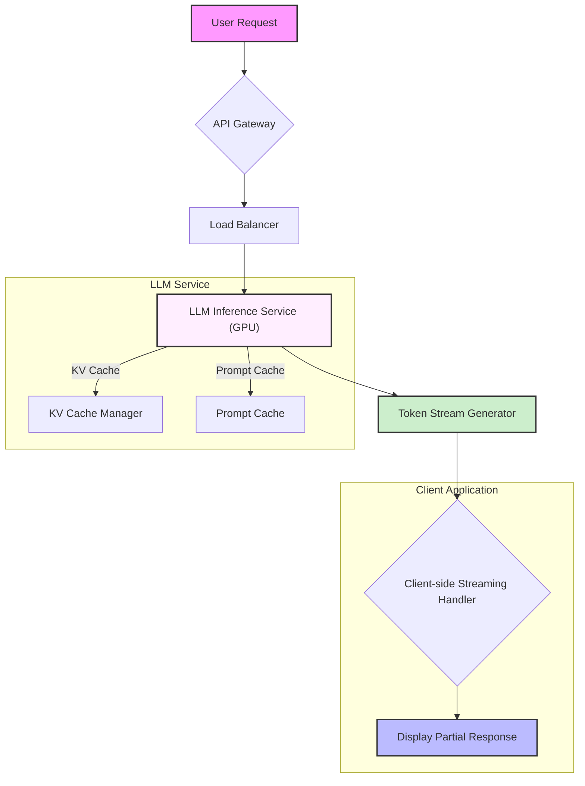

The demand for real-time Large Language Model (LLM) services necessitates rigorous optimization of response latency. User experience directly correlates with the speed and responsiveness of AI applications, making low-latency inference a critical engineering challenge. This entry explores key patterns and strategies to minimize end-to-end delay in LLM-powered systems.

### LLM 응답 지연의 주요 원인 (Key Sources of LLM Latency)

LLM 서비스의 응답 지연은 여러 단계에서 발생할 수 있습니다.
*   **모델 크기 및 복잡성 (Model Size & Complexity)**: 모델의 파라미터 수가 많고 아키텍처가 복잡할수록 추론에 필요한 계산량이 증가합니다. 이는 GPU 메모리 요구사항과 계산 시간에 직접적인 영향을 미칩니다.
*   **컨텍스트 윈도우 크기 (Context Window Size)**: 입력 프롬프트의 길이가 길어질수록, 특히 어텐션 메커니즘은 quadratic 또는 linearithmic하게 계산 비용이 증가하여 지연을 초래합니다. KV 캐시(Key-Value Cache) 관리가 중요해집니다.
*   **네트워크 대기 시간 (Network Latency)**: 사용자 요청이 LLM 서버에 도달하고, 응답이 사용자에게 돌아오는 과정에서 발생하는 네트워크 전송 지연입니다. 지리적 위치, 네트워크 인프라 품질에 따라 달라집니다.
*   **병목 현상 (Bottlenecks)**: GPU 활용률, 메모리 대역폭, I/O 작업, 그리고 서비스 스케일링 전략 등 다양한 시스템 수준의 병목 현상이 발생할 수 있습니다.

### 응답 지연 최적화 패턴 (Response Latency Optimization Patterns)

실시간 LLM 서비스의 응답 지연을 줄이기 위한 핵심 패턴들은 다음과 같습니다.

#### 1. 모델 경량화 및 양자화 (Model Quantization & Compression)
모델의 크기를 줄여 메모리 사용량을 낮추고, 추론 속도를 높이는 기법입니다.
*   **양자화 (Quantization)**: 일반적으로 FP16, BF16으로 학습된 모델의 가중치를 INT8 또는 INT4와 같이 더 낮은 비트 정밀도로 변환합니다. 이는 모델 크기를 크게 줄이고 GPU 연산 효율성을 높이지만, 모델의 정확도(accuracy) 손실이 발생할 수 있습니다. NVIDIA의 TensorRT, Hugging Face의 Optimum, ONNX Runtime 등이 이를 지원합니다.
*   **지식 증류 (Knowledge Distillation)**: 대규모 모델(teacher model)의 지식을 더 작은 모델(student model)에 전이 학습시켜, 작은 모델이 유사한 성능을 내도록 합니다.
*   **프루닝 (Pruning)**: 모델의 중요하지 않은 가중치나 뉴런을 제거하여 희소성(sparsity)을 높이고 모델 크기를 줄입니다.

#### 2. 투기적 디코딩 (Speculative Decoding)
대규모 LLM의 출력 생성 속도를 향상시키는 기법입니다. 작은 모델(draft model)이 빠르게 초안(draft)을 생성하면, 대규모 모델(verifier model)이 이 초안을 병렬로 검증하고 수정하는 방식입니다. 여러 토큰을 한 번에 처리할 수 있어, 순차적 디코딩보다 훨씬 빠릅니다. 2026년에는 더욱 정교한 드래프트 모델과 검증 알고리즘이 발전할 것으로 예상됩니다.

#### 3. 동적 배치 및 파이프라이닝 (Dynamic Batching & Pipelining)
GPU와 같은 가속기 자원을 효율적으로 사용하기 위한 필수적인 전략입니다.
*   **동적 배치 (Dynamic Batching)**: 여러 사용자 요청을 하나의 배치(batch)로 묶어 동시에 GPU에 전달합니다. 요청마다 길이가 다르므로, 패딩(padding)을 최소화하면서 효율적으로 배치를 구성하는 것이 중요합니다. `vLLM`과 같은 라이브러리는 Continuous Batching을 통해 GPU 활용률을 극대화합니다.
*   **파이프라이닝 (Pipelining)**: 모델의 여러 레이어를 여러 GPU에 분산하여 동시에 추론을 진행합니다. 각 GPU가 다음 레이어의 연산을 대기하는 시간을 줄여 전체 지연 시간을 단축합니다.

#### 4. 캐싱 전략 (Caching Strategies)
반복적인 계산을 줄여 응답 시간을 단축합니다.
*   **프롬프트 캐싱 (Prompt Caching)**: 동일하거나 유사한 프롬프트에 대한 LLM 응답을 미리 저장해두고, 요청 시 즉시 반환합니다. 챗봇처럼 반복적인 질문이 많은 시나리오에 유용합니다.
*   **KV 캐시 관리 (KV Cache Management)**: LLM의 어텐션 메커니즘에서 Key와 Value 벡터는 이전에 생성된 토큰에 대해 한 번 계산되면 재사용될 수 있습니다. 이를 KV 캐시라고 하며, 효율적인 캐시 관리는 특히 긴 컨텍스트에서 응답 지연을 크게 줄입니다. `PagedAttention`과 같은 기법이 대표적입니다.

#### 5. 스트리밍 출력 (Streaming Output)
사용자가 LLM의 응답을 즉시 볼 수 있도록 토큰이 생성되는 대로 클라이언트에 스트리밍하는 방식입니다. 실제 LLM의 응답 지연 자체를 줄이는 것은 아니지만, 사용자에게는 훨씬 더 빠르고 상호작용적인 경험을 제공하여 체감 성능을 크게 향상시킵니다. 웹소켓(WebSocket)이나 Server-Sent Events (SSE)와 같은 기술을 활용합니다.

#### 6. 효율적인 인프라 및 가속기 활용 (Efficient Infrastructure & Accelerator Utilization)
최신 GPU (예: NVIDIA Hopper, Blackwell 아키텍처), ASIC 기반 추론 가속기, 그리고 고대역폭 메모리(HBM) 등을 활용하여 하드웨어 수준에서 연산 속도를 극대화합니다. 클라우드 환경에서는 GPU 인스턴스 유형 선택과 Auto-scaling 전략이 중요합니다.

#### 7. 동적 모델 라우팅 (Dynamic Model Routing)
들어오는 요청의 복잡성에 따라 적절한 크기와 성능의 LLM을 동적으로 선택하여 사용합니다. 간단한 질문에는 더 작고 빠른 모델을, 복잡한 질문에는 크고 강력한 모델을 사용하여 전체 시스템의 비용 효율성과 응답 지연을 최적화할 수 있습니다.

다음 Mermaid 다이어그램은 LLM 서비스의 응답 스트리밍 아키텍처를 보여줍니다.



### 코드 예시: LLM 스트리밍 응답 (Python with OpenAI API style)

스트리밍 응답을 처리하는 간단한 Python 예시입니다. `openai` 라이브러리와 유사한 인터페이스를 가정합니다.

```python
import time
import random

# Mock LLM API for demonstration
class MockLLMService:
    def __init__(self, delay_per_token=0.05):
        self.delay_per_token = delay_per_token

    def generate_stream(self, prompt: str):
        print(f"Generating response for: '{prompt}'")
        full_response = "안녕하세요! 실시간 LLM 서비스는 사용자 경험 향상을 위해 응답 지연 최적화가 필수적입니다."
        words = full_response.split(" ")
        for i, word in enumerate(words):
            yield word + (" " if i < len(words) - 1 else "")
            time.sleep(self.delay_per_token + random.uniform(-0.02, 0.02)) # Simulate varying token generation time

# Client-side streaming consumption
def main():
    llm_service = MockLLMService()
    user_prompt = "실시간 LLM 서비스에 대해 설명해줘."

    print("\n--- Streaming Response ---")
    start_time = time.time()
    for token in llm_service.generate_stream(user_prompt):
        print(token, end="", flush=True)
    end_time = time.time()
    print(f"\nTotal time: {end_time - start_time:.2f} seconds")

    # Example of non-streaming (simulated)
    print("\n--- Non-Streaming Response (Simulated) ---")
    start_time = time.time()
    full_response_tokens = list(llm_service.generate_stream(user_prompt))
    print("".join(full_response_tokens))
    end_time = time.time()
    print(f"\nTotal time: {end_time - start_time:.2f} seconds")

if __name__ == "__main__":
    main()
```

### 2026년 최신 트렌드 (2026 Latest Trends)
2026년에는 LLM 응답 지연 최적화가 더욱 정교해지고 시스템 전반에 걸쳐 통합될 것입니다.
*   **하이브리드 추론 아키텍처 (Hybrid Inference Architectures)**: 온디바이스(On-device) 또는 엣지(Edge) LLM과 클라우드 LLM의 조합이 일반화되어, 사용자 경험과 비용 효율성을 동시에 잡는 전략이 강화될 것입니다.
*   **적응형 추론 (Adaptive Inference)**: 런타임에 모델의 크기, 양자화 레벨, 투기적 디코딩의 드래프트 모델 선택 등을 동적으로 조절하여 실시간 부하와 사용자 요구사항에 최적화된 성능을 제공합니다.
*   **전용 AI 가속기 발전 (Advancements in Dedicated AI Accelerators)**: 엔비디아, 구글 TPU, AWS Trainium/Inferentia 등 전용 하드웨어의 발전은 더욱 저렴하고 빠른 추론을 가능하게 할 것입니다. 특히, 추론 전용 칩은 에너지 효율성 측면에서도 큰 개선을 가져올 것입니다.
*   **Agentic Workflows의 지연 최적화**: 여러 LLM 호출과 외부 도구 사용이 결합된 에이전트 기반 시스템에서, 각 단계의 지연을 최소화하고 병렬 처리를 극대화하는 패턴이 중요해질 것입니다.

## 트레이드오프 (Trade-offs)

LLM 응답 지연 최적화 패턴을 적용할 때는 성능과 다른 요소들 사이의 균형을 고려해야 합니다.

*   **양자화 (Quantization)**
    *   **언제 좋은가 (When Good)**: 모델의 크기를 줄여 메모리 사용량을 절감하고, 추론 속도를 크게 향상시켜 비용 효율적인 배포가 가능할 때 유용합니다. 특히 리소스 제약이 있는 엣지 디바이스나 대규모 서비스에 적합합니다.
    *   **언제 나쁜가 (When Bad)**: 모델의 정확도나 견고성(robustness)에 민감한 애플리케이션 (예: 의료 진단, 금융 분석)의 경우, 양자화로 인한 성능 저하가 허용되지 않을 수 있습니다. 정밀한 출력 품질이 최우선일 때 재고해야 합니다.

*   **스트리밍 출력 (Streaming Output)**
    *   **언제 좋은가 (When Good)**: 사용자에게 즉각적인 피드백을 제공하여 체감 응답 시간을 극적으로 개선할 때 효과적입니다. 챗봇, 실시간 대화 시스템, 코드 생성 도구 등 사용자 상호작용이 중요한 애플리케이션에 필수적입니다.
    *   **언제 나쁜가 (When Bad)**: 클라이언트 측에서 스트림 데이터를 처리하고 UI를 업데이트하는 로직이 복잡해질 수 있습니다. 또한, 응답 전체의 일관성이나 최종 출력 형태가 중요한 경우 (예: JSON 포맷 강제, 긴 글의 최종 검수) 스트리밍이 오히려 개발 복잡도를 높일 수 있습니다.

*   **동적 배치 (Dynamic Batching)**
    *   **언제 좋은가 (When Good)**: 서버의 GPU 활용률을 극대화하고 처리량(throughput)을 높여 전체 서비스의 처리 용량을 증가시킬 때 매우 효과적입니다. 특히 다양한 길이의 요청이 불규칙하게 들어오는 다중 사용자 환경에서 비용 효율적인 운영을 가능하게 합니다.
    *   **언제 나쁜가 (When Bad)**: 개별 요청의 응답 지연 시간이 미묘하게 증가할 수 있습니다. 배치에 포함될 다른 요청을 기다려야 할 수 있기 때문입니다. 단일 사용자의 극단적인 저지연이 최우선 목표인 시나리오에서는 신중해야 합니다.

*   **투기적 디코딩 (Speculative Decoding)**
    *   **언제 좋은가 (When Good)**: 특정 추론 가속화 하드웨어와 결합하여 대규모 모델의 실제 토큰 생성 속도를 혁신적으로 높일 수 있습니다. 특히 긴 응답을 빠르게 생성해야 하는 경우에 유리합니다.
    *   **언제 나쁜가 (When Bad)**: 드래프트 모델과 베리파이어 모델 간의 불일치로 인해 잠재적으로 정확성 문제가 발생할 수 있으며, 두 모델을 동시에 관리해야 하므로 시스템 복잡성이 증가합니다. 안정적인 출력이 핵심인 경우 추가적인 검증이 필요합니다.

*   **동적 모델 라우팅 (Dynamic Model Routing)**
    *   **언제 좋은가 (When Good)**: 다양한 복잡도의 사용자 요청에 대해 비용과 성능을 최적화할 때 좋습니다. 간단한 요청에는 저비용/고속 모델을, 복잡한 요청에는 고비용/고품질 모델을 사용하여 전체적인 자원 효율성을 높일 수 있습니다.
    *   **언제 나쁜가 (When Bad)**: 요청의 복잡도를 정확하게 분류하는 로직을 개발하고 유지보수하는 데 추가적인 오버헤드가 발생합니다. 잘못된 분류는 사용자 경험 저하나 비용 비효율성으로 이어질 수 있습니다.

## 실전 체크리스트 (Practical Checklist)

실시간 LLM 서비스의 응답 지연 최적화 패턴을 프로젝트에 적용할 때 다음 항목들을 검증하십시오.

*   [ ] **현재 응답 지연 메트릭 측정**: 핵심 LLM 엔드포인트의 P50, P95, P99 응답 지연 시간(Latency)을 정확히 측정하고 벤치마크를 설정했는가?
*   [ ] **스트리밍 UI/API 적용 여부**: 사용자에게 직접 노출되는 모든 LLM 응답에 대해 스트리밍 방식(SSE 또는 WebSocket)을 적용하여 체감 지연을 최소화했는가?
*   [ ] **모델 경량화 전략 평가**: 사용 중인 LLM에 대해 양자화(Quantization), 프루닝(Pruning), 지식 증류(Knowledge Distillation) 적용 시 정확도 손실 대비 성능 향상 효과를 평가하고 최적의 설정을 찾았는가?
*   [ ] **KV 캐시 및 프롬프트 캐시 활용**: 재사용 가능한 프롬프트 및 컨텍스트에 대해 KV 캐시와 프롬프트 캐시 전략을 구현하여 반복적인 계산 오버헤드를 줄였는가?
*   [ ] **동적 배치 및 GPU 활용률 모니터링**: Dynamic Batching이 효율적으로 작동하는지, GPU 활용률이 목표치(예: 80% 이상)를 달성하고 있는지 지속적으로 모니터링하고 있는가?
*   [ ] **동적 모델 라우팅 구현 및 검증**: 요청 복잡도에 따른 동적 모델 라우팅 로직을 구현하고, 각 모델로의 전환이 정확하며 성능과 비용 목표를 달성하는지 A/B 테스트를 통해 검증했는가?
*   [ ] **네트워크 대기 시간 분석 및 최적화**: 클라이언트-서버 간, 서버-LLM API 간 네트워크 대기 시간을 분석하고, CDN 활용 또는 지역별 배포를 통해 물리적 지연을 최소화했는가?