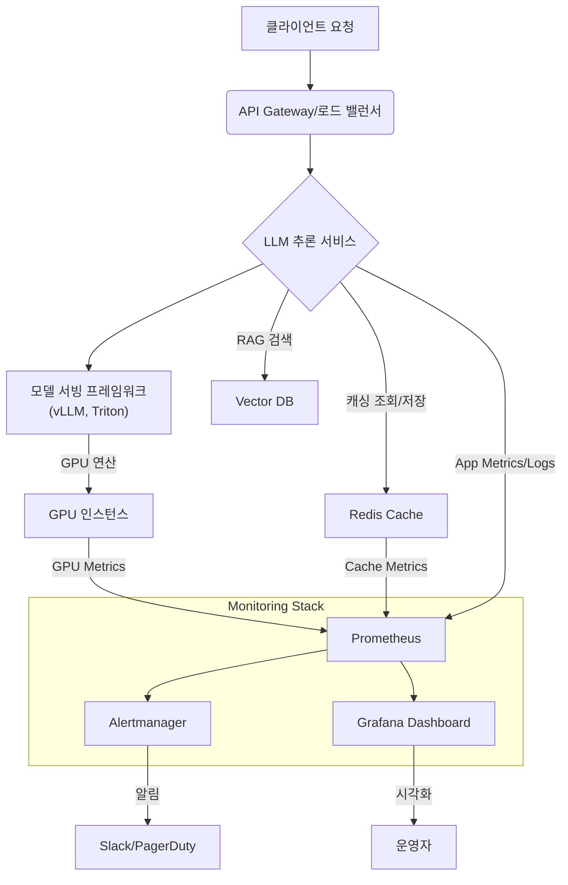

대규모 언어 모델(LLM) 기반 서비스의 실시간 운영은 단순한 모델 배포를 넘어 견고한 아키텍처, 최적화된 추론 파이프라인, 그리고 끊임없는 성능 모니터링을 요구합니다. 본 문서는 프로덕션 환경에서 LLM 서비스의 안정성, 응답성, 비용 효율성을 극대화하기 위한 배포 및 성능 모니터링 시스템 구축 방법을 제시합니다.

## LLM 서비스 배포 아키텍처

실시간 LLM 서비스는 안정적인 트래픽 처리와 효율적인 모델 추론을 위해 여러 계층으로 구성됩니다.

### API Gateway 및 로드 밸런서
사용자 요청의 첫 진입점인 API Gateway는 인증/인가, Rate Limiting, 트래픽 라우팅을 담당합니다. 로드 밸런서를 통해 요청은 여러 추론 인스턴스에 분산되어 고가용성과 확장성을 확보합니다.

### LLM 추론 서비스
핵심 LLM 추론 로직이 실행되는 컨테이너화된(Docker) 서비스입니다. 높은 연산 요구 사항 때문에 GPU 인스턴스 위에서 실행되며, Kubernetes와 같은 컨테이너 오케스트레이션 도구를 통해 배포 및 관리를 자동화합니다. `vLLM`, `Triton Inference Server`, `TorchServe`와 같은 전용 모델 서빙 프레임워크를 활용하여 GPU 활용률을 극대화하고 추론 지연 시간을 최소화합니다.

### 데이터 계층 (Vector DB, Cache)
RAG(Retrieval-Augmented Generation) 패턴 서비스는 벡터 데이터베이스(Vector Database)를 통해 관련 문서를 검색합니다. `Redis`와 같은 인메모리(in-memory) 캐시는 반복되는 프롬프트나 이전에 생성된 응답을 저장하여 추론 비용과 지연 시간을 줄입니다.

## LLM 성능 최적화 전략

실시간 LLM 서비스에서 성능은 사용자 경험과 직결됩니다. 다양한 최적화 기법을 적용하여 모델의 효율성을 높여야 합니다.

### 모델 양자화 (Quantization)
LLM 파라미터(parameter)를 덜 정밀한 데이터 타입(예: FP32에서 INT8)으로 변환하여 모델 크기와 메모리 사용량을 줄입니다. 이는 GPU 메모리 제약 환경이나 엣지 디바이스(edge device)에 유용하며, 추론 속도 향상에 기여합니다.

### 동적 배치 처리 (Dynamic Batching)
여러 사용자 요청을 한 번에 묶어(batch) GPU에 전달하여 GPU 활용률과 스루풋(throughput)을 향상시킵니다. `vLLM`은 연속적인 배치(continuous batching) 기법으로 GPU 유휴 시간을 최소화하고 지연 시간을 줄입니다.

### 응답 캐싱 (Response Caching)
동일한 프롬프트에 대한 응답을 캐시하여 불필요한 추론을 방지하고 응답 지연 시간을 획기적으로 줄입니다. 캐시 유효성(cache invalidation) 전략이 중요합니다.

### 추론 엔진 최적화
`Triton Inference Server`는 동적 배치, 모델 앙상블(ensemble), 멀티 GPU 스케줄링 등 고급 최적화 기능을 제공하여 여러 모델을 효율적으로 서빙하고 복잡한 추론 워크플로우를 관리합니다.

## 실시간 성능 모니터링 시스템

LLM 서비스의 안정적인 운영을 위해서는 체계적인 모니터링 시스템이 필수적입니다. 이는 잠재적인 문제를 조기에 감지하고 신속하게 대응할 수 있도록 돕습니다.

### 핵심 모니터링 지표 (Metrics)
*   **응답 지연 시간 (Latency)**: 요청부터 응답까지 걸리는 시간 (평균, P90, P99).
*   **스루풋 (Throughput)**: 초당 처리되는 요청 수 (QPS), 초당 생성되는 토큰 수 (Tokens/sec).
*   **오류율 (Error Rate)**: 실패한 요청의 비율 (예: 5xx 에러).
*   **GPU 활용률 (GPU Utilization)**: GPU 사용량, 메모리 사용량.
*   **캐시 히트율 (Cache Hit Ratio)**: 캐시에서 응답된 요청의 비율.
*   **비용 지표 (Cost Metrics)**: 토큰 당 비용, GPU 시간 당 비용.

### 로깅 및 추적 (Logging & Tracing)
모든 요청 및 응답, 모델 입력/출력, 시스템 오류를 구조화된 로그(structured logs, 예: JSON) 형태로 기록합니다. `ELK Stack` (Elasticsearch, Logstash, Kibana) 또는 `Loki`, `Promtail`, `Grafana` 조합으로 로그를 중앙 집중화하고 분석합니다. `OpenTelemetry`와 같은 분산 추적(distributed tracing) 시스템을 도입하여 요청의 흐름을 파악하고 병목 현상(bottleneck)을 식별합니다.

### 알림 (Alerting) 및 대시보드 (Dashboarding)
`Prometheus`를 통해 지표를 수집하고, `Alertmanager`로 특정 임계값(threshold) 초과 시 Slack, PagerDuty 등으로 알림을 전송합니다. `Grafana` 대시보드를 구축하여 핵심 지표들을 실시간으로 시각화하고, 서비스 상태를 한눈에 파악할 수 있도록 합니다.



### 코드 예시: Prometheus 메트릭 노출 (Python)
아래 코드는 간단한 FastAPI LLM 서비스에서 Prometheus 클라이언트를 사용하여 응답 지연 시간 및 요청 수를 측정하고 노출하는 예시입니다.

```python
from fastapi import FastAPI, Request
from prometheus_client import Histogram, Counter, generate_latest
from starlette.responses import PlainTextResponse
import time
import os

app = FastAPI()

# Prometheus Metrics 정의
REQUEST_COUNT = Counter(
    "llm_request_total", "Total count of LLM requests", ["model_name", "status"]
)
REQUEST_LATENCY = Histogram(
    "llm_request_latency_seconds", "Latency of LLM requests", ["model_name"]
)

MODEL_NAME = os.getenv("LLM_MODEL_NAME", "default-llm")

@app.get("/health")
async def health():
    return {"status": "ok"}

@app.post("/generate")
async def generate_text(request: Request):
    start_time = time.time()
    status = "success" # Default status
    try:
        payload = await request.json()
        prompt = payload.get("prompt")

        # 실제 LLM 추론 로직 (Placeholder)
        # 예: LLM API 호출 또는 로컬 모델 추론
        response_text = f"Generated response for: {prompt[:50]}..."
        return {"response": response_text}
    except Exception as e:
        status = "error"
        raise e
    finally:
        latency = time.time() - start_time
        REQUEST_LATENCY.labels(model_name=MODEL_NAME).observe(latency)
        REQUEST_COUNT.labels(model_name=MODEL_NAME, status=status).inc()

@app.get("/metrics")
async def metrics():
    return PlainTextResponse(generate_latest().decode("utf-8"))
```

## 트레이드오프

### 1. 복잡성 vs. 성능
*   **언제 좋은가**: 매우 높은 트래픽과 낮은 지연 시간이 요구되는 핵심 서비스에 적합합니다. 최적화된 아키텍처는 고비용의 GPU 자원을 효율적으로 사용합니다.
*   **언제 나쁜가**: 개발/테스트 환경이나 트래픽이 적은 소규모 서비스에서는 과도한 복잡성을 초래하여 배포 및 유지보수 비용이 더 커질 수 있습니다.

### 2. 비용 vs. 응답 지연 시간
*   **언제 좋은가**: 프리미엄 서비스나 실시간성이 중요한 애플리케이션(예: 자율주행, 실시간 상담)에서 낮은 응답 지연 시간이 핵심 경쟁력일 때 유용합니다.
*   **언제 나쁜가**: 비용에 민감하거나 배치(batch) 처리, 비동기(asynchronous) 응답이 허용되는 서비스에서는 과도한 GPU 리소스 할당이 불필요한 비용 낭비로 이어집니다.

### 3. 심층 모니터링 vs. 운영 오버헤드
*   **언제 좋은가**: 비즈니스에 치명적인 영향을 줄 수 있는 핵심 서비스의 경우, 심층적인 모니터링은 장애를 조기에 발견하고 예측하는 데 필수적입니다.
*   **언제 나쁜가**: 모든 지표를 수집하고 분석하는 것은 상당한 스토리지와 컴퓨팅 자원을 요구하며, 대시보드 및 알림 규칙 관리에도 많은 노력이 필요합니다.

### 4. 커스터마이징 vs. 관리형 서비스
*   **언제 좋은가**: 특정 LLM 모델에 대한 독점적인 최적화 기술이 있거나, 엄격한 보안 및 규제 요구사항을 충족해야 하는 경우 자체 구축이 유연성을 제공합니다.
*   **언제 나쁜가**: 빠른 시장 출시(time-to-market)가 중요하거나 인프라 운영 전문 인력이 부족한 경우, 클라우드 제공업체의 관리형 LLM 서비스 활용이 효율적입니다.

## 실전 체크리스트

프로덕션 환경에 실시간 LLM 서비스를 배포하고 모니터링하기 위한 검증 항목입니다.

- [ ] **배포 자동화**: LLM 서비스 배포 파이프라인(CI/CD)이 완벽하게 자동화되어 있으며, 롤백(rollback) 기능이 포함되어 있는가?
- [ ] **GPU 자원 활용률**: 모델 추론 서비스가 GPU 리소스를 < 80% 범위 내에서 효율적으로 활용하며, 병목 현상이 발생하지 않는가?
- [ ] **응답 지연 시간 목표**: 핵심 API의 종단 간(end-to-end) 응답 지연 시간이 평균 `{200ms}` 미만으로 유지되는 것을 Prometheus/Grafana 대시보드에서 실시간으로 확인 가능한가?
- [ ] **로그 구조화 및 중앙화**: 모든 서비스 로그가 `JSON` 형식으로 구조화되어 있으며, `ELK Stack` 또는 `Loki`로 중앙 집중화되어 검색 및 분석이 용이한가?
- [ ] **알림 시스템 동작**: 핵심 지표(latency, error rate, QPS)에 대한 알림(alert) 임계값이 적절히 설정되어 있으며, 테스트 시 Slack/PagerDuty로 정상적으로 알림이 전송되는가?
- [ ] **캐싱 효율성**: `Redis`와 같은 캐시 시스템의 캐시 히트율(cache hit ratio)이 < 70% 이상으로 유지되며, 캐시 무효화(cache invalidation) 전략이 비즈니스 로직과 일치하는가?
- [ ] **비용 모니터링**: 클라우드 비용 청구서와 LLM 서비스의 토큰 사용량, GPU 사용량을 연동하여 실제 비용 지표를 실시간으로 모니터링하고 예산을 추적하고 있는가?