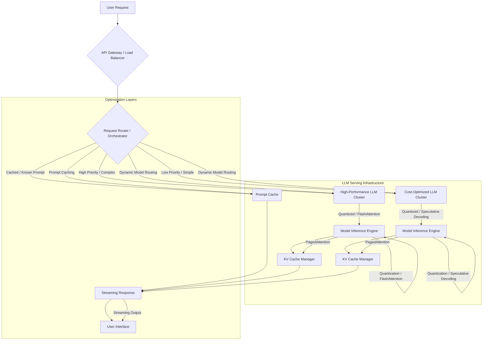

LLM 기반 서비스의 사용자 경험은 응답 시간(Latency)과 처리량(Throughput)에 의해 직접적으로 결정됩니다. 2026년까지 LLM 애플리케이션이 더욱 보편화되면서, 수많은 사용자의 동시 요청을 빠르고 효율적으로 처리하는 실시간 성능 최적화 기술은 핵심적인 경쟁 우위로 작용할 것입니다. 본 문서에서는 LLM 서비스의 실시간 성능을 극대화하기 위한 주요 전략과 실제 적용 방안을 제시합니다.

## 핵심 성능 지표 이해
LLM 서비스의 성능은 주로 두 가지 지표로 측정됩니다:
*   **Latency (응답 지연 시간)**: 사용자 요청부터 첫 토큰이 생성되기까지의 시간(Time To First Token, TTFT)과 전체 응답이 완료되기까지의 시간(Time To Last Token, TTLT)을 포함합니다. 이는 사용자 경험에 직접적인 영향을 미칩니다.
*   **Throughput (처리량)**: 단위 시간당 처리할 수 있는 요청 수 또는 생성할 수 있는 토큰 수입니다. 이는 서비스의 확장성과 비용 효율성과 직결됩니다.

성능 최적화는 이 두 지표 사이의 균형을 찾는 과정입니다.

### 모델 효율성 최적화 (Model Efficiency)
모델 자체의 크기와 복잡도를 줄여 추론 속도를 높이는 방법입니다.
*   **Quantization (양자화)**: 모델의 가중치를 16-bit float (FP16)에서 8-bit integer (INT8)나 4-bit integer (INT4) 등으로 정밀도를 낮춰 메모리 사용량과 연산 속도를 개선합니다. `bitsandbytes` 라이브러리 등이 널리 사용됩니다.
    ```python
    from transformers import AutoModelForCausalLM, AutoTokenizer
    import torch

    model_id = "mistralai/Mistral-7B-Instruct-v0.2"
    tokenizer = AutoTokenizer.from_pretrained(model_id)

    # 4-bit quantization 적용
    model_4bit = AutoModelForCausalLM.from_pretrained(
        model_id,
        load_in_4bit=True,
        torch_dtype=torch.bfloat16,
        device_map="auto"
    )
    print(f"Model loaded with 4-bit quantization: {model_4bit.quantization_config}")
    ```
*   **Pruning (가지치기)**: 모델에서 중요도가 낮은 연결이나 뉴런을 제거하여 모델 크기를 줄이고 불필요한 연산을 제거합니다.
*   **Distillation (지식 증류)**: 대규모 `Teacher` 모델의 지식을 작고 빠른 `Student` 모델로 전이시켜 성능 저하를 최소화하면서 추론 속도를 향상시킵니다.
*   **Sparse Attention (희소 어텐션)**: 모든 토큰 간의 어텐션 스코어를 계산하는 대신, 관련성 높은 특정 토큰 쌍에만 어텐션을 집중하여 연산량을 줄입니다.

### 추론 런타임 최적화 (Inference Runtime Optimization)
LLM 추론 과정 자체를 가속화하는 기술들입니다.
*   **KV Cache (Key-Value Cache)**: 디코딩 단계에서 이전에 계산된 Key 및 Value 상태를 캐싱하여, 각 토큰 생성 시 전체 시퀀스를 다시 계산하는 오버헤드를 줄입니다. 이는 특히 긴 시퀀스에서 TTFT와 TTLT를 크게 개선합니다.
*   **PagedAttention**: `vLLM`과 같은 고성능 추론 엔진에서 사용되는 기법으로, KV Cache를 효율적으로 관리하여 가변 길이 시퀀스 배치 처리 시 GPU 메모리 파편화를 줄이고 처리량을 극대화합니다.
*   **Speculative Decoding (예측 디코딩)**: 작은 `Draft` 모델이 다음 토큰 시퀀스를 예측하고, 큰 `Target` 모델이 이 예측을 빠르게 검증하는 방식입니다. 검증이 성공하면 여러 토큰을 한 번에 생성한 효과를 얻어 TTLT를 크게 단축합니다.
*   **FlashAttention**: 대규모 어텐션 연산 시 GPU 메모리 대역폭(Memory Bandwidth) 제한을 극복하기 위해 `Tiling` 기법을 사용하여 HBM(High Bandwidth Memory) 접근 횟수를 줄여 속도를 향상시킵니다.

### 인프라 및 배포 전략 (Infrastructure & Deployment)
모델을 효율적으로 서빙하기 위한 인프라 수준의 접근 방식입니다.
*   **Dynamic Batching (동적 배치 처리)**: 여러 사용자 요청을 하나의 배치로 묶어 GPU 사용률을 극대화합니다. 요청이 도착하는 즉시 배치를 생성하는 방식을 통해 유휴 시간을 줄입니다. `vLLM`, `Triton Inference Server` 등에서 지원됩니다.
*   **GPU Utilization Optimization**: GPU의 컴퓨팅 자원을 최대한 활용하도록 워크로드를 최적화합니다. 이는 `NVIDIA TensorRT`, `ONNX Runtime`과 같은 추론 최적화 라이브러리를 활용하여 모델 그래프를 최적화하고 특정 하드웨어에 맞춰 컴파일하는 것을 포함합니다.
*   **Distributed Inference (분산 추론)**: 매우 큰 모델의 경우, 모델 병렬화(Model Parallelism)나 파이프라인 병렬화(Pipeline Parallelism)를 통해 여러 GPU 또는 서버에 모델을 분산하여 추론합니다. `DeepSpeed`, `Megatron-LM` 등이 대표적입니다.
*   **Edge Deployment**: 모바일 기기나 엣지 디바이스에 경량화된 LLM을 배포하여 클라우드 왕복 지연을 없애고 즉각적인 응답을 제공합니다. 이는 `Google Gemini Nano`, `Apple MLX`와 같은 온디바이스 모델과 프레임워크의 발전으로 가능해지고 있습니다.

### 네트워크 및 데이터 흐름 최적화 (Network & Data Flow)
데이터 전송과 처리 방식을 개선하여 성능을 높입니다.
*   **Prompt Caching (프롬프트 캐싱)**: 자주 사용되는 프롬프트나 프롬프트의 일부를 캐싱하여 중복된 계산을 방지합니다. 특히 RAG(Retrieval Augmented Generation) 시나리오에서 검색된 문서 부분의 임베딩이나 LLM 프롬프트가 반복될 때 유용합니다.
*   **Streaming Output (스트리밍 출력)**: LLM이 토큰을 생성하는 즉시 사용자에게 전송하여 TTFT를 줄이고 사용자 인지 지연 시간을 개선합니다. 웹소켓이나 서버-센트(Server-Sent) 이벤트를 통해 구현됩니다.
    ```python
    import asyncio
    from fastapi import FastAPI
    from fastapi.responses import StreamingResponse
    from transformers import AutoModelForCausalLM, AutoTokenizer
    import torch

    app = FastAPI()
    model_id = "mistralai/Mistral-7B-Instruct-v0.2"
    tokenizer = AutoTokenizer.from_pretrained(model_id)
    model = AutoModelForCausalLM.from_pretrained(model_id, torch_dtype=torch.bfloat16).to("cuda")

    async def generate_tokens(prompt: str):
        input_ids = tokenizer.encode(prompt, return_tensors="pt").to("cuda")
        # In a real scenario, stream=True might not be directly supported by all model.generate methods
        # You would typically implement custom token-by-token generation logic for actual streaming.
        # This example simulates streaming for illustrative purposes.
        outputs = model.generate(input_ids, max_new_tokens=50, do_sample=True, top_k=50, top_p=0.95, temperature=0.7)
        for output_token_id in outputs[0, input_ids.shape[-1]:]:
            decoded_token = tokenizer.decode(output_token_id.item(), skip_special_tokens=True)
            if decoded_token:
                yield f"data: {decoded_token}\n\n"
            await asyncio.sleep(0.01) # Simulate async token generation

    @app.get("/stream_llm")
    async def stream_llm_response(prompt: str = "Explain the concept of AI agents in one paragraph."):
        return StreamingResponse(generate_tokens(prompt), media_type="text/event-stream")

    # To run this example:
    # pip install fastapi uvicorn transformers torch
    # uvicorn your_file_name:app --reload
    # Then access in browser or with curl: curl -N http://127.0.0.1:8000/stream_llm
    ```
*   **RAG System Optimization**: 검색 증강 생성(RAG) 시스템에서 리트리버(Retriever)의 응답 속도와 정확도를 최적화합니다. 효율적인 임베딩, 벡터 데이터베이스 쿼리 최적화, 계층적 캐싱 전략 등이 포함됩니다.

### 동적 모델 라우팅 및 티어링 (Dynamic Model Routing & Tiering)
들어오는 요청의 특성(길이, 복잡도, 중요도 등)에 따라 적절한 LLM 모델이나 인스턴스로 라우팅하여 전체 시스템의 효율성을 높입니다.
*   **Multi-model API Gateway**: 다양한 크기와 성능 특성을 가진 LLM을 백엔드에 두고, 요청 파라미터나 메타데이터에 따라 최적의 모델로 요청을 분배합니다.
*   **Cost-Performance Optimization**: 저렴하고 빠른 경량 모델을 기본으로 사용하고, 복잡하거나 중요한 요청에만 고성능/고비용 모델을 사용하도록 라우팅합니다.

## 아키텍처 다이어그램: LLM 실시간 서비스 최적화


## 트레이드오프

*   **모델 양자화 (Quantization)**
    *   **언제 좋은가**: GPU 메모리 제약이 크거나, 추론 지연 시간을 최소화해야 할 때 (예: 엣지 디바이스, 실시간 대화 시스템). 모델 크기 감소 및 처리량 증가에 탁월합니다.
    *   **언제 나쁜가**: 모델의 정밀도가 매우 중요하여 미세한 품질 저하도 용납할 수 없을 때. 특히 미세 조정된 모델이나 특정 도메인 작업에서 성능 저하가 발생할 수 있습니다.

*   **동적 배치 처리 (Dynamic Batching)**
    *   **언제 좋은가**: 예측 불가능한 사용자 트래픽 패턴에서 GPU 활용률을 극대화하여 전체 처리량을 높일 때. 서비스 비용 효율성을 크게 개선합니다.
    *   **언제 나쁜가**: 매우 낮은 지연 시간(TTFT)이 최우선이고, 단일 요청의 응답 속도가 민감한 애플리케이션 (예: 고빈도 금융 거래 분석). 배치에 다른 요청이 쌓이는 동안 초기 요청의 지연 시간이 늘어날 수 있습니다.

*   **스트리밍 출력 (Streaming Output)**
    *   **언제 좋은가**: 사용자에게 즉각적인 반응성을 제공하여 인지 지연 시간을 줄이고 사용자 경험을 향상시킬 때. 대화형 챗봇, 실시간 콘텐츠 생성에 필수적입니다.
    *   **언제 나쁜가**: 응답의 최종 형태나 구조가 중요하며, 중간에 끊기거나 변경될 수 있는 스트리밍 방식이 적합하지 않을 때 (예: 특정 JSON 형식의 복잡한 구조화된 데이터 생성).

*   **예측 디코딩 (Speculative Decoding)**
    *   **언제 좋은가**: TTLT를 크게 단축하여 전체 응답 시간을 줄여야 할 때. 특히 긴 응답 생성에 유리하며, 성능 향상 대비 구현 복잡성이 높지 않습니다.
    *   **언제 나쁜가**: `Draft` 모델의 예측 정확도가 매우 낮거나, `Target` 모델과의 구조적 불일치가 클 경우 오히려 오버헤드가 발생하여 성능이 저하될 수 있습니다.

*   **동적 모델 라우팅 (Dynamic Model Routing)**
    *   **언제 좋은가**: 다양한 유형의 요청에 대해 비용 효율성과 성능 최적화를 동시에 달성하려 할 때. 리소스 사용의 유연성을 높입니다.
    *   **언제 나쁜가**: 라우팅 로직의 복잡성으로 인해 디버깅이 어렵거나, 라우팅 결정 자체가 추가적인 지연 시간을 유발할 수 있습니다. 요청 분류의 오작동 시 예상치 못한 성능 저하 또는 비용 증가를 초래할 수 있습니다.

## 실전 체크리스트

LLM 서비스의 실시간 성능 최적화를 위해 다음 항목들을 검토하십시오.

*   [ ] **GPU Utilization Monitoring**: GPU 사용률(CUDA Cores, Memory)이 80% 이상으로 유지되는지 지속적으로 모니터링하고, `idle` 상태가 길다면 배치 처리 또는 동시성 설정을 조정하십시오.
*   [ ] **TTFT & TTLT Benchmarking**: 다양한 프롬프트 길이와 응답 길이에 대해 TTFT와 TTLT를 주기적으로 측정하고, 목표 지연 시간을 초과하는 경우 원인을 분석하십시오.
*   [ ] **Quantization Impact Assessment**: INT8 또는 INT4 양자화를 적용한 후, 모델의 응답 품질(정확도, 일관성) 저하 여부를 정량적으로 평가하고 허용 가능한 범위 내에 있는지 확인하십시오.
*   [ ] **KV Cache Hit Rate**: `KV Cache`가 효율적으로 사용되고 있는지 `Cache Hit Rate`를 모니터링하여, 특히 긴 컨텍스트를 처리할 때 캐시 활용도를 최적화하십시오.
*   [ ] **Speculative Decoding Validation**: 예측 디코딩 적용 후 `Draft` 모델의 예측 정확도와 `Target` 모델의 검증 속도를 측정하여 실제 성능 향상이 이루어졌는지 검증하십시오.
*   [ ] **Streaming Output Implementation**: 모든 사용자 대면 LLM 응답에 스트리밍 방식을 적용하고, 웹소켓 또는 SSE(Server-Sent Events)를 통해 안정적으로 토큰이 전송되는지 확인하십시오.
*   [ ] **Dynamic Routing Policy Review**: 트래픽 패턴 및 요청 특성(길이, 복잡도, 비용)에 따라 동적 모델 라우팅 정책이 최적화되어 있는지 분기별로 검토하고, A/B 테스트를 통해 효과를 검증하십시오.
*   [ ] **RAG Component Latency Breakdown**: RAG 시스템을 사용하는 경우, 검색기(Retriever)와 생성기(Generator) 각 단계의 지연 시간을 측정하여 병목 지점을 정확히 파악하고 최적화 계획을 수립하십시오.