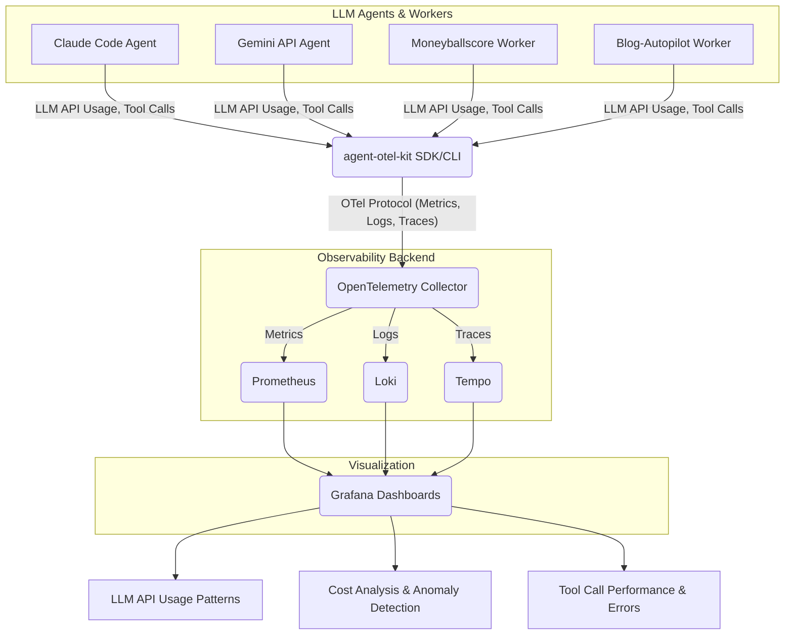

LLM 기반 에이전트 워크플로우는 그 복잡성만큼이나 효율적인 운영 관리가 중요합니다. 특히 Claude Code, Gemini API와 같은 LLM 서비스의 사용량, 이로 인한 비용, 그리고 워커 에이전트(moneyballscore, blog-autopilot 등)가 수행하는 수많은 도구 호출은 단순히 에이전트별 `(/usage)` 화면만으로는 통합적인 인사이트를 얻기 어렵습니다. 여러 에이전트가 동시에 구동되는 환경에서는 이 모든 활동을 하나의 대시보드에서 시각화하고 분석하여 최적화 포인트를 찾는 것이 필수적입니다. 이때 `agent-otel-kit`은 OpenTelemetry 기반의 통합 모니터링 솔루션을 제공하여 이러한 과제를 해결합니다.

`agent-otel-kit`은 LLM API 사용량, 토큰 소비량, API 호출 지연 시간, 그리고 에이전트 내부에서 발생하는 도구 호출(Tool Calls) 등의 데이터를 표준화된 OpenTelemetry 형식으로 수집하여 중앙화된 옵저버빌리티 스택으로 전송합니다. 이를 통해 개발자와 운영팀은 LLM 사용 패턴, 비용 추이, 잠재적인 성능 병목 지점을 명확하게 파악할 수 있습니다.

## `agent-otel-kit` 아키텍처 및 데이터 흐름

`agent-otel-kit`은 경량 Go CLI 도구와 OpenTelemetry Collector 설정을 포함하여 구성됩니다. 로컬 환경에서 `docker compose up` 명령 한 번으로 OpenTelemetry Collector, Prometheus (메트릭), Loki (로그), Tempo (트레이스)와 Grafana 및 Perses 대시보드가 자동으로 배포됩니다. 각 LLM 에이전트(Claude Code, Gemini CLI 등)는 `agent-otel-kit setup <agent_name>` 명령을 통해 OpenTelemetry Collector로 데이터를 전송하도록 설정됩니다.

이러한 구조를 통해 LLM API 요청은 물론, 각 에이전트가 어떤 도구를 언제 호출했는지, 그 결과는 어떠했는지 등의 상세한 트레이스 정보까지 수집할 수 있습니다. 이는 에이전트의 행동을 디버깅하고 최적화하는 데 결정적인 역할을 합니다. 특히 2026년 현재, LLM 기반 시스템의 복잡도가 증가하면서 '블랙박스'와 같았던 에이전트의 내부 동작을 가시화하는 것이 중요한 트렌드로 자리잡고 있습니다.



## 통합 시나리오 예제

Playbook 환경에서 `agent-otel-kit`을 통합하는 과정은 다음과 같습니다. 먼저, 로컬 환경에 OpenTelemetry 스택을 배포합니다.

```bash
git clone https://github.com/your-org/agent-otel-kit.git
cd agent-otel-kit
docker compose up -d
```

이후 각 에이전트에 대해 `agent-otel-kit` CLI를 사용하여 모니터링을 활성화합니다. 이 CLI는 해당 에이전트의 설정 파일을 백업하고 OpenTelemetry Collector를 가리키도록 변경합니다.

```bash
# Claude Code 에이전트 설정
agent-otel-kit setup claude

# Gemini API 에이전트 설정
agent-otel-kit setup gemini

# 모든 지원 에이전트 설정
agent-otel-kit setup all

# 설정 변경 사항 확인 및 데이터 흐름 진단
agent-otel-kit doctor
```

설정이 완료되면 Grafana 대시보드(일반적으로 `http://localhost:3000`)에 접속하여 LLM 사용량, 비용, 각 워커의 도구 호출 메트릭을 실시간으로 확인할 수 있습니다. 예를 들어, `moneyballscore` 워커가 특정 데이터베이스 조회 도구를 호출하는 빈도, 성공률, 응답 시간 등을 추적하여 최적화 기회를 발굴할 수 있습니다.

## 트레이드오프

*   **복잡성 증가 vs. 심층 가시성**: `agent-otel-kit` 통합은 초기 설정 및 OpenTelemetry 스택 관리에 대한 추가적인 학습과 노력을 요구합니다. 이는 특히 소규모 프로젝트나 단일 에이전트 환경에서는 오버헤드가 될 수 있습니다. 반면, 다수의 에이전트와 복잡한 워크플로우를 가진 시스템에서는 분산된 LLM 활동에 대한 심층적인 가시성과 통합된 분석 환경을 제공하여 문제 해결 및 최적화 시간을 크게 단축합니다. 언제 좋고: 여러 LLM 에이전트가 상호작용하며 복잡한 태스크를 수행하는 프로덕션 환경. 언제 나쁜지: 단일 LLM API 호출만 발생하는 간단한 스크립트.
*   **자원 오버헤드 vs. 비용 최적화**: OpenTelemetry Collector, Prometheus, Loki, Tempo와 같은 모니터링 스택은 일정 수준의 CPU, 메모리, 스토리지 자원을 소비합니다. 이는 자체적으로 비용을 발생시키지만, LLM API의 불필요한 사용이나 비효율적인 도구 호출 패턴을 조기에 감지하여 장기적으로 더 큰 LLM API 비용 절감 효과를 가져올 수 있습니다. 언제 좋고: LLM API 비용이 상당한 부분을 차지하거나, 비용 변동성이 큰 경우. 언제 나쁜지: LLM API 사용량이 매우 적어 모니터링 인프라 비용이 API 비용보다 높아질 때.
*   **표준화된 데이터 모델 vs. 고유 메트릭 커스터마이징**: OpenTelemetry는 강력한 표준을 제공하여 다양한 에이전트 및 서비스에서 일관된 방식으로 데이터를 수집합니다. 그러나 비즈니스 로직에 특화된 고유한 메트릭(예: 특정 에이전트의 비즈니스 성공 지표)을 완벽하게 반영하기 위해서는 추가적인 계측(instrumentation) 개발이 필요할 수 있습니다. 언제 좋고: 다양한 LLM 서비스와 커스텀 에이전트를 혼용하는 환경에서 일관된 모니터링이 필요할 때. 언제 나쁜지: 매우 특수한 비즈니스 KPI만을 추적하며, 이미 자체적인 모니터링 시스템이 잘 구축되어 있을 때.
*   **중앙 집중식 대시보드 vs. 에이전트별 상세 뷰**: Grafana는 통합 대시보드를 통해 모든 에이전트의 데이터를 한눈에 볼 수 있도록 합니다. 이는 전반적인 시스템 상태를 파악하는 데 유용하지만, 특정 에이전트의 깊은 내부 동작이나 개별 워크플로우를 분석할 때는 여전히 해당 에이전트의 로그나 자체 디버깅 도구가 필요할 수 있습니다. `agent-otel-kit`은 `/usage` 화면을 대체하기보다는 보완하는 도구입니다. 언제 좋고: 여러 에이전트 간의 상호작용 및 전체 시스템의 자원 사용량을 비교 분석할 때. 언제 나쁜지: 개별 에이전트의 마이크로한 스텝별 디버깅이 주된 목적인 경우.

## 실전 체크리스트

이 지식을 프로젝트에 적용할 때 다음 항목들을 검증해야 합니다.

*   [ ] `agent-otel-kit` CLI 및 OpenTelemetry Collector가 모든 LLM 에이전트(Claude Code, Gemini API) 및 워커(moneyballscore, blog-autopilot)의 LLM API 호출 및 도구 호출을 성공적으로 계측하고 있는지 확인한다.
*   [ ] OpenTelemetry Collector, Prometheus, Loki, Tempo 및 Grafana 대시보드를 포함한 모든 모니터링 스택 구성 요소가 정상적으로 실행 중이며 서로 통신하는지 `docker logs` 및 `agent-otel-kit doctor` 명령으로 검증한다.
*   [ ] Grafana 대시보드에서 각 LLM 에이전트의 토큰 사용량, API 호출 횟수, 비용 추이, 그리고 도구 호출별 성공률 및 지연 시간 메트릭이 정확하게 시각화되고 있는지 확인한다.
*   [ ] 특정 LLM API 호출량 급증, 비용 임계값 초과, 또는 도구 호출 에러율 증가 등 비정상적인 패턴 발생 시 Slack 또는 이메일로 알림이 발송되도록 알림 규칙(Alerting Rules)을 설정한다.
*   [ ] 과거 데이터 분석을 통해 LLM API 사용량이 가장 많은 시간대, 가장 많은 비용을 유발하는 에이전트/도구, 그리고 성능 저하가 발생하는 도구 호출 지점을 식별하고 최적화 방안을 도출한다.
*   [ ] `agent-otel-kit`이 생성하는 트레이스 데이터를 활용하여 복잡한 에이전트 워크플로우 내에서 LLM 호출 및 도구 호출의 전체적인 실행 경로와 상호 의존성을 분석한다.
*   [ ] 주기적으로 Grafana 대시보드를 검토하여 새로운 에이전트/워커 추가 시 누락된 모니터링 포인트가 없는지 확인하고, 최신 LLM 트렌드에 맞춰 대시보드를 업데이트한다.