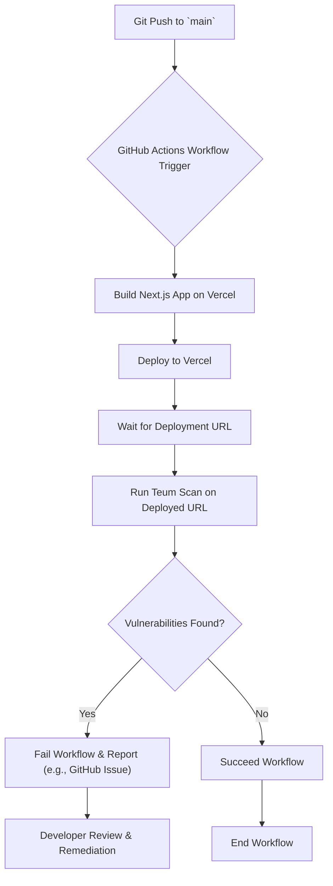

현대의 웹 애플리케이션은 복잡한 빌드 및 배포 과정을 거치며, 개발자의 의도와 다르게 민감한 정보가 외부에 노출될 위험이 상존합니다. 특히 빌드 번들 내의 API 키, 환경 변수(`.env`) 파일 노출, 혹은 데이터베이스의 접근 제어 설정 미흡(예: Supabase RLS)은 심각한 보안 취약점으로 이어질 수 있습니다. 이러한 취약점들은 내부 정적 분석이나 런타임 테스트만으로는 발견하기 어렵습니다. 외부에서 실제 배포된 사이트를 '보는' 관점의 점검이 필수적입니다.

## 외부 노출 취약점과 자동화의 필요성

많은 서비스에서 개발 편의성을 위해 사용되는 `service_role` JWT, `sk-`로 시작하는 API 키, `AKIA`, `sk_live_` 등 다양한 민감 정보가 JavaScript 번들이나 `.env` 파일에 포함된 채 배포되는 경우가 발생합니다. 또한, Supabase와 같은 BaaS(Backend as a Service)의 경우 Row Level Security(RLS) 설정 오류로 인해 테이블 데이터가 익명으로 읽힐 수 있습니다. 이러한 문제들은 수동으로 찾아내기 어렵고, 주기적인 검토 없이는 쉽게 간과될 수 있습니다.

이러한 외부 노출 취약점을 효과적으로 식별하기 위해 '틈'과 같은 외부 스캔 도구를 CI/CD 파이프라인에 통합하는 것은 DevSecOps 전략의 핵심입니다. '틈'은 배포된 사이트의 공개된 정보를 크롤링하여 노출된 키 패턴, 열린 `.env` 경로, 익명으로 읽히는 Supabase 테이블 등을 찾아주는 웹 도구입니다. 이를 GitHub Actions와 연동하여 배포 후 자동 점검을 수행함으로써, 잠재적 보안 사고를 미연에 방지할 수 있습니다.

## '틈' 도구를 활용한 GitHub Actions 워크플로우 구성

Next.js 애플리케이션을 Vercel에 배포하고 '틈'을 통해 보안 취약점을 점검하는 GitHub Actions 워크플로우 예시입니다. 이 워크플로우는 `main` 브랜치에 코드가 푸시될 때마다 실행되며, Vercel 배포 후 '틈'으로 스캔을 진행합니다.

```yaml
name: Deploy to Vercel & Scan with Teum

on: 
  push:
    branches:
      - main

env:
  VERCEL_ORG_ID: ${{ secrets.VERCEL_ORG_ID }}
  VERCEL_PROJECT_ID: ${{ secrets.VERCEL_PROJECT_ID }}
  TEUM_API_KEY: ${{ secrets.TEUM_API_KEY }}

jobs:
  deploy-and-scan:
    runs-on: ubuntu-latest
    steps:
      - name: Checkout code
        uses: actions/checkout@v4

      - name: Install Vercel CLI
        run: npm install --global vercel@latest

      - name: Pull Vercel Environment Information
        run: vercel pull --yes --environment=production --token=${{ secrets.VERCEL_TOKEN }}

      - name: Build Project Artifacts
        run: vercel build --prod --token=${{ secrets.VERCEL_TOKEN }}

      - name: Deploy to Vercel
        id: vercel_deploy
        run: |
          DEPLOY_URL=$(vercel deploy --prod --token=${{ secrets.VERCEL_TOKEN }})
          echo "Deployed to: ${DEPLOY_URL}"
          echo "DEPLOY_URL=${DEPLOY_URL}" >> "${GITHUB_ENV}"

      - name: Wait for Vercel Deployment to be Ready
        uses: jakejarvis/wait-for-vercel-deployment@v2
        with:
          token: ${{ secrets.VERCEL_TOKEN }}
          url: ${{ env.DEPLOY_URL }}
          timeout: 300 # 5 minutes

      - name: Run Teum Scan on Deployed URL
        id: teum_scan
        run: |
          TEUM_RESPONSE=$(curl -s -X POST -H "Authorization: Bearer ${{ env.TEUM_API_KEY }}" -H "Content-Type: application/json" \
          -d '{"url": "${{ env.DEPLOY_URL }}", "options": {"scanBundles": true, "checkEnvFiles": true, "checkSupabase": true}}' \
          https://api.teum.app/v1/scan)

          echo "Teum Scan Result: ${TEUM_RESPONSE}"
          echo "TEUM_RESULT_JSON=${TEUM_RESPONSE}" >> "${GITHUB_ENV}"

      - name: Parse Teum Scan Result and Report
        run: |
          ISSUES=$(echo "${{ env.TEUM_RESULT_JSON }}" | jq -r '.issues | length')
          if [ "${ISSUES}" -gt 0 ]; then
            echo "### :warning: Teum Scan Found Vulnerabilities :warning:"
            echo "<details><summary>Click to view details</summary>"
            echo "````json"
            echo "${{ env.TEUM_RESULT_JSON }}"
            echo "````"
            echo "</details>"
            # Optionally, create a GitHub Issue or Slack notification
            # For example, using `gh` CLI:
            # gh issue create --title "Teum Scan found ${ISSUES} issues in ${{ env.DEPLOY_URL }}" --body "${TEUM_RESPONSE}"
            exit 1 # Fail the CI/CD pipeline
          else
            echo "### :white_check_mark: Teum Scan Completed Successfully. No critical issues found."
          fi
        env:
          GITHUB_TOKEN: ${{ secrets.GITHUB_TOKEN }}
```

이 워크플로우는 Vercel 배포 후 `DEPLOY_URL` 환경 변수를 사용하여 '틈' API 엔드포인트에 스캔 요청을 보냅니다. '틈'의 응답을 파싱하여 취약점이 발견되면 CI/CD 파이프라인을 실패시키고, 상세한 보고서를 GitHub Actions 로그에 출력합니다. 실제 프로젝트에서는 `gh issue create`와 같은 명령어를 통해 GitHub Issues를 자동으로 생성하거나 Slack, Jira 등으로 알림을 보낼 수 있습니다.

### 워크플로우 시각화



## 트레이드오프

### 1. 외부 스캔 vs. 내부 정적/동적 분석
*   **언제 좋은가**: 실제 사용자 관점에서 외부로 노출될 수 있는 민감 정보를 식별하는 데 매우 효과적입니다. 빌드 번들 분석, 환경 파일 노출, 잘못된 DB 접근 제어 등 런타임 환경에서만 드러나는 취약점 탐지에 강점을 가집니다. 특히 third-party 라이브러리나 배포 환경 설정 오류로 인한 노출을 찾아내는 데 유리합니다.
*   **언제 나쁜가**: 애플리케이션의 내부 로직 취약점(예: SQL Injection, XSS)이나 인증/인가 오류 등 코드 레벨의 심층적인 분석이 필요한 부분은 탐지하기 어렵습니다. 이는 SAST(Static Application Security Testing)나 DAST(Dynamic Application Security Testing)의 영역입니다.

### 2. 점검 범위와 깊이
*   **언제 좋은가**: 광범위한 웹 애플리케이션의 일반적인 민감 정보 노출 패턴에 대해 빠르게 점검하고 피드백을 제공합니다. 특히 초기 개발 단계나 소규모 팀에서 기본적인 보안 기준을 빠르게 확보하는 데 유용합니다.
*   **언제 나쁜가**: 복잡한 비즈니스 로직을 가진 대규모 애플리케이션의 모든 잠재적 취약점을 포괄적으로 검증하기에는 한계가 있습니다. '틈'과 같은 도구는 스캔 패턴에 의존하므로, 새로운 유형의 취약점이나 고도로 obfuscation된 정보는 놓칠 수 있습니다.

### 3. CI/CD 통합 용이성 vs. 오탐 및 성능 오버헤드
*   **언제 좋은가**: GitHub Actions와 같은 CI/CD 플랫폼에 쉽게 통합하여 배포 워크플로우의 한 단계로 자동화할 수 있습니다. 개발자가 수동으로 개입할 필요 없이 지속적인 보안 점검이 가능해 DevSecOps 문화 정착에 기여합니다.
*   **언제 나쁜가**: 스캔에 소요되는 시간으로 인해 배포 파이프라인의 전체 실행 시간이 증가할 수 있습니다. 또한, 일반적인 패턴 매칭 방식은 때때로 오탐(false positive)을 유발할 수 있어 초기 설정 단계에서 결과 검토 및 예외 처리에 추가적인 노력이 필요할 수 있습니다.

## 실전 체크리스트

배포된 사이트 보안 취약점 점검 자동화를 도입할 때 다음 사항들을 점검해야 합니다.

- [ ] **Teum API Key 보안 관리**: `TEUM_API_KEY`와 같은 민감 정보는 GitHub Secrets에 안전하게 저장되었으며, 최소한의 권한으로만 접근 가능한지 확인합니다.
- [ ] **Vercel Deploy Token 권한 최소화**: `VERCEL_TOKEN`이 배포에 필요한 최소한의 권한만을 가지는지 검토하고, 불필요한 추가 권한은 제거합니다.
- [ ] **스캔 트리거 전략 정의**: `main` 브랜치 푸시 외에, Pull Request 생성 시 프리뷰 환경에 대한 스캔을 추가하거나, 야간 스케줄링으로 정기적인 점검을 수행할지 결정합니다.
- [ ] **취약점 보고 및 알림 시스템 구축**: '틈' 스캔 결과 취약점이 발견되었을 때, GitHub Issues 자동 생성, Slack/MS Teams 알림, Jira 연동 등 적절한 알림 채널과 담당자를 명확히 설정합니다.
- [ ] **오탐(False Positive) 관리 프로세스**: 초기 스캔 결과에서 발생할 수 있는 오탐에 대한 검토 및 무시(ignore) 규칙 설정 프로세스를 마련하여 불필요한 알림을 줄이고 피로도를 관리합니다.
- [ ] **스캔 범위 및 옵션 최적화**: 애플리케이션의 특성에 맞춰 번들 분석(`scanBundles`), `.env` 파일 점검(`checkEnvFiles`), Supabase RLS 점검(`checkSupabase`) 등의 '틈' 스캔 옵션을 적절히 구성합니다.
- [ ] **성능 모니터링 및 병목 지점 개선**: 자동화된 스캔이 CI/CD 파이프라인의 전체 실행 시간에 미치는 영향을 주기적으로 모니터링하고, 필요시 스캔 단계를 병렬화하거나 스캔 대상을 최적화하여 병목 지점을 개선합니다.