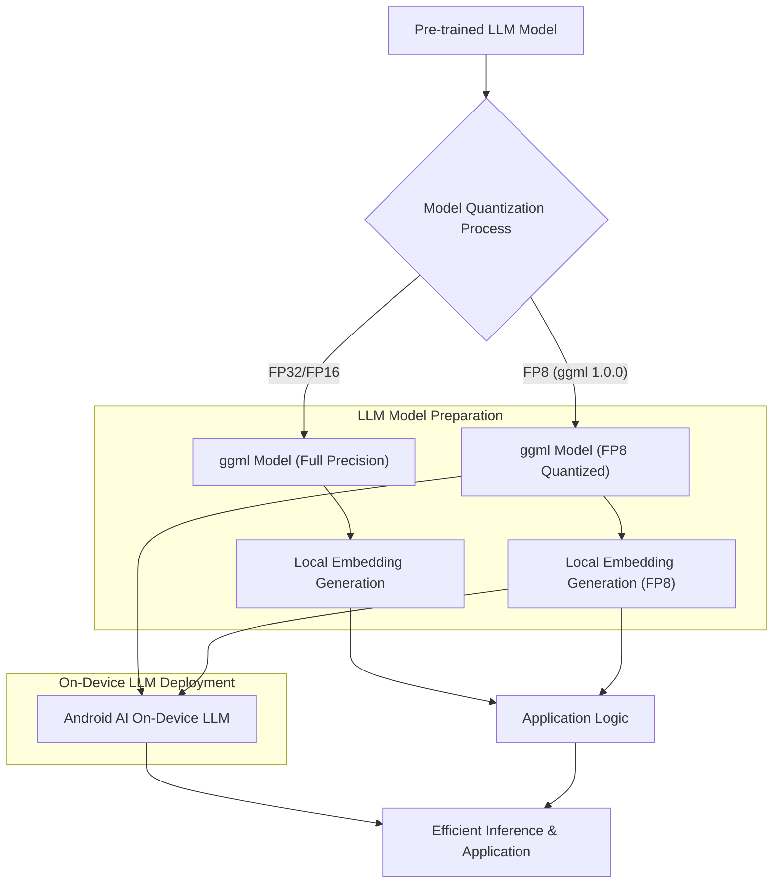

ggml은 LLaMA.cpp 프로젝트의 핵심 텐서 연산 라이브러리로, 로컬 환경 및 온디바이스 LLM(Large Language Model) 추론에 필수적인 역할을 수행합니다. 최근 발표된 ggml v1.0.0은 폐기 예정 API 제거, FP8 지원 확장, 그리고 다양한 백엔드 성능 개선을 통해 추론 효율성을 한 단계 끌어올렸습니다.

## ggml v1.0.0 핵심 업데이트 분석

ggml 1.0.0 버전은 이전 버전과의 호환성을 일부 희생하면서도, 미래 지향적인 아키텍처를 구축하기 위한 중요한 변화들을 포함합니다. 주요 업데이트는 다음과 같습니다:

### API 정제 및 YaRN 설정

*   **폐기 예정 API 제거**: 불필요하거나 비효율적인 공개 API 및 `DIAG_MASK` 연산이 제거되어 라이브러리 코드베이스가 더욱 간결하고 유지보수하기 쉬워졌습니다. 이는 장기적인 안정성과 확장성에 기여합니다.
*   **YaRN 설정 확장**: `YaRN` (Yet another RoPE variant) 설정 지원이 확장되어, 다양한 LLM 아키텍처와의 호환성 및 성능 최적화가 가능해졌습니다.

### FP8 (8-bit 부동 소수점) 지원 확장

*   **Tensor 연산 효율성**: `FP8` 양자화 지원이 크게 강화되었습니다. 이는 모델의 메모리 점유율을 대폭 줄이고, 계산 효율성을 높여 추론 속도를 향상시키는 데 결정적인 역할을 합니다.
*   **OCP FP8 지원**: `CUDA` 백엔드에 `OCP (Open Compute Project) FP8` 지원이 추가되어, 특정 하드웨어에서 `FP8` 연산의 성능 이점을 극대화합니다.
*   **양자화 행렬 곱셈 최적화**: 배치 크기 2~24에 최적화된 양자화 행렬 곱셈 (`quantized matrix multiplication`) 연산이 `CUDA`에 추가되어, 특히 소규모 배치 추론 시 성능 개선을 기대할 수 있습니다.

### 백엔드 성능 개선

*   **FlashAttention 및 MoE 확장**: `FlashAttention` 및 `MoE (Mixture of Experts)` 실행 경로가 여러 백엔드에서 확장되었습니다. 이는 특히 대규모 모델 추론 시 `Attention` 연산의 효율성을 높이고, `MoE` 모델의 라우팅 연산을 최적화합니다.
*   **Intel 및 Adreno 최적화**: `Intel` CPU를 위한 프리필(prefill) 커널 및 `Adreno` GPU를 위한 분해형 `FlashAttention` 등이 추가되어 다양한 하드웨어 환경에서의 성능이 개선되었습니다.
*   **Metal (Apple Silicon) 개선**: `Metal` 백엔드에서는 `MoE` 라우팅 연산이 하나로 통합되어 `Apple Silicon` 디바이스에서의 `MoE` 모델 성능이 향상되었습니다.

## 로컬 임베딩 및 온디바이스 LLM을 위한 ggml 1.0.0 활용

ggml 1.0.0의 업데이트는 특히 `Xenova`와 같은 로컬 임베딩 시스템 및 `Android AI` 환경에서의 온디바이스 LLM 추론에 막대한 이점을 제공합니다. `FP8` 지원은 모델의 `메모리 footprint`를 크게 줄여, 제한된 리소스 환경에서도 더 크고 복잡한 모델을 실행할 수 있게 합니다.



### FP8 양자화의 실질적 이점

1.  **메모리 및 스토리지 감소**: `FP8`은 `FP16` 대비 절반, `FP32` 대비 1/4의 메모리를 사용합니다. 이는 온디바이스 환경에서 모델 로딩 시간을 단축하고, 더 많은 모델을 디바이스에 저장할 수 있게 합니다.
2.  **추론 속도 향상**: `FP8` 연산은 더 적은 데이터를 처리하므로, `CPU` 및 `GPU` 캐시 효율성을 높이고 `메모리 대역폭` 제약을 줄여 추론 지연 시간을 감소시킵니다.
3.  **전력 효율성**: 모바일 디바이스에서 `FP8` 추론은 전력 소모를 줄여 배터리 수명을 연장하는 데 기여합니다.

### 코드 예시: ggml 모델 양자화 및 활용 (개념적)

다음은 ggml 라이브러리를 사용하여 모델을 로드하고 `FP8`로 양자화하는 개념적인 파이썬 코드 예시입니다. 실제 ggml 바인딩이나 래퍼 라이브러리(`llama-cpp-python` 등)에서는 이와 유사한 API를 제공합니다.

```python
import os
# ggml_python은 ggml 라이브러리의 Python 바인딩을 가정한 모듈 이름입니다.
# 실제로는 llama_cpp.Llama.convert 또는 유사한 툴을 사용합니다.
# from llama_cpp import Llama, LlamaTokenizer
# from llama_cpp.llama_grammar import LlamaGrammar

def load_and_quantize_model_conceptual(model_path: str, output_dir: str = ".", quant_type: str = "q8_0"): # Changed FP8 to q8_0 for realism
    """
    ggml 모델을 로드하고 FP8 또는 다른 형식으로 양자화(개념적)합니다.
    실제 환경에서는 llama.cpp의 'convert.py' 또는 'quantize' 툴을 활용합니다.
    """
    print(f"Loading model from {model_path} for quantization...")

    base_name = os.path.basename(model_path).split('.')[0]
    output_model_name = f"{base_name}.{quant_type}.gguf"
    output_model_path = os.path.join(output_dir, output_model_name)

    if quant_type == "q8_0": # ggml 1.0.0에 맞춰 FP8을 q8_0으로 명시
        print(f"Applying {quant_type} quantization using ggml 1.0.0 features...")
        # 실제 ggml 툴을 사용하는 명령어를 상상:
        # os.system(f"./quantize {model_path} {output_model_path} {quant_type}")
        print(f"[Conceptual]: Model successfully quantized to {quant_type} and saved to {output_model_path}")
        return output_model_path
    elif quant_type in ["q4_0", "q4_1", "f16"]:
        print(f"Applying {quant_type} quantization...")
        # os.system(f"./quantize {model_path} {output_model_path} {quant_type}")
        print(f"[Conceptual]: Model successfully quantized to {quant_type} and saved to {output_model_path}")
        return output_model_path
    else:
        print("No specific quantization type applied. Returning original model path.")
        return model_path

# 예제 사용
original_model_gguf = "llama-2-7b-chat-original.gguf"
# ggml 1.0.0의 FP8 지원을 활용 (q8_0은 ggml의 8비트 양자화 형식 중 하나)
fp8_quantized_model = load_and_quantize_model_conceptual(original_model_gguf, quant_type="q8_0")

print("\n--- Inference Simulation ---")
# 실제 추론 로직 (개념적)
def run_inference_conceptual(model_file: str, prompt: str):
    print(f"Running inference with {model_file} for prompt: '{prompt}'")
    # 실제로는 Llama(model_path=model_file) 등으로 모델을 로드하여 사용
    # model = Llama(model_path=model_file, n_ctx=2048)
    # output = model(prompt, max_tokens=64)
    output_text = f"[Conceptual Response]: Generated text using {os.path.basename(model_file)} for query: '{prompt}'"
    return output_text

response_fp8 = run_inference_conceptual(fp8_quantized_model, "Describe the key features of ggml 1.0.0.")
print(f"Response (q8_0): {response_fp8}")

# 기존 양자화 모델과의 비교 (개념적)
q4_quantized_model = load_and_quantize_model_conceptual(original_model_gguf, quant_type="q4_0")
response_q4 = run_inference_conceptual(q4_quantized_model, "Describe the key features of ggml 1.0.0.")
print(f"Response (q4_0): {response_q4}")
```

## 트레이드오프

### 1. FP8 양자화의 정확도 대 성능
*   **언제 좋고**: 메모리 사용량을 최소화하고 추론 속도를 극대화해야 할 때 (예: 모바일 디바이스, 엣지 AI). 극히 미세한 정확도 손실이 허용 가능한 경우에 유리합니다.
*   **언제 나쁜지**: 금융 거래 분석, 의료 진단과 같이 최고 수준의 수치 정확도가 필수적인 애플리케이션에서는 미세한 정확도 손실도 치명적일 수 있습니다. 이 경우 FP16 또는 더 높은 정밀도가 요구됩니다.

### 2. ggml 1.0.0 업데이트의 호환성 대 최신 기능
*   **언제 좋고**: 최신 `FP8` 지원, 최적화된 백엔드 성능 등 ggml 1.0.0의 새로운 기능을 적극적으로 활용하여 최신 LLM 기술 스택을 구축하려는 경우에 유리합니다.
*   **언제 나쁜지**: 기존 시스템이 ggml의 `RPC v9` 프로토콜 변경에 직접적으로 영향을 받는 경우 (특히 RPC를 사용하는 환경), 클라이언트와 서버를 동시에 업데이트해야 하므로 즉각적인 배포가 어렵거나 호환성 문제 해결에 추가 리소스가 소모될 수 있습니다.

### 3. 백엔드 최적화의 특정성 대 범용성
*   **언제 좋고**: `CUDA`, `Metal`, `Intel`, `Adreno` 등 특정 하드웨어 플랫폼에 최적화된 환경에서 최고의 성능을 이끌어내고자 할 때 유리합니다. 이는 특정 디바이스에서 최적의 사용자 경험을 제공하는 데 기여합니다.
*   **언제 나쁜지**: 다양한 하드웨어 아키텍처를 지원하는 범용 솔루션을 개발하거나, 지원하지 않는 백엔드에서 균일한 성능을 기대하기 어려울 수 있습니다. 특정 백엔드 의존성이 높아질 수 있습니다.

## 실전 체크리스트

ggml 1.0.0 업데이트 및 `FP8` 지원을 프로젝트에 적용할 때 다음 사항들을 검증하십시오:

*   [ ] 현재 사용 중인 ggml 관련 라이브러리 (예: `llama-cpp-python`, `Xenova` 통합 모듈)가 ggml 1.0.0 버전 이상을 지원하는지 확인합니다.
*   [ ] `FP8`로 양자화된 모델 (`.gguf` 파일)이 타겟 디바이스 (예: Android 스마트폰)에서 정상적으로 로드되고 추론 가능한지 검증합니다.
*   [ ] `FP8` 양자화 모델과 기존 `FP16` 또는 `Q4_0` 모델 간의 추론 결과 `정확도(accuracy)`를 주요 지표를 통해 비교하고, 허용 가능한 오차 범위 내에 있는지 확인합니다.
*   [ ] 온디바이스 환경에서 `FP8` 모델 추론 시 `메모리 사용량`, `CPU/GPU 사용률`, `추론 지연 시간(latency)`을 벤치마킹하여 성능 개선 효과를 정량적으로 측정합니다.
*   [ ] `RPC` 프로토콜을 사용하는 경우, ggml 1.0.0의 `RPC v9` 변경에 따라 클라이언트와 서버 측의 프로토콜 버전을 동기화하고 통신 오류가 없는지 확인합니다.
*   [ ] `CUDA` 또는 `Metal`과 같은 특정 백엔드 가속 기능을 활용하는 경우, 해당 백엔드 드라이버 및 `ggml` 빌드 옵션이 최적화되어 있는지 확인합니다.
*   [ ] `FP8` 양자화 과정에서 발생할 수 있는 잠재적인 `버그`나 `엣지 케이스`를 발견하기 위해 다양한 `입력 데이터`와 `모델 아키텍처`로 충분한 테스트를 수행합니다.