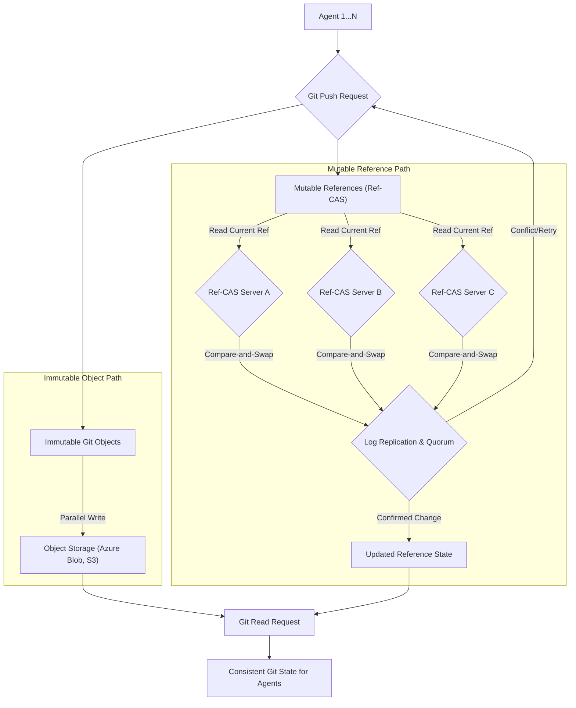

GitHub Rubicon은 수천 개의 Agent가 초당 수천 회의 푸시를 단일 Git 저장소에 처리하면서도 낮은 읽기 지연 시간을 유지하도록 설계된 GitHub의 차세대 Git 스토리지 아키텍처입니다. 특히 대규모 AI Agent 시스템에서 Git을 SCM (Source Code Management)으로 활용할 때 발생하는 동시성 및 처리량 문제를 해결하는 핵심적인 접근 방식을 제공합니다. 이 아키텍처는 Agent 기반 워크플로우에서 코드 변경 사항을 빈번하게 커밋하고 푸시하는 시나리오에 대한 최적의 솔루션을 구상하는 데 중요한 통찰력을 줍니다.

## Rubicon 핵심 아키텍처
Rubicon은 크게 두 가지 핵심 컴포넌트와 한 가지 독특한 동시성 제어 메커니즘으로 구성됩니다.

### 불변 Git 객체 (Immutable Git Objects)
Git의 모든 객체(Blob, Tree, Commit, Tag)는 생성 후에는 변경되지 않는 불변(Immutable) 특성을 가집니다. Rubicon은 이러한 불변 객체를 Azure Blob Storage와 같은 Content-Addressable Storage에 저장합니다. 이 방식의 장점은 다음과 같습니다.

*   **병렬 쓰기 최적화**: 수많은 Agent가 동시에 Git 객체를 생성해도, 각 객체는 독립적으로 스토리지에 기록되므로 병렬 처리가 극대화됩니다.
*   **뛰어난 확장성**: Blob Storage의 무한한 확장성을 활용하여 저장소 크기 증가에 유연하게 대응합니다.
*   **데이터 무결성**: 객체가 불변하므로 데이터 손상 위험이 낮고, Git의 Content-Addressable 특성과 잘 맞습니다.

### Ref-CAS (Reference Content-Addressable Storage)
Git에서 브랜치(Branch)나 태그(Tag)와 같은 참조(Reference)는 특정 커밋(Commit)을 가리키는 포인터로, 시간이 지남에 따라 가리키는 커밋이 변경될 수 있는 가변(Mutable) 요소입니다. Ref-CAS는 이러한 가변 참조의 상태를 일관되고 안전하게 관리하는 분산 시스템입니다.

*   **로그 복제본 및 과반수 확정**: Ref-CAS는 Paxos나 Raft와 유사한 분산 합의(Distributed Consensus) 프로토콜을 사용하여 참조 변경 사항을 로그로 복제하고, 과반수의 복제본이 기록을 확정해야만 변경이 완료됩니다. 이는 참조 상태의 강력한 일관성(Strong Consistency)을 보장합니다.
*   **Atomic Compare-and-Swap (CAS)**: 각 푸시는 단순히 새로운 커밋을 가리키는 것이 아니라, 현재 참조가 특정 커밋을 가리키고 있을 경우에만 새로운 커밋으로 업데이트하는 CAS 연산을 수행합니다. 이를 통해 경쟁 조건(Race Condition)을 방지합니다.

### 참조별 잠금 (Reference-Specific Locking) 및 낙관적 동시성 (Optimistic Concurrency)
Rubicon의 가장 큰 혁신 중 하나는 동시성 제어 방식입니다. 기존 Git 호스팅 서비스는 저장소 전체 또는 일정 범위에 대한 잠금을 사용하는 경우가 많아 동시 푸시 처리량에 한계가 있었습니다. Rubicon은 다음을 통해 이를 극복합니다.

*   **부분 잠금 (Partial Locking)**: 각 푸시는 자신이 변경하려는 특정 브랜치 참조(예: `refs/heads/main` 또는 `refs/heads/feature-x`)만 잠급니다. 이는 Agent가 서로 다른 브랜치에 푸시할 경우 대부분 기다릴 필요 없이 동시에 작업을 수행할 수 있도록 합니다.
*   **낙관적 동시성 제어**: 푸시 요청 시 현재 참조의 버전(또는 예상되는 커밋 ID)을 확인하고, 변경이 성공하면 새로운 버전으로 업데이트합니다. 만약 다른 푸시가 그 사이에 참조를 변경했다면, 현재 푸시는 충돌을 감지하고 재시도(Retry)하거나 실패 처리합니다. 이는 시스템의 처리량을 극대화하는 데 기여합니다.

## Agent 기반 SCM 고도화 적용 방안
Rubicon 아키텍처의 원칙은 AI Agent Harness가 Git과 상호작용하는 방식에 중요한 시사점을 제공합니다. 특히 수많은 Agent가 독립적이거나 협업하여 코드베이스를 변경하는 시나리오에서 병렬성 및 처리량을 개선할 수 있습니다.

### 병렬 푸시 처리량 극대화
*   **Agent별 브랜치 전략**: 각 Agent 또는 Agent 그룹이 독립적인 Feature Branch에 작업하고 푸시하면, Rubicon의 참조별 잠금 메커니즘 덕분에 Git 푸시 단계에서의 병목 현상을 최소화할 수 있습니다.
*   **비동기적 객체 쓰기**: Agent가 새로운 Git 객체(블롭, 트리, 커밋)를 생성할 때, 이를 SCM 시스템의 불변 객체 스토리지에 비동기적으로 병렬 쓰기하여 I/O 성능을 최적화합니다.

### 읽기 일관성 보장
*   **Ref-CAS 활용**: Agent가 Git 저장소의 최신 상태를 읽을 때는 Ref-CAS를 통해 항상 최신 확정된 참조 상태를 조회하여 일관성 있는 코드베이스를 기반으로 작업을 수행하도록 합니다. 오래된 스냅샷으로 인한 Agent의 비효율적인 작업을 방지합니다.

### 분산 환경에서의 견고성
*   **장애 복구 및 고가용성**: Ref-CAS의 로그 복제본 과반수 확정 방식은 단일 장애 지점(Single Point of Failure)을 제거하고, Agent 시스템이 Git 서비스의 일시적인 중단에도 강건하게 동작할 수 있도록 합니다.
*   **멱등성 (Idempotency) 있는 작업**: Agent가 Git 푸시와 같은 작업을 재시도할 때, Rubicon의 CAS 연산은 동일한 작업을 여러 번 수행해도 시스템 상태가 일관되게 유지되도록 하여 Agent 로직의 복잡성을 줄여줍니다.

## 코드 예제: Agent의 고성능 Git 푸시 시뮬레이션 (Python)
아래는 Rubicon의 원칙을 차용한 Agent의 Git 푸시 동작을 시뮬레이션하는 Python 의사 코드입니다. 여러 Agent가 동시에 다른 브랜치에 푸시하는 상황을 가정합니다.

```python
import threading
import time
import random

class MockRefCAS:
    def __init__(self):
        self.references = {"main": "initial_commit_hash"}
        self.locks = {ref: threading.Lock() for ref in self.references}

    def update_reference(self, ref_name, old_commit_hash, new_commit_hash):
        # Simulate Ref-CAS with optimistic locking
        if ref_name not in self.references:
            self.references[ref_name] = ""
            self.locks[ref_name] = threading.Lock()
            
        with self.locks[ref_name]:
            if self.references[ref_name] == old_commit_hash:
                print(f"  -> Ref-CAS: Reference '{ref_name}' updated from '{old_commit_hash[:7]}' to '{new_commit_hash[:7]}'")
                self.references[ref_name] = new_commit_hash
                return True
            else:
                print(f"  -> Ref-CAS: Conflict on '{ref_name}'. Expected '{old_commit_hash[:7]}', but found '{self.references[ref_name][:7]}'. Retrying...")
                return False

class MockObjectStorage:
    def store_object(self, content):
        obj_hash = f"new_object_hash_{random.randint(1000, 9999)}"
        print(f"  -> Blob Storage: Stored object with hash '{obj_hash}'")
        return obj_hash

def agent_push_workflow(agent_id, branch_name, ref_cas, obj_storage):
    print(f"[Agent {agent_id}] Starting push to branch '{branch_name}'")
    current_ref = ref_cas.references.get(branch_name, "")
    if not current_ref: # If branch doesn't exist yet, mock a base commit
        current_ref = "0000000"

    # 1. Create new Git objects (e.g., new file, new tree, new commit object)
    # These are immutable and can be stored in parallel.
    new_blob_hash = obj_storage.store_object(f"Agent {agent_id} content")
    new_tree_hash = obj_storage.store_object(f"Tree for {new_blob_hash}")
    new_commit_message = f"feat: Agent {agent_id} adds changes to {branch_name}"
    new_commit_hash = obj_storage.store_object(new_commit_message)
    time.sleep(random.uniform(0.05, 0.2)) # Simulate network latency/processing

    # 2. Update the branch reference via Ref-CAS (critical section)
    max_retries = 3
    for attempt in range(max_retries):
        if ref_cas.update_reference(branch_name, current_ref, new_commit_hash):
            print(f"[Agent {agent_id}] Successfully pushed to '{branch_name}' (Attempt {attempt + 1})")
            break
        else:
            # Fetch latest ref state and retry
            current_ref = ref_cas.references.get(branch_name, "")
            time.sleep(random.uniform(0.1, 0.3)) # Exponential backoff simulation
    else:
        print(f"[Agent {agent_id}] Failed to push to '{branch_name}' after {max_retries} attempts due to conflicts.")

# Simulate environment
ref_cas_service = MockRefCAS()
object_storage_service = MockObjectStorage()

# Launch multiple agents concurrently
threads = []
branch_names = [f"feature/agent-{i}" for i in range(5)] + ["main"]
for i in range(10):
    agent_branch = random.choice(branch_names)
    thread = threading.Thread(target=agent_push_workflow, args=(i+1, agent_branch, ref_cas_service, object_storage_service))
    threads.append(thread)
    thread.start()

for thread in threads:
    thread.join()

print("\nAll agents finished their push attempts.")
print("Final reference states:", {k: v[:7] for k, v in ref_cas_service.references.items()})
```

## Rubicon Architecture Flow


## 트레이드오프 (Trade-offs)
Rubicon과 같은 고성능 분산 SCM 아키텍처를 도입할 때 고려해야 할 트레이드오프는 다음과 같습니다.

*   **복잡성 vs. 성능**: 이 아키텍처는 고성능과 확장성을 제공하지만, 분산 시스템(Ref-CAS, Object Storage)의 설계, 배포 및 운영은 매우 복잡합니다. 언제 좋냐면 극도로 높은 동시성 및 처리량이 필요한 대규모 Agent 시스템에 좋고, 언제 나쁘냐면 소규모 프로젝트나 제한된 Agent 환경에서는 불필요한 오버헤드와 복잡성을 증가시킬 수 있습니다.
*   **비용 vs. 확장성**: Object Storage 및 분산 Ref-CAS 서버 운영에는 상당한 인프라 비용이 수반됩니다. 언제 좋냐면 미래의 폭발적인 성장과 트래픽 급증이 예상되는 서비스에 좋고, 언제 나쁘냐면 비용 효율성이 최우선이거나 트래픽 예측이 안정적인 환경에는 과도한 투자가 될 수 있습니다.
*   **강력한 일관성 모델 vs. 개발 편의성**: Ref-CAS의 강력한 일관성 보장은 데이터 무결성 측면에서 유리하지만, 낙관적 동시성 실패 시 재시도 로직 구현 등 Agent 개발 과정에 추가적인 고려 사항이 발생할 수 있습니다. 언제 좋냐면 금융 거래나 중요한 코드베이스처럼 데이터 일관성이 절대적으로 요구되는 경우에 좋고, 언제 나쁘냐면 약간의 데이터 지연이나 비일관성이 허용되는 로깅 또는 분석 시스템에는 복잡성이 더 클 수 있습니다.
*   **기술 의존성 vs. 유연성**: Azure Blob Storage와 같은 특정 클라우드 서비스에 의존할 경우, 해당 벤더에 대한 종속성이 증가합니다. 언제 좋냐면 특정 클라우드 에코시스템 내에서 최적의 성능과 통합을 추구할 때 좋고, 언제 나쁘냐면 멀티 클라우드 전략이나 벤더 종속성을 최소화하려는 경우에는 추가적인 추상화 계층이 필요합니다.

## 실전 체크리스트 (Practical Checklist)
GitHub Rubicon 아키텍처의 원칙을 Agent 기반 SCM 고도화에 적용할 때 검증할 항목입니다.

*   [ ] **Agent Git 작업 패턴 분석**: 현재 Agent들이 Git에 푸시하는 빈도, 병렬성 요구사항, 브랜치 전략(단일 브랜치 vs. 다중 브랜치)을 분석하여 고성능 SCM 아키텍처 도입의 필요성을 정량적으로 확인했는가?
*   [ ] **불변 객체 스토리지 전략 수립**: Agent가 생성하는 Git 객체(코드, 설정 파일, 데이터 등)를 불변 객체로 간주하고, 이를 효율적으로 저장 및 관리할 수 있는 Object Storage 솔루션(예: S3, Azure Blob)을 선정하고 통합 계획을 수립했는가?
*   [ ] **참조 일관성 관리 시스템 설계**: Git 참조(브랜치, 태그)의 일관성을 강력하게 유지하면서도 고성능을 제공할 수 있는 Ref-CAS와 유사한 분산 시스템(예: Apache ZooKeeper, etcd 또는 커스텀 솔루션) 도입을 검토했는가?
*   [ ] **낙관적 동시성 및 재시도 로직 구현**: Agent가 Git 푸시 시 충돌이 발생했을 때, 최신 참조 상태를 다시 확인하고 재시도하는 낙관적 동시성 제어 로직을 각 Agent의 Git 상호작용 레이어에 구현하고 테스트했는가?
*   [ ] **병렬 작업 및 브랜치 전략 최적화**: 다수의 Agent가 동시에 작업할 때 서로 다른 브랜치에 푸시하도록 가이드라인을 설정하고, 메인 브랜치로의 Merge/Rebase 정책을 수립하여 Git 서비스의 동시성 잠재력을 최대한 활용할 수 있도록 했는가?
*   [ ] **성능 모니터링 및 병목 지점 식별**: Agent의 Git 푸시 지연 시간, Ref-CAS의 응답 시간, Object Storage의 처리량 등을 지속적으로 모니터링하여 잠재적인 병목 지점을 식별하고 최적화할 수 있는 대시보드와 경고 시스템을 구축했는가?
*   [ ] **장애 복구 및 일관성 검증 프로세스**: Ref-CAS 시스템 장애 시 참조 상태의 일관성을 복구하고 검증할 수 있는 절차(예: 로그 재생, 스냅샷 복원)를 정의하고 정기적으로 모의 훈련을 실시하여 시스템의 견고성을 확보했는가?