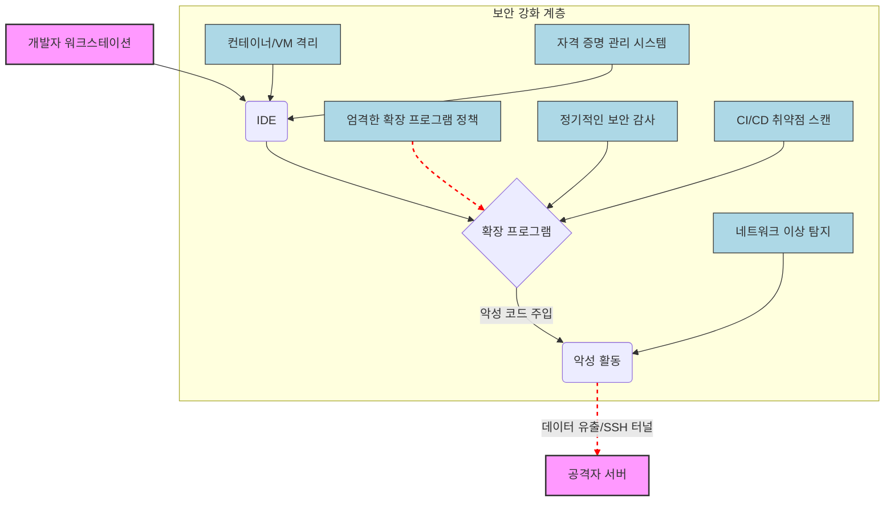

IDE 확장 프로그램을 통한 공급망 공격은 개발 워크플로우의 핵심을 노리는 심각한 위협입니다. 특히 `AI` 코딩 도구의 사용이 증가하면서, 이들이 제공하는 편리함 이면에 숨겨진 보안 취약점은 더욱 치명적인 결과를 초래할 수 있습니다. 최근 `Cursor Marketplace`의 `Claude Code for VS Code` 확장 프로그램에서 발견된 백도어 사례는 이러한 위협의 현실을 명확히 보여줍니다. 이는 개발 환경 자체의 보안 검증과 강화가 얼마나 중요한지 시사합니다.

## IDE 확장 프로그램 공급망 공격의 위협

공급망 공격은 소프트웨어 개발 및 배포 과정의 약점을 이용해 악성 코드를 주입하는 방식입니다. `IDE` 확장 프로그램은 개발자의 코드에 직접 접근하고, 파일 시스템 및 네트워크 권한을 광범위하게 가질 수 있어 공격자에게 매력적인 목표가 됩니다. `Claude Code for VS Code` 2.1.313 버전에서 발견된 백도어는 확장 프로그램 활성화 시점에서 공격자 `SSH` 공개 키를 심고 외부 서버로 역방향 `SSH` 터널을 연결하여 지속적인 접근 권한을 확보하려 했습니다. 이는 개발 환경이 곧 공격자의 침투 경로가 될 수 있음을 의미하며, 프로젝트의 소스 코드, 민감한 자격 증명, 그리고 최종 사용자 제품까지 위험에 빠뜨릴 수 있습니다.

## 즉각적인 위협 평가 및 대응

조직의 개발 환경을 이러한 위협으로부터 보호하기 위한 첫걸음은 현재 사용 중인 `IDE` 확장 프로그램의 즉각적인 점검입니다.

1.  **확장 프로그램 버전 확인**: 개발자들이 사용하는 `VS Code` `Claude Code for VS Code` 확장 프로그램 버전이 `2.1.313` 이하인지 확인합니다. `VS Code`의 `CLI`를 통해 설치된 확장 프로그램 목록과 버전을 쉽게 확인할 수 있습니다.

    ```bash
    # 설치된 VS Code 확장 프로그램 목록과 버전 확인
    code --list-extensions --show-versions

    # 특정 확장 프로그램이 설치되어 있다면 다음 명령으로 제거 (예시)
    # code --uninstall-extension publisher.extension-name
    # 예: code --uninstall-extension anthropic.claude-code
    ```

2.  **악성 버전 제거 및 업데이트**: 만약 악성 코드가 포함된 버전이 발견되면 즉시 해당 확장 프로그램을 제거하고, 가능하다면 공식적으로 안전하다고 검증된 최신 버전으로 업데이트합니다. 업데이트가 불가능하거나 의심스러운 경우, 해당 기능을 대체할 다른 안전한 도구를 고려해야 합니다.

3.  **시스템 무결성 검사**: 백도어가 설치되었을 가능성이 있는 개발자 워크스테이션에 대해 파일 시스템 무결성 검사 (예: `AIDE`, `Tripwire` 또는 `osquery` 활용)를 수행하여 비정상적인 파일 변경이나 추가된 `SSH` 키가 없는지 확인합니다.

## 개발 환경 보안 강화 전략

장기적인 관점에서 개발 환경의 공급망 보안을 강화하기 위한 다계층 방어 전략을 수립해야 합니다.

### 확장 프로그램 설치 정책 수립

*   **신뢰할 수 있는 소스만 사용**: 공식 `IDE Marketplace` 또는 자체 검증된 저장소에서만 확장 프로그램을 설치하도록 정책을 강제합니다. 알려지지 않은 소스 또는 비공식 채널을 통한 설치를 금지합니다.
*   **필요 최소한의 권한 (Principle of Least Privilege)**: 개발자가 프로젝트 수행에 필수적인 확장 프로그램만 설치하도록 유도하고, 불필요하게 넓은 권한을 요구하는 확장 프로그램은 신중하게 검토합니다.
*   **정기적인 검토 및 제거**: 주기적으로 설치된 확장 프로그램 목록을 검토하고, 더 이상 사용되지 않거나 보안 위험이 있는 확장 프로그램은 즉시 제거합니다.

### 자동화된 보안 검사 및 모니터링

*   **CI/CD 파이프라인 통합**: `CI/CD` 파이프라인에 개발 환경 구성을 위한 `IDE` 확장 프로그램 및 종속성 취약점 스캔 도구를 통합합니다. 새로운 확장 프로그램이 추가되거나 버전이 업데이트될 때마다 자동으로 보안 검사를 수행합니다.
*   **파일 시스템 및 프로세스 무결성 모니터링**: 개발자 워크스테이션에서 중요한 파일, 디렉터리, 그리고 실행 중인 프로세스에 대한 무결성 검사 및 변경 모니터링을 상시 운영하여 비정상적인 활동을 조기에 탐지합니다.
*   **네트워크 활동 모니터링**: 개발자 기기에서 외부로 나가는 `네트워크 트래픽`을 모니터링하여 비정상적인 `SSH` 터널링 시도, `C2 (Command and Control)` 서버 통신 등 이상 징후를 탐지합니다. `IDS/IPS` 솔루션이나 `EDR` (Endpoint Detection and Response) 솔루션을 활용할 수 있습니다.

### 격리 환경 활용

*   **개발 환경 컨테이너화/가상화**: 민감한 프로젝트나 외부 의존성이 많은 개발 작업은 `Docker`, `Dev Containers` 또는 `VM` (Virtual Machine)과 같은 격리된 환경에서 수행합니다. 이를 통해 악성 코드가 호스트 운영 체제나 다른 프로젝트로 확산되는 것을 방지합니다.
*   **자격 증명 (Credentials) 접근 제한**: `SSH` 키, `API` 토큰, 클라우드 자격 증명 등 민감한 정보는 `Secret Management System` (예: `HashiCorp Vault`, `AWS Secrets Manager`)을 통해 안전하게 관리하고, 개발 환경 내부에 직접 저장하는 것을 최소화합니다. 확장 프로그램이 자격 증명에 직접 접근하는 것을 막고, 필요시 임시적이고 제한적인 접근만 허용합니다.



## 트레이드오프

개발 환경 보안 강화 조치는 생산성과 편의성 사이의 트레이드오프를 수반합니다. 각 전략의 장단점과 적용 시점을 명확히 이해해야 합니다.

*   **엄격한 확장 프로그램 통제 및 승인 프로세스**: 
    *   **장점**: 공급망 공격의 진입점을 대폭 축소하고, 개발 환경의 보안 기준선을 높일 수 있습니다.
    *   **단점**: 새로운 유용한 도구 도입이 지연되거나, 개발자의 자유도가 제한되어 생산성에 부정적인 영향을 줄 수 있습니다.
    *   **언제 좋고/언제 나쁜지**: 고도의 보안 규제 준수가 필요한 금융, 국방 분야나 민감한 정보를 다루는 프로젝트에서는 필수적입니다. 반면, 빠른 실험과 개발 속도가 중요한 스타트업 환경에서는 유연성을 저해할 수 있습니다.

*   **정기적인 자동화된 보안 스캔 및 모니터링**: 
    *   **장점**: 잠재적인 취약점이나 비정상적인 활동을 조기에, 그리고 일관된 방식으로 탐지할 수 있습니다. 수동 검사의 한계를 극복합니다.
    *   **단점**: 스캔 과정에서 상당한 컴퓨팅 리소스와 시간이 소모될 수 있으며, 오탐 (false positive) 발생 시 분석 및 대응에 추가적인 노력이 필요합니다. 초기 시스템 구축 비용이 발생합니다.
    *   **언제 좋고/언제 나쁜지**: 대규모 개발 팀이나 지속적으로 업데이트되는 소프트웨어 환경에서 효과적입니다. 소규모 프로젝트에서는 초기 설정 및 유지보수 부담이 커서 수동 검사가 더 현실적일 수 있습니다.

*   **개발 환경 격리 (컨테이너/VM)**: 
    *   **장점**: 악성 코드의 확산을 격리된 환경 내로 제한하여 호스트 시스템 및 다른 프로젝트를 보호할 수 있습니다. 일관된 개발 환경을 제공하여 '내 컴퓨터에서는 되는데' 문제를 줄입니다.
    *   **단점**: 추가적인 리소스 (메모리, CPU) 오버헤드가 발생하며, 개발 환경 설정의 복잡성이 증가할 수 있습니다. `IDE`와의 통합이 완벽하지 않을 경우 개발 워크플로우에 마찰이 생길 수 있습니다.
    *   **언제 좋고/언제 나쁜지**: 민감한 자산을 다루거나, 여러 고객사의 다양한 환경에서 개발하는 경우 (보안 경계 확립), 그리고 외부 의존성이 복잡한 프로젝트에 적합합니다. 경량 프로젝트나 단순히 학습을 위한 환경에서는 과도한 설정으로 여겨질 수 있습니다.

*   **네트워크 이상 탐지 시스템 구축**: 
    *   **장점**: `C2` 통신, 비정상적인 데이터 유출 시도 등 `제로데이` 공격을 포함한 다양한 위협을 네트워크 레벨에서 조기에 탐지하고 대응할 수 있습니다.
    *   **단점**: 구축 및 운영에 전문적인 지식과 상당한 비용이 필요합니다. 네트워크 트래픽 분석의 복잡성으로 인해 오탐이 발생할 가능성이 있으며, 프라이버시 문제도 고려해야 합니다.
    *   **언제 좋고/언제 나쁜지**: 내부 네트워크 보안이 최우선시되는 기업 환경이나 국가 중요 시설에서 유용합니다. 개인 개발 환경이나 소규모 팀에서는 비용 대비 효율성이 낮을 수 있습니다.

## 실전 체크리스트

개발 환경의 `AI` 코딩 도구 공급망 보안을 강화하기 위해 다음 항목들을 점검하고 실행해야 합니다.

*   [ ] 모든 개발자의 `VS Code` `Claude Code for VS Code` 확장 프로그램 버전 `2.1.313` 이하 사용 여부를 확인하고, 발견 시 즉시 제거 및 최신 안전 버전으로 업데이트했는가?
*   [ ] 조직 내 모든 `IDE` 확장 프로그램에 대한 공식 승인 목록 (`Allowlist`)을 수립하고, 승인되지 않은 확장 프로그램의 설치를 기술적으로 제한하는 정책을 시행하는가?
*   [ ] 개발 환경 구축 `CI/CD` 파이프라인에 `IDE` 확장 프로그램 및 종속성 취약점 스캔 단계를 추가하여 자동화된 보안 검사를 수행하는가?
*   [ ] 개발자 워크스테이션의 중요한 시스템 파일 및 설정에 대한 무결성 검사 (예: `osquery`, `auditd` 또는 `EDR` 솔루션 활용)를 정기적으로 실행하고 이상 징후를 모니터링하는가?
*   [ ] `SSH` 키, `API` 토큰 등 민감한 자격 증명 관리를 위해 중앙화된 `Secret Management System`을 도입하고, 개발 환경에서 직접 파일로 저장하는 것을 금지하는 정책을 시행하는가?
*   [ ] 개발자 트래픽의 비정상적인 `SSH` 터널링 또는 외부 `C2 (Command and Control)` 서버 통신 시도를 탐지하기 위한 네트워크 모니터링 시스템을 구축하고 경보를 활성화했는가?
*   [ ] 새로운 `AI` 코딩 도구 또는 `IDE` 확장 프로그램을 도입하기 전에 독립적인 보안 검토를 거치고, 그 결과를 문서화하는 공식적인 프로세스가 존재하는가?