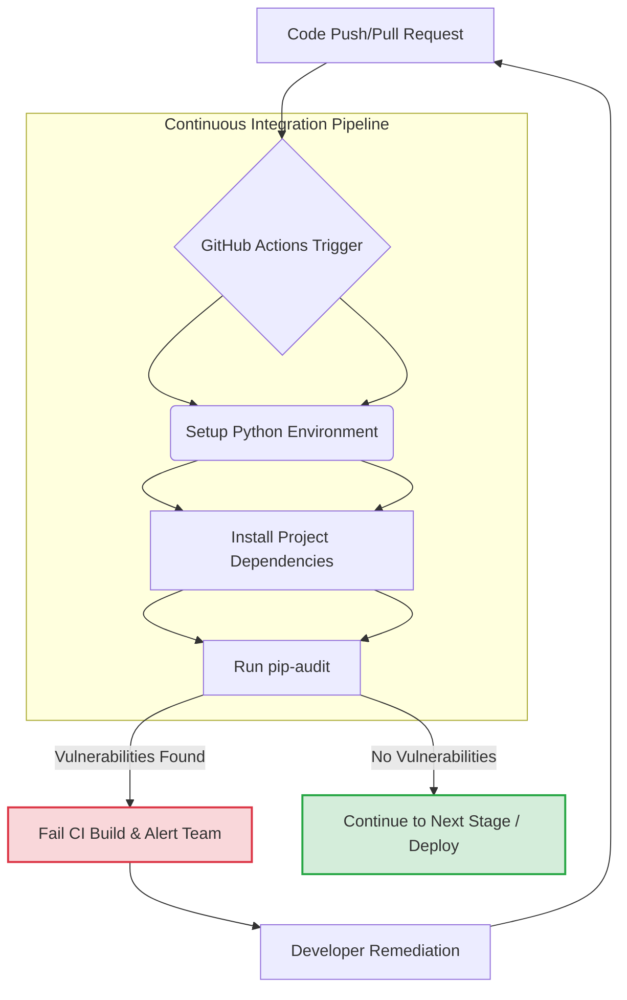

최근 PyPI의 LiteLLM 1.107.0 변조 사례는 LLM(Large Language Model) 관련 프로젝트의 공급망 보안(Supply Chain Security) 위험성을 극명하게 보여주었습니다. 악성 코드가 포함된 라이브러리 릴리스는 자격 증명 탈취 및 원격 코드 실행(RCE) 백도어를 설치할 수 있으며, 이는 개발 환경과 배포 환경 모두에 치명적인 영향을 미칩니다. 이러한 위협으로부터 LLM 애플리케이션을 보호하기 위한 의존성 검토 및 강화 전략은 필수적입니다.

## LLM 프로젝트의 공급망 보안 위협 이해

LLM 기반 애플리케이션은 복잡한 생태계를 가지고 있으며, 다양한 오픈소스 라이브러리(예: LangChain, LlamaIndex, LLM SDKs for Claude, Gemini 등)에 의존하는 경향이 있습니다. 이러한 의존성들은 PyPI, npm과 같은 공개 저장소를 통해 배포되는데, 이는 다음과 같은 주요 공격 벡터를 생성합니다.

*   **레포지토리 변조 (Repository Tampering)**: 공식 패키지 저장소의 릴리스가 공격자에 의해 변조되어 악성 코드가 삽입될 수 있습니다. LiteLLM 사례가 대표적입니다.
*   **타이포스쿼팅 (Typosquatting)**: 인기 있는 라이브러리의 이름을 오타로 유사하게 만들어 개발자가 실수로 악성 패키지를 설치하도록 유도합니다.
*   **의존성 하이재킹 (Dependency Hijacking)**: 자주 사용되지 않거나 관리되지 않는 의존성을 공격자가 인수하여 악성 코드를 주입합니다.
*   **업스트림 공격 (Upstream Attacks)**: 핵심 의존성(예: Python의 `setuptools`, `pip`) 자체에 악성 코드가 삽입되어 광범위한 피해를 유발합니다.

이러한 공격은 개발자의 PC에 자격 증명을 유출하거나, CI/CD 파이프라인에 침투하여 빌드 아티팩트를 변조하고, 최종 배포된 서비스에 백도어를 설치하는 등 전방위적인 피해를 야기할 수 있습니다.

## 의존성 공급망 보안 강화 전략

LLM 프로젝트의 공급망 보안을 강화하기 위한 핵심 전략은 다음과 같습니다.

### 1. 의존성 무결성 검증 및 취약점 감사

프로젝트에서 사용하는 모든 의존성, 특히 LLM 관련 SDK 및 라이브러리에 대해 정기적으로 무결성을 확인하고 알려진 취약점을 감사해야 합니다. Python 프로젝트의 경우 `pip-audit`와 같은 도구가 유용합니다. `pip-audit`는 설치된 패키지나 `requirements.txt` 파일을 스캔하여 공개된 취약점 데이터베이스(예: PyPI Advisory Database)와 대조합니다.

```python
# project_root/requirements.txt
# LLM SDKs
litellm==1.106.0 # hypothetical safe version, always pin versions
openai>=1.20.0
langchain-core>=0.1.0

# Other dependencies
fastapi>=0.100.0
# ...
```

터미널에서 `pip-audit`를 실행하여 취약점을 검사합니다.

```bash
# pip-audit 설치 (최초 1회 또는 환경에 따라)
pip install pip-audit

# 현재 환경의 설치된 패키지 감사
pip-audit

# requirements.txt 파일 기반 감사
pip-audit --requirement requirements.txt
```

Node.js 기반 프로젝트의 경우 `npm audit` 또는 `yarn audit` 명령을 활용하여 유사한 검사를 수행할 수 있습니다.

### 2. CI/CD 워크플로우에 보안 감사 통합

수동 감사는 누락되기 쉬우므로, GitHub Actions와 같은 CI/CD(Continuous Integration/Continuous Deployment) 파이프라인에 의존성 보안 감사를 자동화하는 것이 중요합니다. 이는 코드 변경이 발생할 때마다 자동으로 의존성 상태를 확인하여 잠재적인 위협을 조기에 감지하고 차단합니다.

**GitHub Actions 워크플로우 예시 (`.github/workflows/dependency-audit.yml`)**:

```yaml
name: Dependency Supply Chain Security Audit

on:
  push:
    branches:
      - main
      - develop
  pull_request:
    branches:
      - main
      - develop

jobs:
  audit:
    runs-on: ubuntu-latest
    steps:
      - name: Checkout Code
        uses: actions/checkout@v4

      - name: Set up Python
        uses: actions/setup-python@v5
        with:
          python-version: '3.x'

      - name: Install Project Dependencies
        run: |
          python -m pip install --upgrade pip
          pip install -r requirements.txt

      - name: Run pip-audit for Vulnerabilities
        run: |
          pip install pip-audit
          pip-audit --requirement requirements.txt
        # fail-on-severity: high (Optional, uncomment to fail build on high severity issues)
        # For more strictness, consider removing this line to fail on any found vulnerability

      - name: Notify if Vulnerabilities Found
        if: failure()
        run: echo "Security vulnerabilities found! Please check the audit report."
        # Add integration with Slack/Teams/Jira here for alerts

      - name: Continue if Audit Passed
        if: success()
        run: echo "Dependency audit passed successfully."
```

이 워크플로우는 `main` 및 `develop` 브랜치에 대한 푸시 또는 풀 리퀘스트 발생 시 자동으로 실행됩니다. `pip-audit`는 프로젝트 의존성을 검사하고, 만약 취약점이 발견되면 빌드를 실패시키고 알림을 보낼 수 있습니다.

Mermaid 다이어그램으로 CI/CD 내 보안 감사 흐름을 시각화할 수 있습니다:



### 3. 의존성 버전 고정 (Dependency Pinning)

`requirements.txt`나 `package.json` 같은 의존성 명세 파일에서 버전을 `litellm==1.106.0`와 같이 명확하게 고정(pinning)하는 것은 매우 중요합니다. `litellm>=1.0.0`와 같은 유동적인 버전 지정은 예기치 않은 악성 버전 업데이트를 자동으로 받아들일 위험이 있습니다. 보안 패치 적용을 위해 정기적인 버전 업데이트 정책을 수립하되, 매 업데이트 시 반드시 감사 절차를 거치도록 합니다.

### 4. 최소 권한 원칙 (Least Privilege Principle) 적용

CI/CD 환경 및 배포 환경에서 LLM API 키, 클라우드 자격 증명 등의 민감 정보를 관리할 때는 최소 권한 원칙을 철저히 준수해야 합니다. 환경 변수, Secret Management 시스템(예: HashiCorp Vault, AWS Secrets Manager)을 사용하고, 필요한 최소한의 권한만 부여하여 악성 코드 감염 시 피해 범위를 최소화합니다.

### 5. 추가적인 공급망 보안 도구 고려

*   **Dependabot (GitHub)**: 의존성 취약점을 자동으로 스캔하고 업데이트를 제안하는 봇입니다.
*   **Snyk, SonarQube**: 코드 취약점 및 의존성 분석을 포함하는 종합적인 SAST(Static Application Security Testing) 도구입니다.
*   **Sigstore**: 소프트웨어 아티팩트의 무결성을 암호화 방식으로 보장하는 표준으로, 서명된 빌드를 통해 위변조를 방지합니다.

## 트레이드오프

### 1. 자동화된 의존성 감사 (Automated Dependency Audits)
*   **언제 좋은가**: 초기 개발 단계부터 배포까지 지속적으로 취약점을 검사하여 보안 사각지대를 줄이고, 개발자가 수동으로 모든 의존성을 추적하는 부담을 덜어줍니다. 특히, LLM 라이브러리는 빠르게 변화하고 새로운 취약점이 발견될 수 있으므로 자동화는 필수적입니다.
*   **언제 나쁜가**: 오탐(false positive)이 발생할 수 있어, 실제 위협이 아닌데도 불구하고 CI/CD 파이프라인을 중단시키고 개발 시간을 소모할 수 있습니다. 또한, 최신 취약점 데이터베이스 업데이트까지 약간의 지연이 발생할 수 있습니다.

### 2. 의존성 버전 고정 (Dependency Pinning)
*   **언제 좋은가**: 빌드의 안정성과 재현성을 극대화하며, 예기치 않은 의존성 업데이트로 인한 악성 코드 주입이나 기능 오작동을 방지합니다. 프로덕션 환경에서 예측 가능한 동작을 보장하는 데 매우 중요합니다.
*   **언제 나쁜가**: 최신 보안 패치나 성능 개선 사항이 있는 라이브러리 업데이트를 즉시 적용하기 어렵게 만들 수 있습니다. 정기적인 의존성 업데이트 및 재검증 프로세스가 없다면, 오래된 취약점을 그대로 안고 갈 위험이 있습니다.

### 3. 통합된 CI/CD 보안 스캔 (Integrated CI/CD Security Scans)
*   **언제 좋은가**: 모든 코드 변경에 대해 일관된 보안 검증 절차를 적용하여 개발 초기 단계부터 보안을 고려하도록 강제합니다. 이는 보안 이슈를 배포 전에 발견하여 수정 비용을 크게 절감할 수 있습니다.
*   **언제 나쁜가**: 스캔 도구의 실행 시간이 길어지면 CI/CD 파이프라인의 전체 소요 시간이 증가하여 개발 속도를 저해할 수 있습니다. 또한, 스캔 결과 해석 및 오탐 관리를 위한 추가적인 인력 및 자원 투입이 필요할 수 있습니다.

## 실전 체크리스트

LLM 관련 의존성 공급망 보안 강화를 위한 실전 체크리스트는 다음과 같습니다.

*   [ ] 프로젝트 내 모든 `requirements.txt`, `package.json` 등 의존성 명세 파일에 대해 정기적인 `pip-audit` (Python) 또는 `npm audit` (Node.js) 실행 워크플로우가 GitHub Actions (또는 유사 CI/CD)에 통합되어 있는가?
*   [ ] 모든 의존성, 특히 LLM 관련 라이브러리(Claude SDK, Gemini SDK 등)의 버전이 `==X.Y.Z` 또는 `~=X.Y.Z` 형식으로 명확하게 고정되어 있으며, `requirements.lock` 파일이 사용되는가?
*   [ ] 새로운 의존성을 프로젝트에 추가할 때, 해당 의존성의 소스 및 평판에 대한 간략한 수동 검토 프로세스가 정의되어 있으며, CI/CD에서 자동화된 보안 스캔이 함께 실행되는가?
*   [ ] 알려진 의존성 취약점에 대한 알림 시스템(예: Dependabot, Snyk)이 활성화되어 있으며, Critical/High 등급 취약점 발생 시 관련 팀에 24시간 이내에 즉시 통보되는가?
*   [ ] LLM API 키 및 기타 민감 정보가 환경 변수, Secret Management 시스템(예: Kubernetes Secrets, AWS Secrets Manager)을 통해 안전하게 관리되며, 코드에 하드코딩되지 않음을 정기적으로 검증하는가?
*   [ ] CI/CD 환경에서 코드를 실행하는 Runner 또는 Agent에 부여된 권한이 해당 작업 수행에 필요한 최소한의 권한(Least Privilege)만 가지고 있도록 구성되어 있는가?
*   [ ] 의존성 업데이트 주기를 명확히 설정하고(예: 분기별 또는 월별), 업데이트 시에는 반드시 회귀 테스트와 함께 보안 감사 절차를 거치도록 정책이 수립되어 있는가?