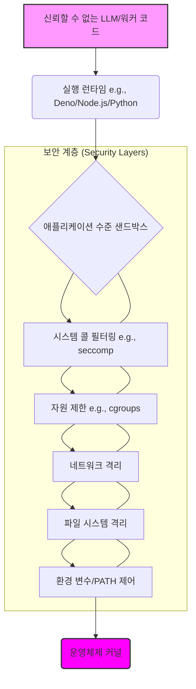

LLM(Large Language Model)이 생성하는 코드나 외부에서 유입되는 워커(Worker) 코드를 실행하는 환경에서 샌드박스(Sandbox)의 완전성(Integrity)은 시스템의 보안과 안정성을 보장하는 핵심 요소입니다. 2026년에도 예측 불가능한 LLM 출력과 다양한 워커 프로세스 도입은 이러한 검증의 필요성을 더욱 증대시키고 있습니다. 덴소(Deno)의 보안 모델에 대한 비판처럼, 런타임 권한 시스템만으로는 충분하지 않으며, 프로세스 자체를 샌드박스화하지 않으면 공격자에게 잘못된 안도감을 줄 수 있습니다.

## 샌드박스 완전성 검증의 중요성

신뢰할 수 없는 코드를 실행하는 환경에서는 해당 코드가 시스템 자원에 임의로 접근하거나, 예상치 못한 부작용을 일으키거나, 심지어 시스템을 탈취할 가능성이 항상 존재합니다. 특히 LLM 에이전트가 복잡한 태스크를 수행하기 위해 코드 실행 도구(Tool)를 사용하는 경우, 생성된 코드가 의도치 않게 악성 행위를 수행할 수 있습니다. 덴소(Deno)의 `--allow-run` 플래그와 같이 외부 명령 실행을 허용하는 기능은 특히 위험할 수 있습니다. PATH 환경 변수나 프로그램 설정용 환경 변수를 조작하여 의도하지 않은 실행 파일을 호출하거나, 런타임 권한 프롬프트를 조작해 사용자의 승인을 유도하는 공격에 노출될 수 있기 때문입니다. 이러한 공격은 단순히 파일 시스템 접근 제한을 넘어, 프로세스 실행 환경 자체에 대한 통제력 상실로 이어질 수 있습니다.

## 다중 계층 샌드박스 아키텍처

진정한 샌드박스 완전성을 확보하려면 단일 방어선이 아닌 다중 계층 보안(Multi-layered Security) 접근 방식이 필수적입니다. 각 계층은 특정 유형의 공격을 방어하며, 한 계층이 우회되더라도 다음 계층이 시스템을 보호할 수 있도록 설계해야 합니다.

### 1. 운영체제(OS) 수준 격리

*   **네임스페이스(Namespaces)**: 프로세스, 네트워크, 파일 시스템 등을 호스트 시스템으로부터 분리하여 독립적인 환경을 제공합니다. 이는 컨테이너(Container) 기술의 핵심 기반입니다.
*   **컨트롤 그룹(cgroups)**: CPU, 메모리, 네트워크 대역폭 등 시스템 자원 사용을 제한하여, 워커 프로세스가 시스템 자원을 고갈시키는 서비스 거부(DoS) 공격을 방지합니다.
*   **보안 컴퓨팅(seccomp)**: 프로세스가 호출할 수 있는 시스템 콜(System Call)을 명시적으로 제한합니다. 예를 들어, 불필요한 네트워크 통신이나 파일 쓰기 시스템 콜을 차단할 수 있습니다.
*   **강제적 접근 제어(MAC - Mandatory Access Control)**: AppArmor나 SELinux와 같은 메커니즘을 사용하여 프로세스의 행동을 세분화된 정책으로 통제합니다.

### 2. 런타임(Runtime) 수준 방어

*   **환경 변수(Environment Variables) 및 PATH 엄격 제어**: `--allow-run`과 같은 기능 사용 시, `PATH` 변수를 최소한의 안전한 경로로 제한하고, `LD_PRELOAD`, `PYTHONPATH` 등 공격에 악용될 수 있는 환경 변수를 제거하거나 엄격하게 관리합니다.
*   **파일 시스템(File System) 접근 제한**: 워커 프로세스가 접근할 수 있는 파일 시스템 경로를 최소한으로 제한하고, 읽기 전용으로 마운트합니다.
*   **네트워크(Network) 격리**: 외부 인터넷 접속이 필요 없는 경우 네트워크 접근을 완전히 차단하거나, 허용된 특정 엔드포인트(Endpoint)로만 제한합니다.

## 코드 실행 환경 샌드박스 구현 예제

다음은 Python의 `subprocess` 모듈을 사용하여 외부 명령어를 실행할 때, 환경 변수와 PATH를 엄격하게 제어하는 개념적인 코드 예시입니다.

```python
import subprocess
import os

def execute_sandboxed_command(command_with_args: list[str], timeout: int = 60):
    # 안전한 PATH만 허용 (예: /usr/bin, /bin)
    safe_path = "/usr/bin:/bin"

    # 최소한의 환경 변수만 설정
    # 공격에 사용될 수 있는 변수(LD_PRELOAD 등)는 명시적으로 제거
    clean_env = {
        "PATH": safe_path,
        "LANG": "C.UTF-8",
        "HOME": "/tmp", # 격리된 홈 디렉토리
        "TMPDIR": "/tmp" # 격리된 임시 디렉토리
    }

    # 프로세스 그룹 ID를 사용하여 부모 프로세스가 자식 프로세스들을 쉽게 관리할 수 있도록 함
    # (예: 타임아웃 발생 시 모든 자식 프로세스 종료)
    try:
        print(f"Executing: (command_with_args) with env: (clean_env)")
        result = subprocess.run(
            command_with_args,
            env=clean_env,
            capture_output=True,
            text=True,
            timeout=timeout,
            check=True, # Exit code가 0이 아니면 CalledProcessError 발생
            start_new_session=True # 새로운 세션 시작하여 격리 강화
        )
        print("STDOUT:", result.stdout)
        print("STDERR:", result.stderr)
        return result.stdout
    except subprocess.CalledProcessError as e:
        print(f"Command failed with error (e.returncode):\nSTDOUT: (e.stdout)\nSTDERR: (e.stderr)")
        raise
    except subprocess.TimeoutExpired as e:
        print(f"Command timed out after (timeout) seconds: (e.cmd)")
        # 타임아웃된 프로세스 그룹 종료
        os.killpg(e.args[0].pid, 9) # Kill signal 9 (SIGKILL)
        raise
    except Exception as e:
        print(f"An unexpected error occurred: (e)")
        raise

# 예제 사용:
# execute_sandboxed_command(["ls", "-l", "/tmp"]) # 안전한 명령
# execute_sandboxed_command(["/bin/bash", "-c", "echo $PATH"]) # PATH 확인
# execute_sandboxed_command(["cat", "/etc/shadow"]) # 권한 없으면 실패
```

이 예제는 `env` 인자를 통해 실행 환경을 완전히 재정의하고, `PATH`를 최소한으로 제한하며, `start_new_session=True`를 통해 프로세스 그룹을 분리합니다. 타임아웃 처리 또한 중요한 방어 메커니즘입니다.

## 샌드박스 환경 계층 구조

샌드박스 환경의 다양한 보안 계층은 다음과 같이 시각화할 수 있습니다.



이 다이어그램은 신뢰할 수 없는 코드가 실행될 때, 애플리케이션 수준 샌드박스부터 운영체제 커널에 이르기까지 여러 계층의 방어를 통과해야 함을 보여줍니다. 각 계층은 특정 유형의 위협으로부터 시스템을 보호하는 역할을 합니다.

## 트레이드오프

샌드박스 완전성 검증 및 강화는 여러 트레이드오프를 수반합니다.

*   **성능 vs. 보안**: 엄격한 샌드박스는 추가적인 오버헤드를 발생시켜 코드 실행 속도를 저하시킬 수 있습니다. 예를 들어, 컨테이너나 가상 머신(VM) 환경은 높은 격리 수준을 제공하지만, 순수한 프로세스 실행보다 시작 및 실행 비용이 높습니다. 성능이 중요한 실시간 워커(Worker)에는 부담이 될 수 있지만, 보안이 최우선인 LLM 에이전트 코드 실행에는 필수적입니다.
*   **복잡성 vs. 안전성**: 다중 계층 샌드박스 아키텍처는 구현 및 관리가 복잡합니다. `seccomp` 프로필 작성, `cgroups` 설정, `AppArmor` 정책 관리 등은 전문 지식을 요구합니다. 초기 구축 비용과 관리 복잡성이 증가하지만, 장기적으로는 시스템의 안전성을 크게 향상시킵니다.
*   **유연성 vs. 통제**: 샌드박스는 코드의 유연성을 제한합니다. 예를 들어, `PATH`를 엄격히 제한하면, 워커 코드가 예상치 못한 경로의 유틸리티를 사용하지 못하게 됩니다. 이는 개발자의 편의성을 저해할 수 있지만, 허용되지 않은 명령 실행을 통한 공격을 효과적으로 차단합니다.
*   **개발 속도 vs. 검증 심도**: 샌드박스 정책의 완전성을 검증하는 데는 시간과 노력이 많이 듭니다. 모든 잠재적 공격 경로를 테스트하고 완화하는 과정은 개발 속도를 늦출 수 있지만, 이는 프로덕션 환경에서 발생할 수 있는 치명적인 보안 사고를 예방하는 데 필수적입니다.

## 실전 체크리스트

워커/LLM 코드 실행 환경의 샌드박스 완전성을 검증하고 강화하기 위한 실전 체크리스트입니다.

*   [ ] **운영체제 수준 격리 확인**: 워커/LLM 실행 환경이 리눅스 네임스페이스(Namespace), cgroups, seccomp, AppArmor/SELinux를 활용하여 호스트 시스템으로부터 격리되어 있는지 확인합니다.
*   [ ] **환경 변수 화이트리스트(Whitelist) 적용**: 코드 실행 시 `PATH`를 포함한 모든 환경 변수를 명시적인 화이트리스트로 제한하고, 알 수 없는 변수는 자동으로 제거되도록 설정합니다.
*   [ ] **최소 권한(Least Privilege) 원칙 적용**: 파일 시스템, 네트워크, 시스템 콜 접근 권한을 워커/LLM 코드의 필수 기능 수행에 필요한 최소한으로 제한합니다.
*   [ ] **타임아웃(Timeout) 및 자원 제한 설정**: 무한 루프나 자원 고갈 공격을 방지하기 위해 코드 실행 시간에 대한 엄격한 타임아웃과 메모리, CPU 사용량 제한을 설정합니다.
*   [ ] **실행 파일 경로 및 인자 검증**: `--allow-run`과 같이 외부 명령 실행을 허용하는 경우, 실행 파일의 전체 경로와 전달되는 인자를 사전에 정의된 안전한 목록과 비교하여 검증합니다.
*   [ ] **공격 표면(Attack Surface) 최소화**: 워커/LLM 런타임 환경에 불필요한 라이브러리, 도구, 서비스가 설치되어 있지 않도록 구성하여 잠재적 공격 경로를 줄입니다.
*   [ ] **샌드박스 탈출(Sandbox Escape) 테스트 수행**: 정기적으로 침투 테스트(Penetration Test) 또는 퍼징(Fuzzing)을 통해 샌드박스 정책의 우회 가능성을 검증하고, 발견된 취약점을 즉시 패치(Patch)합니다.