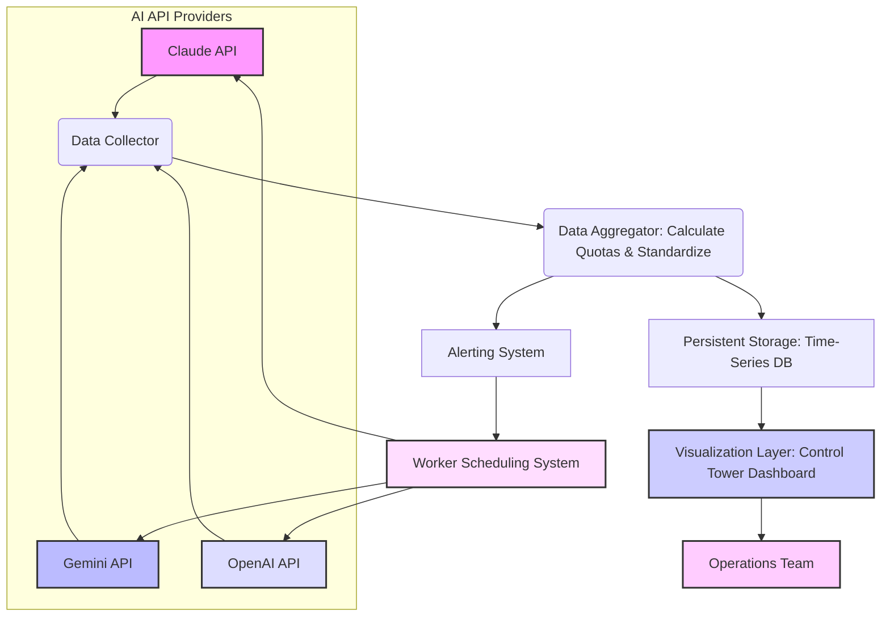

다수의 AI API 공급자(Claude, Gemini, OpenAI 등)를 활용하는 현대적인 AI 프로젝트에서, 각 API의 할당량을 개별적으로 관리하는 것은 비효율적이며 예측 불가능한 서비스 중단이나 비용 초과로 이어질 수 있습니다. 특히 일간, 주간 한도뿐만 아니라 '5시간 한도'와 같은 복합적인 기준은 단순한 잔여량 숫자만으로는 파악하기 어렵습니다. 이러한 문제를 해결하기 위해, 통합 AI API 할당량 모니터링 시스템을 구축하고 중앙 관제 대시보드에 시각화하는 것은 필수적인 운영 전략입니다.

## 핵심 개념: 복합 할당량 시각화 및 워커 스케줄링 연동

AI API 할당량 모니터링의 핵심은 단순히 남은 양을 보여주는 것을 넘어, 현재 가장 주의해야 할 한도를 직관적으로 파악하고 워커 스케줄링 및 비용 관리에 활용하는 데 있습니다. 예를 들어, 전체 주간 한도는 여유롭지만 5시간 롤링 한도가 임박한 경우, 해당 상황을 명확히 인지하고 LLM 사용 패턴을 조정해야 합니다.

이 시스템은 다음과 같은 기능을 포함해야 합니다.

### 다중 LLM 공급자 할당량 통합
서로 다른 API 제공사의 할당량 데이터를 표준화된 형식으로 수집하고 통합하여 단일 뷰에서 관리합니다.

### 복합 할당량 기준 계산 및 시각화
API 공급자별로 상이한 할당량 정책(예: 일별 토큰, 분당 요청, 5시간 롤링 사용량)을 정확히 계산하고, 시계열 데이터와 함께 추세 분석을 제공합니다.

### 워커 스케줄링 시스템 연동
할당량 소진이 임박할 경우, AI 에이전트 워커 스케줄링 시스템에 신호를 보내 해당 LLM 사용을 일시 중지하거나, 비용 효율적이거나 할당량이 충분한 다른 LLM으로 동적으로 전환할 수 있도록 합니다. 이는 서비스 연속성과 비용 최적화를 동시에 달성하는 데 기여합니다.

## 아키텍처 설계: 통합 모니터링 시스템 구성

통합 AI API 할당량 모니터링 시스템은 일반적으로 다음과 같은 구성 요소를 포함합니다.

*   **데이터 수집기 (Data Collector)**: 각 AI API 엔드포인트에 접속하여 할당량 정보를 주기적으로 폴링(polling)합니다. 각 API의 인증 방식 및 Rate Limit 정책을 준수하여 과도한 호출을 방지합니다.
*   **데이터 어그리게이터 (Data Aggregator)**: 수집된 원시 데이터를 표준화된 형식으로 변환하고, 복합 할당량 기준(예: 5시간 롤링 합계)을 계산합니다. 또한, 여러 LLM 공급자의 데이터를 통합하여 중앙 집중식 관리를 용이하게 합니다.
*   **영구 저장소 (Persistent Storage)**: 시계열 데이터베이스(Time-Series Database, TSDB)를 활용하여 할당량 이력 데이터를 저장합니다. 이를 통해 과거 사용량 트렌드 분석 및 미래 사용량 예측이 가능합니다.
*   **시각화 계층 (Visualization Layer)**: 관제탑 대시보드를 통해 잔여 할당량, 현재 소진율, 예측 소진 시간 등 핵심 메트릭스를 실시간으로 시각화합니다. 특히 '주의 필요' 상태의 할당량을 강조하여 표시합니다.



## 구현 예제: Go 기반 모니터링 에이전트 (개념)

Go 언어를 사용하여 각 AI API의 할당량을 가져와 로컬에 기록하는 간단한 모니터링 에이전트의 개념을 보여줍니다. 실제 API 호출 대신 Mock 데이터를 사용했습니다.

```go
package main

import (
	"encoding/json"
	"fmt"
	"log"
	"time"
)

type QuotaInfo struct {
	Provider       string  `json:"provider"`
	LimitType      string  `json:"limitType"`
	TotalLimit     int     `json:"totalLimit"`
	Used           int     `json:"used"`
	Remaining      int     `json:"remaining"`
	ResetTimestamp int64   `json:"resetTimestamp"`
	WarningThreshold float64 `json:"warningThreshold"` // e.g., 0.1 for 10% remaining
}

// Mock function to simulate fetching quota from an AI API
func fetchMockQuota(provider string) (QuotaInfo, error) {
	// In a real scenario, this would make an HTTP request to the AI API
	// and parse its quota response.
	now := time.Now().Unix()
	var quota QuotaInfo

	switch provider {
	case "claude":
		quota = QuotaInfo{
			Provider:         "claude",
			LimitType:        "5hour_token_limit",
			TotalLimit:       2000000,
			Used:             1850000, // High usage to simulate warning
			Remaining:        150000,
			ResetTimestamp:   now + 3600, // Resets in 1 hour
			WarningThreshold: 0.1
		}
	case "gemini":
		quota = QuotaInfo{
			Provider:         "gemini",
			LimitType:        "daily_request_limit",
			TotalLimit:       10000,
			Used:             2500,
			Remaining:        7500,
			ResetTimestamp:   now + 86400, // Resets in 24 hours
			WarningThreshold: 0.2
		}
	default:
		return QuotaInfo{}, fmt.Errorf("unknown provider %s", provider)
	}

	return quota, nil
}

func monitorQuota(provider string) {
	quota, err := fetchMockQuota(provider)
	if err != nil {
		log.Printf("Error fetching %s quota: %v", provider, err)
		return
	}

	// Calculate usage percentage
	usagePct := float64(quota.Used) / float64(quota.TotalLimit)

	// Determine if a warning is needed
	isWarning := float64(quota.Remaining) / float64(quota.TotalLimit) < quota.WarningThreshold

	quotaJSON, _ := json.MarshalIndent(quota, "", "  ")
	log.Printf("Monitoring %s Quota:\n%s", provider, quotaJSON)

	if isWarning {
		log.Printf("!!! WARNING for %s: Remaining %d (%2.2f%%). Reset in %v.",
				provider, quota.Remaining, (1-usagePct)*100, time.Until(time.Unix(quota.ResetTimestamp, 0)))
		// In a real system, send alert to dashboard/slack/pagerduty and trigger worker adjustment
	}
}

func main() {
	log.Println("Starting AI Quota Monitor...")

	providers := []string{"claude", "gemini"}

	// Simulate periodic monitoring
	ticker := time.NewTicker(5 * time.Second) // Check every 5 seconds
	defer ticker.Stop()

	for range ticker.C {
		for _, p := range providers {
			monitorQuota(p)
		}
		fmt.Println("-----------------------------------")
	}
}
```

## 2026년 트렌드 반영: AIOps와 비용 최적화

2026년 AI 생태계는 더욱 복잡해지며, AIOps(Artificial Intelligence for IT Operations)의 중요성이 부각됩니다. AI API 할당량 모니터링은 AIOps의 핵심 구성 요소로, 예측 분석(predictive analytics)을 통해 할당량 소진 임박을 사전에 감지하고 자동화된 대응(autonomic response)을 트리거하는 것이 중요합니다. 이는 Multi-LLM 라우팅 전략과 결합하여, 할당량이 충분한 모델로 동적 전환함으로써 서비스 연속성을 확보하고 비용을 최적화하는 데 기여합니다. 또한, 지속적인 사용량 데이터를 기반으로 LLM 구독 모델을 최적화하는 의사결정 지원 시스템으로 발전할 수 있습니다.

## 트레이드오프

### 1. 커스텀 구현 vs. 상용 SaaS 솔루션
*   **커스텀 구현**: 높은 유연성과 특정 환경에 최적화된 기능을 제공하지만, 초기 개발 비용과 지속적인 유지보수(API 변경 대응 등) 부담이 큽니다. 데이터 주권을 완전히 확보하고 독점적인 경쟁 우위를 구축할 때 좋습니다. 초기 투자와 운영 인력이 충분하지 않을 때 나쁩니다.
*   **상용 SaaS 솔루션**: 빠른 도입과 낮은 유지보수 부담이 장점이지만, 커스터마이징의 한계와 데이터 보안/주권 문제가 있을 수 있습니다. 빠른 프로토타이핑이나 범용적인 모니터링이 필요할 때 좋습니다. 고유한 복합 할당량 기준이나 특정 워커 스케줄링 연동이 필요할 때 나쁩니다.

### 2. 실시간 모니터링 vs. 주기적 배치 처리
*   **실시간 모니터링**: 할당량 소진 상황에 즉각적인 대응이 가능하여 서비스 중단을 최소화합니다. 높은 가용성과 엄격한 SLA를 요구하는 서비스에 좋습니다. API 호출 빈도 증가로 인한 비용 상승 및 API Rate Limit 도달 위험이 높을 때 나쁩니다.
*   **주기적 배치 처리**: API 호출 빈도를 줄여 비용과 Rate Limit 부담을 경감할 수 있습니다. 수 분에서 수 시간 단위의 지연이 허용되는 배치 워크로드에 좋습니다. 즉각적인 대응이 필요한 critical path에는 적합하지 않습니다.

### 3. 세분화된 할당량 기준 vs. 집계된 요약
*   **세분화된 기준**: 특정 워커, 프로젝트, 또는 사용자 그룹별로 할당량을 추적하여 정교한 비용 할당 및 리소스 관리가 가능합니다. 복잡한 멀티테넌트 환경이나 정밀한 비용 분석이 필요할 때 좋습니다. 데이터 처리 및 대시보드 복잡성이 증가하여 초기 구축 비용이 높을 때 나쁩니다.
*   **집계된 요약**: 전체적인 사용량 트렌드를 빠르게 파악할 수 있어 대시보드의 가독성이 높고 시스템 부하가 적습니다. 단순한 비용 개요나 고수준의 운영 상태 확인이 필요할 때 좋습니다. 특정 사용 패턴의 할당량 문제 원인 분석이 어려울 때 나쁩니다.

### 4. LLM 공급자별 개별 연동 vs. 표준화된 추상화 레이어
*   **개별 연동**: 각 LLM API의 고유한 할당량 정보 구조와 기능을 최대한 활용할 수 있습니다. 특정 LLM의 고급 기능을 사용하거나, API 변경에 빠르게 대응해야 할 때 좋습니다. 새로운 LLM이 추가될 때마다 상당한 개발 노력이 필요하고 코드 중복이 발생할 때 나쁩니다.
*   **표준화된 추상화 레이어**: 새로운 LLM 공급자를 쉽게 통합할 수 있는 확장성을 제공하며, 개발 및 유지보수 비용을 절감합니다. 여러 LLM을 자주 추가하거나 교체하는 유연한 아키텍처가 필요할 때 좋습니다. LLM API의 특정 세부 정보를 놓치거나 추상화 오버헤드가 발생할 수 있을 때 나쁩니다.

## 실전 체크리스트

프로젝트에 AI API 할당량 통합 모니터링 기능을 적용할 때 다음 항목들을 검증합니다.

*   [ ] 주요 AI API (Claude, Gemini, OpenAI 등)의 할당량 정보를 수집하는 스크립트 또는 서비스가 주기적으로, 안정적으로 작동하는가?
*   [ ] '5시간 한도', '일간 한도' 등 각 API의 복합적인 할당량 기준을 정확히 계산하고 현재 상태를 시각화할 수 있는 로직이 구현되었는가?
*   [ ] 할당량 소진 임박 시 (예: 잔여량 < 10% 또는 예측 소진 시간 < 1시간) Slack, PagerDuty 등 연동된 채널로 실시간 알림이 발송되는가?
*   [ ] 관제탑 대시보드에 각 AI API의 현재 잔여 할당량, 최근 소진율, 그리고 과거 7일간의 트렌드 그래프가 명확하게 시각화되어 있는가?
*   [ ] 워커 스케줄링 시스템이 할당량 모니터링 데이터를 구독하여, 할당량 부족 LLM 사용을 회피하거나 대체 LLM으로 동적으로 전환하는 기능이 작동하는가?
*   [ ] 새로운 AI API 공급자가 추가될 경우, 기존 시스템에 최소한의 노력으로 모니터링 및 대시보드에 통합할 수 있는 확장성을 확보했는가?
*   [ ] 할당량 모니터링 시스템 자체의 API 호출이 각 LLM 공급자의 Rate Limit에 걸려 모니터링 정보가 유실되지 않도록 충분한 지연, 재시도, 지수 백오프 로직이 구현되었는가?