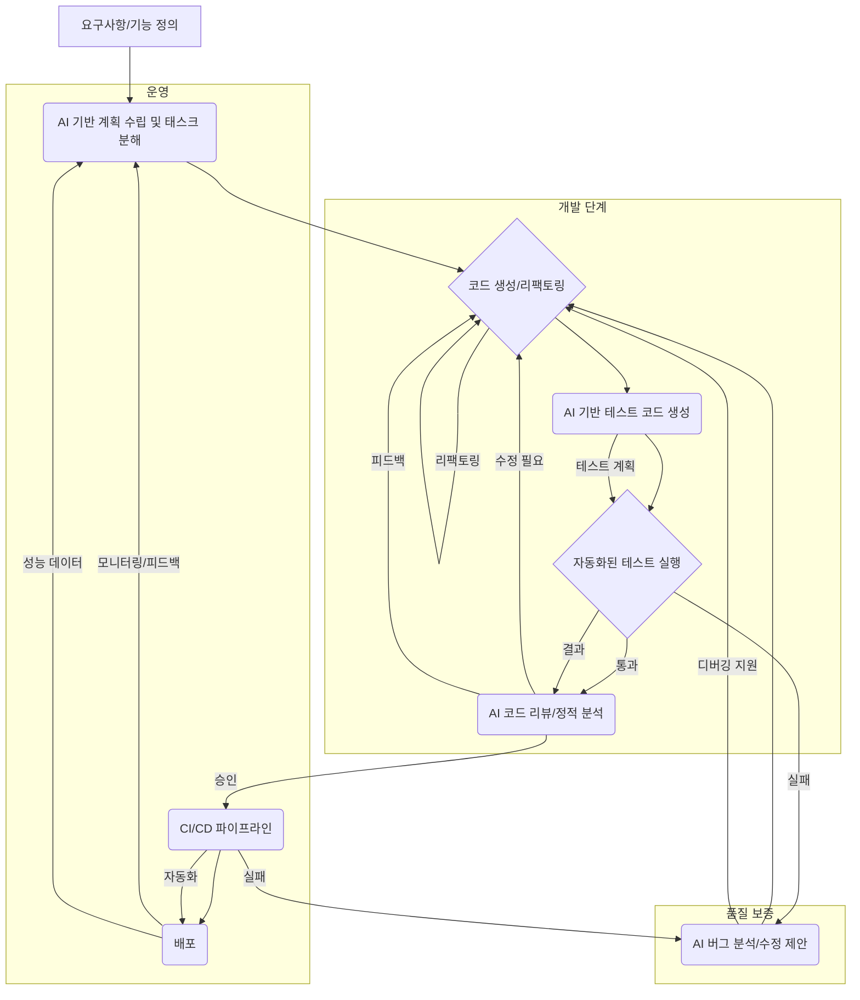

AI-native 엔지니어링 조직으로의 전환은 개발 생산성과 소프트웨어 품질을 혁신하는 핵심 동력으로 부상하고 있다. FurtherAI의 사례에서 볼 수 있듯이, AI는 코드 작성부터 테스트, 리뷰, CI/CD, 버그 접수 및 병합에 이르는 개발 과정 전반에 걸쳐 효율성을 비약적으로 향상시킬 수 있다. 이는 엔지니어링 워크플로에서 수동 검사 규칙을 AI 기반 자동 검사로 전환하고, 반복적인 작업을 자동화하여 엔지니어가 더 가치 있는 업무에 집중하도록 돕는 패러다임 전환을 의미한다.

## AI-Driven SDLC 통합 전략
AI를 엔지니어링 워크플로에 효과적으로 통합하기 위한 구체적인 방안은 소프트웨어 개발 라이프사이클(SDLC)의 각 단계에서 AI의 역량을 최대한 활용하는 것이다.

### AI-Assisted Code Generation and Refactoring
코드 작성 단계에서 AI는 개발자의 생산성을 크게 높일 수 있다. 코파일럿(Copilot)과 같은 도구는 컨텍스트에 맞는 코드 스니펫을 제안하고, 복잡한 로직을 구현하는 데 도움을 준다. 더 나아가, AI 에이전트는 기존 코드베이스를 분석하여 리팩토링이 필요한 부분을 식별하고, 최적화된 코드를 자동으로 생성하거나 제안할 수 있다. 이는 일관된 코드 스타일을 유지하고 기술 부채를 줄이는 데 기여한다.

### Intelligent Automated Testing and Validation
테스트는 소프트웨어 품질 보증의 핵심이지만, 많은 시간이 소요되는 작업이다. AI는 다음 영역에서 테스트 프로세스를 혁신한다:

*   **테스트 케이스 자동 생성**: 요구사항 문서나 기존 코드를 기반으로 유닛 테스트, 통합 테스트, 심지어 UI 테스트 케이스까지 자동으로 생성한다.
*   **테스트 데이터 생성**: 특정 시나리오를 커버하는 현실적인 테스트 데이터를 생성하여 수동 데이터 준비 부담을 줄인다.
*   **테스트 결과 분석 및 보고**: 테스트 실행 후 방대한 로그와 결과를 분석하여 잠재적 버그의 근본 원인을 파악하고, 명확한 보고서를 생성한다.
*   **회귀 테스트 최적화**: 코드 변경이 기존 기능에 미치는 영향을 예측하여, 가장 관련성이 높은 회귀 테스트를 우선적으로 실행하도록 제안한다.

### Enhanced Code Review and Feedback Loops
코드 리뷰는 품질 향상에 필수적이지만, 사람의 시간과 전문 지식에 크게 의존한다. AI는 이 과정을 보완하고 강화한다.

*   **AI 기반 코드 리뷰어**: 스타일 가이드 위반, 잠재적 버그, 보안 취약점, 성능 저하 요인 등을 자동으로 감지하여 코드 리뷰어의 부담을 줄인다. 이는 엔지니어만 알던 규칙을 자동 검사로 전환하는 핵심 부분이다.
*   **피드백 요약 및 제안**: PR(Pull Request)에 대한 AI 리뷰 피드백을 요약하고, 개선을 위한 구체적인 코드 변경을 제안하여 리뷰-수정 주기를 단축한다.
*   **학습 기반 개선**: 과거의 코드 변경 사항과 리뷰 패턴을 학습하여, 시간이 지남에 따라 AI 리뷰의 정확도와 유용성을 높인다.

### CI/CD Pipeline Optimization with AI
CI/CD(Continuous Integration/Continuous Deployment) 파이프라인은 소프트웨어 전달의 속도를 결정한다. AI는 이 파이프라인의 병목 현상을 해결하고 효율성을 높인다.

*   **예측적 CI/CD**: 과거 CI/CD 실패 이력을 분석하여 특정 코드 변경이 파이프라인 실패로 이어질 가능성을 예측하고, 선제적으로 경고하거나 대체 전략을 제안한다.
*   **리소스 최적화**: 빌드 및 테스트 환경의 리소스 사용량을 AI가 분석하여, 가장 효율적인 리소스 할당 방안을 제안하여 비용을 절감한다.
*   **배포 자동화 지능화**: A/B 테스트 결과, 사용자 피드백, 시스템 성능 지표 등을 AI가 실시간으로 분석하여, 안전하고 최적의 배포 시점을 결정한다.

### Proactive Bug Detection and Remediation
버그 발견 및 수정은 개발 비용의 상당 부분을 차지한다. AI는 이 과정을 사전 예방적으로 바꾼다.

*   **로그 및 모니터링 데이터 분석**: 운영 중인 시스템의 로그, 메트릭, 사용자 피드백을 AI가 실시간으로 분석하여 잠재적인 문제를 조기에 감지한다. 이는 버그가 사용자에게 도달하기 전에 선제적으로 대응할 수 있게 한다.
*   **근본 원인 분석(Root Cause Analysis)**: 감지된 문제에 대해 AI가 관련 로그, 코드 변경 이력, 시스템 구성을 종합적으로 분석하여 버그의 근본 원인을 파악하는 데 도움을 준다.
*   **자동 수정 제안 및 적용**: 간단한 버그에 대해서는 AI가 자동으로 수정 코드를 제안하고, 승인 시 자동 적용까지 수행하여 문제 해결 시간을 대폭 단축한다.

## AI 기반 엔지니어링 워크플로 통합 다이어그램


## AI 기반 자동화 코드 예시 (Python)
아래 예시는 AI 에이전트가 코드 변경사항에 대해 정적 분석 도구를 활용하여 잠재적 문제를 감지하고 수정 제안을 생성하는 과정을 시뮬레이션한다.

```python
import json

def run_static_analysis_tool(file_path: str) -> dict:
    # 실제 정적 분석 도구(예: Pylint, ESLint)를 호출하고 JSON 형식의 결과를 반환하는 함수
    # 여기서는 가상의 결과를 반환합니다.
    if "buggy_code.py" in file_path:
        return {
            "file": file_path,
            "issues": [
                {"line": 10, "type": "error", "message": "Unused variable 'temp'"},
                {"line": 15, "type": "warning", "message": "Potential SQL injection vulnerability"}
            ]
        }
    return {"file": file_path, "issues": []}

def ai_agent_code_review(code_changes: str, file_path: str) -> str:
    print(f"Analyzing code changes in {file_path} with AI...")
    analysis_results = run_static_analysis_tool(file_path)

    if analysis_results["issues"]:
        response = f"AI Review: Found issues in {file_path}:\n"
        for issue in analysis_results["issues"]:
            response += f"- Line {issue['line']}: {issue['type'].upper()} - {issue['message']}\n"
        response += "\nAI suggests: Please review these findings and consider applying the following fixes:\n"
        
        # AI LLM 호출을 시뮬레이션하여 수정 제안을 생성합니다.
        if "Unused variable" in str(analysis_results["issues"]):
            response += "- Remove or use the 'temp' variable on line 10.\n"
        if "SQL injection" in str(analysis_results["issues"]):
            response += "- Use parameterized queries for database operations on line 15.\n"
        
        return response
    else:
        return f"AI Review: No critical issues found in {file_path}. Looks good!"

# 예제 사용
changed_file_path = "src/buggy_code.py"
code_to_review = """
# This is a sample buggy Python file
def process_data(data):
    temp = 0
    if data == "admin";
        # Potentially vulnerable code
        query = f"SELECT * FROM users WHERE username = '{data}'"
        print("Executing query")
    return len(data)
"""

review_output = ai_agent_code_review(code_to_review, changed_file_path)
print(review_output)

changed_file_path_clean = "src/clean_code.py"
clean_code = """
def calculate_sum(a, b):
    return a + b
"""
review_output_clean = ai_agent_code_review(clean_code, changed_file_path_clean)
print(review_output_clean)
```

## 트레이드오프
AI 기반 엔지니어링 워크플로 자동화 및 품질 향상 방안을 도입할 때는 다음과 같은 트레이드오프를 고려해야 한다.

*   **초기 설정 복잡성 vs. 장기적 효율성**: 초기 AI 시스템 구축 및 기존 워크플로와의 통합은 상당한 시간과 리소스(예: 프롬프트 엔지니어링/harness-engineering)를 요구한다. 이는 단기적으로는 생산성 저하를 유발할 수 있으나, 장기적으로는 반복 작업 감소, 버그 감소, 배포 속도 향상으로 압도적인 ROI를 제공한다. **언제 좋은가**: 장기적인 관점에서 개발팀의 규모가 커지고 반복적인 수동 작업이 많을 때. **언제 나쁜가**: 소규모 프로젝트로 빠르게 MVP를 출시해야 하거나, AI 전문가 확보가 어려울 때.
*   **AI의 환각(Hallucination) 및 편향(Bias) vs. 생산성 증대**: AI가 생성하는 코드, 테스트 케이스, 리뷰 피드백은 때때로 부정확하거나(hallucination) 기존 데이터의 편향(bias)을 반영할 수 있다. 이는 추가적인 검증(evaluation/llm-output-validation-pipeline-enhancement)과 수정 작업을 필요로 하여 AI의 생산성 이점을 상쇄할 수 있다. **언제 좋은가**: 사람의 검증을 거치는 피드백 루프(evaluation/eval-driven-development-llm-output-validation)가 잘 구축되어 있고, AI의 실수를 빠르게 잡아낼 수 있을 때. **언제 나쁜가**: AI 생성물의 최종 검토자 없이 전적으로 AI에 의존하여 배포할 때, 또는 AI 학습 데이터에 심각한 편향이 있을 때.
*   **제어 및 투명성 vs. 자율성**: AI 에이전트(agents/autonomous-ai-agent-decision-logic-implementation-patterns)에게 높은 수준의 자율성을 부여할수록 워크플로는 더 빠르게 진행되지만, 의사결정 과정의 투명성이 떨어지고 통제가 어려워질 수 있다. 이는 예기치 않은 부작용이나 보안 문제(project-ops/ai-agent-secret-exposure-prevention-key-amnesia)로 이어질 위험이 있다. **언제 좋은가**: 명확한 가드레일(agents/ai-agent-control-accountability-guardrails)과 모니터링 시스템(evaluation/llm-agent-observability-spanlens-trace-monitoring)이 구축되어 있고, 반복적이고 정형화된 작업에 AI를 활용할 때. **언제 나쁜가**: 핵심 비즈니스 로직이나 중요한 보안 영역에 대해 AI에게 전적인 자율성을 부여할 때.
*   **기술 스택 변화 저항 vs. 최신 기술 채택**: 기존 엔지니어링 조직은 새로운 AI 기술 스택(agents/agent-native-framework-unified-action-layer) 도입에 저항하거나 학습 곡선으로 인한 일시적인 생산성 저하를 겪을 수 있다. 이는 기술 부채 증가나 혁신 기회 상실로 이어질 수 있다. **언제 좋은가**: 기술 변화에 대한 팀의 의지가 강하고, 장기적인 경쟁력 강화를 목표로 할 때. **언제 나쁜가**: 변화 관리가 미숙하거나, 팀원들의 AI 기술 수용도가 낮을 때.

## 실전 체크리스트
AI 기반 엔지니어링 워크플로 자동화를 프로젝트에 성공적으로 적용하기 위한 실전 체크리스트는 다음과 같다.

- [ ] **AI 적용 범위 명확화**: 현재 워크플로에서 AI가 가장 큰 가치를 제공할 수 있는 특정 영역(예: 유닛 테스트 자동 생성, 초기 코드 리뷰)을 식별하고 우선순위를 정한다.
- [ ] **성능 지표 정의 및 측정**: AI 도입 전후의 핵심 성능 지표(예: 엔지니어당 하루 병합 건수, 버그 밀도, CI/CD 시간, 변경 되돌림 비율)를 명확히 정의하고 지속적으로 측정할 계획을 수립한다.
- [ ] **인간-AI 협업 모델 설계**: AI 에이전트의 자율성 수준을 결정하고, 인간의 검토 및 승인 프로세스를 명확히 하여 안전하고 효율적인 협업 모델(agents/ai-human-collaborative-workspace-architecture-buzz)을 구축한다.
- [ ] **보안 및 개인 정보 보호 강화**: AI가 코드, 데이터, 시스템 접근 권한을 다룰 때 발생할 수 있는 보안 취약점(evaluation/ai-agent-sandbox-escape-security-hardening) 및 개인 정보 보호 문제를 사전에 파악하고 적절한 제어 메커니즘을 구현한다.
- [ ] **점진적 도입 및 피드백 루프 구축**: 한 번에 모든 것을 자동화하기보다는 작은 성공 사례를 만들고, AI 에이전트의 성능에 대한 지속적인 피드백 루프(agents/autonomous-agent-feedback-loop-design-patterns)를 통해 시스템을 개선한다.
- [ ] **기존 도구 및 시스템과의 통합 전략 수립**: AI 솔루션이 기존의 Git, CI/CD 시스템, 이슈 트래킹 도구 등과 원활하게 연동될 수 있도록 통합 방안(agents/ai-agent-external-tool-integration-patterns)을 계획한다.
- [ ] **AI 시스템의 비용 및 자원 모니터링**: AI 모델 사용에 따른 API 비용, 컴퓨팅 자원 사용량 등을 지속적으로 모니터링하고, 비용 효율적인 운영 방안(harness-engineering/llm-cost-optimization-design-patterns)을 마련한다.