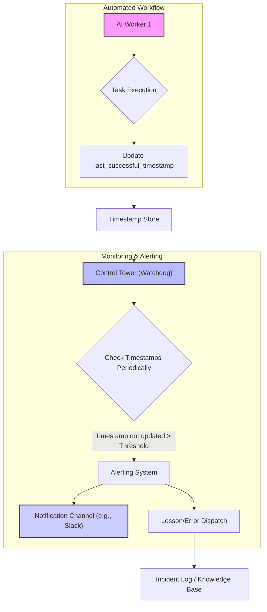

AI 기반 자동화 워커가 반복 작업을 수행할 때 '사일런트 실패(silent failure)'는 심각한 운영 문제를 야기합니다. 이는 워커가 명시적인 오류 없이 작동을 멈추거나 잘못된 결과를 조용히 생성하는 상태로, 데이터의 비활성, 기한 지연 또는 서비스 품질 저하로 이어집니다. AI 에이전트가 더욱 자율적이고 복잡해지는 2026년 환경에서는 이러한 자동화 워크플로우의 '드리프트(drift)'를 사전에 감지하는 것이 시스템 신뢰성 및 운영 무결성 유지에 필수적입니다.

### AI 자동화에서의 사일런트 드리프트 문제

사일런트 실패는 AI 워커가 예상치 못한 외부 요인이나 미묘한 내부 상태 변화를 적절히 처리하지 못할 때 발생합니다. 일반적인 시나리오는 다음과 같습니다.
*   **외부 서비스 세션 만료**: 타사 서비스(예: 웹사이트 로그인)의 OAuth 토큰 또는 세션 쿠키가 시간이 지나 만료됩니다.
*   **API Rate Limit 소진**: API 할당량이 점진적으로 소진되어 치명적인 오류 없이 작업이 중단됩니다.
*   **업스트림 데이터 스키마 변경**: 외부 데이터 소스의 사소한 변경으로 AI 워커의 파싱 로직이 조용히 실패하거나 부정확한 출력을 생성합니다.
*   **일시적 네트워크 문제**: 간헐적인 네트워크 불안정으로 작업이 일시적으로 차단되지만, 워커가 견고한 재시도 로직이나 적절한 상태 관리를 갖추지 못합니다.

이러한 상황들은 워커 프로세스의 *존재* 뿐만 아니라 의도된 작업을 성공적으로 완료하는 *활성(liveness)* 및 *효과성(effectiveness)*을 모니터링하기 위한 견고한 메커니즘의 필요성을 부각합니다.

### 타임스탬프 기반 워치독 시스템 구현

사일런트 실패를 감지하는 매우 효과적인 패턴은 `last_successful_timestamp` 기반 워치독(watchdog)입니다. 이 접근 방식은 각 AI 워커(또는 워크플로우 내 특정 임계 작업)가 핵심 작업을 성공적으로 완료할 때마다 중앙 집중식의 고가용성 저장소(예: Redis, 전용 데이터베이스 테이블, 공유 파일 시스템)에 타임스탬프를 업데이트하도록 합니다. 별도의 “워치독” 컴포넌트는 주기적으로 이 타임스탬프들을 검사합니다. 만약 워커의 `last_successful_timestamp`가 미리 정의된 간격(예: 15분, 1시간) 내에 업데이트되지 않았다면, 워치독은 해당 워커를 실패 상태로 간주하고 경고를 트리거합니다.

#### 아키텍처 개요

이 시스템은 일반적으로 다음으로 구성됩니다:
1.  **AI 워커(들)**: 자동화된 작업을 실행합니다.
2.  **타임스탬프 저장소**: `last_successful_timestamp` 업데이트를 위한 영구적이고 공유 가능한 데이터 저장소입니다.
3.  **관제탑(워치독)**: 주기적으로 타임스탬프를 확인하고 이상 징후를 감지합니다.
4.  **알림 시스템**: 이상 징후 감지 시 알림(Slack, Email, PagerDuty 등)을 발송합니다.
5.  **Lesson/Error Dispatch**: 사후 분석 및 개선을 위해 사건을 기록합니다.



#### 워커 구현

각 AI 워커는 주요 기능을 성공적으로 완료한 후 자신의 `last_successful_timestamp`를 업데이트할 책임이 있습니다. 이 작업은 견고하게 이루어져야 하며, 모든 중요한 부수 효과(예: 데이터베이스 쓰기, API 호출)가 성공적으로 커밋된 *후*에 수행되는 것이 이상적입니다.

```python
import datetime
import redis

def run_ai_worker_task(worker_id):
    try:
        # Simulate AI worker's core logic
        # ... perform complex operations ...

        # Update timestamp only upon definitive success
        update_last_successful_timestamp(worker_id)
        
    except Exception as e:
        # Log specific error details for debugging
        # Do NOT update timestamp on failure
        print(f"[{worker_id}] Task failed: {e}")

def update_last_successful_timestamp(worker_id):
    # Example using Redis
    r = redis.StrictRedis(host='localhost', port=6379, db=0)
    current_time = datetime.datetime.now().isoformat()
    r.set(f"worker:{worker_id}:last_successful", current_time)

# Example usage:
# worker_id = "browser-automation-agent-001"
# run_ai_worker_task(worker_id)
```

#### 워치독 구현 (Control Tower)

워치독 프로세스는 독립적으로 실행되며, 정기적인 간격으로 타임스탬프 저장소를 쿼리합니다.

```python
import datetime
import time
import redis
import requests

ALERT_THRESHOLD_SECONDS = 900 # 15 minutes
WORKER_IDS = ["browser-automation-agent-001", "data-ingestion-bot-002"]
SLACK_WEBHOOK_URL = "YOUR_SLACK_WEBHOOK_URL"

def send_alert(message):
    payload = {"text": message}
    try:
        requests.post(SLACK_WEBHOOK_URL, json=payload).raise_for_status()
    except requests.exceptions.RequestException as e:
        print(f"Failed to send Slack alert: {e}")

def check_worker_status():
    r = redis.StrictRedis(host='localhost', port=6379, db=0)
    for worker_id in WORKER_IDS:
        last_successful_str = r.get(f"worker:{worker_id}:last_successful")
        
        if last_successful_str:
            last_successful = datetime.datetime.fromisoformat(last_successful_str.decode('utf-8'))
            time_since_last_success = (datetime.datetime.now() - last_successful).total_seconds()

            if time_since_last_success > ALERT_THRESHOLD_SECONDS:
                send_alert(f"❗ AI Worker '{worker_id}' silent failure detected! Last successful update was {int(time_since_last_success / 60)} minutes ago.")
        else:
            send_alert(f"❗ AI Worker '{worker_id}' has no successful timestamp recorded. Possibly never ran or initial setup issue.")

# Main watchdog loop:
# if __name__ == "__main__":
#     while True:
#         check_worker_status()
#         time.sleep(300) # Check every 5 minutes
```

### 2026년 트렌드 및 고급 고려사항

2026년에는 동적 툴 사용과 자가 수정 기능을 갖춘 고급 AI 에이전트의 사일런트 실패를 찾아내기가 더욱 어려워질 수 있습니다. `last_successful_timestamp` 패턴은 여전히 기본적인 구성 요소로 유효합니다.
*   **세분화된 타임스탬프**: 워커당 하나의 타임스탬프 대신, 에이전트 워크플로우 내의 중요한 하위 작업이나 툴 호출에 대한 타임스탬프를 구현하여 복잡한 에이전트의 *어떤 부분*이 조용히 실패하는지 더 세밀하게 감지합니다.
*   **LLM 관측 가능성(Observability) 통합**: 타임스탬프 검사를 LLM 관측 가능성 플랫폼(`spanlens-trace-monitoring`)과 통합하여 사일런트 실패를 특정 프롬프트-응답 주기 또는 툴 출력과 연관시킵니다.
*   **자동화된 개선**: 감지 시, 인적 개입이 발생하기 전에 자동화된 개선 플레이북(예: 워커 재시작, 세션 재인증, 캐시 지우기)을 트리거합니다. 이는 자가 복구 시스템을 위한 SRE 원칙과 일치합니다.

## 트레이드오프

### 1. 단순성 vs. 세분화된 진단
*   **언제 좋은가**: 기본적인 자동화 작업이나 워커 전체의 생존(liveness) 여부만 중요한 경우, 구현 및 유지보수가 매우 간단하며 빠른 시간 내에 최소한의 비용으로 모니터링 시스템을 구축할 수 있습니다.
*   **언제 나쁜가**: 복잡한 다단계 AI Agent 워크플로우에서 특정 서브 태스크나 툴 사용에서만 조용히 실패하는 경우, 전체 워커가 멈추지 않는 한 이 패턴만으로는 정확한 실패 지점을 빠르게 식별하기 어렵습니다. 이는 세분화된 디버깅을 지연시킬 수 있습니다.

### 2. 비용 효율성 vs. 실시간성
*   **언제 좋은가**: 대부분의 반복 작업은 몇 분에서 몇 시간 주기로 성공 여부를 확인해도 충분합니다. 낮은 빈도로 데이터베이스/Redis에 접근하고, 주기적인 체크로 자원 소모가 적어 비용 효율적입니다.
*   **언제 나쁜가**: 밀리초 단위의 실시간 반응성과 완전한 데이터 무결성이 요구되는 금융 거래, 보안 시스템과 같은 미션 크리티컬한 작업에는 적합하지 않습니다. '최대 N분 지연'이라는 내재적인 한계가 있습니다.

### 3. 쉬운 구현 vs. 오탐(False Positive) 가능성
*   **언제 좋은가**: 특정 Agent의 동작이 예측 가능한 안정적인 패턴을 가질 때, 임계값을 잘 설정하면 높은 정확도로 실제 실패를 감지할 수 있습니다.
*   **언제 나쁜가**: AI Agent의 동작 시간이 가변적이거나, 외부 요인(네트워크 지연, 외부 API 응답 시간)에 따라 성공 시점이 크게 달라질 수 있는 경우, 고정된 임계값은 오탐을 유발할 수 있습니다. 너무 민감하면 불필요한 알림 폭주로 SRE 피로도를 증가시키고, 너무 둔감하면 실제 실패를 놓칠 위험이 있습니다.

### 4. 확장성 vs. 중앙 집중형 의존성
*   **언제 좋은가**: 수많은 워커가 독립적으로 작업을 수행하고, 중앙 Timestamp Store (예: Redis 클러스터, 분산 DB)가 높은 가용성을 보장하는 경우, 시스템 전체의 확장성이 뛰어납니다.
*   **언제 나쁜가**: Timestamp Store 자체가 SPOF (Single Point of Failure)가 되거나 성능 병목이 될 수 있습니다. 이 스토어의 가용성이 전체 모니터링 시스템의 신뢰성을 결정합니다.

## 실전 체크리스트

프로젝트에 AI 워커의 사일런트 실패 감지 및 알림 시스템을 적용할 때 다음 항목들을 검증합니다.

*   [ ] **핵심 작업 식별**: 각 AI 워커가 수행하는 가장 중요한 '성공' 지점을 명확히 정의하고 문서화합니다. (예: "데이터베이스에 최종 결과 레코드 삽입 완료", "타겟 웹사이트 로그인 성공 및 초기 데이터 스크래핑 완료")
*   [ ] **`last_successful_timestamp` 업데이트 로직 검증**: 워커가 정의된 '성공' 지점에 도달했을 때만 Timestamp Store에 정확히 `YYYY-MM-DDTHH:MM:SSZ` 형식으로 타임스탬프를 업데이트하는지 유닛/통합 테스트를 통해 검증합니다. 실패 경로에서는 절대 업데이트되지 않아야 합니다.
*   [ ] **Timestamp Store 고가용성 확보**: Timestamp Store (Redis, DB 테이블 등)가 워커나 Watchdog의 장애와 무관하게 고가용성 및 내구성을 보장하는지 확인합니다. (클러스터링, 백업, 복제 전략)
*   [ ] **워치독 임계값 최적화**: 각 워커의 정상적인 작업 완료 시간 분포를 분석하여 오탐을 최소화하면서 실제 실패를 빠르게 감지할 수 있는 `ALERT_THRESHOLD_SECONDS` 값을 설정합니다. 초기에는 여유롭게 설정하고 점진적으로 줄여나갑니다.
*   [ ] **알림 채널 및 에스컬레이션 정책 설정**: 워치독이 감지한 알림이 지정된 알림 채널(Slack, PagerDuty, Email)로 즉시 전송되는지 확인하고, 긴급도에 따른 에스컬레이션 정책(주간/야간 담당자, 자동 티켓 생성)이 명확히 정의되어 있는지 검토합니다.
*   [ ] **초기 실패/시작 미기록 감지**: 워커가 처음 실행되거나 어떤 이유로든 `last_successful_timestamp`가 전혀 기록되지 않았을 때, Watchdog이 이를 '실패'로 감지하고 알림을 발생시키는지 테스트합니다.
*   [ ] **반복 알림 방지 메커니즘**: 동일한 실패에 대해 불필요하게 반복 알림이 발생하지 않도록, 일정 시간 동안은 한 번만 알림을 보내거나 문제 해결 시까지 알림을 억제하는 기능을 구현했는지 확인합니다.
*   [ ] **incident log/Lesson 기록 확인**: 발생한 silent failure가 incident log에 자동으로 기록되고, 향후 분석 및 개선을 위한 정보(발생 시간, 워커 ID, 감지된 지연 시간)가 포함되는지 검증합니다.
