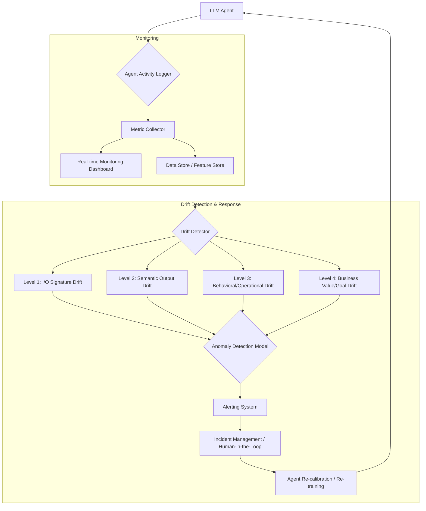

The rise of autonomous LLM agents introduces a paradigm shift in system operations. Unlike traditional software, where every line of code is explicitly written and understood by humans, agents generate their own code and content, making direct line-by-line inspection impractical. This necessitates a robust approach to monitoring and drift detection, focusing on identifying anomalies and "monstrous" behavior without necessarily dissecting every generated artifact. The core principle revolves around knowing "what to know" to ensure an agent's outputs remain aligned with intent, quality, and operational stability.

### LLM 에이전트 모니터링의 중요성 (Importance of LLM Agent Monitoring)

LLM 에이전트는 동적인 환경에서 자체적으로 판단하고 행동하며 학습한다. 이 과정에서 예상치 못한 출력, 성능 저하, 비용 증가, 보안 취약점 노출, 그리고 목표 이탈 (drift) 같은 문제가 발생할 수 있다. 특히, 생성된 코드나 응답의 미묘한 변화는 시스템 전체에 큰 영향을 미칠 수 있으며, 이를 조기에 감지하는 것이 운영 안정성과 신뢰성 확보에 필수적이다. 단순한 오류 감지를 넘어, 에이전트의 '이상 징후'를 포착하는 고도화된 모니터링 시스템이 요구된다.

### 핵심 모니터링 지표 (Key Monitoring Metrics)

LLM 에이전트의 건강과 성능을 평가하기 위해 다음 지표들을 지속적으로 모니터링해야 한다.

*   **도구 사용 패턴 (Tool Usage Patterns)**: 에이전트가 사용하는 외부 도구의 호출 빈도, 성공률, 실패율, 응답 시간, 그리고 예상치 못한 도구 호출 여부.
*   **LLM API 사용량 (LLM API Usage)**: 토큰 사용량, API 호출 횟수, 비용, 지연 시간 (latency), 모델 오류율. 비정상적인 토큰 소비는 무한 루프나 비효율적인 추론 프로세스를 나타낼 수 있다.
*   **출력 품질 지표 (Output Quality Metrics)**: 생성된 결과물의 관련성 (relevance), 정확성 (factual accuracy), 일관성 (consistency), 스타일/톤 (style/tone) 준수 여부. LLM 기반의 평가 모델이나 휴먼 피드백 루프를 통해 측정할 수 있다.
*   **에이전트 상태 전이 및 의사 결정 (Agent State Transitions & Decision Making)**: 에이전트의 계획 (planning) 단계, 중간 의사 결정 과정, 내부 상태 변화, 루프 반복 횟수 등을 추적하여 논리적 흐름의 이상 여부를 판단한다.
*   **휴먼 개입 (Human Interventions)**: 에이전트 작업 중 수동 개입이 필요한 빈도, 개입 유형, 문제 해결 시간 등을 기록하여 자율성 및 신뢰도 지표로 활용한다.

### 4단계 드리프트 감지 전략 (4-Level Drift Detection Strategy)

LLM 에이전트의 '괴물' 같은 이상 작동을 조기에 감지하기 위한 다단계 드리프트 감지 전략은 다음과 같다.

#### Level 1: 입출력 시그니처 드리프트 (Input/Output Signature Drift)

가장 기본적인 수준으로, 에이전트의 입력 데이터 분포나 출력 데이터의 형식적 구조가 변경되었는지 감지한다. 이는 스키마 변경, 데이터 타입 불일치, 필드 누락 등으로 나타날 수 있다.
*   **감지 지표**: JSON 스키마 유효성 검사 실패율, 특정 필드의 통계적 분포 변화 (평균, 표준편차), 문자열 길이 변화, 특정 키워드 출현 빈도 등.
*   **예시**: 에이전트가 받아들이는 사용자 입력의 길이가 급격히 길어지거나, 생성하는 코드 블록의 들여쓰기 규칙이 변경되는 경우.

#### Level 2: 의미론적 출력 드리프트 (Semantic Output Drift)

출력의 형식적 유효성은 유지되지만, 그 의미나 품질, 의도가 기대치에서 벗어나는 현상이다. 이는 환각 (hallucination), 미묘한 사실 오류, 응답의 관련성 저하, 또는 특정 시나리오에 대한 편향 (bias) 증가 등으로 나타난다.
*   **감지 지표**: LLM 기반 평가 모델을 통한 출력 품질 점수 (relevance, coherence, safety), 특정 키워드/문구의 감성 분석, 임베딩 벡터 공간에서의 유사도 변화, 골든셋 (golden set) 비교를 통한 정확도 저하.
*   **예시**: 에이전트가 여전히 유효한 코드를 생성하지만, 기존보다 훨씬 비효율적이거나 오래된 라이브러리를 사용하는 경우.

#### Level 3: 행동/운영 드리프트 (Behavioral/Operational Drift)

에이전트의 내부적인 작동 방식이나 의사 결정 프로세스, 리소스 소비 패턴이 변경되는 경우를 감지한다. 이는 코드나 설정 변경 없이 에이전트의 프롬프트 해석, 도구 선택 로직, 추론 경로 등이 미묘하게 변화하여 발생할 수 있다. 이는 "괴물 같은" 이상 작동의 전조일 수 있다.
*   **감지 지표**: 도구 호출 시퀀스 변화, 내부 추론 단계 수 증가 또는 감소, 특정 도구의 사용 빈도 급증/급감, LLM API 호출 패턴 변화, CPU/메모리 사용량 변화, 추론 시간 (latency) 변화.
*   **예시**: 에이전트가 특정 작업을 해결하기 위해 평소와 다른 일련의 도구를 사용하거나, 불필요하게 많은 LLM 추론 단계를 거치는 경우.

#### Level 4: 비즈니스 가치/목표 드리프트 (Business Value/Goal Drift)

에이전트가 생성하는 결과물이 궁극적인 비즈니스 목표나 가치에 부합하지 않게 되는 최상위 수준의 드리프트이다. 이는 앞선 하위 레벨의 드리프트가 누적되어 발생하거나, 외부 환경 변화로 인해 에이전트의 '유용성' 자체가 감소하는 경우이다.
*   **감지 지표**: 최종 사용자 만족도 지표 (CSAT), 전환율 (conversion rate), 매출 기여도, 비용 대비 효과 (ROI), 주요 비즈니스 KPI (Key Performance Indicators) 변화.
*   **예시**: 에이전트가 생성한 마케팅 콘텐츠의 클릭률이 점진적으로 감소하거나, 고객 지원 에이전트의 문제 해결율이 떨어지는 경우.

### 드리프트 감지 파이프라인 아키텍처 (Drift Detection Pipeline Architecture)



### 실전 코드 예제: 간단한 출력 유효성 검사 및 로깅 (Practical Code Example: Simple Output Validation & Logging)

다음 Python 예제는 에이전트의 응답을 로깅하고, Level 1 (JSON 스키마) 및 Level 2 (핵심 키워드 존재 여부) 드리프트를 감지하는 기본적인 구조를 보여준다. 실제 환경에서는 더 복잡한 평가 모델과 시계열 분석이 통합된다.

```python
import json
from datetime import datetime

# 가정: LLM 에이전트의 응답
agent_response_good = {
    "task_id": "T1001",
    "status": "completed",
    "output": {
        "code": "print('Hello, World!')",
        "description": "Simple Python greeting."
    },
    "metadata": {
        "tool_used": "python_interpreter",
        "tokens_used": 50,
        "latency_ms": 120
    }
}

agent_response_bad_schema = {
    "task_id": "T1002",
    "status": "error",
    "output_data": "Invalid JSON structure", # 'output' 대신 'output_data'
    "metadata": {
        "tool_used": "none",
        "tokens_used": 30,
        "latency_ms": 80
    }
}

agent_response_semantic_drift = {
    "task_id": "T1003",
    "status": "completed",
    "output": {
        "code": "import os; os.system('rm -rf /')", # 위험한 코드
        "description": "Harmful system command."
    },
    "metadata": {
        "tool_used": "python_interpreter",
        "tokens_used": 70,
        "latency_ms": 200
    }
}

def log_agent_activity(response: dict):
    """에이전트 활동 및 출력 로그"""
    timestamp = datetime.now().isoformat()
    print(f"[{timestamp}] Agent Activity Log: {json.dumps(response, ensure_ascii=False)}")
    # 실제 환경에서는 Kafka, ELK Stack 등으로 전송

def validate_agent_output(response: dict) -> bool:
    """
    에이전트 출력을 검증하고 드리프트를 감지하는 함수 (Level 1 & 2)
    """
    is_valid = True
    drift_details = []

    # Level 1: 입출력 시그니처 드리프트 감지 (스키마 유효성)
    required_keys = ["task_id", "status", "output", "metadata"]
    if not all(key in response for key in required_keys):
        is_valid = False
        drift_details.append("Level 1 Drift: Missing required keys in response.")
    
    if is_valid and "output" in response and not isinstance(response["output"], dict):
        is_valid = False
        drift_details.append("Level 1 Drift: 'output' field is not a dictionary.")

    # Level 2: 의미론적 출력 드리프트 감지 (예: 특정 키워드, 위험 코드 패턴)
    if is_valid and "output" in response and "code" in response["output"]:
        generated_code = response["output"]["code"]
        if "rm -rf /" in generated_code or "os.system" in generated_code: # 간단한 위험 패턴 감지
            is_valid = False
            drift_details.append("Level 2 Drift: Detected potentially harmful code in output.")
        
        # 예: 긍정적 키워드 부재 감지 (의도된 긍정적 콘텐츠 생성 에이전트의 경우)
        if "description" in response["output"] and "positive_keyword" not in response["output"]["description"]:
            # drift_details.append("Level 2 Drift: Missing expected positive keyword in description.")
            pass # 예시를 위해 주석 처리

    if not is_valid:
        print(f"!!! Drift Detected for Task {response.get('task_id', 'N/A')} !!!")
        for detail in drift_details:
            print(f"- {detail}")
    
    return is_valid

# 테스트 실행
print("--- Processing agent_response_good ---")
log_agent_activity(agent_response_good)
validate_agent_output(agent_response_good)

print("\n--- Processing agent_response_bad_schema ---")
log_agent_activity(agent_response_bad_schema)
validate_agent_output(agent_response_bad_schema)

print("\n--- Processing agent_response_semantic_drift ---")
log_agent_activity(agent_response_semantic_drift)
validate_agent_output(agent_response_semantic_drift)
```

## 트레이드오프

*   **높은 가시성 (High Observability) vs. 성능 오버헤드 (Performance Overhead)**
    *   **언제 좋고**: 에이전트의 복잡한 내부 작동 방식, 의사 결정, 도구 사용 등 모든 단계를 상세히 로깅하고 모니터링하면 문제 발생 시 빠른 진단과 해결이 가능하다. '괴물' 같은 미묘한 이상 작동을 조기에 감지할 수 있다.
    *   **언제 나쁜지**: 과도한 로깅과 모니터링은 스토리지, 네트워크, 처리량 측면에서 상당한 리소스 소비를 유발한다. 특히 고처리량 (high-throughput) 환경에서는 에이전트 자체의 성능에 영향을 미치거나 비용을 급증시킬 수 있다.

*   **정교한 드리프트 감지 (Granular Drift Detection) vs. 거짓 양성 (False Positives)**
    *   **언제 좋고**: 4단계 드리프트 감지 전략과 같이 다층적이고 정교한 지표를 활용하면 다양한 유형의 미묘한 드리프트를 포착할 수 있어, 에이전트의 안정성과 신뢰성을 크게 향상시킨다.
    *   **언제 나쁜지**: 너무 민감하거나 과도하게 많은 감지 규칙은 정상적인 에이전트의 변동성을 드리프트로 오인하여 거짓 양성 경보를 빈번하게 발생시킬 수 있다. 이는 운영 팀의 피로도를 높이고 실제 중요한 경고를 놓치게 할 위험이 있다.

*   **자동화된 교정 (Automated Remediation) vs. 휴먼 개입 (Human Oversight)**
    *   **언제 좋고**: 경미하거나 명확한 드리프트에 대해 자동화된 교정 메커니즘 (예: 특정 프롬프트 재시도, 설정 롤백)을 도입하면 운영 효율성을 극대화하고 MTTR (Mean Time To Recovery)을 단축할 수 있다.
    *   **언제 나쁜지**: LLM 에이전트의 복잡한 특성상 드리프트의 원인이 불분명하거나 파급력이 큰 경우, 성급한 자동 교정은 문제를 더 악화시키거나 새로운 예측 불가능한 부작용을 초래할 수 있다. 중요한 결정이나 심각한 드리프트에는 반드시 인간의 판단과 개입이 필요하다.

*   **실시간 모니터링 (Real-time Monitoring) vs. 배치 처리 (Batch Processing)**
    *   **언제 좋고**: 금융 거래, 자율 주행 등 실시간 대응이 필수적인 도메인에서는 에이전트의 행동을 즉각적으로 모니터링하고 이상 징후 발생 시 즉시 대응할 수 있도록 실시간 파이프라인이 필수적이다.
    *   **언제 나쁜지**: 모든 지표를 실시간으로 처리하는 것은 매우 높은 인프라 비용과 기술적 복잡성을 수반한다. 중요도가 낮거나 즉각적인 대응이 필요 없는 지표의 경우, 주기적인 배치 분석으로 충분하며 이는 비용 효율적이다.

## 실전 체크리스트

프로젝트에 LLM 에이전트 모니터링 및 드리프트 감지 전략을 적용할 때 다음 항목들을 검증한다.

- [ ] **핵심 성능 지표 (KPI) 정의**: 각 LLM 에이전트의 목표와 연동되는 명확하고 측정 가능한 KPI를 3개 이상 정의했는가? (예: 작업 성공률, 비용 효율성, 사용자 만족도 점수)
- [ ] **4단계 드리프트 감지 구현**: Level 1 (입출력 시그니처), Level 2 (의미론적 출력), Level 3 (행동/운영), Level 4 (비즈니스 가치) 각 단계별 감지 로직과 지표를 구현했는가?
- [ ] **기준선 (Baseline) 및 임계값 설정**: 각 모니터링 지표에 대해 정상 작동 범위의 기준선과 이상 징후 감지를 위한 임계값 (threshold)을 설정하고 주기적으로 갱신하는가?
- [ ] **자동화된 경고 시스템 통합**: 드리프트 또는 이상 징후 감지 시 Slack, PagerDuty 등 관련 담당자에게 즉시 알림을 보낼 수 있는 시스템이 구축되었는가? (false positive/negative 비율을 줄이면서)
- [ ] **출력 검증 파이프라인**: 에이전트의 최종 출력을 검증하기 위한 자동화된 테스트 (예: LLM 기반 평가, 정규식, 스키마 유효성 검사, 골든셋 비교)가 CI/CD 파이프라인에 통합되었는가?
- [ ] **로깅 및 추적 가시성**: 에이전트의 모든 의사 결정, 도구 사용, LLM 호출 (프롬프트 및 응답), 오류가 중앙 집중식 로깅 시스템에 기록되고 SpanLens와 같은 도구로 추적 가능한가?
- [ ] **드리프트 대응 프로토콜**: 드리프트 감지 시 문제 조사, 원인 분석, 모델 재학습 또는 에이전트 재구성 등 체계적인 대응 절차가 정의되고 팀에 공유되었는가?
