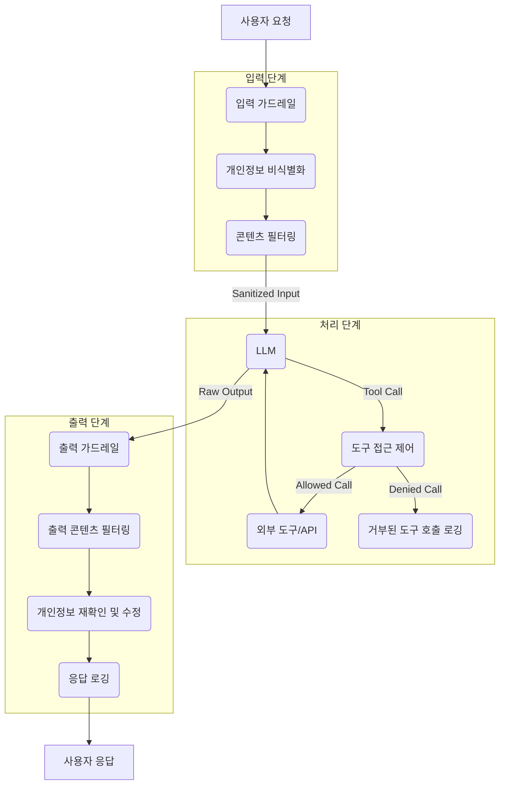

The increasing adoption of Large Language Models (LLMs) across diverse applications necessitates robust guardrails for privacy protection and controlled agent tool access. Without these safeguards, LLM-powered systems risk exposing sensitive information, executing unauthorized actions, or generating harmful content. This entry details strategies to implement comprehensive guardrails, drawing inspiration from initiatives like Spring AI Privacy Guardrails, to ensure secure and responsible LLM operations.

### LLM 기반 시스템의 개인정보 보호: 핵심 원칙 및 구현

LLM의 개인정보 보호는 입력 데이터의 비식별화(de-identification)부터 출력 콘텐츠 검사에 이르기까지 전 생애 주기에서 고려되어야 합니다. 민감한 정보가 LLM의 학습 데이터로 유입되거나, 추론 과정에서 부적절하게 노출되지 않도록 하는 것이 핵심입니다.

#### 1. 데이터 비식별화 (Data Anonymization/De-identification)

LLM에 입력되는 모든 데이터를 사전에 검사하고 개인식별정보(PII)를 비식별화하는 과정입니다. 이는 정규 표현식(Regular Expression), 머신러닝 기반 개체명 인식(Named Entity Recognition, NER) 모델, 또는 프라이버시 강화 기술(Privacy-Enhancing Technologies, PETs)을 통해 구현될 수 있습니다.

```python
import re

def anonymize_pii(text: str) -> str:
    # Example: Simple PII redaction for email, phone, and names
    text = re.sub(r'\b[A-Za-z0-9._%+-]+@[A-Za-z0-9.-]+\.[A-Z|a-z]{2,}\b', '[EMAIL_REDACTED]', text)
    text = re.sub(r'\b(?:\d{3}[-.\s]?\d{3}[-.\s]?\d{4}|\(\d{3}\)\s*\d{3}[-]?\d{4})\b', '[PHONE_REDACTED]', text)
    # This is a very basic example; real-world NER is far more complex.
    text = text.replace("김철수", "[NAME_REDACTED]")
    text = text.replace("이영희", "[NAME_REDACTED]")
    return text

user_input = "안녕하세요, 제 이름은 김철수이고 이메일은 kim.chulsu@example.com입니다. 연락처는 010-1234-5678입니다."
anonymized_input = anonymize_pii(user_input)
# print(anonymized_input) # Output: 안녕하세요, 제 이름은 [NAME_REDACTED]이고 이메일은 [EMAIL_REDACTED]입니다. 연락처는 [PHONE_REDACTED]입니다.
```

#### 2. 에이전트 도구 사용 권한 제어 (Agent Tool Access Control)

LLM이 외부 도구(API, 데이터베이스, 시스템 명령 등)를 호출할 때, 사전에 정의된 정책에 따라 접근 권한을 엄격하게 통제해야 합니다. 이는 에이전트의 오작동이나 악의적인 공격으로 인한 시스템 침해를 방지하는 데 필수적입니다. 각 도구에 대한 접근 정책을 세분화하고, LLM의 도구 호출 시 이를 검증하는 레이어를 추가합니다.

```python
from typing import Callable, Dict, Any

class ToolAccessController:
    def __init__(self, policies: Dict[str, Callable[[Dict[str, Any]], bool]]):
        self.policies = policies

    def check_access(self, tool_name: str, args: Dict[str, Any]) -> bool:
        policy_function = self.policies.get(tool_name)
        if not policy_function:
            return False # Tool not explicitly allowed
        return policy_function(args)

# Define policies for specific tools
def file_write_policy(args: Dict[str, Any]) -> bool:
    # Allow writing only to a specific safe directory
    allowed_paths = ["/app/safe_data/"]
    file_path = args.get("path", "")
    return any(file_path.startswith(p) for p in allowed_paths)

def db_query_policy(args: Dict[str, Any]) -> bool:
    # Disallow 'DELETE' or 'DROP' operations
    query = args.get("query", "").upper()
    return "DELETE" not in query and "DROP" not in query

# Initialize controller with policies
access_controller = ToolAccessController({
    "file_writer": file_write_policy,
    "database_connector": db_query_policy,
    "web_search": lambda args: True # Allow web search by default
})

# Example usage by an LLM agent
# agent_tool_call = {"tool_name": "file_writer", "args": {"path": "/etc/passwd", "content": "malicious"}}
# if access_controller.check_access(agent_tool_call["tool_name"], agent_tool_call["args"]):
#    execute_tool(agent_tool_call)
# else:
#    print("Access denied for file_writer to /etc/passwd")
```

#### 3. 콘텐츠 검사 및 필터링 (Content Inspection and Filtering)

LLM의 입력(프롬프트 인젝션 방지)과 출력(유해 콘텐츠, 편향된 정보, 개인정보 노출 방지)에 대한 실시간 검사가 필요합니다. 이는 사전 정의된 키워드 필터링, 정서 분석, 또는 별도의 소형 LLM 기반 분류기를 통해 수행될 수 있습니다. 특히 2026년에는 적대적 공격(adversarial attacks) 방어를 위한 동적이고 적응적인 필터링 시스템이 더욱 중요해질 것입니다.

### 가드레일 구현 아키텍처 (Mermaid Diagram)



이 아키텍처는 LLM과의 모든 상호작용 지점에 가드레일 계층을 통합하여 잠재적 위험을 완화합니다. 특히, 2026년에는 가드레일 자체가 LLM 기반으로 더욱 지능화되고, 실시간으로 정책을 업데이트하며, 제로 트러스트(Zero-Trust) 원칙에 따라 모든 도구 호출을 엄격히 검증하는 추세가 강화될 것입니다.

## 트레이드오프

1.  **정교한 제어 vs. 성능 오버헤드**:
    *   **언제 좋고**: 높은 규제 준수 요구사항(GDPR, HIPAA 등), 민감한 데이터 처리, 에이전트의 광범위한 외부 시스템 접근 권한이 있을 때 강력한 가드레일은 필수적입니다. 보안 침해 시 막대한 손실을 방지합니다.
    *   **언제 나쁜지**: 실시간 응답 속도가 critical한 애플리케이션이나 처리량이 매우 높은 시스템에서는 가드레일의 복잡성으로 인한 추가 지연이 사용자 경험을 저해하거나 비용을 증가시킬 수 있습니다. 오버헤드를 최소화하기 위한 최적화가 중요합니다.

2.  **엄격한 정책 vs. LLM의 유연성/기능성**:
    *   **언제 좋고**: 시스템의 안전과 규제 준수가 최우선인 경우, 엄격한 정책은 예측 불가능한 LLM의 행동을 통제하여 잠재적 위험을 차단합니다.
    *   **언제 나쁜지**: LLM의 창의성이나 광범위한 지식 활용이 중요한 작업에서는 너무 엄격한 정책이 LLM의 잠재력을 제한하고, 원하는 결과를 얻기 어렵게 만들 수 있습니다. 예를 들어, 민감한 키워드 필터링이 필요한 비판적 분석이나 특정 도메인 연구를 방해할 수 있습니다.

3.  **중앙 집중식 관리 vs. 분산된 적용**:
    *   **언제 좋고**: 소규모 팀이나 단일 LLM 애플리케이션에서는 중앙 집중식 가드레일 관리가 정책 일관성을 유지하고 배포를 단순화하는 데 유리합니다.
    *   **언제 나쁜지**: 여러 LLM 모델, 다양한 에이전트, 상이한 서비스 환경을 가진 대규모 엔터프라이즈 아키텍처에서는 중앙 집중식 가드레일이 병목 현상을 유발하거나 각 서비스의 특수한 요구사항을 충족하기 어렵게 만들 수 있습니다. 이 경우, 분산된 마이크로서비스 형태의 가드레일이 더 적합할 수 있습니다.

4.  **수동 정책 정의 vs. AI 기반 자동 정책 생성**:
    *   **언제 좋고**: 초기 단계나 예측 가능한 위협에 대해서는 수동으로 명확하게 정의된 정책이 빠르고 안정적인 구현을 가능하게 합니다.
    *   **언제 나쁜지**: 빠르게 변화하는 위협 환경이나 복잡한 비즈니스 로직에 대응해야 할 경우, 수동 정책만으로는 한계가 있습니다. AI 기반의 동적이고 적응적인 정책 생성 및 업데이트가 필요하며, 이는 구현의 복잡성과 검증의 어려움을 수반합니다.

## 실전 체크리스트

프로젝트에 LLM 가드레일을 적용할 때 다음 항목들을 검증하여 안정성을 확보합니다.

*   [ ] **데이터 흐름 매핑 및 PII 식별**: LLM 시스템 내에서 민감 데이터(PII)의 유입 경로, 처리 방식, 저장 위치를 완전히 매핑하고, 각 단계에서 어떤 PII가 처리되는지 정확히 식별했는가?
*   [ ] **입력 데이터 비식별화 정책 정의 및 구현**: 입력 프롬프트에서 개인식별정보(PII)를 자동으로 탐지하고 비식별화하는 정책(e.g., 정규식, NER 모델)을 수립하고, 모든 입력에 적용되는가?
*   [ ] **에이전트 도구 접근 제어 정책 상세화**: LLM 에이전트가 호출할 수 있는 모든 외부 도구(API, DB, 파일 시스템 등)에 대해 최소 권한 원칙(Least Privilege)에 기반한 접근 제어 정책을 정의하고, 이를 코드 레벨에서 강제하는가?
*   [ ] **콘텐츠 검사 및 유해성 필터링 로직 구현**: LLM의 입력 및 출력에 대해 유해 콘텐츠(혐오 발언, 폭력, 불법 콘텐츠 등), 편향된 정보, 프롬프트 인젝션 시도를 탐지하고 필터링하는 로직이 적용되었는가?
*   [ ] **가드레일 우회 공격 시나리오 테스트**: 프롬프트 인젝션, 악의적인 도구 호출 시도, 데이터 유출 시도 등 다양한 가드레일 우회 공격 시나리오에 대해 정기적인 모의 해킹(pentest) 및 자동화된 테스트를 수행하는가?
*   [ ] **감사(Audit) 및 로깅 시스템 구축**: 가드레일 정책 위반, 도구 호출 시도 및 결과, 데이터 비식별화 이력 등 모든 보안 관련 이벤트가 상세히 로깅되고, 감사 가능한 형태로 저장되는가?
*   [ ] **비상 대응 및 복구 계획 수립**: 가드레일이 우회되거나 보안 사고가 발생했을 경우를 대비하여, 신속한 탐지, 격리, 복구를 위한 명확한 비상 대응 절차와 책임자가 지정되어 있는가?