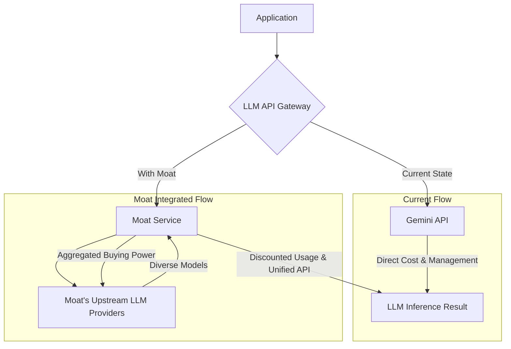

대규모 언어 모델(LLM) 기반 서비스의 운영 비용에서 LLM API 호출 비용은 상당한 비중을 차지한다. 특히, 사용량이 증가하고 다양한 모델을 활용할수록 비용은 기하급수적으로 늘어날 수 있다. 이러한 문제에 직면한 기업들은 비용 효율성을 극대화하기 위한 다양한 전략을 모색하고 있으며, Moat와 같은 서비스는 이러한 맥락에서 중요한 대안으로 부상하고 있다. Moat는 멤버십 기반의 LLM API 도매 중개 서비스로, 회원들의 통합된 구매력을 바탕으로 할인된 가격에 다양한 AI 모델을 제공하여 LLM API 비용 최적화를 지원한다.

## Moat 서비스 개요 및 가치 제안
Moat는 OpenRouter와 유사하게 여러 LLM 공급자의 모델을 통합하여 제공하지만, 무제한 정액제가 아닌 멤버십을 통해 할인된 단가로 사용량에 따라 지불하는 구조를 가진다. 연간 60달러(월 5달러) 또는 월 10달러의 멤버십 비용을 지불하면, 일반적인 API 요금보다 저렴하게 AI 모델을 이용할 수 있다. 특히, 사용량 제한이나 라우터 수수료가 없다는 점이 매력적이다. 모든 모델을 전체 가중치(full weights)로 제공하고 자체 벤치마크를 수행하여 품질을 보증하며, 개발자가 여러 제공업체 중 선택할 필요 없이 모델마다 하나의 가격으로 간편하게 접근할 수 있는 통합 인터페이스를 제공한다. 이는 2026년 현재, LLM API 사용량이 급증하는 기업들에게 효율적인 비용 관리와 더불어 안정적인 성능을 제공할 수 있는 중요한 인프라 요소로 작용할 수 있다.

## Moat 도입 검토: 핵심 평가 지표
playbook의 LLM 호출 비용 절감을 위해 Moat 서비스 도입을 검토할 때, 다음과 같은 핵심 지표들을 평가해야 한다.

### 1. 모델 목록 및 성능
Moat가 제공하는 모델 목록은 현재 playbook에서 활용하는 LLM의 성능 요구사항을 충족하는지 확인해야 한다. 특히, 현재 Gemini API를 활용하고 있다면, Moat가 Gemini 또는 그에 준하는 성능을 제공하는 모델을 합리적인 가격에 제공하는지 여부가 중요하다. Moat의 자체 벤치마크 데이터는 모델 선택의 중요한 참고 자료가 될 것이다.

### 2. API 호환성 및 통합 용이성
기존 LLM 호출 로직과의 API 호환성은 서비스 전환 비용을 결정하는 핵심 요소이다. Moat가 OpenAI API 표준을 따르는지, 혹은 자체적인 SDK나 라이브러리를 제공하여 통합 과정을 간소화하는지 평가해야 한다. 매끄러운 통합은 개발 공수를 최소화하고 빠른 전환을 가능하게 한다.

### 3. 가격 구조 분석 및 비용 절감 효과
Moat의 가격 구조를 상세히 분석하여 현재 Gemini API 사용 패턴과 비교해야 한다. 단순히 단가 비교를 넘어, 월별/연간 멤버십 비용, 토큰 사용량에 따른 실제 청구액, 그리고 장기적인 사용량 예측을 기반으로 총 소유 비용(TCO: Total Cost of Ownership)을 산출해야 한다. 현재 LLM 워크로드에서 Gemini 1.5 Flash와 같은 저비용 고성능 모델의 사용이 일반화되고 있으므로, Moat가 제공하는 할인율이 이러한 모델들의 비용 효율성을 뛰어넘을 수 있는지 정밀하게 분석해야 한다.

## LLM API 호출 흐름 비교
Moat 서비스 도입 시 LLM API 호출 흐름의 변화는 다음과 같이 시각화할 수 있다.



## Moat API 연동 예시 (Python)
Moat가 OpenAI API와 호환되는 엔드포인트를 제공한다고 가정했을 때, Python을 이용한 기본적인 LLM 호출 예시는 다음과 같다. `MOAT_API_BASE_URL` 및 `MOAT_API_KEY` 환경 변수를 설정하여 사용할 수 있다.

```python
import os
import requests
import json

# Assume Moat provides a unified API endpoint compatible with OpenAI's chat completions
MOAT_API_BASE_URL = os.getenv("MOAT_API_BASE_URL", "https://api.moat.com/v1")
MOAT_API_KEY = os.getenv("MOAT_API_KEY")

if not MOAT_API_KEY:
    raise ValueError("MOAT_API_KEY environment variable not set.")

def call_llm_via_moat(model_name: str, prompt: str, temperature: float = 0.7, max_tokens: int = 150):
    headers = {
        "Authorization": f"Bearer {MOAT_API_KEY}",
        "Content-Type": "application/json"
    }
    payload = {
        "model": model_name,
        "messages": [{"role": "user", "content": prompt}],
        "temperature": temperature,
        "max_tokens": max_tokens
    }
    try:
        response = requests.post(f"{MOAT_API_BASE_URL}/chat/completions", headers=headers, json=payload)
        response.raise_for_status() # Raise HTTPError for bad responses (4xx or 5xx)
        result = response.json()
        if "choices" in result and len(result["choices"]) > 0:
            return result["choices"][0]["message"]["content"]
        return "No response content."
    except requests.exceptions.HTTPError as err:
        print(f"HTTP error occurred: {err}. Response: {response.text if response is not None else 'N/A'}")
        return None
    except requests.exceptions.RequestException as err:
        print(f"Request error occurred: {err}")
        return None

# Example Usage:
# model_to_use = "claude-3-haiku-20240307" # Example model offered by Moat
# user_prompt = "Explain zero-shot learning in the context of LLMs."
# response_text = call_llm_via_moat(model_to_use, user_prompt)

# if response_text:
#     print("\nLLM Response:")
#     print(response_text)
# else:
#     print("Failed to get response from LLM via Moat.")

```

## 트레이드오프

*   **비용 절감 vs. 새로운 종속성(Dependency)**
    *   **언제 좋은가**: LLM API 호출 비용이 현재 예산에 큰 부담이 되며, Moat의 할인율이 상당한 경우, 즉시적인 비용 절감 효과를 볼 수 있다.
    *   **언제 나쁜가**: Moat에 대한 새로운 종속성이 발생하여, Moat 서비스 자체의 안정성 문제나 정책 변경 발생 시 서비스 운영에 영향을 미칠 수 있다.
*   **모델 선택의 유연성 vs. 잠재적 성능 저하**
    *   **언제 좋은가**: Moat가 다양한 모델을 한 곳에서 제공하여 특정 LLM 제공업체에 묶이지 않고 유연하게 모델을 전환하며 최적의 비용/성능 균형을 찾을 수 있다.
    *   **언제 나쁜가**: Moat가 프록시(Proxy) 역할을 하므로, Moat를 통한 API 호출 시 미미한 추가 지연 시간(latency)이 발생하거나, Moat의 자체 인프라 문제로 인해 응답의 일관성 및 안정성이 저하될 가능성이 있다.
*   **단순화된 관리 vs. 초기 통합 복잡성**
    *   **언제 좋은가**: 여러 LLM 제공업체와의 개별 계약 및 기술적 통합의 복잡성을 줄여, 단일 Moat 인터페이스를 통해 모델을 관리하고 사용할 수 있어 운영 효율성이 증대된다.
    *   **언제 나쁜가**: 기존 시스템에서 Moat로의 전환 과정에서 API 엔드포인트 변경, 인증 방식 통합 등 초기 통합 및 테스트에 추가적인 개발 리소스가 필요할 수 있다.

## 실전 체크리스트

프로젝트에 Moat 서비스를 도입하기 전에 다음 항목들을 검증해야 한다.

- [ ] **Moat 모델 목록 검토**: 현재 사용 중인 Gemini 또는 유사 성능 LLM 모델이 Moat에서 제공되는지, 그리고 가격 대비 성능이 경쟁력이 있는지 확인한다.
- [ ] **API 호환성 테스트**: Moat API 엔드포인트가 기존 LLM 호출 라이브러리/코어 로직과 원활하게 호환되는지 PoC (Proof of Concept)를 통해 검증한다.
- [ ] **실제 비용 시뮬레이션**: 현재 LLM 사용량(프롬프트/컴플리션 토큰) 데이터를 기반으로 Moat 멤버십 비용과 사용량 단가를 적용하여 예상 비용 절감액을 구체적으로 산출한다.
- [ ] **성능 벤치마킹**: Moat를 통한 LLM API 호출 시 평균 및 P99 지연 시간(latency), 처리량(throughput), 응답 일관성 등을 현재 Gemini API와 비교하여 벤치마킹한다.
- [ ] **안정성 및 SLA 확인**: Moat의 서비스 수준 협약(SLA: Service Level Agreement), 가동 시간(uptime) 보장, 에러 처리 정책 및 지원 채널을 검토하여 프로덕션 환경에서의 안정성을 평가한다.
- [ ] **보안 및 데이터 프라이버시**: Moat가 데이터 전송 및 저장 과정에서 적절한 보안 프로토콜을 준수하는지, 그리고 데이터 프라이버시 정책이 기업의 규정 및 요구사항을 충족하는지 확인한다.
- [ ] **마이그레이션 및 롤백 계획 수립**: Moat로의 전환 과정에서 발생할 수 있는 잠재적 문제에 대비하여 상세한 마이그레이션 계획과 함께 문제가 발생했을 때 현재 시스템으로 돌아갈 수 있는 롤백 전략을 마련한다.