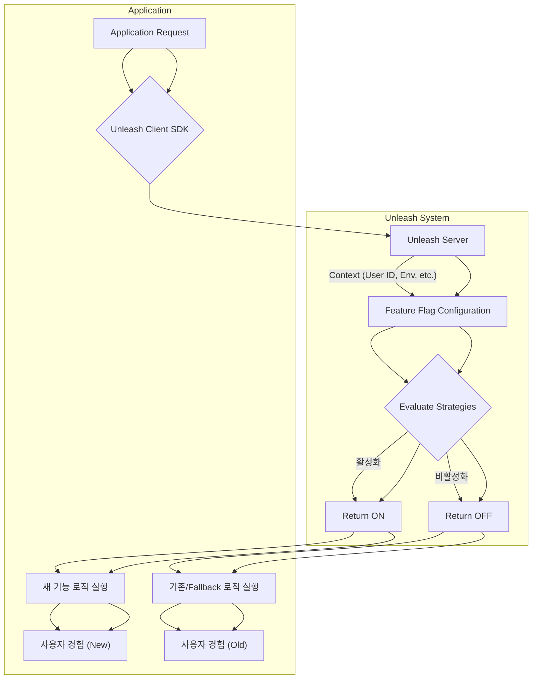

Feature Flag는 애플리케이션 코드를 재배포하지 않고도 기능 출시를 동적으로 제어하는 핵심 메커니즘입니다. 오픈소스 Unleash는 이러한 유연성을 제공하여, 특히 AI 에이전트 전략, LLM 출력 검증 파이프라인의 A/B 테스트, 새로운 플레이북 기능의 점진적 롤아웃 등 복잡한 시스템에서 배포 위험을 최소화하고 빠른 반복 개발을 가능하게 합니다.

## Unleash 핵심 개념

Unleash는 Feature Toggles (기능 스위치), Strategies (활성화 조건 정의: 점진적 롤아웃, 사용자 ID 기반 등), Environments (환경별 플래그 관리), Context (플래그 평가에 사용되는 동적 데이터), 그리고 다양한 언어의 SDK를 통해 Feature Flag를 관리합니다. 이 시스템은 리스크 감소, 점진적 롤아웃, A/B 테스트 역량 제공으로 AI/LLM 기반 시스템의 효율적 진화를 지원합니다.

## Unleash 클라이언트 통합 예제 (Node.js)

Node.js에서 Unleash 클라이언트를 통합하고 Feature Flag를 확인하는 예제입니다. `isEnabled` 함수에 컨텍스트를 전달하여 정교한 제어를 수행합니다.

```javascript
const { initialize, isEnabled } = require('unleash-client');

const unleash = initialize({
  appName: 'my-ai-service',
  instanceId: 'server-instance-1',
  url: 'http://localhost:4242/api/',
  customHeaders: {
    Authorization: 'YOUR_UNLEASH_API_TOKEN',
  },
});

unleash.on('error', console.error);
unleash.on('ready', () => {
  console.log('Unleash client ready.');

  const userId = 'user-123';
  const llmModel = 'gpt-4o';

  // A/B test for LLM validation pipeline
  if (isEnabled('llm-validation-pipeline-v2', { userId, customContext: { llmModel } })) {
    console.log(`User ${userId} uses LLM Validation Pipeline V2 with ${llmModel}.`);
  } else {
    console.log(`User ${userId} uses LLM Validation Pipeline V1.`);
  }

  // Gradual rollout for a new Agent strategy
  if (isEnabled('advancedAgentStrategyRollout', { sessionId: 'session-abc-123' })) {
    console.log('Advanced Agent Strategy is active.');
  } else {
    console.log('Default Agent Strategy is active.');
  }
});
```

Unleash의 Feature Flag 결정 흐름은 다음과 같이 시각화할 수 있습니다.



## 트레이드오프

Feature Flag 시스템 도입은 다음과 같은 장단점을 수반합니다.

*   **유연성 vs 복잡성**: 복잡한 롤아웃 및 A/B 테스트에 강력하지만, 단순 기능 토글에는 관리 오버헤드가 발생하며 시스템 복잡도를 증가시킬 수 있습니다.
*   **빠른 배포 및 위험 감소 vs 기술 부채**: 기능 개발 완료 전 통합 및 배포 안정성 확보에 유리하지만, 사용 종료 후 `Dead Flag`를 제거하지 않으면 코드 가독성을 해치고 유지보수 비용을 높입니다.
*   **운영 안정성 vs 모니터링 부담**: 문제 발생 시 즉시 기능 비활성화로 서비스 안정성을 높이지만, 플래그 상태 모니터링, A/B 테스트 분석, 상호작용 방지를 위한 추가 운영 리소스와 도구가 필요합니다.
*   **정교한 제어 vs 사용자 경험 일관성**: 컨텍스트 기반의 정교한 제어는 개인화된 경험에 유용하지만, 복잡한 로직은 사용자 경험의 일관성을 저해하거나 예측 불가능한 동작을 유발할 수 있습니다.

## 실전 체크리스트

Unleash 기반 Feature Flag 시스템 도입 시 고려해야 할 항목들입니다.

*   - [ ] **플래그 명명 규칙 및 라이프사이클 정의**: 일관된 플래그 명명 규칙을 수립하고, 생성부터 제거까지의 라이프사이클을 문서화합니다.
*   - [ ] **Client SDK 통합 및 Fallback 구현**: 모든 서비스에 Unleash SDK를 통합하고, 통신 실패 시 안정적인 `Fallback` 로직을 구현 및 테스트합니다.
*   - [ ] **환경별 관리 및 권한 분리**: 환경별 플래그 관리 정책을 수립하고, 중요 플래그 변경 방지를 위해 최소 권한 원칙에 따른 접근 제어를 설정합니다.
*   - [ ] **A/B 테스트 지표 및 데이터 연동 계획**: LLM A/B 테스트를 위한 핵심 지표를 정의하고, 분석 도구와의 데이터 연동 및 시각화 계획을 수립합니다.
*   - [ ] **데드 플래그 제거 자동화**: 사용되지 않는 `Dead Flag`를 감지하고 코드에서 제거하는 자동화된 `Cleanup` 워크플로우를 구축하여 기술 부채를 방지합니다.
*   - [ ] **Feature Flag 변경 모니터링 및 알림**: 중요한 Feature Flag 변경사항에 대한 실시간 모니터링 및 알림 시스템을 구축하여 신속히 대응합니다.
*   - [ ] **성능 영향도 분석**: Feature Flag 평가 로직이 애플리케이션 성능에 미치는 영향을 분석하고, 필요 시 캐싱 전략 등으로 오버헤드를 최소화합니다.