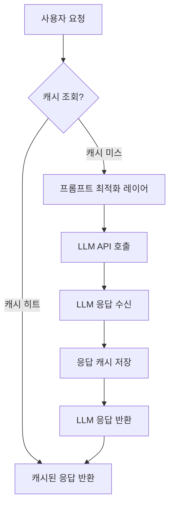

대규모 언어 모델(LLM)의 활용이 증가함에 따라, LLM API 호출 비용은 기업 및 프로젝트 운영의 주요 관심사가 되었다. 특히 Apple과 같은 대기업이 엔지니어의 AI 예산을 제한하는 사례에서 보듯이, 비용 효율적인 LLM 운영 전략은 2026년 이후에도 핵심적인 경쟁력으로 작용한다. 본 문서는 LLM 비용을 효과적으로 절감하기 위한 프롬프트 최적화 및 캐싱 전략에 대해 다룬다.

## 프롬프트 최적화(Prompt Optimization)
프롬프트 최적화는 LLM에 전달하는 입력(프롬프트)의 효율성을 극대화하여 필요한 출력 품질을 유지하면서 토큰 사용량과 LLM 호출 횟수를 줄이는 기법이다. 이는 LLM API 비용이 주로 토큰 사용량에 비례하기 때문에 매우 중요하다.

### 1. 간결하고 명확한 프롬프트 작성
불필요한 설명이나 반복을 제거하고, LLM이 수행해야 할 작업을 명확하고 간결하게 지시한다. 이는 LLM이 응답을 생성하는 데 필요한 '생각'하는 시간과 출력 토큰 수를 줄이는 데 기여한다. 특히, 비영어권 프롬프트는 영어 프롬프트보다 최대 179배 많은 에너지를 소비하고 정확도도 낮을 수 있다는 연구 결과가 있으므로, 다국어 환경에서는 더욱 신중한 접근이 필요하다.

### 2. 구조화된 출력(Structured Output) 지시
JSON, XML 등 특정 형식의 출력을 명시적으로 요구하여 LLM이 불필요한 서식이나 설명을 추가하지 않도록 한다. 이는 파싱 용이성을 높이고 출력 토큰 usage을 줄인다.

### 3. Few-shot Prompting 활용
소수의 예시를 프롬프트에 포함하여 LLM이 원하는 응답 스타일과 형식을 빠르게 학습하도록 유도한다. 이는 시행착오를 줄이고, LLM의 반복적인 호출 없이도 고품질의 응답을 얻는 데 도움을 준다.

### 4. 역할 부여 및 제약 조건 설정
LLM에 특정 역할(예: '전문 소프트웨어 개발자')을 부여하고, 응답 길이나 내용에 대한 제약 조건(예: '최대 100단어', '기술적인 용어만 사용')을 명시하여 원하는 범위 내에서 응답을 생성하도록 유도한다.

**예제: 프롬프트 간결화 (Python)**
다음은 `google-generativeai` 라이브러리를 사용한 프롬프트 최적화의 간단한 예시이다. 불필요한 서론 없이 바로 질문의 핵심을 전달한다.

```python
import google.generativeai as genai
import os

# genai.configure(api_key=os.environ["GEMINI_API_KEY"])

def call_llm(prompt_text: str):
    model = genai.GenerativeModel('gemini-pro')
    try:
        response = model.generate_content(prompt_text)
        return response.text
    except Exception as e:
        return f"Error: {e}"

# 비효율적인 프롬프트 예시
verbose_prompt = (
    "안녕하세요, 제 질문에 답변해 주시겠습니까? "
    "최근 AI 기술 동향에 대해 알고 싶습니다. "
    "특히 2026년 기준의 최신 정보를 요약하여 알려주세요. "
    "길게 작성하기보다는 핵심만 간략하게 부탁드립니다."
)

# 최적화된 프롬프트 예시
optimized_prompt = (
    "2026년 기준 최신 AI 기술 동향을 핵심만 간략히 요약하세요."
)

# print("Verbose Prompt Output:", call_llm(verbose_prompt))
# print("Optimized Prompt Output:", call_llm(optimized_prompt))
```

## LLM 출력 캐싱(Caching) 전략
캐싱은 이전에 계산된 LLM 응답을 저장해 두었다가 동일하거나 유사한 요청이 들어왔을 때 저장된 응답을 반환함으로써 LLM API 호출을 줄이는 효과적인 방법이다. 이는 응답 시간을 단축하고 비용을 절감하는 데 크게 기여한다.

### 1. 캐싱 대상 선정
*   **정확한 응답이 필요한 경우**: 자주 요청되며, LLM이 항상 동일하거나 매우 유사한 응답을 생성하는 질의 (예: FAQ, 정의).
*   **비용이 높은 API 호출**: 복잡하거나 긴 프롬프트로 인해 토큰 사용량이 많은 경우.
*   **실시간성이 중요하지 않은 경우**: 약간의 데이터 지연이 허용되는 정보 제공성 응답.

### 2. 캐싱 메커니즘 설계
*   **In-memory Cache**: Python의 `functools.lru_cache`와 같이 애플리케이션 메모리 내에 캐시를 구현한다. 소규모 애플리케이션이나 특정 함수의 반복 호출에 적합하다.
*   **Distributed Cache**: Redis, Memcached와 같은 분산 캐시 시스템을 활용한다. 여러 인스턴스 간에 캐시를 공유하고, 확장성 및 내구성을 제공한다.
*   **Database Cache**: NoSQL 데이터베이스(예: MongoDB, DynamoDB)를 활용하여 LLM 입력(프롬프트 해시)과 출력 쌍을 저장한다. 영속성이 필요한 경우에 적합하다.

### 3. 캐시 무효화(Invalidation) 전략
*   **Time-to-Live (TTL)**: 캐시된 데이터에 만료 시간을 설정한다. 일정 시간 후 자동으로 캐시가 무효화되어 최신성을 유지한다.
*   **Event-driven Invalidation**: 원본 데이터가 변경되었을 때 관련 캐시를 명시적으로 무효화한다. (예: 백엔드 데이터베이스 업데이트 시 캐시 삭제).
*   **Least Recently Used (LRU)**: 캐시 공간이 부족할 때 가장 오랫동안 사용되지 않은 항목을 제거한다.

**예제: 간단한 캐싱 데코레이터 (Python)**

```python
from functools import lru_cache
import time

# 시뮬레이션 LLM 호출 함수 (실제 LLM API 호출로 대체)
def simulated_llm_call(prompt: str) -> str:
    time.sleep(2) # LLM 호출 지연 시뮬레이션
    return f"LLM response for: {prompt}"

# lru_cache를 이용한 캐싱 데코레이터 적용
@lru_cache(maxsize=128)
def get_llm_response_cached(prompt: str) -> str:
    print(f"Calling LLM for '{prompt}'...")
    return simulated_llm_call(prompt)

# 첫 호출 (캐시 미스)
# print(get_llm_response_cached("What is serverless architecture?"))
# 두 번째 호출 (캐시 히트)
# print(get_llm_response_cached("What is serverless architecture?"))
# 다른 호출 (캐시 미스)
# print(get_llm_response_cached("Explain quantum computing."))
```

LLM 요청 흐름에 캐싱을 적용한 개념 다이어그램은 다음과 같다.



## 트레이드오프

*   **프롬프트 간결성 vs. 응답의 견고성**: 매우 간결한 프롬프트는 토큰을 절약하지만, LLM이 맥락을 놓치거나 일반적인(generic) 응답을 생성할 위험이 있다. 간결성은 예상 가능한 범위 내에서 LLM의 명확한 이해가 보장될 때 좋다. 복잡하거나 모호한 주제에서는 충분한 맥락과 제약 조건을 제공하는 것이 더 나을 수 있다.
*   **캐싱의 공격성 vs. 데이터 신선도**: 캐시 TTL을 길게 설정하거나 광범위하게 캐싱하면 비용 절감 효과는 크지만, LLM 응답이 최신 정보와 다를 수 있다. 자주 변하지 않는 정적 정보나 지연이 허용되는 경우 캐싱은 매우 효과적이다. 실시간성이 필수적인 데이터에는 최소한의 캐싱 또는 캐시 무효화 전략이 정교하게 설계되어야 한다.
*   **소형 모델 사용 vs. 기능 및 품질**: 저렴하고 빠른 소형 모델은 특정 작업에 비용 효율적이지만, 복잡하거나 창의적인 작업에서는 대형 모델만큼의 성능을 내지 못할 수 있다. 간단한 분류, 요약, 형식 변환과 같은 명확한 작업에는 소형 모델이 유리하다. 복잡한 추론, 심층적인 지식 생성, 고도의 창의성이 요구되는 작업에는 대형 모델이 필수적이다.
*   **프롬프트 엔지니어링 투자 vs. 개발 속도**: 고도화된 프롬프트 엔지니어링은 초기 개발 시간을 증가시키고 지속적인 튜닝 노력이 필요하다. 그러나 장기적인 LLM 운영 비용 절감과 응답 품질 향상에 기여한다. MVP 개발이나 빠른 프로토타이핑 단계에서는 기본적인 프롬프트로 시작하고, 서비스가 안정화되고 비용이 중요해질 때 집중적인 투자가 필요하다.

## 실전 체크리스트

*   [ ] 현재 LLM API 호출의 평균 토큰 사용량과 비용을 주기적으로 모니터링하고 있는가?
*   [ ] 서비스 내에서 LLM 호출 패턴을 분석하여 캐싱 가능한(정확하거나 자주 반복되는) 요청을 식별했는가?
*   [ ] 주요 LLM 프롬프트에 대해 불필요한 서론, 반복 문구, 모호한 지시를 제거하여 간결하게 최적화했는가?
*   [ ] LLM이 구조화된 JSON 응답을 생성하도록 프롬프트에 명시적인 지시와 스키마 예시를 포함했는가?
*   [ ] 캐시 미스 발생 시 LLM API 호출, 캐시 히트 시 캐시된 응답 반환 로직이 안정적으로 동작하는지 테스트했는가?
*   [ ] 캐시된 응답의 신선도를 보장하기 위한 TTL(Time-to-Live) 또는 이벤트 기반 무효화 전략이 구현되어 있는가?
*   [ ] 다양한 LLM 모델(예: `gemini-pro` vs. `gemini-flash` 또는 소형/대형 모델) 간의 비용-성능 트레이드오프를 고려하여 적절한 모델 라우팅 전략을 수립했는가?
*   [ ] 비영어권 사용자 트래픽이 있는 경우, 해당 언어 프롬프트의 비용 효율성을 별도로 분석하고 개선 방안을 모색했는가?
