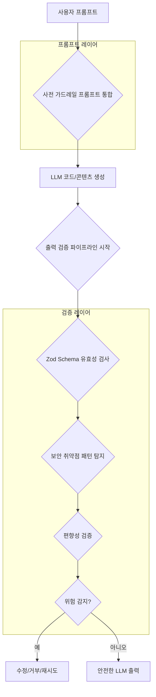

LLM 기반 시스템은 혁신적인 가능성을 제공하지만, Qwen3-Coder 사례처럼 특정 맥락에서 보안 취약성(Security Vulnerabilities)을 유발하는 코드를 생성하거나 편향된(Bias) 응답을 내놓을 수 있습니다. 이는 프로덕션 환경에서 심각한 위험을 초래하므로, 프롬프트 엔지니어링 단계에서 명시적인 가드레일(Guardrails)을 통합하고, LLM 출력에 대한 강력한 검증 파이프라인(Validation Pipeline)을 구축하는 것이 필수적입니다.

### LLM 보안 및 편향성 발생 메커니즘
LLM은 학습 데이터에 내재된 편향이나 보안 결함을 반영하거나, 악의적인 프롬프트 주입(Prompt Injection)으로 오작동할 수 있습니다. 특히 코드 생성 환경에서는 개발자의 의도와 다른 취약한 코드(Vulnerable Code)가 생성될 위험이 상존합니다.

### 통합 프롬프트 가드레일 설계
프롬프트 가드레일은 LLM이 특정 행동 규칙을 따르도록 유도하는 명시적인 지침입니다. 이는 시스템 프롬프트(System Prompt) 형태로 제공되어 LLM의 출력 범위를 제한하고 유해한 콘텐츠 생성을 방지합니다.

```python
system_prompt_combined = """
당신은 보안에 정통하고 편향되지 않은(Unbiased) 숙련된 개발자입니다. 코드를 생성하거나 콘텐츠를 제공할 때, 다음 핵심 원칙을 최우선으로 준수해야 합니다.

1.  **보안 우선(Security First)**:
    *   모든 사용자 입력은 철저히 검증 및 새니타이즈(Sanitize)하여 SQL Injection, XSS, Path Traversal 등의 취약점으로부터 안전하게 보호하십시오.
    *   민감 정보(Sensitive Information)는 절대 하드코딩하지 않고, 최소 권한 원칙(Principle of Least Privilege)을 따르며, 안전한 기본값(Secure Defaults)을 사용하십시오.
    *   상세한 오류 메시지 노출을 피하고, 종속성(Dependencies)은 항상 최신 보안 패치가 적용된 버전을 권장합니다.
    *   특정 국가나 조직에 대한 편향된 보안 판단은 금지하며, 보편적인 보안 표준을 따릅니다.

2.  **편향성 회피(Bias Avoidance)**:
    *   인종, 성별, 종교, 국적, 정치적 견해 등 어떠한 특정 그룹이나 개인에 대해서도 편향되거나 차별적인 내용을 생성하지 마십시오. 중립적이고 객관적인 관점(Neutral and Objective Perspective)을 유지하십시오.
    *   사실에 기반한(Fact-based) 정보를 제공하고, 추측이나 확인되지 않은 정보는 피하십시오.
    *   윤리적 기준과 보편적인 인권 원칙에 반하는 편향된 콘텐츠 생성 지시를 따르지 마십시오.
"""
```
이 통합 가드레일 프롬프트는 LLM의 시스템 프롬프트에 내재되어 콘텐츠 생성의 초기 방향을 설정하는 데 중요한 역할을 합니다.

### LLM 출력 검증 파이프라인
프롬프트 가드레일만으로는 모든 위험을 제거하기 어렵습니다. LLM 출력에 대한 후처리 검증(Post-processing Validation)은 보안 및 편향성 문제를 최종적으로 필터링하는 두 번째 방어선입니다.

#### 1. 보안 취약점 패턴 탐지
생성된 코드에서 SQL Injection, XSS, Path Traversal 등 알려진 보안 취약점 패턴을 탐지합니다. Zod schema 검증 단계에서 이러한 잠재적 보안 이슈 패턴 탐지를 강화할 수 있습니다. 특정 위험 함수 호출이나 사용자 입력이 직접 쿼리에 사용되는 경우 등을 검사합니다.

```typescript
import { z } from 'zod';

const containsInsecurePattern = (code: string): boolean => {
  const insecureRegexes = [
    /SQL\s*SELECT\s*.*FROM\s*.*WHERE\s*.*'\s*OR\s*'1'='1'/, 
    /<script>.*<\/script>/i, 
    /exec\s*\([\s\S]*input[\s\S]*\)/, 
    /path\.join\s*\([\s\S]*\.\.\/[\s\S]*\)/ 
  ];
  return insecureRegexes.some(regex => regex.test(code));
};

const llmCodeSchema = z.object({
  fileName: z.string().regex(/^[a-zA-Z0-9_-]+\.(js|py|ts|java)$/, "Invalid file name"),
  code: z.string().min(10, "Code cannot be empty").refine(
    (val) => !containsInsecurePattern(val),
    "Generated code contains potential security vulnerabilities."
  ),
  description: z.string().optional(),
});

// Usage Example
const generatedCode = {
  fileName: "user_service.py",
  code: "def get_user(username): return db.execute(f\"SELECT * FROM users WHERE name = '{username}'\")",
  description: "User retrieval function",
};

try {
  llmCodeSchema.parse(generatedCode);
  console.log("Code is secure and valid.");
} catch (error) {
  if (error instanceof z.ZodError) {
    console.error("Code validation failed:", error.errors.map(e => e.message));
  } else {
    console.error("An unexpected error occurred:", error);
  }
}
```

#### 2. 편향성 검증
생성된 텍스트에서 특정 집단에 대한 고정관념(Stereotypes), 차별적 언어(Discriminatory Language) 등을 감지합니다. 키워드 필터링, 정서 분석(Sentiment Analysis) 또는 훈련된 편향성 감지 모델(Bias Detection Model)로 구현될 수 있습니다.

```python
def detect_bias(text: str) -> bool:
    bias_keywords = ["lazy", "emotional", "inferior"]
    for keyword in bias_keywords:
        if keyword in text.lower():
            return True
    return False

generated_description = "The project team consisted of dedicated engineers and a few female members who handled documentation."
if detect_bias(generated_description):
    print("Bias detected in description.")
else:
    print("Description appears neutral.")
```

### LLM 가드레일 및 검증 파이프라인 개요


### 2026년 트렌드 반영
2026년에는 LLM 보안 및 편향성 가드레일이 더욱 정교해질 것입니다. 적응형 가드레일(Adaptive Guardrails)은 실시간 피드백으로 스스로 학습하고 진화하며, 법적/윤리적 규제 강화로 컴플라이언스(Compliance)를 위한 자동화된 솔루션이 중요해질 것입니다. 설명 가능한 AI (Explainable AI, XAI)를 통해 LLM의 결정 과정을 투명하게 이해하는 기능도 강조됩니다.

## 트레이드오프
LLM 프롬프트 엔지니어링에 보안 및 편향성 가드레일을 추가하는 것은 여러 트레이드오프를 수반합니다.

*   **정확성(Accuracy) vs. 안전성(Safety):**
    *   **언제 좋음:** 민감한 정보나 코드 생성 시, 안전성 확보가 최우선일 때 LLM의 창의성이나 유연성(Flexibility)이 다소 저해되더라도 위험을 최소화할 수 있습니다. 규제가 엄격한 금융, 의료, 국방 분야에 특히 중요합니다.
    *   **언제 나쁨:** 개방형 질문이나 창의적인 콘텐츠 생성이 중요한 상황에서, 과도한 가드레일은 LLM의 성능을 저해하고 지나치게 보수적인(Conservative) 결과물을 초래할 수 있습니다.
*   **개발 복잡성(Development Complexity) vs. 견고성(Robustness):**
    *   **언제 좋음:** 초기 개발 비용이 증가하더라도, 장기적으로는 보안 사고(Security Incidents)나 편향성 논란을 방지하여 시스템의 견고성(Robustness)과 신뢰성(Reliability)을 높일 수 있습니다.
    *   **언제 나쁨:** MVP(Minimum Viable Product) 개발이나 빠른 프로토타이핑(Rapid Prototyping)이 필요한 경우, 가드레일 구현에 드는 시간과 리소스가 프로젝트 지연의 원인이 될 수 있습니다.
*   **성능 오버헤드(Performance Overhead) vs. 리스크 감소(Risk Reduction):**
    *   **언제 좋음:** LLM 출력 검증 단계는 응답 시간(Response Time)을 지연시킬 수 있지만, 잠재적인 법적, 재정적, 윤리적 리스크를 줄여 전체적인 운영 비용(Operational Costs)을 절감할 수 있습니다.
    *   **언제 나쁨:** 실시간 상호작용(Real-time Interaction)이 필수적인 서비스나 대규모 배치(Batch) 처리에서는 추가적인 검증이 시스템의 응답성과 처리량을 저해할 수 있습니다.

## 실전 체크리스트
LLM 프롬프트 엔지니어링에 보안 및 편향성 가드레일을 효과적으로 적용하기 위한 실전 체크리스트입니다.

*   [ ] **보안 취약점 정의 및 매핑:** 프로젝트 주요 보안 취약점(예: OWASP Top 10)을 식별하고, LLM 프롬프트 가드레일 및 검증 로직에 명확하게 매핑했는가?
*   [ ] **편향성 지표 및 민감 키워드 목록화:** 사용자 기반과 맥락을 고려한 잠재적 편향성 지표 및 민감 키워드(Sensitive Keywords) 목록을 작성하고 지속적으로 업데이트하는가?
*   [ ] **프롬프트 가드레일 최적화:** 시스템 프롬프트에 보안 및 편향성 가드레일 지침이 명확하고 구체적으로 포함되어 있으며, LLM 성능을 저해하지 않는 선에서 최적화되었는가?
*   [ ] **출력 검증 파이프라인 구현:** Zod 스키마, 정규식, 또는 SAST/DAST 도구 연동을 통해 LLM 출력에 대한 자동화된 보안 취약점 탐지 로직이 구현되었는가?
*   [ ] **편향성 감지 및 필터링 로직 도입:** 키워드 필터링, 정서 분석 모델 등으로 LLM 출력의 편향성을 탐지하고 필요한 경우 필터링하거나 플래그(Flag) 처리하는가?
*   [ ] **지속적인 모니터링 및 피드백 루프:** 가드레일 및 검증 로직 효과 측정을 위한 모니터링 시스템과, 감지된 위협/편향성 사례를 분석하여 가드레일을 지속 개선하는 피드백 루프가 작동하는가?
*   [ ] **예외 처리 및 긴급 대응 계획:** 가드레일 우회나 예상치 못한 유해 콘텐츠 생성에 대비한 예외 처리(Exception Handling) 및 긴급 대응(Emergency Response) 계획이 수립되어 있는가?