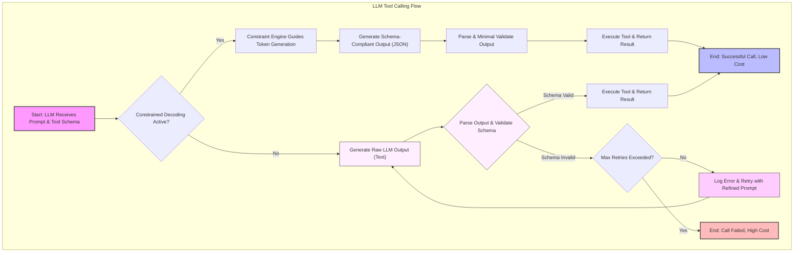

대규모 언어 모델(LLM)의 도구 호출(Tool Calling) 기능은 에이전트의 핵심 역량 중 하나입니다. 그러나 LLM이 외부 도구 호출 시 정의된 스키마를 준수하지 못하면 예측 불가능한 오류를 유발하고, 이로 인해 불필요한 재시도가 발생하여 에이전트의 신뢰성과 운영 비용에 치명적인 영향을 미칠 수 있습니다. 특히, vLLM 0.28과 같은 특정 모델 및 추론 엔진 환경에서 스키마 정확도가 92% 수준에 그친다는 연구 결과는 이러한 문제의 심각성을 보여줍니다. LLM 출력 검증 파이프라인의 신뢰성과 효율성을 높이는 것은 에이전트 시스템의 전반적인 품질과 비용 효율성을 확보하는 데 필수적입니다. 이 엔트리에서는 도구 호출 정확도를 개선하고 비용을 최적화하기 위한 전략들을 탐구합니다.<br />
<br />
## 도구 호출 정확도 문제의 본질

LLM이 도구를 호출할 때는 사전에 정의된 함수 시그니처(스키마)에 맞춰 인자를 생성해야 합니다. 이 스키마는 대개 JSON이나 YAML과 같은 구조화된 형태로 정의됩니다. 문제는 LLM이 이러한 구조화된 출력을 100% 완벽하게 생성하지 못할 수 있다는 점입니다. 토큰 생성 과정에서 유효하지 않은 문자열이나 잘못된 형식의 값이 포함되면, 파싱(parsing) 오류가 발생하고 도구 실행이 실패합니다. 이는 다음과 같은 결과를 초래합니다:<br />
<br />
*   **정확도 저하**: 잘못된 도구 호출로 인해 에이전트가 올바른 작업을 수행하지 못합니다.<br />
*   **비용 증가**: 실패한 호출은 재시도를 유발하며, 이는 LLM API 호출 횟수 증가로 이어져 비용이 상승합니다.<br />
*   **레이턴시 증가**: 재시도 로직 때문에 전체 작업 완료 시간이 길어집니다.<br />
*   **개발 및 디버깅 복잡성**: 예상치 못한 스키마 불일치 오류는 디버깅을 어렵게 만듭니다.<br />
<br />
## Constrained Decoding을 통한 정확도 개선

**Constrained Decoding**은 LLM이 토큰을 생성하는 각 단계마다 미리 정의된 스키마(또는 문법 규칙)에 맞춰 유효한 토큰만을 생성하도록 강제하는 기법입니다. 이는 모델이 자유롭게 텍스트를 생성하는 대신, 특정 구조를 벗어나는 토큰을 애초에 생성하지 못하게 함으로써 출력의 정확도를 극적으로 향상시킵니다.<br />
<br />
### 작동 원리

1.  **스키마 정의**: 호출할 도구의 스키마를 JSON Schema, Pydantic 모델 등 구조화된 형태로 정의합니다.<br />
2.  **토큰 제약**: LLM이 다음 토큰을 예측할 때마다, 정의된 스키마에 따라 현재까지 생성된 토큰 시퀀스가 유효한지 검사합니다.<br />
3.  **유효 토큰만 허용**: 스키마에 따라 다음으로 올 수 있는 유효한 토큰들의 서브셋(subset)만을 허용하고, 나머지 토큰들의 확률을 0으로 설정하거나 매우 낮춥니다.<br />
4.  **반복 생성**: 이 과정을 반복하여 최종적으로 스키마에 완벽하게 부합하는 출력을 생성합니다.<br />
<br />
### 주요 이점

*   **높은 정확도**: LLM 출력이 스키마에 100% 가깝게 일치하도록 보장하여 파싱 오류를 최소화합니다.<br />
*   **비용 절감**: 재시도 횟수가 줄어들어 LLM API 호출 비용이 절감됩니다.<br />
*   **레이턴시 감소**: 불필요한 재시도와 후처리 검증 단계가 줄어들어 응답 속도가 빨라집니다.<br />
*   **안정성 향상**: 에이전트 시스템의 예측 가능성과 안정성이 크게 향상됩니다.<br />
<br />
### 구현 전략

1.  **모델 제공 API 활용**: Gemini API나 OpenAI의 `response_format=(type: "json_object")`와 같은 최신 LLM API들은 자체적으로 constrained decoding 기능을 제공합니다. 특히 Gemini는 Pydantic 모델을 직접 넘겨주어 강력한 제약을 걸 수 있습니다.<br />
2.  **라이브러리 활용**: `Instructor` (Pydantic 기반), `Outlines`, `Guidance`와 같은 라이브러리들은 다양한 LLM 백엔드 위에서 constrained decoding을 추상화하여 제공합니다. 이를 통해 코드에서 쉽게 구조화된 출력을 강제할 수 있습니다.<br />
3.  **후처리 및 재시도 로직 개선**: constrained decoding이 불가능하거나 특정 이유로 사용하기 어려운 경우, LLM 출력에 대한 강력한 후처리(post-processing) 검증 로직을 구축해야 합니다. 스키마 불일치 시 의미 있는 오류 메시지를 생성하고, `최대 N회 재시도` 정책과 함께, 재시도가 반복되는 패턴을 감지하여 문제의 근본 원인을 분석하는 모니터링 시스템을 갖추는 것이 중요합니다.<br />
<br />
### 코드 예시: Pydantic을 활용한 구조화된 출력 정의

다음은 Python에서 Pydantic을 사용하여 도구 호출 스키마를 정의하고, LLM의 출력이 이 스키마를 준수하도록 유도하는 개념적인 코드입니다. 실제 constrained decoding은 LLM API 단에서 이루어지지만, Pydantic은 그 기반이 되는 스키마를 강력하게 정의하는 데 사용됩니다.

```python
from pydantic import BaseModel, Field
from typing import Optional
import json

# 1. 도구 호출을 위한 스키마 정의 (Pydantic BaseModel)
class SearchTool(BaseModel):
    """Perform a web search for relevant information."""
    query: str = Field(..., description="The search query to execute.")
    num_results: int = Field(1, description="Number of search results to retrieve, default to 1.")
    language: Optional[str] = Field("en", description="Language for search results (e.g., 'en', 'ko').")

# 2. LLM 호출 시 스키마를 전달하고 Constrained Decoding을 적용하는 가상의 함수
def call_llm_with_constrained_tool(model_api_client, prompt: str, tool_schema: BaseModel) -> dict:
    """
    LLM API를 호출하여 constrained decoding으로 스키마에 맞는 출력을 생성합니다.
    실제 환경에서는 model_api_client가 이 스키마를 활용하여 유효한 JSON을 반환합니다.
    """
    print(f"LLM에 다음 프롬프트와 스키마를 전달합니다:\n프롬프트: '{prompt}'\n스키마: {tool_schema.model_json_schema()}")

    # 실제 LLM API 호출 로직 (가상)
    # 예시를 위해 스키마에 맞는 JSON 문자열을 직접 생성합니다.
    # 실제 constrained decoding이 적용되면, LLM은 항상 유효한 JSON을 반환합니다.
    if "weather" in prompt.lower():
        raw_json_output = '{"query": "current weather in seoul", "num_results": 2, "language": "ko"}'
    elif "stock price" in prompt.lower():
        raw_json_output = '{"query": "stock price for google", "num_results": 1}' # language defaults to 'en'
    else:
        raw_json_output = '{"query": "LLMs general information", "num_results": 3, "language": "en"}'

    print(f"LLM이 생성한 (constrained) JSON: {raw_json_output}")

    try:
        # Pydantic을 사용하여 LLM 출력을 검증하고 파싱합니다.
        # constrained decoding 덕분에 대부분의 경우 성공적으로 파싱됩니다.
        tool_call_params = tool_schema.model_validate_json(raw_json_output)
        print(f"성공적으로 파싱된 도구 호출 파라미터: {tool_call_params}")
        return tool_call_params.model_dump()
    except Exception as e:
        print(f"⚠️ 오류: LLM 출력 파싱 실패 (constrained decoding 문제 또는 스키마 불일치): {e}")
        # constrained decoding이 제대로 작동했다면 이 블록에 들어올 일은 거의 없습니다.
        raise

# 가상의 LLM 클라이언트 (실제로는 Anthropic, Google, OpenAI 등의 클라이언트 사용)
class MockLLMClient:
    def call(self, prompt, schema):
        pass # 실제 호출 로직 생략

mock_llm_client = MockLLMClient()

# 예시 사용법:
output_1 = call_llm_with_constrained_tool(mock_llm_client, "Search for current weather in Seoul.", SearchTool)
print(f"첫 번째 호출 결과: {output_1}\n")

output_2 = call_llm_with_constrained_tool(mock_llm_client, "What's the stock price of Google today?", SearchTool)
print(f"두 번째 호출 결과: {output_2}\n")

output_3 = call_llm_with_constrained_tool(mock_llm_client, "Tell me about large language models.", SearchTool)
print(f"세 번째 호출 결과: {output_3}\n")
```
<br />
<br />
### Constrained Decoding 흐름 비교


<br />

## 트레이드오프

### 1. Constrained Decoding 적용<br />
*   **장점**: LLM 출력의 스키마 정확도를 최대로 보장하며, 재시도 로직으로 인한 비용 및 레이턴시 증가를 효과적으로 방지합니다.<br />
*   **단점**: 모든 LLM 제공자가 이 기능을 완벽하게 지원하지 않거나, 특정 모델에서는 성능 오버헤드가 발생할 수 있습니다. 스키마가 복잡할수록 구현 난이도가 올라갈 수 있습니다.<br />
*   **언제 좋은가**: LLM이 구조화된 JSON 출력을 엄격하게 따라야 하는 도구 호출, 데이터 추출, API 호출 인자 생성 등 고정된 스키마가 중요한 작업에 매우 효과적입니다. 비용과 안정성이 최우선인 프로덕션 환경에 적합합니다.<br />
*   **언제 나쁜가**: 모델이 자유로운 형식의 텍스트를 생성해야 하거나, 스키마가 매우 유동적으로 변하는 상황에서는 유연성이 떨어질 수 있습니다. 제한된 모델 지원 또는 추가적인 라이브러리/프레임워크 도입이 부담스러운 경우 대안을 고려해야 합니다.<br />

### 2. LLM 출력 검증 및 재시도 로직<br />
*   **장점**: Constrained Decoding을 사용할 수 없는 환경에서도 일정 수준의 오류 복구 기능을 제공할 수 있습니다. 모델의 자유로운 출력을 허용하면서 후처리로 오류를 줄이는 방식입니다.<br />
*   **단점**: 재시도 로직은 추가적인 LLM 호출을 유발하여 비용을 증가시키고, 실패가 반복될 경우 에이전트의 응답 레이턴시를 크게 늘릴 수 있습니다. 검증 로직 자체의 견고함이 중요합니다.<br />
*   **언제 좋은가**: LLM 제공자가 Constrained Decoding을 지원하지 않거나, 스키마 불일치가 드물게 발생하는 경우, 또는 특정 필드에 대한 추가적인 비즈니스 로직 검증이 필요한 경우에 유용합니다.<br />
*   **언제 나쁜가**: 스키마 불일치가 빈번하게 발생하거나, 비용 및 레이턴시에 대한 요구사항이 매우 엄격한 경우에는 비효율적입니다. 재시도가 반복될수록 사용자 경험과 시스템 신뢰도에 악영향을 미칩니다.<br />

### 3. 스키마 정의의 복잡성<br />
*   **장점**: 도구 호출 스키마를 명확하고 상세하게 정의할수록 LLM이 더 정확한 출력을 생성할 가능성이 높아집니다.<br />
*   **단점**: 스키마가 너무 복잡해지면 모델이 이를 이해하고 따르는 데 어려움을 겪을 수 있으며, constrained decoding 구현 시 성능 저하나 라이브러리 지원 한계에 부딪힐 수 있습니다.<br />
*   **언제 좋은가**: 도구의 인터페이스가 명확하고, 각 인자의 데이터 타입과 제약 조건이 분명한 경우에 좋습니다.<br />
*   **언제 나쁜가**: 동적으로 변하는 인자가 많거나, 스키마 자체가 비정형 데이터를 포함해야 하는 경우, 또는 스키마가 너무 방대하여 프롬프트 컨텍스트에 부담을 줄 수 있는 경우.<br />
<br />
## 실전 체크리스트

LLM 도구 호출의 정확도 개선 및 비용 최적화를 위해 다음 항목들을 확인하고 적용합니다:<br />
<br />
- [ ] 현재 사용 중인 LLM API(예: Gemini, OpenAI, Anthropic)가 **Constrained Decoding** 또는 유사한 구조화된 출력 강제 기능을 지원하는지 확인하고, 가능하다면 해당 기능을 우선적으로 적용했습니다.<br />
- [ ] 도구 호출 스키마를 **Pydantic Model, JSON Schema** 등 엄격한 형식으로 명확하게 정의하고, 이를 LLM에게 명시적으로 전달하는 프롬프트 엔지니어링 전략을 수립했습니다.<br />
- [ ] LLM의 도구 호출 출력에 대한 **자동화된 스키마 유효성 검증(validation) 파이프라인**을 구축하고, 파싱 오류 발생 시 로그를 상세하게 기록하도록 설정했습니다.<br />
- [ ] 스키마 유효성 검증에 실패한 경우를 대비하여, **의미 있는 오류 메시지와 함께 최대 재시도 횟수를 제한하는 복구(retry) 로직**을 구현하고, 재시도 실패 시 후속 조치(예: 사용자에게 알림, 관리자에게 보고)를 정의했습니다.<br />
- [ ] LLM 도구 호출의 **성공률, 재시도 횟수, 평균 레이턴시, 토큰 사용량(비용)** 등의 핵심 지표를 모니터링하는 시스템을 구축하여 최적화 효과를 측정하고 있습니다.<br />
- [ ] 스키마가 변경될 때마다 **LLM의 도구 호출 정확도를 평가하는 테스트 케이스**를 업데이트하고, 회귀 테스트(regression test)를 통해 변경 사항이 기존 정확도에 미치는 영향을 주기적으로 검증합니다.<br />
- [ ] **복잡한 스키마는 작은 단위의 모듈로 분리**하여 LLM의 인지 부담을 줄이고, 필요한 경우 동적으로 스키마를 로드하거나 프롬프트에 포함하는 전략을 고려합니다.<br />