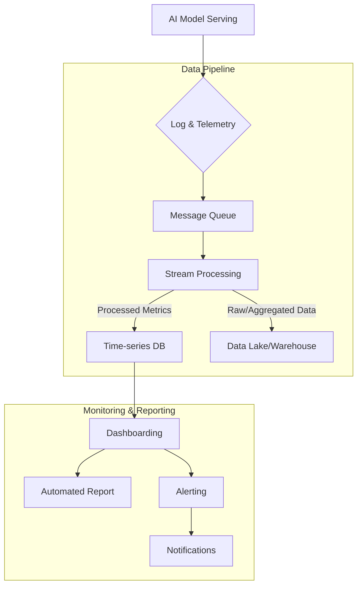

## AI 모델 배포 후 실시간 성능 모니터링 리포트 자동화

### 실시간 모니터링의 중요성
배포된 AI 모델은 시간이 지남에 따라 성능 저하(Model Drift)나 입력 데이터 분포 변화(Data Drift)를 겪을 수 있습니다. 지속적인 모니터링은 이러한 문제를 조기에 감지하고, 비즈니스 영향 최소화 및 시스템 신뢰성 유지를 위한 필수 과정입니다. 자동화된 리포팅은 운영팀이 시스템의 '건전성(Health)'을 직관적으로 파악하고, 문제 발생 시 즉각적인 대응을 가능하게 합니다.

### 핵심 모니터링 지표
AI 모델의 실시간 성능 모니터링에는 다음 지표들이 핵심적으로 활용됩니다.

*   **성능 지표**: Accuracy, Precision, Recall, F1-Score (분류); RMSE, MAE (회귀); Latency, Throughput (공통).
*   **데이터 드리프트**: 학습/추론 데이터 간 통계적 분포 차이 (PSI, KS-Test), 특성 중요도 변화.
*   **모델 드리프트**: 모델 예측 결과 분포 변화, XAI 기법(Shapley values, LIME)을 통한 예측 근거 변화 감지.
*   **자원 활용 지표**: CPU/GPU 사용률, 메모리 사용량, 네트워크 I/O.

### 실시간 모니터링 아키텍처 패턴

실시간 AI 모델 성능 모니터링 시스템은 일반적으로 다음 구성 요소를 포함합니다.

#### 1. 데이터 수집 (Data Ingestion)
모델 서빙 레이어에서 발생하는 추론 요청, 응답, 지연 시간, 에러 등을 상세히 기록하고, Kafka, Kinesis 같은 메시지 큐로 데이터를 중앙 집중화합니다.

#### 2. 실시간 데이터 처리 및 분석 (Real-time Processing & Analysis)
수집된 데이터를 Apache Flink, Spark Streaming 등으로 실시간 가공 및 분석하여 모니터링 지표를 계산하고, 모니터링에 필요한 특성(Feature)을 추출합니다.

#### 3. 지표 저장 (Metric Storage)
처리된 실시간 지표를 Prometheus, InfluxDB 같은 시계열 데이터베이스에 저장합니다. 장기 분석을 위해 S3, BigQuery 같은 데이터 레이크/웨어하우스에도 저장될 수 있습니다.

#### 4. 시각화 및 대시보드 (Visualization & Dashboarding)
Grafana, Kibana 등으로 지표를 직관적으로 시각화하고, 정기적으로 대시보드 스냅샷을 찍거나 요약 리포트를 자동 생성하여 배포합니다.

#### 5. 알림 및 이상 감지 (Alerting & Anomaly Detection)
정의된 임계값(예: Latency > 100ms)을 벗어나거나, 통계적(EWMA, CUSUM) 또는 머신러닝 기반 이상 감지 모델이 비정상 패턴을 감지할 때 Slack, PagerDuty 등으로 알림을 전송합니다.

### 아키텍처 시각화



### 코드 예제: Python 기반 메트릭 수집 및 전송 (Prometheus 클라이언트)
```python
from flask import Flask, request, jsonify
from prometheus_client import Gauge, Histogram, generate_latest, Counter
import time, random

app = Flask(__name__)

INFERENCE_LATENCY = Histogram('inference_latency_seconds', 'AI model inference latency', buckets=(.005, .01, .05, .1, .5, 1.0, float('inf')))
INFERENCE_REQUESTS_TOTAL = Counter('inference_requests_total', 'Total inference requests')
INFERENCE_ERRORS_TOTAL = Counter('inference_errors_total', 'Total inference errors')
MODEL_ACCURACY_GAUGE = Gauge('model_accuracy', 'Current reported model accuracy')
DATA_DRIFT_SCORE_GAUGE = Gauge('data_drift_score', 'Current data drift score')

def run_ai_inference(): # Simplified for brevity
    time.sleep(random.uniform(0.01, 0.2))
    if random.random() < 0.03: raise ValueError("Simulated error")
    return {"result": random.choice(["cat", "dog"])}

@app.route('/predict', methods=['POST'])
def predict():
    start_time = time.time()
    INFERENCE_REQUESTS_TOTAL.inc()
    try:
        prediction = run_ai_inference()
        INFERENCE_LATENCY.observe(time.time() - start_time)
        return jsonify(prediction), 200
    except Exception as e:
        INFERENCE_ERRORS_TOTAL.inc()
        return jsonify({"error": str(e)}), 500

@app.route('/metrics')
def metrics(): return generate_latest(), 200

def update_external_reports(): # Mock external updates
    MODEL_ACCURACY_GAUGE.set(random.uniform(0.75, 0.95))
    DATA_DRIFT_SCORE_GAUGE.set(random.uniform(0.01, 0.15))

if __name__ == '__main__':
    update_external_reports()
    app.run(host='0.0.0.0', port=5000)
```

### 2026년 최신 트렌드 반영

2026년에는 AI 모델 모니터링 및 리포팅 분야에서 다음과 같은 트렌드가 두드러지고 있습니다.

*   **Explainable AI (XAI) 기반 모니터링**: '왜' 모델 성능이 변했는지, 어떤 특성이 영향을 미쳤는지 실시간으로 분석/시각화하는 XAI 기법(SHAP, LIME)이 깊이 통합되어 근본 원인 파악을 돕습니다.
*   **능동형 드리프트 감지 및 예측**: 과거 비교를 넘어 잠재적 미래 드리프트를 예측하고 선제적으로 경고하는 예측 모델이 도입됩니다. 이는 AIOps의 핵심 요소로, 문제 발생 전 대응하는 '예측 유지보수'를 가능하게 합니다.
*   **통합 MLOps 플랫폼 강화**: 모델 개발부터 배포, 운영, 모니터링, 재학습까지 전 과정을 단일 플랫폼에서 관리합니다. 실시간 모니터링 리포트 자동화는 기본 기능으로 제공되며, 워크플로우 전반의 가시성을 제공합니다.
*   **경량화된 엣지 디바이스 모니터링**: IoT 및 엣지 컴퓨팅 환경에서의 AI 모델 증가로, 제한된 자원에서 효율적으로 모델 성능을 모니터링하고 리포팅하는 경량화된 솔루션이 중요해집니다.

## 트레이드오프

### 1. 실시간 모니터링 vs 배치 모니터링
*   **실시간 모니터링**:
    *   **장점/단점**: 문제 즉시 감지 및 대응 가능하나, 높은 인프라 비용/복잡성.
    *   **적합/부적합**: 금융 거래, 자율 주행 등 낮은 지연 시간과 높은 신뢰성이 요구되는 Critical 시스템에 적합합니다. 데이터 변화가 느린 모델에는 과도한 투자일 수 있습니다.
*   **배치 모니터링**:
    *   **장점/단점**: 낮은 인프라 비용/구현 용이하나, 문제 감지 시간 소요.
    *   **적합/부적합**: 주간/월간 평가로 충분하거나 리소스 제약이 큰 환경에 적합합니다. 실시간 대응이 필수적인 시스템에는 부적합합니다.

### 2. 모니터링 지표의 깊이 vs 시스템 복잡성
*   **깊이 있는 지표 (예: XAI 기반)**:
    *   **장점/단점**: 근본 원인 파악 용이하나, 높은 컴퓨팅 자원/복잡성.
    *   **적합/부적합**: 규제 산업(의료, 법률), 모델 개선/디버깅이 중요한 상황에 유용합니다. 단순 성능 지표로 충분한 경우 불필요한 오버헤드입니다.
*   **간단한 지표 (예: Accuracy, Latency)**:
    *   **장점/단점**: 낮은 구현 복잡성/자원 소모하나, 근본 원인 파악 어려움.
    *   **적합/부적합**: 초기 시스템 구축 시, 또는 핵심 지표만으로 충분한 모델에 적합합니다. 심층 분석이 필요한 경우 한계가 있습니다.

### 3. 상용 MLOps 플랫폼 vs 자체 구축
*   **상용 MLOps 플랫폼**:
    *   **장점/단점**: 빠른 도입, 통합 기능, 관리 용이하나, 높은 비용/벤더 종속성/커스터마이징 한계.
    *   **적합/부적합**: 자원이 제한적이지만 빠른 구축이 필요한 스타트업, 광범위한 기능을 즉시 활용하려는 대기업에 적합합니다. 엄격한 보안 요구사항이 있는 경우 제약이 있을 수 있습니다.
*   **자체 구축 (Open Source/Custom)**:
    *   **장점/단점**: 높은 유연성/커스터마이징 가능, 벤더 종속성 없음이나, 높은 초기 비용/시간/유지보수 부담.
    *   **적합/부적합**: 고유 요구사항이 많거나, 전문성을 보유하고 장기적 최적화를 추구하는 조직에 적합합니다. 빠른 시장 출시가 필요한 경우 비효율적일 수 있습니다.

## 실전 체크리스트

AI 모델 배포 후 실시간 성능 모니터링 리포트 자동화를 구현할 때 다음 사항들을 검증하십시오.

- [ ] **핵심 모니터링 지표 및 임계값 정의**: 모델 유형에 따른 성능, 드리프트 지표를 명확히 정의하고, 각 지표에 대한 실질적인 경고 임계값 설정 여부. (예: `Accuracy < 0.85`, `PSI > 0.1`)
- [ ] **실시간 데이터 수집 파이프라인 안정성**: 모든 추론 데이터가 최소 지연 시간으로 메시지 큐에 안정적으로 수집되며, 데이터 손실 없이 처리되는지 검증 완료 여부.
- [ ] **스트림 처리 엔진 지표 계산 로직 검증**: 실시간 스트림 처리 엔진에서 정의된 모니터링 지표들이 정확하고 효율적으로 계산되며, 정확성 및 계산 속도가 기대치를 충족하는지 확인 완료 여부.
- [ ] **시계열 데이터베이스 및 대시보드 연동**: 계산된 지표들이 시계열 DB에 올바르게 저장되고, Grafana 같은 대시보드에서 시각화 및 자동 리포팅 설정이 완료되었는지 확인 완료 여부.
- [ ] **자동 알림 시스템 및 이상 감지 활성화**: 정의된 임계값 위반 또는 이상 패턴 감지 시 적절한 채널로 알림이 즉시 전송되며, 오탐/미탐 비율이 허용 가능한 수준인지 테스트 완료 여부.
- [ ] **모니터링 시스템 자체 가용성 및 성능 모니터링**: 모니터링 시스템 자체의 높은 가용성과 성능(처리량, 저장 공간)이 별도로 모니터링되고, 이상 발생 시 알림이 설정되어 있는지 확인 완료 여부 (메타-모니터링).
- [ ] **재학습(Retraining) 워크플로우 연동 준비**: 감지된 드리프트가 자동 재학습을 트리거하거나, 재학습 필요성에 대한 신호를 제공하여 MLOps 파이프라인의 다음 단계로 원활히 연결되는지 확인 완료 여부.