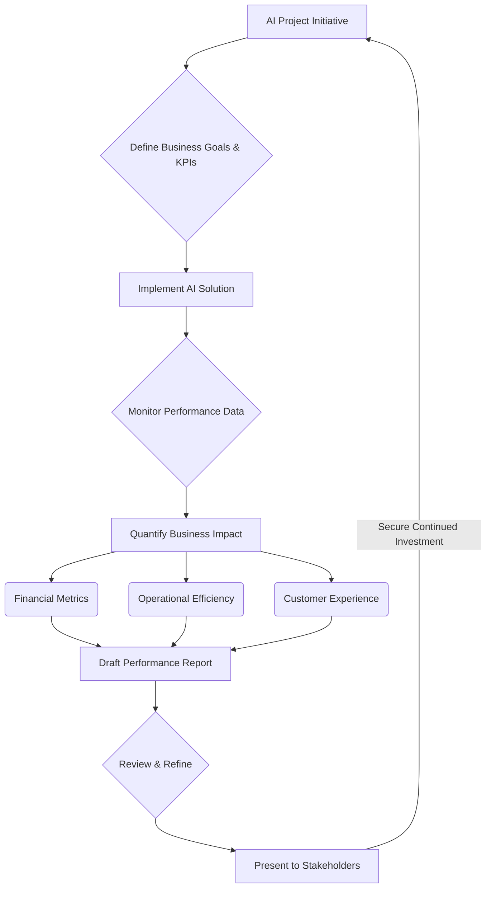

AI 프로젝트의 성공은 단순히 기술적 성능 지표를 달성하는 것을 넘어, 조직의 비즈니스 목표에 얼마나 기여하는지를 명확하게 입증하는 데 있습니다. 2026년 기준, AI 기술 투자는 더욱 가속화되고 있으며, 이러한 투자를 지속적으로 유치하고 프로젝트의 중요성을 조직 내외에 효과적으로 설득하기 위해서는 실질적인 비즈니스 영향력을 담은 성과 보고서 작성이 필수적입니다.

## 핵심 원칙

AI 프로젝트 성과 보고서는 기술 중심이 아닌 비즈니스 가치 중심의 접근 방식을 채택해야 합니다. 다음은 효과적인 보고서를 위한 핵심 원칙입니다.

### 1. 비즈니스 목표 정렬 (Business Goal Alignment)
AI 프로젝트가 해결하려는 근본적인 비즈니스 문제와 그로 인해 창출될 가치를 보고서 전면에 제시해야 합니다. 예를 들어, '모델의 정확도 90%' 대신 'AI 기반 수요 예측 시스템으로 재고 유지 비용 15% 절감'과 같이 비즈니스 KPI(Key Performance Indicator)에 직접적으로 연결하여 설명합니다. 이는 프로젝트가 '솔루션을 위한 솔루션'이 아닌, 실제 비즈니스 요구에 부응하고 있음을 보여줍니다.

### 2. 정량적 성과 지표 (Quantitative Metrics)
비즈니스 가치를 측정 가능한 수치로 제시하는 것이 중요합니다. ROI (Return on Investment), 순이익 증가분, 비용 절감액, 시장 점유율 변화, 고객 이탈률 감소, 운영 효율성 향상(예: 처리 시간 단축, 인력 투입 감소) 등 재무적, 운영적 지표를 활용합니다. 정량적인 데이터는 경영진의 의사결정에 강력한 근거를 제공합니다.

### 3. 스토리텔링 (Storytelling)
데이터와 수치만 나열하는 것만으로는 충분하지 않습니다. AI가 어떻게 특정 비즈니스 프로세스를 변화시키고, 실제 사용자의 경험을 개선하며, 어떤 이점을 창출했는지에 대한 서사적 설명을 덧붙여야 합니다. 성공 사례나 Before & After 시나리오를 통해 AI의 영향력을 더욱 생생하게 전달할 수 있습니다. 이는 보고서의 설득력을 높이고 감성적인 공감을 유도합니다.

### 4. 명확하고 간결한 커뮤니케이션 (Clear & Concise Communication)
보고서는 기술 전문가뿐만 아니라 비기술적 배경을 가진 경영진 및 이해관계자들도 쉽게 이해할 수 있도록 작성되어야 합니다. 기술 전문 용어 사용을 최소화하고, 필요한 경우 명확한 설명을 덧붙여야 합니다. `Executive Summary`는 핵심 메시지를 한두 페이지 내로 압축하여 바쁜 의사결정권자들이 빠르게 내용을 파악할 수 있도록 구성합니다.

## 성과 보고서의 구성 요소

효과적인 AI 프로젝트 성과 보고서는 일반적으로 다음과 같은 섹션으로 구성됩니다.

*   **요약 (Executive Summary)**: 프로젝트의 핵심 성과, 비즈니스 영향, 주요 권고 사항 및 다음 단계를 간결하게 요약합니다.
*   **프로젝트 개요 (Project Overview)**: 프로젝트의 목표, 범위, 사용된 주요 AI 기술(간략히), 프로젝트 기간 및 팀 구성 등을 소개합니다.
*   **주요 성과 및 비즈니스 영향 (Key Achievements & Business Impact)**:
    *   **재무적 지표 (Financial Metrics)**: AI 도입 후 발생한 ROI, 순이익 증가분, 비용 절감액, 매출 증대분 등을 구체적인 수치로 제시합니다. (예: `IRR`, `NPV`, `Payback Period`)
    *   **운영 효율성 (Operational Efficiency)**: 프로세스 자동화율, 작업 처리 시간 단축, 인력 투입 감소, 리소스 활용도 개선 등을 보고합니다.
    *   **고객 경험 (Customer Experience)**: 고객 만족도(`CSAT`) 개선, 고객 이탈률 감소, 개인화된 서비스 제공으로 인한 고객 참여도 증대 등을 다룹니다.
    *   **위험 감소 및 규제 준수 (Risk Mitigation & Compliance)**: 오류율 감소, 사기 탐지율 향상, 보안 강화, 특정 규제 요구사항 충족 등을 포함합니다.
*   **기술적 성과 (Technical Performance)**: 모델의 정확도, 정밀도, 재현율, `F1-score`, `latency`, `throughput` 등 기술 지표를 제시하되, 반드시 이 지표들이 비즈니스 목표에 어떻게 기여했는지 연결하여 설명합니다. 예를 들어, '모델 정확도 95% 달성으로 오탐지율 50% 감소, 이는 곧 운영 비용 2천만원 절감으로 이어짐'과 같이 설명합니다.
*   **도전 과제 및 해결 (Challenges & Solutions)**: 프로젝트 진행 중 발생했던 어려움과 이를 어떻게 해결했는지 투명하게 공유합니다. 이는 팀의 학습 능력과 문제 해결 역량을 보여주며, 신뢰를 구축하는 데 기여합니다.
*   **향후 계획 및 권고 (Future Plans & Recommendations)**: 다음 단계, 추가적인 개선 사항, 잠재적인 AI 프로젝트 확장 기회, 그리고 지속적인 가치 창출을 위한 권고 사항을 제시합니다.

## 코드 예제: AI 프로젝트 비즈니스 가치 계산 시뮬레이션

다음 Python 코드는 가상의 AI 프로젝트에 대한 `ROI` 및 총 비즈니스 가치를 계산하는 시뮬레이션을 보여줍니다. 이는 보고서에 포함될 정량적 지표 계산의 기초가 될 수 있습니다.

```python
import pandas as pd
import numpy as np

# 가상 AI 프로젝트 데이터
np.random.seed(42)
months = pd.date_range(start='2025-01-01', periods=12, freq='M')
initial_cost = 500000 # 초기 투자 비용
monthly_revenue_ai_project = np.random.normal(loc=100000, scale=10000, size=12).cumsum()
monthly_revenue_baseline = np.random.normal(loc=70000, scale=8000, size=12).cumsum()
monthly_cost_savings = np.random.normal(loc=15000, scale=2000, size=12)

df = pd.DataFrame({
    'Month': months,
    'AI_Project_Revenue': monthly_revenue_ai_project,
    'Baseline_Revenue': monthly_revenue_baseline,
    'Cost_Savings': monthly_cost_savings
})

# AI 프로젝트로 인한 추가 수익 및 총 비용 절감
df['Incremental_Revenue'] = df['AI_Project_Revenue'] - df['Baseline_Revenue']
df['Cumulative_Incremental_Revenue'] = df['Incremental_Revenue'].cumsum()
df['Cumulative_Cost_Savings'] = df['Cost_Savings'].cumsum()

# 총 비즈니스 가치
df['Total_Business_Value'] = df['Cumulative_Incremental_Revenue'] + df['Cumulative_Cost_Savings'] - initial_cost

print("AI Project Business Value Report (Simulated Data):")
print(df[['Month', 'Incremental_Revenue', 'Cost_Savings', 'Total_Business_Value']].tail(3).to_markdown(index=False))

# 간단한 ROI 계산 (12개월 기준)
total_benefit = df['Cumulative_Incremental_Revenue'].iloc[-1] + df['Cumulative_Cost_Savings'].iloc[-1]
roi = ((total_benefit - initial_cost) / initial_cost) * 100

print(f"\nInitial Investment: ${initial_cost:,.2f}")
print(f"Total Benefit (12 months): ${total_benefit:,.2f}")
print(f"Return on Investment (ROI) after 12 months: {roi:.2f}%")
```

이 코드는 가상의 데이터를 기반으로 AI 프로젝트의 월별 증분 수익, 비용 절감, 누적 비즈니스 가치 및 `ROI`를 계산합니다. 실제 보고서에서는 이와 유사한 방식으로 실제 데이터를 사용하여 프로젝트의 재무적 기여도를 정량화할 수 있습니다.

## AI 프로젝트 성과 보고 프로세스 흐름

아래 Mermaid 다이어그램은 AI 프로젝트 성과 보고서 작성의 일반적인 워크플로를 시각적으로 보여줍니다.



이 흐름도는 AI 프로젝트의 기획 단계에서부터 비즈니스 목표와 `KPI`를 명확히 정의하고, 솔루션 구현 후 데이터를 모니터링하여 비즈니스 영향을 정량화한 다음, 최종적으로 보고서를 작성하고 이해관계자에게 발표하는 전 과정을 나타냅니다.

## 트레이드오프

AI 프로젝트의 비즈니스 가치 보고에는 여러 트레이드오프가 존재하며, 상황에 따라 최적의 접근 방식이 달라질 수 있습니다.

*   **심층 기술 분석 vs. 간결한 비즈니스 요약**: 기술 팀은 모델 아키텍처, 학습 방법, 최적화 기법 등 심층적인 기술적 세부 사항에 대한 보고를 선호할 수 있습니다. 반면, 경영진은 이러한 복잡성보다 핵심적인 비즈니스 영향과 재무적 성과에 대한 간결한 요약을 우선시합니다.
    *   **언제 좋은가**: 기술적 의사결정, 모델 개선 및 개발 팀 간의 지식 공유가 필요할 때는 심층 분석이 유용합니다. 복잡한 문제의 근본 원인을 파악하는 데 필수적입니다.
    *   **언제 나쁜가**: 전략적 의사결정이나 투자 유치를 위한 보고서에서는 과도한 기술적 세부 사항이 핵심 메시지를 희석시키고 의사결정자의 피로도를 높일 수 있습니다.

*   **단기 성과 중심 vs. 장기적 가치 예측**: AI 프로젝트의 즉각적인 `ROI`나 단기적인 비용 절감 효과는 초기 투자 정당화에 필수적입니다. 그러나 AI의 진정한 가치는 장기적인 경쟁 우위 확보, 새로운 비즈니스 모델 창출, 조직의 혁신 문화 구축 등에서 발현될 수 있습니다.
    *   **언제 좋은가**: 초기 투자 유치, 분기별 성과 보고, 예산 확보 등 즉각적인 재무적 근거가 필요할 때 단기 성과 중심 보고가 효과적입니다.
    *   **언제 나쁜가**: AI가 가져올 장기적인 전략적 이점이나 시장 변화의 잠재력을 과소평가하여, 프로젝트의 지속적인 발전과 확장을 저해할 수 있습니다.

*   **기술적 정확성 vs. 비즈니스 친화적 언어**: 모델의 `F1-score`, `AUC`, `latency`와 같은 지표는 AI 전문가에게 모델의 성능을 정확하게 설명하지만, 비즈니스 리더에게는 해당 지표가 매출 증대나 비용 절감에 어떻게 직접적으로 기여하는지가 더 중요합니다.
    *   **언제 좋은가**: 모델 성능 벤치마킹, 기술적 결함 진단, 모델 고도화 방안 논의 등 AI 개발 및 운영 단계에서 기술적 정확성은 필수적입니다.
    *   **언제 나쁜가**: 비기술적 이해관계자 대상 보고 시, 전문 용어를 과도하게 사용하면 메시지 전달력이 떨어지고 비즈니스 가치에 대한 오해를 불러일으킬 수 있습니다.

*   **투명한 실패 공유 vs. 긍정적 성과 강조**: 프로젝트의 성공 사례와 함께 발생한 도전 과제, 예상치 못한 문제, 그리고 그로부터 얻은 교훈을 투명하게 공유하는 것은 조직 내 신뢰를 구축하고 학습 문화를 조성하는 데 기여합니다. 그러나 민감한 실패 정보는 프로젝트에 대한 부정적인 인식을 심어줄 수 있습니다.
    *   **언제 좋은가**: 내부 학습 세션, 사후 분석 보고서, 또는 위험 관리에 중점을 둔 이해관계자 보고 시 투명한 공유가 팀의 성장과 다음 프로젝트의 성공에 중요한 자산이 됩니다.
    *   **언제 나쁜가**: 외부 투자자, 대외 홍보 자료, 또는 프로젝트의 존립이 위태로운 상황에서는 부정적인 측면을 강조하는 것이 오히려 역효과를 낼 수 있습니다. 이 경우, 실패를 `Learning Opportunity`로 재구성하여 전달하는 것이 중요합니다.

## 실전 체크리스트

AI 프로젝트의 비즈니스 가치를 설득력 있게 전달하기 위한 성과 보고서를 작성할 때 다음 항목들을 검토하고 적용합니다.

- [ ] AI 프로젝트의 최종 목표가 비즈니스의 핵심 `KPI` (예: 매출, 비용, 고객 만족도)와 명확히 연결되었는지 확인합니다.
- [ ] 보고서에 제시된 모든 정량적 비즈니스 가치 지표 (예: `ROI`, 비용 절감액)에 대한 데이터 출처와 계산 방식이 명확히 명시되었는지 검토합니다.
- [ ] 보고서의 `Executive Summary`가 1페이지 이내로 핵심 성과, 비즈니스 영향, 그리고 다음 단계를 효과적으로 전달하는지 점검합니다.
- [ ] 비기술적 이해관계자가 쉽게 이해할 수 있도록 기술 전문 용어를 최소화하고, 필요한 경우 비즈니스 용어로 재해석하여 사용했는지 확인합니다.
- [ ] 최소 1개 이상의 `Mermaid` 다이어그램 또는 데이터 시각화(차트, 그래프)를 포함하여 복잡한 정보를 직관적으로 전달하는 데 활용했는지 확인합니다.
- [ ] AI 프로젝트의 성공 사례뿐만 아니라, 발생했던 도전 과제와 그로부터 얻은 학습 내용이 투명하고 건설적인 방식으로 공유되었는지 검토합니다.
- [ ] 다음 단계 또는 확장 가능성에 대한 구체적인 로드맵과 필요한 자원(예: 추가 투자, 인력)에 대한 권고가 명확하게 제시되었는지 확인합니다.