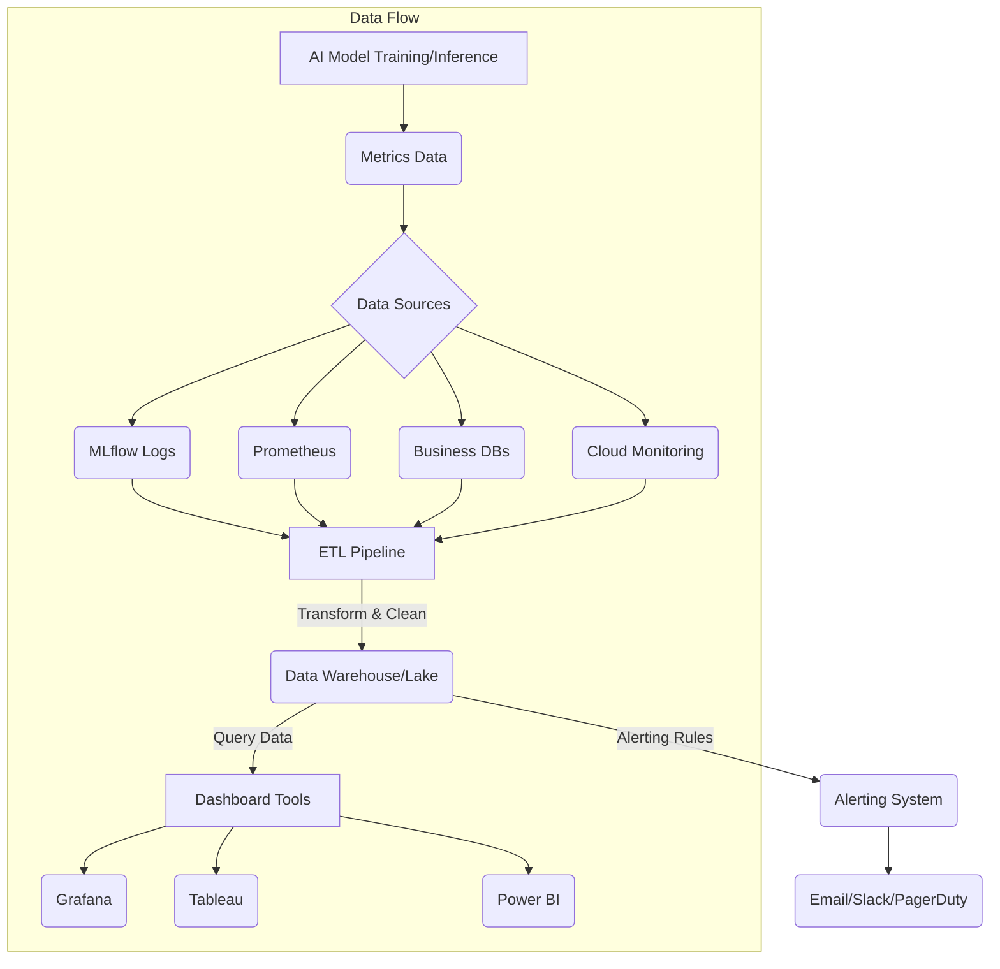

AI 프로젝트의 성공은 모델의 기술적 성능을 넘어 비즈니스 가치 창출에 있습니다. 이를 위해서는 프로젝트의 투명성을 확보하고 진행 상황을 명확하게 파악할 수 있는 자동화된 성과 지표 대시보드(Automated Performance Metrics Dashboard)가 필수적입니다. 이러한 대시보드는 이해관계자들에게 신뢰할 수 있는 정보를 제공하며, 데이터 기반의 신속한 의사결정을 가능하게 합니다. 2026년 현재, MLOps의 발전과 함께 실시간 모니터링, 비용 효율성, 그리고 설명 가능성(Explainability, XAI) 지표의 중요성이 더욱 강조되고 있습니다.

## 핵심 성과 지표(KPI) 정의 및 수집
AI 프로젝트의 KPI는 크게 세 가지 영역으로 나눌 수 있습니다.

### 1. 모델 성능 지표 (Model Performance Metrics)
*   **정확도(Accuracy), 정밀도(Precision), 재현율(Recall), F1-Score**: 분류(Classification) 모델의 기본 지표.
*   **ROC AUC, PR AUC**: 분류 모델의 성능을 다양한 임계값에서 평가.
*   **RMSE, MAE**: 회귀(Regression) 모델의 오차 측정.
*   **평균 추론 시간(Average Inference Time)**: 모델의 예측 속도.
*   **GPU/CPU 사용률(GPU/CPU Utilization)**: 자원 효율성 지표.
*   **데이터 드리프트(Data Drift) / 모델 드리프트(Model Drift)**: 입력 데이터 분포 변화 또는 모델 성능 저하 감지.

### 2. 비즈니스 가치 지표 (Business Value Metrics)
*   **전환율(Conversion Rate) 증가**: 추천 시스템, 마케팅 AI의 핵심 지표.
*   **비용 절감(Cost Reduction)**: 자동화 AI 또는 최적화 AI의 효과.
*   **사용자 참여도(User Engagement)**: 챗봇, 개인화 AI의 만족도 지표.
*   **수익(Revenue) 증가**: 직접적인 비즈니스 영향.

### 3. 운영 및 MLOps 지표 (Operational & MLOps Metrics)
*   **파이프라인 실행 성공률(Pipeline Execution Success Rate)**: 모델 학습 및 배포 파이프라인의 안정성.
*   **배포 빈도(Deployment Frequency)**: CI/CD의 민첩성.
*   **평균 복구 시간(Mean Time To Recovery, MTTR)**: 문제 발생 시 복구 속도.
*   **자원 사용 비용(Resource Usage Cost)**: 클라우드 자원 비용 효율성.

이러한 지표들은 MLflow, Kubeflow, Prometheus와 같은 MLOps 플랫폼, 그리고 AWS CloudWatch, Azure Monitor, Google Cloud Monitoring과 같은 클라우드 모니터링 서비스에서 수집될 수 있습니다.

## 데이터 통합 및 ETL 파이프라인 구축
다양한 소스에서 수집된 지표 데이터를 통합하고 정제하는 ETL(Extract, Transform, Load) 파이프라인 구축은 대시보드 자동화의 핵심입니다. 배치(Batch) 처리 또는 스트리밍(Streaming) 방식으로 데이터를 웨어하우스(Data Warehouse)나 레이크(Data Lake)에 적재하여 분석에 용이하게 만듭니다.

```python
import pandas as pd
import requests
import json
from datetime import datetime

def extract_metrics(log_file_path):
    # Simulate extracting data from a log file or API
    # In a real scenario, this would connect to MLflow, Prometheus, etc.
    data = [
        {"model_id": "fraud_detection_v1", "metric_name": "accuracy", "value": 0.95, "timestamp": "2026-07-20T10:00:00Z"},
        {"model_id": "fraud_detection_v1", "metric_name": "latency_ms", "value": 50, "timestamp": "2026-07-20T10:00:00Z"},
        {"model_id": "churn_prediction_v2", "metric_name": "f1_score", "value": 0.88, "timestamp": "2026-07-20T10:00:00Z"},
        {"model_id": "fraud_detection_v1", "metric_name": "accuracy", "value": 0.94, "timestamp": "2026-07-20T11:00:00Z"}
    ]
    df = pd.DataFrame(data)
    df["timestamp"] = pd.to_datetime(df["timestamp"])
    return df

def transform_metrics(df):
    # Aggregate or pivot data as needed for dashboard display
    # For simplicity, we'll just add a 'report_date' column
    df['report_date'] = df['timestamp'].dt.date
    return df

def load_metrics_to_dashboard_api(df, dashboard_api_endpoint):
    # Simulate pushing data to a dashboard service API
    headers = {'Content-Type': 'application/json'}
    for index, row in df.iterrows():
        payload = row.to_dict()
        payload["timestamp"] = payload["timestamp"].isoformat() # ISO format for JSON
        try:
            response = requests.post(dashboard_api_endpoint, data=json.dumps(payload), headers=headers)
            response.raise_for_status() # Raise an exception for bad status codes
            print(f"Successfully loaded: {payload}")
        except requests.exceptions.RequestException as e:
            print(f"Error loading data: {e} for {payload}")

if __name__ == "__main__":
    LOG_FILE = "./ai_metrics_log.csv" # Placeholder for actual log/data source
    DASHBOARD_API = "https://api.your-dashboard-service.com/metrics" # Replace with actual API

    print("Starting metrics pipeline...")
    extracted_data = extract_metrics(LOG_FILE)
    transformed_data = transform_metrics(extracted_data)
    load_metrics_to_dashboard_api(transformed_data, DASHBOARD_API)
    print("Metrics pipeline completed.")
```

## 대시보드 구축 및 시각화
대시보드는 데이터의 시각적 요약(Visual Summary)을 제공하여 복잡한 AI 프로젝트의 상태를 한눈에 파악하게 해줍니다. Grafana, Tableau, Power BI, Metabase와 같은 도구들이 널리 사용됩니다.

### 대시보드 설계 원칙:
*   **핵심 지표 우선 배치**: 가장 중요한 KPI를 상단 또는 좌측에 배치하여 가시성을 높입니다.
*   **추세 및 변화 시각화**: 시계열 차트(Time-series Charts)를 사용하여 지표의 변화 추이를 쉽게 파악할 수 있도록 합니다.
*   **드릴다운(Drill-down) 기능**: 상세 데이터를 탐색할 수 있는 기능을 제공하여 문제의 근본 원인을 찾기 용이하게 합니다.
*   **경고 및 알림 설정**: 지표가 특정 임계값을 벗어날 경우 자동으로 알림을 전송하는 기능을 통합합니다.



## 자동화 및 지속적 모니터링 전략
대시보드의 가치는 지속적인 업데이트와 실시간에 가까운 정보 제공에서 나옵니다. 이를 위해 데이터 수집, 처리, 대시보드 업데이트 전 과정을 자동화해야 합니다.

*   **스케줄러 활용**: Apache Airflow, cron job, AWS Lambda, Azure Functions 등을 사용하여 ETL 파이프라인을 주기적으로 실행합니다.
*   **CI/CD 통합**: 모델 학습 및 배포 파이프라인에 지표 수집 및 대시보드 업데이트 단계를 포함하여, 새로운 모델 버전이 배포될 때마다 자동으로 성능 지표를 캡처하고 시각화합니다.
*   **이상 감지 및 경고**: 통계적 방법론이나 머신러닝 기반의 이상 감지(Anomaly Detection) 모델을 사용하여 지표의 비정상적인 변화를 자동으로 감지하고, Slack, PagerDuty 등의 채널로 관련 팀에 즉시 알림을 보냅니다.
*   **코드형 인프라(Infrastructure as Code, IaC)**: 대시보드 구성과 모니터링 설정을 코드로 관리하여(예: Grafana Dashboards as Code), 버전 관리 및 재현성을 확보합니다.

## 트레이드오프

### 1. 실시간 대시보드 vs. 배치 처리 대시보드
*   **언제 좋음**: 실시간(Real-time) 대시보드는 금융 사기 탐지, 자율주행 등 즉각적인 반응이 필요한 AI 시스템의 운영 상태를 모니터링할 때 유용합니다. 이상 징후를 빠르게 파악하고 대응할 수 있습니다.
*   **언제 나쁨**: 구축 및 유지보수 비용이 높고, 데이터 처리 파이프라인의 복잡도가 증가합니다. 모든 지표에 실시간성이 요구되는 것은 아니므로 불필요한 자원 낭비를 초래할 수 있습니다.

### 2. 범용 대시보드 도구(e.g., Grafana) vs. MLOps 플랫폼 내장 대시보드(e.g., MLflow UI)
*   **언제 좋음**: Grafana와 같은 범용 도구는 다양한 데이터 소스와 연동 가능하며, 고도로 커스터마이징된 시각화를 제공합니다. 비즈니스 지표, 인프라 지표 등 AI 외의 데이터와 통합하여 전사적인 관점에서 모니터링할 때 강력합니다.
*   **언제 나쁨**: AI/ML 특정 지표(모델 메타데이터, 실험 결과 비교)에 대한 깊이 있는 컨텍스트가 부족할 수 있습니다. 초기 설정 및 통합에 더 많은 노력이 필요하며, MLOps 전문가가 아닌 경우 학습 곡선이 높을 수 있습니다.

### 3. 상세 지표 제공 vs. 요약 지표 제공
*   **언제 좋음**: 상세 지표는 문제 발생 시 근본 원인 분석(Root Cause Analysis)에 필수적입니다. 개발자나 데이터 과학자에게 모델의 미세한 동작을 이해하는 데 도움을 줍니다.
*   **언제 나쁨**: 모든 이해관계자가 상세 지표를 필요로 하지는 않습니다. 너무 많은 상세 정보는 대시보드를 복잡하게 만들고, 핵심 정보 파악을 방해하여 비즈니스 의사결정 속도를 저해할 수 있습니다. 대시보드 로딩 성능에도 영향을 미칩니다.

## 실전 체크리스트

*   [ ] **핵심 KPI 정의 완료**: AI 프로젝트의 기술적, 비즈니스적, 운영적 KPI를 명확히 정의하고 관련 이해관계자와 합의를 도출했는가?
*   [ ] **데이터 소스 통합 검증**: 모든 KPI에 필요한 데이터 소스(MLflow, Prometheus, DB 등)와의 연결 및 데이터 추출 메커니즘이 안정적으로 동작하는가?
*   [ ] **ETL 파이프라인 자동화**: 지표 데이터를 수집, 변환, 적재하는 ETL 파이프라인이 스케줄링되어 주기적으로, 안정적으로 실행되는가?
*   [ ] **대시보드 시각화 최적화**: 대시보드가 핵심 정보를 한눈에 파악할 수 있도록 설계되었으며, 성능 저하 없이 빠르게 로드되는가?
*   [ ] **경고 시스템 연동**: 정의된 KPI 임계값을 벗어날 경우, 관련 팀에 자동으로 알림이 전송되는 경고 시스템이 구축 및 테스트되었는가?
*   [ ] **CI/CD 통합**: 모델 학습/배포 파이프라인에 새로운 모델 버전의 성능 지표가 자동으로 대시보드에 반영되는 단계가 포함되어 있는가?
*   [ ] **보안 및 접근 제어**: 민감한 지표 데이터에 대한 접근 제어가 적절하게 설정되어 있으며, 데이터 유출 위험은 없는가?