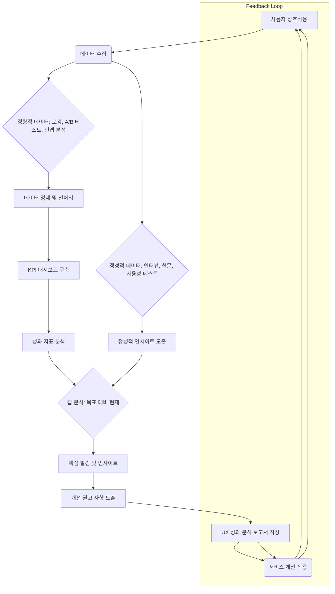

## 생성형 AI UX 분석: 데이터 기반 성과 보고서 작성 방법론

생성형 AI 서비스의 등장으로 사용자 경험(UX)은 더욱 복잡하고 다층적인 분석을 요구한다. 서비스의 실질적인 가치를 측정하고 지속적인 개선 방향을 도출하기 위해서는 단순한 기능적 만족도를 넘어선 심층적인 사용자 경험 데이터 기반의 성과 분석 보고서 작성이 필수적이다. 이 문서는 생성형 AI 서비스의 UX 성과를 체계적으로 분석하고 보고하는 방법론을 제시한다.

### 1. 생성형 AI UX 성과 분석의 중요성

기존 소프트웨어와 달리 생성형 AI는 예측 불가능성, 결과의 다양성, 그리고 인간과 AI 간의 복합적인 상호작용이라는 특성을 지닌다. 따라서 단순히 클릭률이나 전환율 같은 표면적인 지표만으로는 서비스의 성공 여부를 판단하기 어렵다. 사용자가 AI의 제안을 얼마나 신뢰하고, 어떤 맥락에서 가치를 느끼며, 비효율적인 상호작용은 무엇인지 깊이 있게 이해해야 한다. 이러한 분석은 Hallucination Detection, Bias Identification, Prompt Engineering Optimization 등 AI 모델 자체의 개선뿐만 아니라, 사용자 인터페이스(UI) 및 워크플로우 전반의 UX 개선을 위한 핵심적인 근거를 제공한다.

### 2. 핵심 성과 지표 (KPIs) 선정

생성형 AI 서비스의 UX 성과를 측정하기 위한 KPI는 기존 UX 지표와 AI 특화 지표를 결합하여 구성한다.

*   **참여도 (Engagement):**
    *   `Session Duration`: 사용자당 세션 평균 시간
    *   `Query Frequency`: 사용자당 질문/요청 빈도
    *   `Feature Adoption Rate`: 특정 AI 기능 사용률
    *   `Retention Rate`: 서비스 재방문/재사용률
*   **만족도 (Satisfaction):**
    *   `NPS (Net Promoter Score)`: 사용자 추천 의향
    *   `CSAT (Customer Satisfaction Score)`: 특정 상호작용 후 만족도
    *   `SUS (System Usability Scale)`: 시스템 전반의 사용 편의성
*   **결과 품질 (Output Quality):**
    *   `Relevance Score`: AI 생성 결과물의 관련성 (사용자 평가 또는 내부 모델)
    *   `Accuracy/Factuality Rate`: 정보의 정확성 (특히 RAG 시스템에서 중요)
    *   `Hallucination Rate`: 환각 현상 발생 빈도
    *   `Completion Rate`: 사용자가 AI 결과물을 통해 목표를 달성한 비율
    *   `Edit Distance/Correction Rate`: 사용자가 AI 결과물을 수정한 정도/빈도
*   **효율성 (Efficiency):**
    *   `Task Completion Time`: 특정 작업 완료에 걸린 시간 (AI 사용 전후 비교)
    *   `Interaction Cost`: AI와의 상호작용에 드는 노력 (프롬프트 길이, 재시도 횟수)
    *   `Cost per Query/Session`: AI 모델 호출 및 컴퓨팅 자원 비용

### 3. 데이터 수집 및 분석 방법

다양한 방법을 통해 정량적/정성적 데이터를 수집하고 분석한다.

#### 3.1. 정량적 데이터 수집
*   **서비스 로깅 (Service Logging):** 사용자 입력 프롬프트, AI 응답, 사용자 액션(수정, 공유, 좋아요/싫어요), 세션 정보 등을 상세히 기록한다.
*   **A/B 테스트 (A/B Testing):** 새로운 AI 기능, 프롬프트 개선, UI/UX 변경 사항이 핵심 지표에 미치는 영향을 측정한다.
*   **설문 조사 (Surveys):** 서비스 사용 후 만족도, 유용성, 개선점 등에 대한 대규모 사용자 의견을 수집한다.
*   **인앱 분석 (In-app Analytics):** Google Analytics 4, Mixpanel, Amplitude 등 도구를 활용하여 사용자 행동 흐름 및 퍼널 분석을 수행한다.

#### 3.2. 정성적 데이터 분석
*   **사용자 인터뷰 (User Interviews) 및 포커스 그룹 (Focus Groups):** 특정 사용자 그룹의 심층적인 경험, AI에 대한 기대, Pain Point를 이해한다.
*   **사용성 테스트 (Usability Testing):** 실제 사용자가 특정 작업을 수행하는 과정을 관찰하여 문제점을 발견하고 개선 기회를 모색한다.
*   **피드백 분석 (Feedback Analysis):** 자유 형식 피드백, 고객 지원 문의 등을 분석하여 공통적인 패턴과 중요한 이슈를 도출한다.
*   **Sentiment Analysis:** 사용자 텍스트 피드백의 감성(긍정, 부정, 중립)을 분석하여 전반적인 사용자 정서를 파악한다.

### 4. 보고서 구성 요소

생성형 AI UX 성과 분석 보고서는 다음 핵심 요소를 포함해야 한다.

1.  **Executive Summary:** 핵심 발견, 주요 성과 지표 요약, 추천 사항
2.  **Methodology:** 데이터 수집 방법, 분석 기간, 사용된 도구
3.  **Key Findings:**
    *   긍정적 성과 (Success Stories): 어떤 AI 기능이 사용자에게 큰 가치를 제공했는지
    *   개선 필요 영역 (Areas for Improvement): 낮은 만족도, 높은 Hallucination Rate, 사용성 문제 등
    *   예상치 못한 행동 (Unexpected Behaviors): 사용자가 AI를 예상과 다르게 활용한 사례
4.  **Detailed KPI Analysis:** 각 KPI에 대한 시계열 분석, 사용자 세그먼트별 비교
5.  **Qualitative Insights:** 사용자 인터뷰, 설문 피드백에서 도출된 정성적 패턴
6.  **Recommendations:** 데이터 기반의 구체적인 UX/AI 개선 방안 (단기/장기)
7.  **Appendices:** 원시 데이터, 설문 문항, 추가 분석 자료



### 5. 코드 예제: 간단한 사용자 만족도 분석 (Python)

사용자 피드백 데이터가 있다고 가정하고, Python Pandas를 사용하여 감성(Sentiment)별 만족도 평균을 계산하는 예제다.

```python
import pandas as pd

# 가상의 사용자 피드백 데이터
data = {
    'user_id': [1, 2, 3, 4, 5, 6, 7, 8, 9, 10],
    'feedback_text': [
        "정말 유용하고 만족스럽습니다!",
        "가끔 엉뚱한 답변을 해서 당황스러워요.",
        "생성 품질이 전반적으로 좋아요.",
        "너무 느리고 사용하기 어려워요.",
        "기대 이상입니다. 자주 사용할 것 같아요.",
        "답변이 모호할 때가 많아요.",
        "새로운 아이디어를 얻는 데 도움이 됩니다.",
        "인터페이스가 직관적이지 않네요.",
        "환상적인 경험이었어요!",
        "가끔 Hallucination이 발생하지만 유용해요."
    ],
    'satisfaction_score': [5, 2, 4, 1, 5, 3, 4, 2, 5, 3], # 1(매우 불만족) ~ 5(매우 만족)
    'sentiment': ['positive', 'negative', 'positive', 'negative', 'positive', 'negative', 'positive', 'negative', 'positive', 'neutral']
}

df = pd.DataFrame(data)

# 감성별 평균 만족도 점수 계산
average_satisfaction_by_sentiment = df.groupby('sentiment')['satisfaction_score'].mean()

print("--- 감성별 평균 만족도 점수 ---")
print(average_satisfaction_by_sentiment)

# 특정 키워드 포함 피드백 분석 예시
hallucination_feedback = df[df['feedback_text'].str.contains('Hallucination|엉뚱한', case=False)]
print("\n--- 'Hallucination' 또는 '엉뚱한' 키워드 포함 피드백 ---")
print(hallucination_feedback[['user_id', 'satisfaction_score', 'feedback_text']])

# 2026년 트렌드: 실시간 피드백 루프 및 고급 NLP를 통한 자동화된 분석이 더욱 중요해진다.
# 예를 들어, 스트리밍 데이터를 기반으로 실시간으로 사용자 감성을 분석하고 이상 징후를 감지하는 시스템이 보편화될 것이다.
```

### ## 트레이드오프

생성형 AI 서비스의 UX 데이터 기반 성과 분석은 강력한 접근 방식이지만, 몇 가지 트레이드오프를 수반한다.

*   **정량 vs 정성 데이터의 균형**: 
    *   **언제 좋은가**: 객관적인 지표로 서비스의 전반적인 건강 상태를 빠르게 파악하고, 대규모 사용자 행동 패턴을 식별할 때 효과적이다. 사용자 행동의 '무엇(What)'을 알려준다.
    *   **언제 나쁜가**: 단순 수치만으로는 사용자 경험의 '왜(Why)'를 설명하기 어렵고, 미묘한 불만족이나 잠재된 니즈를 파악하기 어렵다.
*   **데이터 수집의 복잡성 및 비용**: 
    *   **언제 좋은가**: AI 상호작용의 다양한 측면(프롬프트, 응답 품질, 수정 행위)을 상세히 기록하고 분석하여, AI 모델 및 UX 개선에 대한 구체적인 인사이트를 얻을 수 있다.
    *   **언제 나쁜가**: 고도화된 로깅 시스템, 데이터 파이프라인 구축 및 유지보수에 상당한 개발 및 운영 비용이 발생한다. 특히 민감한 사용자 데이터 처리 시 보안 및 규제 준수 문제가 복잡해진다.
*   **Hallucination 및 Bias 지표의 측정 난이도**: 
    *   **언제 좋은가**: AI의 핵심 문제인 환각 현상이나 편향을 정량적으로 추적하고 개선 목표를 설정함으로써 AI의 신뢰성을 높일 수 있다.
    *   **언제 나쁜가**: Hallucination이나 Bias는 정의하고 측정하기 매우 까다로우며, 수동 검증이나 고도화된 모델이 필요하여 많은 시간과 인력이 소요될 수 있다. 주관성이 개입될 여지도 크다.
*   **빠른 AI 모델 업데이트와 지표 안정성**: 
    *   **언제 좋은가**: A/B 테스트 등을 통해 새로운 AI 모델 버전이나 프롬프트 개선이 실제 사용자 경험에 미치는 영향을 직접적으로 검증하고, 빠른 의사결정을 내릴 수 있다.
    *   **언제 나쁜가**: AI 모델이 자주 업데이트될 경우, 지표의 기준선이 끊임없이 변동하여 장기적인 추세 분석이나 과거 데이터와의 비교가 어려워질 수 있다. 지표의 안정성 확보가 관건이다.

### ## 실전 체크리스트

생성형 AI 서비스의 UX 데이터 기반 성과 분석 보고서를 작성하고 활용하기 위한 실전 체크리스트다.

- [ ] **KPI 명확화**: 핵심적인 생성형 AI UX 지표 (예: Hallucination Rate, Relevance Score, Task Completion Rate with AI)가 명확하게 정의되고 측정 가능한가?
- [ ] **데이터 수집 인프라 구축**: 사용자 프롬프트, AI 응답, 사용자 수정 및 재시도 액션 등 AI 상호작용의 모든 단계가 로깅 시스템에 기록되고 있는가?
- [ ] **정량-정성 데이터 연계**: 정량적 지표의 변화(예: 특정 기능 사용률 하락)에 대한 정성적 원인 (예: 사용자 인터뷰에서 발견된 Pain Point)을 파악할 수 있는 분석 파이프라인이 구축되어 있는가?
- [ ] **Hallucination 및 Bias 측정 방안**: AI의 Hallucination 및 Bias를 측정하기 위한 자동화된 평가 지표 또는 수동 검증 프로세스가 정의되어 주기적으로 실행되는가?
- [ ] **A/B 테스트 환경**: 새로운 AI 모델, 프롬프트, UX/UI 변경 사항이 사용자 경험에 미치는 영향을 체계적으로 검증할 수 있는 A/B 테스트 환경이 갖춰져 있는가?
- [ ] **보고서 주기 및 공유**: UX 성과 분석 보고서가 정기적으로 작성되고 (예: 주간, 월간), 관련 이해관계자 (PM, 개발팀, AI 엔지니어)에게 효과적으로 공유되어 의사결정에 활용되는가?
- [ ] **개선 사항 추적**: 보고서에서 도출된 개선 권고 사항들이 실제 제품 로드맵에 반영되고, 그 결과가 다음 보고서에서 추적 및 검증되는 피드백 루프가 작동하는가?