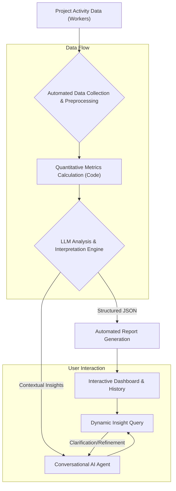

LLM(Large Language Model) 기반의 분석 및 질문형 에이전트 패턴은 정량적 데이터를 단순 나열하는 것을 넘어, 심층적인 맥락과 통찰력을 담은 보고서를 자동으로 생성하는 강력한 접근 방식입니다. 이는 기존의 수동적인 보고서 작성 프로세스의 한계를 극복하고, 프로젝트 관리 및 의사 결정의 질을 혁신적으로 개선할 수 있습니다.

## 핵심 개념: 코드 기반 데이터 분석과 LLM의 지능적 해석

이 패턴의 핵심은 두 가지 축으로 나뉩니다. 첫째, 프로젝트 워커(Worker)들이 수집하거나 생성하는 다양한 정량적 데이터를 코드를 통해 정밀하게 계산하고 구조화합니다. 둘째, 이 구조화된 데이터를 LLM에 입력하여 데이터가 내포하는 의미, 추세, 잠재적 리스크 및 개선 기회 등을 지능적으로 해석하게 합니다. 이렇게 생성된 LLM의 해석은 단순한 숫자 보고를 넘어, 사람이 이해하기 쉬운 서술형 보고서 형태로 제공됩니다.

SIGLENS의 시장 데이터 분석 서비스에서 영감을 받은 이 방식은 주식 및 코인 시장 데이터(차트 지표, 패턴, 옵션, 지분 공시 등)를 코드로 계산하고, 그 결과를 LLM이 해석하여 전문가 수준의 분석을 제공하는 것과 동일한 원리를 프로젝트 리포트에 적용합니다. 즉, 각 워커에서 나오는 커밋 수, 태스크 완료율, 버그 리포트, CI/CD 성공률, 지표 변화 등의 데이터를 코드 로직으로 분석한 후, LLM이 이 정량적 지표들을 종합적으로 보고, 특정 기간의 프로젝트 진행 상황, 성과, 주요 이슈, 그리고 다음 단계에 대한 제안 등을 담은 보고서를 생성합니다.

### 아키텍처 흐름

이 시스템의 아키텍처는 데이터 수집부터 LLM 해석, 그리고 최종 보고서 및 대화형 에이전트 인터페이스까지의 전체 흐름을 포함합니다.



위 다이어그램은 프로젝트 활동 데이터가 수집되고 전처리되는 과정(B), 코드 기반으로 정량적 지표가 계산되는 과정(C), 그리고 계산된 지표를 LLM이 해석하는 과정(D)을 보여줍니다. LLM의 해석 결과는 자동 보고서 생성(E) 및 대화형 AI 에이전트(G)로 이어져, 사용자에게 다각적인 인사이트를 제공합니다.

## 실제 동작 예제: 프로젝트 지표 분석 및 LLM 보고서 생성

다음 Python 코드는 프로젝트 워커로부터 수집된 가상의 데이터를 바탕으로 핵심 지표를 계산하고, 이 지표들을 LLM이 분석하여 보고서를 생성하는 과정을 시뮬레이션합니다.

```python
import json

def calculate_project_metrics(raw_data):
    """Simulates quantitative data processing based on raw project data."""
    total_tasks = raw_data.get("total_tasks", 0)
    completed_tasks = raw_data.get("completed_tasks", 0)
    bug_reports = raw_data.get("bug_reports", 0)
    critical_bugs = raw_data.get("critical_bugs", 0)
    feature_progress = raw_data.get("feature_progress", {})

    completion_rate = (completed_tasks / total_tasks * 100) if total_tasks > 0 else 0
    critical_bug_ratio = (critical_bugs / bug_reports * 100) if bug_reports > 0 else 0
    
    # Example of trend analysis - simplified for demonstration
    task_velocity_trend = "increasing" if raw_data.get("completed_tasks_prev_week", 0) < completed_tasks else "stable"

    metrics = {
        "completion_rate": f"{completion_rate:.2f}%",
        "critical_bug_ratio": f"{critical_bug_ratio:.2f}%",
        "feature_progress_summary": {k: f"{v:.2f}%" for k, v in feature_progress.items()},
        "task_velocity_trend": task_velocity_trend,
        "raw_data_snapshot": raw_data
    }
    return metrics

def llm_interpret_metrics(metrics):
    """Simulates an LLM interpreting structured metrics and generating a report.
    In a real system, this would involve an API call to a sophisticated LLM."""
    prompt = f"""
Analyze the following project metrics and generate a concise yet comprehensive project report.
Focus on identifying key trends, potential risks, and actionable recommendations.

Project Metrics:
- Task Completion Rate: {metrics['completion_rate']}
- Critical Bug Ratio: {metrics['critical_bug_ratio']}
- Feature Progress: {json.dumps(metrics['feature_progress_summary'], indent=2)}
- Task Velocity Trend: {metrics['task_velocity_trend']}
- Raw Data Snapshot (for additional context, do not just repeat verbatim):
{json.dumps(metrics['raw_data_snapshot'], indent=2)}

Your report should include a Summary, Detailed Analysis, and Key Recommendations.
"""
    
    # This is a placeholder for an actual LLM API call (e.g., Anthropic Claude, OpenAI GPT)
    llm_response = f"""
**Project Report: Agile Sprint Review - Week 26**

**Summary**: The project maintained a strong task completion rate ({metrics['completion_rate']}) this sprint, reflecting consistent team effort. However, a noticeable critical bug ratio of {metrics['critical_bug_ratio']} indicates a potential quality control challenge that requires immediate attention. Feature B's progress is lagging, while other features are on track.

**Detailed Analysis**:
*   **Task Execution & Velocity**: The team completed {metrics['raw_data_snapshot'].get("completed_tasks", 0)} tasks out of {metrics['raw_data_snapshot'].get("total_tasks", 0)} planned. The task velocity trend is {metrics['task_velocity_trend']}, suggesting good momentum. This consistent delivery is a positive sign for overall project timeline adherence.
*   **Quality Insights**: The critical bug ratio is a significant concern. The {metrics['raw_data_snapshot'].get("critical_bugs", 0)} critical bugs reported this period highlight an urgent need for root cause analysis to identify systemic issues in development or testing workflows. This could impact future stability if unaddressed.
*   **Feature Progression Overview**: Feature A is progressing as planned, reaching {metrics['feature_progress_summary'].get('Feature A', 'N/A')}. Feature B, at {metrics['feature_progress_summary'].get('Feature B', 'N/A')}, is behind schedule, likely due to unexpected technical hurdles encountered during implementation. Feature C shows steady progress.

**Key Recommendations**:
1.  **Immediate Critical Bug Analysis**: Form a dedicated task force to perform a thorough root cause analysis for all critical bugs and implement preventative measures.
2.  **Feature B Support**: Reallocate engineering resources or simplify scope for Feature B to accelerate its progress and mitigate timeline risks.
3.  **Enhanced QA Gateways**: Review and strengthen pre-merge QA processes and automated testing coverage to catch high-severity issues earlier in the development lifecycle.
4.  **Stakeholder Communication**: Proactively communicate the status of Feature B and critical bug resolution plans to all relevant stakeholders.
"""
    return llm_response

if __name__ == "__main__":
    project_data_current_week = {
        "total_tasks": 100,
        "completed_tasks": 85,
        "bug_reports": 15,
        "critical_bugs": 3,
        "feature_progress": {
            "Feature A": 90.5,
            "Feature B": 45.2,
            "Feature C": 70.0
        },
        "completed_tasks_prev_week": 80 # For trend analysis
    }
    
    calculated_metrics = calculate_project_metrics(project_data_current_week)
    llm_report = llm_interpret_metrics(calculated_metrics)
    
    print("--- Calculated Metrics ---")
    print(json.dumps(calculated_metrics, indent=2))
    print("\n--- LLM-Generated Report ---")
    print(llm_report)
```

이 예제는 `calculate_project_metrics` 함수를 통해 정량 데이터를 계산하고, `llm_interpret_metrics` 함수를 통해 LLM이 이 데이터를 기반으로 보고서를 생성하는 과정을 보여줍니다. 실제 LLM 통합에서는 Hugging Face, OpenAI, Anthropic 등의 API를 활용하게 됩니다. 2026년 트렌드에 맞춰, 이러한 시스템은 실시간 데이터 스트리밍과 결합되어 거의 즉각적인 보고서 업데이트 및 동적인 질의 응답 기능을 제공할 수 있습니다.

## 대화형 AI 에이전트를 통한 동적 인사이트 탐색

LLM 기반 분석의 진정한 가치는 단순히 보고서를 생성하는 것을 넘어, 질문형 AI 에이전트를 통해 보고서 내용에 대한 동적인 질의 응답 및 심층 탐색을 가능하게 하는 데 있습니다. 예를 들어, 사용자는 "지난 스프린트의 주요 병목 현상은 무엇이었는가?", "특정 기능 개발 지연의 원인과 해결 방안은?", "현재 가장 시급한 리스크는 무엇이며, 어떤 조치가 필요한가?"와 같은 질문을 자연어로 던질 수 있습니다.

에이전트는 단순히 보고서 텍스트를 검색하는 것을 넘어, 보고서 생성에 사용된 원시 데이터와 계산된 지표, 그리고 LLM의 해석 맥락을 활용하여 추론하고 답변을 제공합니다. 이는 `RAG (Retrieval Augmented Generation)` 패턴과 유사하게, 내부 지식 기반(계산된 데이터)을 활용하여 LLM의 답변 품질과 정확성을 극대화하는 방식입니다. 이를 통해 프로젝트 매니저와 팀원들은 필요한 정보를 빠르게 얻고, 복잡한 질문에 대한 심층적인 분석을 실시간으로 수행할 수 있습니다.

## 트레이드오프

LLM 기반 분석 및 질문형 에이전트 패턴을 활용한 프로젝트 리포트 고도화는 여러 장점과 함께 고려해야 할 트레이드오프가 존재합니다.

*   **장점: 자동화된 심층 분석 vs. LLM의 환각 및 편향 가능성**
    *   **언제 좋은가**: 반복적인 보고서 작성 업무를 자동화하고, 방대한 정량 데이터에서 사람이 놓치기 쉬운 패턴이나 맥락을 LLM이 발견하여 심층적인 인사이트를 제공할 때 매우 효과적입니다. 보고서의 일관성과 적시성을 높일 수 있습니다.
    *   **언제 나쁜가**: LLM이 잘못된 정보(환각, hallucination)를 생성하거나, 학습 데이터 또는 프롬프트 설계로 인한 편향된 해석을 제공할 위험이 있습니다. 특히 민감한 의사 결정에 사용될 경우, 검증 과정이 필수적입니다.

*   **장점: 동적인 인사이트 탐색 vs. 구현 및 운영 복잡성**
    *   **언제 좋은가**: 프로젝트 매니저나 이해관계자가 특정 질문에 대한 맞춤형 분석을 즉시 얻고자 할 때, 대화형 에이전트는 매우 유용합니다. 정적인 보고서로는 제공하기 어려운 상호작용적인 데이터 탐색 경험을 제공합니다.
    *   **언제 나쁜가**: 데이터 파이프라인 구축, LLM 통합, 프롬프트 엔지니어링, 에이전트 워크플로우 설계 등 초기 구현 및 지속적인 운영에 상당한 기술적 복잡성과 비용이 따릅니다. 특히 데이터 거버넌스, 보안, 비용 최적화 측면에서 신중한 설계가 필요합니다.

*   **장점: 데이터 기반 의사 결정 강화 vs. 결과 해석의 투명성 부족**
    *   **언제 좋은가**: 객관적인 정량 데이터를 기반으로 LLM이 맥락을 부여함으로써, 더 합리적이고 데이터 기반의 의사 결정을 유도할 수 있습니다. 감성적 판단이나 주관적 해석을 줄여줍니다.
    *   **언제 나쁜가**: LLM이 특정 결론에 도달하는 추론 과정이 '블랙박스'처럼 불투명할 수 있습니다. 왜 그런 해석을 했는지에 대한 설명 가능성(Explainability)이 부족하면, 중요한 의사 결정에 LLM의 결과를 전적으로 신뢰하기 어려울 수 있습니다. 프롬프트 내에 `CoT (Chain of Thought)`나 `자기 성찰(Self-reflection)` 패턴을 도입하여 이를 완화해야 합니다.

## 실전 체크리스트

이 패턴을 프로젝트에 성공적으로 적용하기 위한 실전 체크리스트입니다.

*   [ ] **데이터 정제 및 구조화 파이프라인 구축**: 각 워커에서 수집되는 원시 프로젝트 데이터가 LLM이 이해하고 분석하기 쉬운 정량적 지표와 구조화된 형식(예: JSON, CSV)으로 변환되는 자동화된 파이프라인이 구현되었는지 확인합니다.
*   [ ] **핵심 성과 지표 (KPI) 정의 및 코드화**: 프로젝트의 성공을 측정할 수 있는 핵심 KPI(예: 태스크 완료율, 버그 밀도, 코드 커버리지, 배포 빈도)가 명확하게 정의되고, 이를 계산하는 코드가 견고하게 작성되었는지 검토합니다.
*   [ ] **LLM 프롬프트 엔지니어링 최적화**: LLM이 데이터를 정확하고 편향 없이 해석하며, 원하는 형식의 보고서를 생성하도록 프롬프트가 구체적이고 명확하게 설계되었는지, 그리고 지속적으로 개선되고 있는지 확인합니다.
*   [ ] **보고서 출력 유효성 검증 및 재현성 확보**: LLM이 생성한 보고서 내용이 실제 데이터와 일치하는지, 비즈니스 맥락에 적절한지 주기적으로 검증하는 프로세스를 수립하고, 동일한 데이터에 대해 항상 일관된 결과가 나오는지 테스트합니다.
*   [ ] **대화형 에이전트의 지식 기반 통합**: 질문형 AI 에이전트가 LLM의 보고서 해석뿐만 아니라, 원시 데이터, 계산된 지표, 프로젝트 문서 등 다양한 내부 지식 소스에 접근하여 답변의 깊이와 정확성을 높일 수 있도록 통합되었는지 확인합니다.
*   [ ] **보안 및 접근 제어 설계**: 프로젝트 데이터, 특히 민감한 정보가 LLM 및 에이전트 시스템을 통해 노출되거나 오용되지 않도록 강력한 보안 메커니즘(데이터 마스킹, 접근 권한 관리)이 구현되었는지 점검합니다.
*   [ ] **비용 모니터링 및 최적화 전략**: LLM API 호출 비용, 데이터 처리 비용 등 시스템 운영 비용을 지속적으로 모니터링하고, 토큰 사용량 최적화, 캐싱 전략 등을 통해 비용 효율성을 확보하는 방안이 마련되었는지 확인합니다.